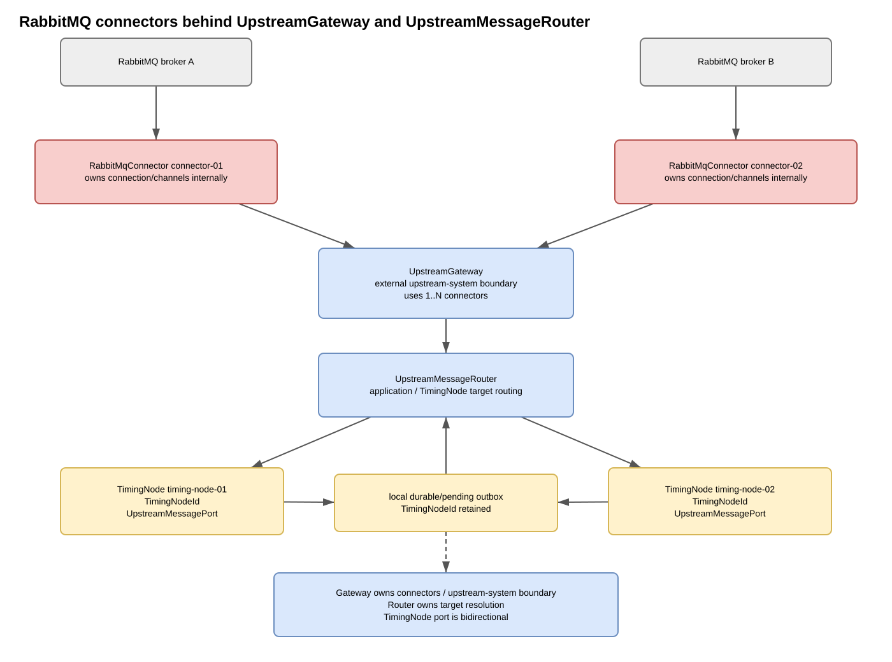

<!-- Generated review/output copy. Edit the source document, not this copy. -->

# Upstream transport detailed design

Status: working draft / focused detailed design

Software item: **SI-01 — Timing Point Application**

## Purpose

This SDD explains **how the upstream connection is implemented**. The SSD still
defines SI-01's integration responsibilities, `32-06-ISD-backend-integration.md`
defines the UpstreamData semantics and `33-06-IDD-upstreamdata-json.md` defines the
public/default JSON representation. This document does not create another protocol
definition.

## Terms and abbreviations

- **SDD** — Software Design Description
- **SSD** — Software Specification Document
- **SI** — Software Item
- **RabbitMQ** — messaging-broker technology used by one transport realization


## Relationship to other documents

This SDD refines the SI-01 SSD for the transport implementation below the upstream
semantic boundary. The applicable system interface contract defines externally visible
semantics; this document defines connector/transport realisation without redefining that
contract.

Two SI-01 connector implementations are planned for the current integration path:

- an **Engineering API upstream connector** for deterministic ST-2 testing through
  existing IF-03 HTTP/WebSocket transport;
- a **RabbitMQ upstream connector** for production-shaped integration and deployment.

The Engineering Client (SI-02) owns one Central System Simulator model/pane. It can drive the
same semantic test data through either IF-03 or RabbitMQ. In RabbitMQ mode SI-02 is the
controllable external Central System peer; it is not part of SI-01.

The application/domain model must not depend on RabbitMQ classes, socket classes, broker names, or the proprietary production message format.

Concrete production broker endpoint names, credentials, queue/exchange names, routing keys, external source IDs and message schemas are deployment/proprietary information and are intentionally excluded from this public repository.

Package/artifact placement follows `43-01-SDD-02-java-component-design.md`: a transport implementation can initially live under the application core's `io.messaging` capability and becomes a separate Maven library only when independent reuse, dependencies, lifecycle, ownership or release boundaries justify that split.

## Architectural goal

The stable architecture separates node-scoped upstream semantics from transport
topology:

```text
TimingSystem
  Upstream
    NodeUpstream A <----> UpstreamStream A
    NodeUpstream B <----> UpstreamStream B
                              |
                              v
                         Messaging (I/O)
                        UpstreamGateway
                              |
                    +---------+---------+
                    |                   |
                    v                   v
          EngineeringApiConnector   RabbitMqConnector
                    |                   |
                    v                   v
          IF-03 WebSocket          RabbitMQ broker
```

There is no separate application-level UpstreamMessageRouter. Each NodeUpstream is
already paired with one NodeId-scoped UpstreamStream. UpstreamGateway owns the routing
between those semantic streams and configured connectors:

- inbound: connector -> decode UpstreamData -> NodeId -> matching UpstreamStream;
- outbound: NodeUpstream -> its UpstreamStream -> gateway connector binding(s);
- connector: physical connection/session, wire mapping, delivery and
  transport-specific addressing.

This division intentionally does **not** standardize physical queues. A RabbitMQ
connector can have several inbound broker queues and a controlled publisher, while an
Engineering API connector can use one full-duplex WebSocket. Both still present the
same bidirectional per-node semantic stream above the gateway.

## Semantic upstream boundary

`UpstreamData` is the reusable/public semantic message contract defined by IF-06.
NodeUpstream and UpstreamGateway exchange complete semantic UpstreamData values, never
RabbitMQ queue names, WebSocket frames or proprietary production messages.

`UpstreamStream` is the bidirectional non-blocking mailbox for one NodeId. It reports
transport availability, exposes queued inbound semantic messages and accepts outbound
semantic messages. UpstreamGateway owns the mapping between that stream and the active
connector binding(s).

The gateway does not interpret RACE_DATA/TIMING_DATA protocol meaning. It may inspect
the semantic NodeId required for routing, but synchronization, ACK/REQ decisions,
heartbeat state and LogBook replay remain in NodeUpstream.

A deployment-specific connector may translate an asymmetric external wire protocol at
its own boundary. That transport asymmetry must not leak into the generic stream
contract.

## Connector bindings and composition

One TimingSystem may configure 1..N connectors. A connector may serve one or several
NodeIds, and a NodeId may intentionally be bound to more than one connector when a
deployment or test composition requires mirrored/parallel delivery.

Illustrative configuration:

```yaml
upstream:
  connectors:
    - id: engineering
      type: engineering-api
      nodes: [A, B]

    - id: central
      type: rabbitmq
      nodes: [A, B]
      # broker endpoints, credentials and routing remain external/private
```

The gateway owns semantic connector selection. Connector-specific routing details stay
inside each connector's configuration/implementation.

This architecture deliberately permits RabbitMQ in the design before its public Java
implementation exists: multiple transport realizations are a known requirement, so the
Connector abstraction is intentional rather than speculative.

## Engineering API test transport

### Purpose

The Engineering API connector provides a deterministic full-duplex upstream transport
without adding another SI-01 listener port or another SI-02 connection lifecycle.

It uses the existing IF-03 WebSocket endpoint:

```text
/api/v1/events?role=upstream
```

The same WebSocket carries both directions:

- SI-02 -> SI-01: each client text frame contains one complete public/default IF-06
  UpstreamData JSON object;
- SI-01 -> SI-02: outbound semantic messages use the existing IF-03
  `UPSTREAM_DATA` event envelope alongside the normal status/event stream.

The direction-specific framing is deliberate: server-to-client traffic remains part of
the existing IF-03 event stream, while client-to-server upstream frames contain only the
UpstreamData value and do not invent an HTTP request/response operation.

There is no separate HTTP upstream-ingress resource and no second WebSocket connection.
Only one `role=upstream` peer is active for one Engineering API connector.

### Engineering topology

```text
SI-02 Central System Simulator
             ^
             | one bidirectional IF-03 WebSocket
             v
EngineeringApiConnector
             ^
             | semantic UpstreamData
             v
       UpstreamGateway
             ^
             | one bidirectional stream per NodeId
             v
        NodeUpstream
```

The connector decodes inbound client frames and hands semantic UpstreamData to the
gateway. The gateway routes by NodeId to the matching UpstreamStream. Outbound
NodeUpstream messages travel back through that stream and gateway to the same connector.

This transport is for engineering and verification. It does not redefine IF-06 and does
not make IF-03 the production backoffice interface.

### Engineering connector lifecycle and wiring

The upstream-role WebSocket becomes connector-operational only after the normal
STATUS_SNAPSHOT baseline has been delivered successfully. Connector activation then
starts the configured heartbeat cadence and triggers source-head synchronization.
Closing or overloading that WebSocket makes the connector unavailable and stops its
connection-scoped cadence.

Generic IF-03 event clients remain independent and do not receive `UPSTREAM_DATA`.
The existing bounded WebSocket backpressure policy applies to the upstream-role peer as
well.

The SI-02 Central System Simulator owns the peer behaviour. It can send RACE_DATA,
SYNC, REQ and PING frames, inspect ACK/REQ/SYNC/TIMING_DATA responses, deliberately
create gaps and disconnect/reconnect without direct access to SI-01 Java objects.

### ST-2 scenarios

ST-2 scenarios include:

- connect SI-02 with `role=upstream` and observe the normal status baseline followed
  by immediate PING/SYNC UpstreamData;
- send RaceData and StageStartTimes as UpstreamData text frames on that same WebSocket;
- observe outbound TIMING_DATA, ACK, REQ, SYNC and PING as `UPSTREAM_DATA` events;
- answer PING REQ automatically and allow explicit manual PING in either direction;
- advertise the Central RACE_DATA source head through SYNC and request retained
  TIMING_DATA through REQ;
- disconnect/reconnect the WebSocket and verify fresh synchronization/replay;
- repeat for one or multiple configured NodeIds.

This profile verifies upstream semantics and gateway routing. It deliberately does not
prove RabbitMQ connection/channel/consumer behaviour.

## RabbitMQ transport

RabbitMQ is a concrete connector implementation beneath the same gateway/stream
boundary. For ST-3 the Engineering Client uses the same Central System Simulator model
but switches to a RabbitMQ peer transport. SI-01 and SI-02 then both connect to the same
broker; SI-02 plays the external Central System side.



### RabbitMQ terminology

RabbitMQ receiving and sending are physically asymmetric:

- a consumer receives from a broker **queue**;
- a publisher normally publishes to an **exchange** with a **routing key**;
- broker bindings route publications to queues.

That asymmetry is internal to RabbitMqConnector. UpstreamGateway and UpstreamStream do
not expose separate generic input/output connector contracts merely to mirror RabbitMQ.

A source/binding may therefore use:

```text
RabbitMqBinding
  inboundQueue
  outboundExchange
  outboundRoutingKey
```

### RabbitMQ connector topology

A `RabbitMqConnector` owns its broker connection/channel/consumer/publisher resources
internally and may multiplex several NodeId bindings over one physical connection.

```text
UpstreamGateway
      |
      v
RabbitMqConnector
  +-- inbound consumer queue A  -> NodeId A
  +-- inbound consumer queue B  -> NodeId B
  +-- controlled publisher
        -> exchange + routing key selected from binding
```

This physical topology does not imply one generic "output box" and many generic "input
boxes" above the connector. The gateway sees semantic send/receive operations and one
bidirectional stream per NodeId.

Separate connectors may use different brokers, credentials or routing domains. A
TimingNode may intentionally participate in more than one connector when configuration
requires it. Separate consumer and publisher connections inside one RabbitMQ connector
remain an implementation option when fault isolation or broker-client behaviour
justifies it.

### RabbitMQ threading

RabbitMQ callbacks are external I/O callbacks and never directly mutate timing-domain
state:

```text
RabbitMQ consumer callback
      |
      v
RabbitMqConnector
      |
      v
UpstreamGateway
      |
      v
UpstreamStream[NodeId]
      |
      v
NodeUpstream
```

Outbound publication follows the reverse semantic path. Connector channel ownership and
callback threading remain connector-internal design.

### RabbitMQ source-specific settings

Pseudo-configuration only:

```yaml
upstream:
  connectors:
    - id: connector-01
      type: rabbitmq
      host: ${BROKER_HOST}
      port: ${BROKER_PORT}
      virtualHost: ${BROKER_VHOST}
      credentials: external-secret-reference
      bindings:
        - timingNode: timing-node-01
          inboundQueue: ${PRIVATE_SOURCE_01_IN_QUEUE}
          outboundExchange: ${PRIVATE_SOURCE_01_OUT_EXCHANGE}
          outboundRoutingKey: ${PRIVATE_SOURCE_01_OUT_KEY}
        - timingNode: timing-node-02
          inboundQueue: ${PRIVATE_SOURCE_02_IN_QUEUE}
          outboundExchange: ${PRIVATE_SOURCE_02_OUT_EXCHANGE}
          outboundRoutingKey: ${PRIVATE_SOURCE_02_OUT_KEY}
```

For two configured node bindings, two inbound consumers may exist even when they share
one physical broker connection.

## PING scheduling and connector lifecycle

PING scheduling belongs to the lifecycle of each configured upstream connector, not to a
TimingNode and not to TimingData persistence.

When a connector reports that it has reached its operational connected state, the owning
connector/gateway lifecycle starts one periodic PING task with:

```text
initial delay: 0
period:        30 seconds
```

The first execution therefore publishes `PING(op=REQ, mode=HB)`
immediately. Later executions publish heartbeat PING REQUEST messages at the
30-second period while that connector remains operationally connected. The
reference implementation may assign a connector-scoped opaque `pingId` to
individual requests and track whether a PING ANSWER echoing that identifier has
been observed. This is an implementation choice rather than an IF-06 interface
obligation. A manual PING request omits `mode`; the answer does too.
A manual request/answer exchange does not reset the heartbeat scheduler.

When the connector disconnects, deactivates or is replaced, its scheduled PING task is
cancelled. Reconnect creates a new task/cycle and again begins with an immediate PING.
Only one active PING task may exist per active connector.

The Java implementation should use the application's existing scheduled-executor
infrastructure rather than introduce a separate `java.util.Timer` thread solely for
heartbeat work. PING submission goes through the normal UpstreamData publisher/connector
path. It bypasses TimingData sequence allocation and LogBook persistence because PING is
not a TimingData record.

Inbound PING REQUEST is handled at the same upstream semantic boundary:
SI-01 creates one PING ANSWER retaining the request's optional `mode`
(`HB` when present; absent for manual) and publishes it through
the connector without entering the TimingData/LogBook path. Incoming PING ANSWER messages are processed as
responses and must never trigger another answer. The reference codec echoes
an optional incoming `pingId` when present.

No missing-answer timeout or disconnect threshold is fixed yet. Connector status may
expose the last sent PING REQUEST, last received PING ANSWER and whether exchanges
remain unconfirmed, but policy for changing connection health remains a later decision.

Transport-level keepalive mechanisms (for example broker/TCP heartbeat features) may
coexist with this application-level PING request/answer exchange but do not replace
IF06-REQ-011/012/013.

## Ordered stream synchronization and replay

Local TimingData commitment and external delivery remain deliberately separated. The
public v1 design uses the **existing source sequence of each direction** rather than
a second outbox sequence.

```text
TimingNode -> Central System
  TimingNode LogBook
    seqNr 1..N
       |
       +--> proactive TIMING_DATA publish
       +--> SYNC stream=TIMING_DATA seq=N
       +--> serve REQ stream=TIMING_DATA fromSeq=M
              by replaying retained LogBook records M..N

Central System -> TimingNode
  RACE_DATA source
    seq 1..R
       |
       v
  TimingNode ordered apply boundary
       |
       +--> next expected seq: apply all changes, then ACK seq
       +--> duplicate seq: do not apply again; ACK may repeat
       +--> gap: do not apply; REQ stream=RACE_DATA fromSeq=missing
```

For TimingData, the LogBook is the durable replay payload history. SI-01 does not
persist a second copy of each committed TimingData merely to implement an outbox.
A failed proactive publish is therefore recoverable: after SYNC, the Central System
can request the required LogBook sequence again.

For RaceData, the Central System owns the source sequence. SI-01 advances its
node-scoped applied RaceData sequence only after the complete message has been
validated and applied on the TimingNode serialization boundary. ACK is semantic
confirmation of that application, not merely transport delivery.

No out-of-order RaceData buffering is required by the v1 baseline. When sequence N
is expected and a later sequence arrives, SI-01 leaves state unchanged and requests
RaceData from N. The Central System is responsible for retaining enough RaceData
history to satisfy the supported REQ range.

A reconnect creates a new transport session but does not create new source sequence
namespaces. The peers exchange fresh source-head SYNC messages and use REQ where the
receiver is behind.

No exact millisecond retry/backoff policy is fixed by D03. Connectors may use suitable
transport retry/backoff for control-message retransmission, while the semantic recovery
mechanism remains SYNC + REQ + source sequence.

## Status model

Transport status and source status remain separately observable.

```text
BackofficeStatus
  selectedTransport
  connection/session state
  lastPing
  lastPong
  pingPending

  source-01
    inbound
      configured
      active
      lastMessage
    streams
      timingDataHead
      raceDataAppliedSeq
      raceDataGapFrom
      syncState
      lastPublish
      lastFailure

  source-02
    ...
```

For RabbitMQ, connection status can additionally expose broker/authentication/recovery
information. For the Engineering API connector, status can expose whether the connector is
enabled plus its last inbound/outbound engineering interaction; IF-03 connection state
itself remains owned by the existing API/Event interfaces.

## Java package and artifact boundaries

Working package/artifact direction:

```text
shared/upstream-data
    UpstreamData
    UpstreamDataCodec
    UpstreamDataProvider
    default/reference JSON implementation

application/domain
    semantic routing, RaceData ordered application, ACK/REQ/SYNC state

existing IF-03 presentation/application adapter
    EngineeringApiUpstreamConnector

io.messaging.rabbitmq
    RabbitMqUpstreamConnector
    broker connection/channel/consumer/publisher implementation
```

This does **not** require three Maven libraries.

Extract an `event-timing-comm-rabbitmq` (or similarly named) artifact only when
one or more of these boundaries become real:

- several applications need RabbitMQ independently;
- the RabbitMQ client dependency should be optional and excluded from non-RabbitMQ applications;
- lifecycle/release ownership needs an independent boundary;
- public/private implementation ownership requires extraction.

Without such evidence, clean package boundaries are sufficient and keep extraction straightforward.

## Public/private boundary

Public core/test code may define:

- transport-independent semantic ports;
- generic source/node binding identities where connector routing requires them;
- shared public `UpstreamData` + provider/codec contracts;
- built-in public/reference JSON UpstreamData representation;
- Engineering API upstream adapter using structured public UpstreamData;
- RabbitMQ connection/consumer infrastructure if proprietary production codec details remain separate;
- SI-02 RabbitMQ backend-peer test transport using synthetic/public topology;
- synthetic RabbitMQ topology for integration tests.

Private components/configuration may provide:

- actual external source-ID mappings;
- actual broker topology names;
- proprietary message schemas/codecs;
- authentication details;
- production-specific retry/synchronization protocol details where sensitive.

## Automated system-test profiles

The transport abstraction supports progressively more realistic automated system tests.

### ST-1 — Application behaviour

Goal: validate application behaviour through its public control/status interface while external dependencies are controlled stubs.

```text
System-test driver
      |
      | public application control/status interface
      v
real application process
      |
      +-- stub RFID/CAN/display
      +-- in-memory/stub backoffice port
```

This is the fastest system-level feedback loop and does not require a network upstream service.

### ST-2 — Engineering API backoffice loop

Goal: verify the semantic upstream path through the existing Engineering Client and
IF-03 transport before broker-specific behaviour is introduced.

```text
SI-02 Central System Simulator
      | IF-03 HTTP / WebSocket
      v
EngineeringApiUpstreamConnector
      |
      v
real SI-01 semantic upstream path
```

This profile verifies source/node routing, inbound/outbound semantics,
acknowledgement/synchronization and recovery of the engineering view without RabbitMQ.

### ST-3 — RabbitMQ integration

Goal: verify the production-shaped broker transport end-to-end with SI-02 as the
controllable Central System peer.

```text
SI-02 Central System Simulator
      |
RabbitMqCentralSystemTransport
      |
      v
hosted RabbitMQ
      ^
      |
RabbitMqUpstreamConnector
      |
      v
real SI-01
```

A hosted broker such as CloudAMQP is a suitable initial environment. This verifies
broker connection/channel/consumer behaviour, source-specific queues/routing,
acknowledgement, outbox recovery and reconnect/recovery scenarios. Hosted-broker
availability is integration evidence and must not become a prerequisite for every fast CI
run.

These profiles complement unit/component tests and Pi Zero/hardware-in-the-loop verification; they do not replace them.

## RabbitMQ test environment

The first production-shaped ST-3 environment may use a hosted RabbitMQ service such as
CloudAMQP. Broker URI, credentials, vhost and test topology are provided through external
configuration/secrets and are never committed to the public repository.

A local disposable RabbitMQ container remains a useful optional fallback for repeatable
offline regression tests, but it is not required for ST-2 and does not replace the hosted
end-to-end verification.

The intended ST-3 operator flow is:

```text
configure test broker
start SI-01 with RabbitMqUpstreamConnector
connect SI-02 Central System Simulator using RabbitMqCentralSystemTransport
exercise inbound/outbound source flows
force/recover broker or client connection where practical
verify source-head SYNC, ACK/REQ and replay synchronization
clean up test topology
```

## Candidate requirements

Temporary identifiers only.

- **CAND-BO-001** — SI-01 upstream semantics shall be independent from the concrete communication transport.
- **CAND-BO-002** — The upstream transport shall be selectable through external configuration/composition.
- **CAND-BO-003** — An Engineering API upstream connector shall be available for deterministic ST-2 testing without requiring RabbitMQ.
- **CAND-BO-004** — The Engineering API connector shall carry structured public/reference UpstreamData through existing IF-03 HTTP/WebSocket transport.
- **CAND-BO-005** — RabbitMQ shall support a source-specific inbound queue configuration for each configured registration source.
- **CAND-BO-006** — RabbitMQ shall support source-specific outbound routing configuration for each configured registration source.
- **CAND-BO-007** — Multiple RabbitMQ source consumers shall be able to share one physical broker connection.
- **CAND-BO-008** — External transport callbacks shall not directly mutate timing-domain state.
- **CAND-BO-009** — Transport connection status and per-source inbound/outbound status shall be observable independently.
- **CAND-BO-010** — Loss of external upstream transport shall not discard locally committed registration data; LogBook remains the authoritative replay payload history.
- **CAND-BO-011** — Reconnection shall exchange fresh source-head SYNC state and use bidirectional REQ to recover missing TIMING_DATA or RACE_DATA without changing either source sequence.
- **CAND-BO-012** — Production broker/source topology, protocol details and credentials shall remain external/private configuration or implementation.
- **CAND-BO-013** — ST-3 shall support an external RabbitMQ test broker and an SI-02 Central System transport so the Engineering Client can exercise the upstream Central System role end-to-end.
- **CAND-BO-014** — SI-01 shall support zero or more configured upstream connectors within one application composition.
- **CAND-BO-018** — Each operationally connected upstream connector shall publish one immediate PING REQUEST with `mode = HB` and then another every 30 seconds until disconnect/deactivation; every valid PING REQUEST shall receive one PING ANSWER preserving optional HEARTBEAT mode (manual requests omit mode; correlation remains optional).
- **CAND-BO-015** — A upstream connector shall support bindings for one or more TimingNodes, and one TimingNode may be bound to more than one connector.
- **CAND-BO-016** — Connector-specific external names/routing identities shall not redefine the internal `TimingNodeId`.
- **CAND-BO-017** — Upstream routing/fan-out shall remain separate from concrete connector transport/resource handling.

## Open questions

- Within one RabbitMqUpstreamConnector, is one physical connection sufficient, or should consumer and publisher traffic use separate connections?
- Are RabbitMQ queues/exchanges pre-provisioned or should the application declare/bind any topology?
- At what point does RabbitMQ deserve its own Maven library rather than a `comm` package inside the core artifact?
- What connector-specific retry/backoff timing is appropriate for the Engineering API
  and RabbitMQ implementations?
- Should cached per-target synchronization progress be persisted for faster status
  restoration, even though it is never authoritative and is re-established by SYNC?
- What broker/client settings are appropriate on the Raspberry Pi Zero memory/CPU budget?
