# Software specification and architecture document set

Generated review/output book containing the SSSD, software-item SSDs and currently active focused detailed designs. The numbered source documents on the source branch remain authoritative.

## Contents

- [Software System Specification Document (SSSD)](31-SSSD-software-system-specification-document.md)
- [API Interface Specification (ISD)](32-03-ISD-application-control-status.md)
- [API HTTP/WebSocket Interface Design Description (IDD)](33-03-IDD-api-http-websocket.md)
- [Web Interface Specification (ISD)](32-04-ISD-web-interface.md)
- [TimingData Interchange Interface Specification (ISD)](32-05-ISD-timingdata-interchange.md)
- [TimingData Interchange Interface Design Description (IDD)](33-05-IDD-timingdata-interchange.md)
- [Backend Integration Interface Specification (ISD)](32-06-ISD-backend-integration.md)
- [UpstreamData JSON Interface Design Description (IDD)](33-06-IDD-upstreamdata-json.md)
- [Application Configuration Interface Specification (ISD)](32-11-ISD-application-configuration.md)
- [Timing Application Specification Document (SSD)](41-01-SSD-timing-application-specification-document.md)
- [Data and display detailed design](43-01-SDD-01-data-and-display-design.md)
- [Java component, package and artifact detailed design](43-01-SDD-02-java-component-design.md)
- [Engineering Desktop Client Specification Document (SSD)](41-02-SSD-gui-application-specification-document.md)
- [SI-02 Lua Scripting Design (SDD)](43-02-SDD-01-lua-scripting-design.md)

---

## Software System Specification Document (SSSD)

**Source document:** [31-SSSD-software-system-specification-document.md](31-SSSD-software-system-specification-document.md)

Status: working draft / non-authoritative

### Purpose

This Software System Specification Document combines the current **software-system requirements baseline** with the **software-system architecture**. It defines the software items, their allocated responsibilities, system-owned interfaces, deployment relationships and constraints that apply across software-item boundaries.

It deliberately does **not** define the internal threading, messaging, persistence, package structure, device processing or implementation technology of the **Timing Point Application** (SI-01). Those concerns belong in the applicable software-item specification and, only where justified, a focused detailed-design document.

Stable working domain facts and terminology are consolidated in `03-domain-baseline.md` and should not be silently reinterpreted here.

### Terms and abbreviations

- **SSSD** — Software System Specification Document
- **SI** — Software Item
- **IF** — system interface
- **ISD** — Interface Specification Document
- **IDD** — Interface Design Description


### Relationship to other documents

The SSSD is derived from upstream system intent, not from software-item design, implementation planning or verification planning:

- `03-domain-baseline.md` for stable domain terminology and facts;
- `30-UC-system-use-cases.md` for externally meaningful behaviour within this software-system scope;
- `20-EXT-external-system-inputs.md` for the controlled register of applicable parent-system requirements, externally owned IDDs, protocols and standards;
- the exact externally owned source revisions identified by that register when they impose requirements or interface obligations on this software system.

The category-20 register does not replace an external authority. It records which external source/revision applies and where it constrains this system.

A system-owned ISD created from an interface allocation made by this SSSD is downstream of the SSSD. Once released, that ISD becomes a normative input to the software-item specification(s) that implement or consume the interface. A separate system-owned IDD may then elaborate concrete interface design for affected detailed design.

The SIP, SDE, software-item SSDs/SDDs and SVP may reference the SSSD, but they are not inputs to it merely because they discuss the same capability.

#### Document chain

The normal product-document authority direction is:

```text
parent / external system contracts
              |
              v
20-EXT external-input register
              |
domain --------+----> 30-UC system use cases
              |                 |
              +-----------------+
                                v
                         31-SSSD
                                |
                    allocates items/interfaces
                                |
                 +--------------+--------------+
                 |                             |
                 v                             v
      32-<IF> system-owned ISDs       optional software-item UC
                 |                             |
                 +--------------+--------------+
                                |
                                v
                         41-<SI>-SSD
                                |
                                v
                         43-<SI>-SDD-<N>
```

An externally imposed/parent-system contract may legitimately precede and constrain the SSSD and, where its allocation is already explicit, an affected SSD. An ISD first allocated and owned by this SSSD follows the SSSD and then becomes a normative input to the affected software-item SSDs. An optional IDD is downstream of that ISD.

Planning, engineering-environment and verification documents are separate control/evidence documents. They may schedule, enable or verify this specification but do not define its product requirements or architecture by document order.

The SSSD answers questions such as:

- which software-system requirements must be allocated;
- which software items exist and what each owns;
- how the software items communicate;
- which external systems/devices form system boundaries;
- where the software items execute;
- which architectural constraints must remain consistent across software items.

The software-item SSDs define the requirements and architecture of each software item.

### Software-system requirements baseline

The current migrated baseline records only obligations already present in the
pre-migration architecture/use-case model; it does not invent a new capability set merely because requirements
and architecture now share one document.

- The **Timing Point Application** (SI-01) keeps local timing/registration state.
- Local registration shall continue without a connected browser, engineering client or
  backoffice session when the RFID input, TimingNode and local TimingData store needed
  for that registration are operational.
- Normal operator interaction is provided through the SI-01-owned **IF-04 Web Interface**.
- The **Engineering Desktop Client (SI-02)** uses supported public interfaces such as
  IF-03 and does not become another owner of SI-01 state.
- Local timing/device operation shall not depend on a connected browser or engineering/test client.
- External devices and the upstream system are explicit software-system boundaries.
- Public/reference and private/proprietary implementations shall meet the same supported
  system contracts without requiring private source in public implementation code.
- Software-system interfaces shall remain independent of incidental deployment topology
  where the interface itself only requires an available IP/network path.

### Architecture drivers

The software-system architecture is driven by these system-level concerns:

- the **Timing Point Application** (SI-01) keeps the local timing/registration state and runs the timing/device functions;
- local registration is the primary runtime function; presentation, diagnostics and
  backoffice delivery are not required for a local TimingData commit;
- normal operator interaction uses the SI-01-owned IF-04 Web Interface;
- the **Engineering Desktop Client (SI-02)** uses IF-03 and other supported public
  engineering boundaries without becoming another owner of timing state;
- local timing/device operation must not depend on a connected browser or engineering/test client;
- external devices and upstream systems are explicit system interfaces rather than hidden implementation dependencies;
- public reference/core implementation code and private/proprietary implementations must meet common supported contracts without private source leaking into public code;
- deployments should support the intended field target and normal development/test hosts; target limits are measured rather than assumed;
- system interfaces and software-item ownership should remain stable even when internal implementation technology changes;
- IP-based system interfaces must not require a particular router or Wi-Fi topology merely to exercise the interface.

### Software-item register

Software-item identity is stated by the document and traceability metadata; the numeric segment in category 40/41 is a document sequence and does not encode the software-item number.

| Software item | Name | Current status | Primary responsibility | Expected deployment |
| --- | --- | --- | --- | --- |
| **SI-01** | Timing Point Application | working specification | Local timing/registration runtime, device integration, state, status, persistence, operator Web presentation and upstream synchronisation | Raspberry Pi Zero/Zero W; Linux/Windows development/test/runtime |
| **SI-02** | Engineering Desktop Client | working specification | Reusable engineering, commissioning and system-test desktop client for supported SI-01 public interfaces | Windows engineering/test workstation; other desktop hosts where qualified |

Normal browser/tablet operator interaction is provided by the direct SI-01 Web Interface
allocated as IF-04. SI-02 serves engineering, integration, commissioning, diagnostics and
system-test workflows rather than the normal operator workflow.

Application profiles are deployment/composition templates of **the same SI-01 Timing Point Application**. A profile may select different default topology/capabilities, but it is not a separate software item and does not create different TimingNode/domain semantics. Concrete deployment profile definitions are outside this public system baseline until an explicit public requirement owns them.

### System context

```text
                         Operator
                            |
                            v
                    Browser / tablet
                            |
                          IF-04
                            |
                            v
                    SI-01 Timing Point Application
                       ^                 ^
                       |                 |
                     IF-03            Backend
                       |             integration
                       |
              SI-02 Engineering
                Desktop Client
                       |
                       v
             field devices / local state
```

Browser sessions and SI-02 may disconnect without changing where timing state is kept:
it remains in the **Timing Point Application** (SI-01).

<a id="fig-sys-01"></a>
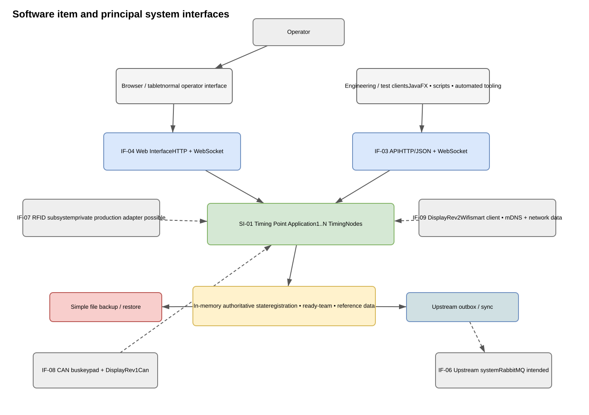
*Figure SYS-01 — Software items and principal system interfaces.*

### Software-item relationships

#### **Timing Point Application** (SI-01) ↔ browser/tablet operator

A browser or tablet-class browser operates SI-01 directly through **IF-04 Web
Interface**. This is the normal operator-facing path in the current architecture.
The current architecture allocates one Web binding per configured TimingNode.

#### **Timing Point Application** (SI-01) ↔ **Engineering Desktop Client** (SI-02)

SI-02 uses supported public boundaries such as **IF-03 API**. It may inspect
status/history, initiate supported commands and exercise explicitly advertised engineering
capabilities, but it does not access SI-01 process memory or private runtime state and does
not become another owner of timing/domain state. A direct, same-host, point-to-point or
normal LAN/Wi-Fi IP path may carry IF-03.

#### **Timing Point Application** (SI-01) ↔ backend

The **Timing Point Application** (SI-01) exchanges RaceData, timing records, control/synchronization and status information with the upstream **Central System** through the system-owned **IF-06 Backend Integration** semantic interface. `TimingData` remains the canonical timing-record model from IF-05; **UpstreamData** uses directional UP_PACKET/DN_PACKET delivery and semantic messages such as TIMING_DATA, TIMING_DATA_REQ, SEQ, RACE_DATA, RECV and PING. Concrete transport/session technology and deployment-specific wire routing remain implementation/integration concerns unless they change the external system contract.

#### **Timing Point Application** (SI-01) ↔ field devices

RFID, CAN, keypad, beeper and display equipment are external device boundaries of the **Timing Point Application** (SI-01). Device semantics belong in system/device interfaces; internal device/network-controller lifecycle, discovery, threads and processing pipelines belong in the **Timing Point Application** (SI-01) architecture/design.

The beeper is currently a transport-neutral device role; its concrete transport/interface allocation remains deferred rather than being assumed to be CAN.

The two display generations deliberately have different ownership. DisplayRev1Can is a passive CAN device actively driven by SI-01. DisplayRev2Wifi is a smart external client: SI-01 advertises a local data service, the display discovers and connects to it, and the display owns its own rendering and synchronisation behaviour.

### System interface catalogue

This catalogue identifies system-owned boundaries before all individual IDDs are mature. IDs are working identifiers but should remain stable once promoted.

| Interface | Parties | Current transport/direction | Purpose | Planned documentation |
| --- | --- | --- | --- | --- |
| **IF-01 Local Operator Console** | Operator ↔ SI-01 | local console/shell | Local version, status and operator commands | operator/application interface material |
| **IF-02 Remote Shell** | Operator/service tool ↔ SI-01 | remote terminal/shell, technology TBD | Remote status and commands using shared semantics | ISD candidate |
| **IF-03 API** | SI-02 / automated test tooling ↔ SI-01 | machine-readable network API; current design HTTP/JSON + WebSocket | General remote query/control/diagnostics/test API | `32-03-ISD-application-control-status.md` + `33-03-IDD-api-http-websocket.md` |
| **IF-04 Web Interface** | Operator/browser ↔ SI-01 | browser-facing HTTP + WebSocket; one binding per TimingNode | Browser-based TimingNode status and control | `32-04-ISD-web-interface.md` |
| **IF-05 TimingData Interchange** | SI-01 / engineering & test tools / compatible data consumers | append-only file / record interchange | Canonical timing-record semantics, identity, ordering, versioning and reference encoding | `32-05-ISD-timingdata-interchange.md` + `33-05-IDD-timingdata-interchange.md` |
| **IF-06 Backend Integration** | SI-01 ↔ Central System | UpstreamData semantics over configured upstream connector | packetized TimingData/RaceData transfer, SEQ/TIMING_DATA_REQ, RECV/resend, PING request/answer and status | `32-06-ISD-backend-integration.md` + public/default `33-06-IDD-upstreamdata-json.md`; deployment-specific wire details may remain private |
| **IF-07 RFID Integration** | SI-01 ↔ RFID subsystem | hardware/protocol adapter | RFID observations, lifecycle and health | device/semantic contract candidate |
| **IF-08 CAN Device Integration** | SI-01 ↔ CAN bus/devices | CAN | CAN discovery/state, DisplayRev1Can and keypad interaction | system/device ISD candidate |
| **IF-09 Smart Display V2** | DisplayRev2Wifi → SI-01 service | mDNS discovery + IP session; direct or LAN/Wi-Fi deployment | Discover SI-01 and consume timing/status/reference data; smart display owns render/sync | system ISD candidate |
| **IF-10 Test Control** | test/reference tooling ↔ public stubs | development-only | Inject device/network/fault behaviour through supported boundaries | SDE/SVP/test design |
| **IF-11 Application Configuration** | Deployment/configuration source → SI-01 | built-in profile/platform/mode defaults + explicit deployment overrides + secret references | Resolve deployed TimingNodes, I/O assets, presentation bindings and runtime composition inputs | `32-11-ISD-application-configuration.md` |

System-level ISDs own normative interface semantics. Software-item requirements reference those obligations rather than redefining the system contract independently. Optional IDDs describe concrete interface design where a separate design baseline is justified.

### Cross-software-item interaction principles

The following rules apply across software-item boundaries:

- operator Web presentation and SI-02 should use shared application semantics rather than implement different business rules per interface;
- network clients read state from and send commands to the **Timing Point Application** (SI-01); timing state remains in that application;
- loss of a browser/operator session or SI-02 must not by itself stop local operation of the **Timing Point Application** (SI-01);
- IF-03, IF-04 and IF-09 shall not make a physical Wi-Fi router an architectural prerequisite where their selected transport only needs an available local/IP path;
- development and automated integration verification may use loopback, same-host or direct IP connectivity while exercising the same system interface semantics;
- interface versioning and compatibility must be explicit once interfaces become stable contracts;
- transport-specific implementation detail should not leak into the semantic system interface unless that transport is itself part of the external contract;
- system status must distinguish local IP availability, configured network-infrastructure state, external reachability and backend/session health where those distinctions affect operator decisions.

### System deployment view

The principal device/interface relationships are a **software-system concern** because they show where the **Timing Point Application** (SI-01), operator/browser presentation, engineering clients, external field devices and backend meet. The lines in this view are logical system-interface relationships: they deliberately do not force traffic through a router node.

<a id="fig-sys-02"></a>
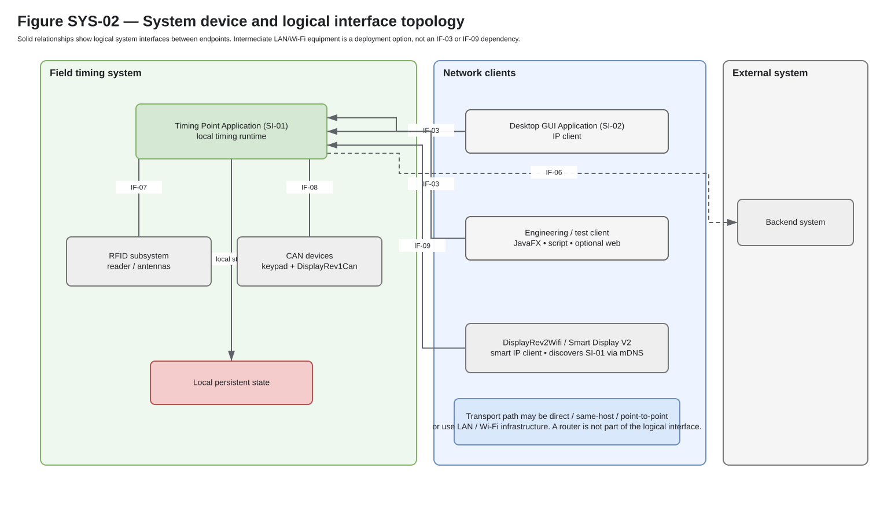
*Figure SYS-02 — System device and logical interface topology.*

Representative relationships are:

```text
Deployment/configuration source
  +-- IF-11 --> SI-01

Field host
  SI-01 Timing Point Application
    |
    +-- IF-07 --> RFID subsystem
    +-- IF-08 --> CAN devices / keypad / DisplayRev1Can
    +-- IF-05 --> canonical TimingData file/interchange

SI-02 Engineering Desktop Client
  +-- IF-03 over available IP path --> SI-01

Browser / tablet operator
  +-- IF-04 Web Interface --> SI-01

DisplayRev2Wifi / Smart Display V2
  +-- discovers SI-01 service through mDNS
  +-- IF-09 client session --> SI-01

Backend
  +-- IF-06 over configured external path --> SI-01
```

An available IP path may be direct/point-to-point, same-host or loopback during development/test, or may run over normal LAN/Wi-Fi infrastructure in a field deployment. A Wi-Fi router/access point is therefore **optional deployment infrastructure**, not part of the semantic definition of IF-03, IF-04 or IF-09.

#### Connectivity and reachability state

Network health is not one boolean and should not be modeled as one mandatory chain. The system needs to expose separately observable states because they answer different operational questions.

<a id="fig-sys-03"></a>
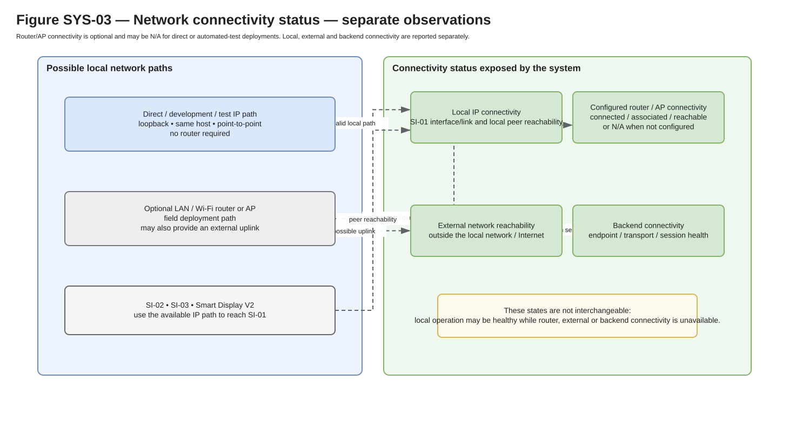
*Figure SYS-03 — Network connectivity status — separate observations.*

At minimum distinguish:

- **local IP connectivity** — network interface/link of the **Timing Point Application** (SI-01) and its ability to communicate with local peers;
- **configured router/AP connectivity** — whether the deployment is connected/associated with the configured local router or access point; this may legitimately be **N/A** for direct/development/test compositions;
- **external network reachability** — whether connectivity beyond the local network is available;
- **backend connectivity** — whether the configured backend endpoint/transport/session is healthy.

These states must not be conflated. For example, local timing and direct local clients may remain fully operational while the router, external uplink or backend is unavailable. Conversely, a configured field deployment may need to report that it has lost its expected router/AP even before external reachability is tested.

The exact process/thread topology, internal runtime cardinality, queueing model, service composition, connectivity probing mechanism and adapter implementation are intentionally outside this SSSD.

### Cross-system architectural constraints

#### State ownership and disconnected operation

The **Timing Point Application** (SI-01) keeps the local operational state. Losing a GUI/test client or external connection must not move that state elsewhere or make synchronisation appear healthy when it is not.

#### Public/private implementation boundary

System contracts used by public reference/core implementation code must allow private production implementations to plug in without public code depending on private source or proprietary identities.

Selected implementation families may be supplied by Java-8-compatible extension providers behind those stable contracts. The expected extension families are timing-data representation/codec, upstream-data representation/codec, antenna implementation, CAN protocol and display protocol. Extension discovery and provider selection are SI-01 implementation/composition concerns; they must not change the software-system interfaces or require proprietary source in the public repositories. Public/reference compositions must remain executable with synthetic/reference implementations so the public system can be built and verified independently.

#### Interface-first separation

Software-item interaction is defined in terms of system-owned semantics. Internal implementation choices such as RabbitMQ libraries, HTTP servers, logging frameworks, executors or file formats are owned by the relevant software-item architecture unless the choice becomes part of an external contract.

#### Deployment portability

The architecture must support constrained field deployment and normal Linux/Windows development/test environments without changing the software-item boundaries. Automated integration verification must be able to exercise network interfaces without provisioning a physical Wi-Fi router unless the test explicitly targets router/AP behaviour.

### Software-item design boundary

The SSD for the **Timing Point Application** (SI-01) owns, among other things:

- layered application responsibilities;
- `TimingNode` software/domain decomposition, separate registration-hardware topology, and their configuration/data-source identity mapping;
- threading/concurrency and internal messaging;
- status architecture and lifecycle handling;
- persistence and restore strategy;
- logging/configuration/composition choices;
- Java/core/library decisions;
- RFID/CAN/display adapter architecture behind the system device interfaces;
- upstream transport implementation behind IF-06;
- resource-budget implications of those choices.

The SSD for the **Engineering Desktop Client (SI-02)** is
`41-02-SSD-gui-application-specification-document.md`. Its engineering environment and
working UI/client-service baseline are elaborated by
`50-SDE-03-development-client.md`.

### Architecture review model

The project uses the 4+1 architectural view model as a review aid, not as a requirement for five documents. At system level, the SSSD primarily provides system context and deployment/relationship views. The software-item SSDs provide the coherent logical, process, development and deployment views of each item and reference selected use cases as scenarios.

Reference: `reference/README.md`.

### Open system-architecture questions

- final system interface ISD/IDD breakdown and ownership;
- authentication, authorisation and secure transport requirements across software-item boundaries;
- compatibility/versioning policy for IF-03 and IF-06;
- which device semantics require system-level IDDs versus software-item-only design;
- required behaviour when local IP, configured router/AP, external network or backend connectivity is unavailable;
- final system-level availability/recovery requirements.


---

## API Interface Specification (ISD)

**Source document:** [32-03-ISD-application-control-status.md](32-03-ISD-application-control-status.md)

Status: review candidate

System interface: **IF-03 — API**


### Purpose

This Interface Specification Document defines the **semantic contract** between the
**Timing Point Application** (SI-01), the **Engineering Desktop Client (SI-02)** and
automated integration tooling.

The **API** is the general programmable interface of SI-01 for remote clients,
engineering tools and headless black-box/integration tests. Engineering-only
operations are identified explicitly; their presence does not make the API itself
an engineering-only interface.

IF-03 defines what clients can query, command and observe. It deliberately does not
define concrete HTTP resource paths, JSON member names, WebSocket envelope fields or
HTTP status-code mappings. The current development-v1 HTTP/JSON + WebSocket realization
is defined by `33-03-IDD-api-http-websocket.md`.

A browser/tablet operator interface served directly by SI-01 is a different system
interface: **IF-04 — Web Interface**.

### Terms and abbreviations

- **IF** — system interface
- **ISD** — Interface Specification Document
- **IDD** — Interface Design Description
- **OP** — Operation
- **SI** — Software Item


### Relationship to other documents

IF-03 is allocated by
`31-SSSD-software-system-specification-document.md` and implements the programmable
client/engineering intent described by the applicable system use cases, especially
UC-009. Normal browser/operator interaction is allocated separately to IF-04.

The affected software-item specifications and automated test tooling consume this interface
contract. They shall not independently redefine IF-03 semantics.

### Parties

```text
SI-02 Engineering Desktop Client / automated test tooling
                         |
                         | IF-03 API
                         v
              SI-01 Timing Point Application
```

SI-01 owns TimingNode state, committed TimingData and command acceptance. A client may
cache presentation state, but cached state is not the source of domain truth.

### Interface model

IF-03 has two semantic interaction styles:

- **request/response** for queries and commands;
- **live event delivery** for current-state and committed-data changes.

The concrete network transports and wire representation are design choices of the
current IF-03 realization and belong to the IDD.

TimingNode-specific operations address an application-wide-unique `TimingNodeId`.
A `TimingNodeId` is exactly one character: `A` through `Z` or `1` through `9`.
`TimingSystemId` remains internal to SI-01 and is not part of the public IF-03 model.

### Build/version identity

IF-03 exposes build identity with these semantic values:

- application identity;
- software version;
- exact source revision;
- source reference;
- build-origin class;
- dirty/modified-source indication;
- IF-03 major interface version.

The identity remains stable for one running application build. Repeating a build does
not require wall-clock build time, CI run number or actor identity to become part of the
product identity.

### Current status

The current status model exposes 1..N TimingNodes. For each node it provides:

- `TimingNodeId`;
- current `LocationId`, or no assigned location;
- functional state `CLOSED` or `OPEN`.

Functional state says whether the registration point is open for participant
registration. Startup/recovery and LogBook failures are not represented as a second
TimingNode health-state value in this baseline.

A restarted TimingNode begins `CLOSED` with no current LocationId. Historical
TimingData does not by itself recreate functional state.

### Operation identifiers

Operations use the identifier form `IF03-OP-<number>`, where **OP** means
**Operation**. The identifier names a stable semantic interface operation; it is
independent of a concrete HTTP route, message name or other wire representation.

### Semantic operations

#### IF03-OP-001 — Get build/version identity

Returns the build/version identity defined above.

#### IF03-OP-002 — Get current status

Returns the complete current IF-03 status model.

#### IF03-OP-003 — Subscribe to live application events

A newly connected or reconnected client first receives a complete current status snapshot
before relying on later change events.

The current semantic event set includes:

- current status snapshot;
- status changed;
- committed TimingData;
- configuration changed.

A configuration-change event is emitted only after the authoritative Runtime
`ApplicationConfiguration` tree accepted a new current value through the Application control boundary. It identifies the
affected configuration target and current value without exposing secret material.

A status-change event is emitted after an actual functional-state or LocationId change.
Committed TimingData is exposed as a live event only after the record is committed and is
visible in the TimingNode LogBook. Recovery of an existing record does not present that
record as a new live commit.

#### IF03-OP-004 — Get public/engineering capabilities

Returns the supported/enabled state of optional IF-03 capabilities. Clients use this to
avoid assuming that an engineering or optional function exists merely because a client
knows how to display it.

The current capability set includes direct accepted-registration simulation.

#### IF03-OP-005 — Open registration at a location

Inputs:

- addressed `TimingNodeId`;
- requested `LocationId`.

For a `CLOSED` TimingNode, applying the requested LocationId and changing lifecycle to
`OPEN` are one application/domain operation. IF-03 has no separate Set Location
operation in the current baseline.

The operation therefore has one externally observable ordering point relative to other
state-changing operations on the same TimingNode. Another presentation client cannot
observe or insert a different location change between the LocationId selection and the
corresponding CLOSED-to-OPEN transition.

Successful semantic outcomes include:

- `OPENED`;
- `ALREADY_OPEN`.

The exact idempotency rule for an OPEN request that supplies a *different* LocationId
while the TimingNode is already `OPEN` remains an explicit interface review point.
Until that rule is fixed, clients shall not rely on such a request changing the active
LocationId.

IF-03 models LocationId selection and the CLOSED-to-OPEN transition as one semantic
operation. A device or transport architecture that separates those responsibilities does
not change this interface contract.

#### IF03-OP-006 — Close registration

Inputs:

- addressed `TimingNodeId`.

Successful semantic outcomes include:

- `CLOSED`;
- `ALREADY_CLOSED`.

A successful state change becomes visible through current status and live status-change
delivery.

#### IF03-OP-007 — Simulate an accepted automatic registration

This is an engineering capability, not the normal RFID input interface.

Inputs:

- addressed `TimingNodeId`;
- automatic-registration action;
- resolved `RegistrationId`;
- optional accepted `time` (explicit effective timestamp for replay).

The current engineering capability supports action `ADD`. Registration revoke is a
normal node-scoped operation defined separately by IF03-OP-011; it is not routed through
this engineering-only simulation endpoint.

If `time` is omitted, the owning TimingNode captures the effective registration
time from its TimingSystem's composed `TimeSource` when processing the command,
not from the presentation adapter clock. With an explicit `time`, that
timestamp is preserved as the effective registration time. The two modes are
distinguished in the LogBook audit metadata.

SI-01 supplies its own source identity, active LocationId, next source sequence and any
other TimingNode-owned commit context. The operation uses the same accepted-registration
commit path used after normal input interpretation/filtering. A real antenna
observation retains its observation time rather than substituting the node clock.

The operation is available only when its advertised capability is enabled.

#### IF03-OP-008 — Query committed LogBook

A client can:

- query LogBook metadata without downloading all records;
- request a bounded source-sequence range;
- request a bounded newest-record range.

Returned records use public IF-05 TimingData semantics and remain in committed
source-sequence order. Queued or uncommitted work is not LogBook content.

#### IF03-OP-009 — Get current application configuration

Returns a non-secret view of the effective startup configuration together with
current active values where runtime overrides are supported.

For a runtime-adjustable field the representation distinguishes at least:

- effective startup/configured value;
- current active value;
- whether a runtime override is currently active;
- whether the field is runtime-adjustable.

The current baseline includes TimingNode-local TagProcessor policy. Secret values
are not returned merely because a configuration reference exists.

#### IF03-OP-010 — Apply or clear a runtime configuration override

Inputs:

- configuration target;
- action `SET` or `CLEAR`;
- replacement value for `SET`.

A successful `SET` changes the active process value without rewriting IF-11
deployment configuration. `CLEAR` restores the effective startup/configured value.

The current TagProcessor baseline permits live override of:

- quiet timeout;
- maximum burst duration;
- duplicate window;
- sweep cadence.

Observation input-queue capacity is queryable but is not live-resizable in the
current implementation baseline. Attempting to override a startup-only field has
an explicit `RESTART_REQUIRED`/not-runtime-mutable outcome rather than silently
accepting a partial change.

Invalid values, unknown targets and unsupported runtime mutation expose explicit
failure outcomes.

#### IF03-OP-011 — Revoke registration

Inputs:

- addressed `TimingNodeId`;
- original registration family: automatic or manual;
- original `LocationId`;
- original `RegistrationId`;
- original registration `time`;
- for a manual registration, the original system-assigned or operator-entered
  time-source classification.

The operation requests one new append-only REV TimingData record. It does not delete
or rewrite the original ADD record. The REV repeats the original LocationId,
RegistrationId and time; a manual REV also repeats the original time-source
classification. SI-01 assigns the new source sequence and record-creation time.

The TimingNode commit/LogBook boundary treats this as bookkeeping. It does not search
or fold prior ADD/REV history to decide whether the requested revoke is meaningful or
already applied. A caller or higher application/business layer is responsible for
selecting the registration semantics supplied to this operation.

#### IF03-OP-012 — Add manual registration

Inputs:

- addressed `TimingNodeId`;
- resolved `RegistrationId`;
- effective registration `time`;
- client time-source classification `AUTO` or `MAN`.

This is a normal node-scoped registration operation, not a development simulation.
The client supplies the effective registration time in both cases. `AUTO` means
the client selected or captured that time automatically; `MAN` means an operator
entered or edited it manually.

The classification does not ask SI-01 to replace the supplied time with its own
clock. SI-01 validates the request against current TimingNode state, captures the
active LocationId, assigns the next source sequence and record-creation time, and
commits one `MAN_REG` ADD record through the normal TimingNode commit path.

#### IF03-OP-013 — Start simulated tag passage

Inputs:

- addressed `TimingNodeId`;
- resolved `RegistrationId`;
- simulation profile identifier.

This is an engineering operation and is available only when the corresponding
simulation capability is advertised and enabled. It starts one simulated
registration scenario **before** the TagProcessor boundary. The selected profile
publishes one or more TagObservation values through the configured
SimulatedAntenna, so normal AntennaManager, TagProcessor, TimingNode and TimingData
behaviour remains in the path.

The operation does not itself commit a registration and does not have the same
semantics as IF03-OP-007 direct accepted-registration simulation. The eventual
registration outcome remains observable through normal committed TimingData.

The initial profile identifiers are `simple`, `normal` and `edge`. Their
internal observation pattern is engineering simulation behaviour rather than
TimingData/domain semantics.

#### IF03-OP-014 — Submit engineering upstream UpstreamData

This development/engineering operation submits one structured public/reference
IF-06 UpstreamData message to SI-01 through the configured
`EngineeringApiUpstreamConnector`.

Inputs:

- one complete UpstreamData value;
- any NodeId scope is carried by that UpstreamData value itself.

The operation is available only when the engineering upstream connector is
configured/enabled and one IF03-OP-003 event connection has registered the
`upstream` role. The HTTP adapter does not call TimingNode/domain objects
directly; the message enters the same semantic upstream routing boundary used by
other upstream connectors.

The HTTP response reports the submission/application outcome. Semantic outbound
messages generated while processing the input, such as a PING answer, are delivered
through the upstream-role IF03-OP-003 event stream rather than being substituted
as the HTTP response body.

#### IF03-OP-015 — Query applied StageStartTimes

This read-only node-scoped operation exposes the current RegistrationId-scoped
StageStartTimes actually applied in SI-01 RaceData state. It is current runtime data,
not Central simulator state and not reconstructed LogBook history.

The operation provides metadata plus bounded paging. Metadata shall include the
current row count and a monotonically changing StageStart revision. A page shall
contain RegistrationId and current start value in deterministic RegistrationId order.
Clients may use the revision to detect mutation during paging and retry.

The same StageStart revision shall be exposed with the active registration projection,
because a StageStart SET/DEL can change elapsed time and rank without changing
registration count or LogBook ADD/REV mutation cursors.

### Operation ordering and concurrency

Presentation clients may submit commands concurrently. IF-03 therefore requires
state-changing operations for one TimingNode to have a deterministic application-owned
order and to expose no partially applied compound operation.

In particular, IF03-OP-005 is one operation: LocationId selection and the
CLOSED-to-OPEN transition are not two independently interleavable presentation commands.

This requirement defines externally observable semantics. It does not prescribe a Java
mutex, worker class or thread implementation.

### Reconnect and resynchronisation

After a live connection is interrupted, a client rebuilds its view from SI-01 state rather
than assuming that its cache remained current.

A conforming client can:

1. obtain a complete current status snapshot;
2. query LogBook metadata/ranges for missed committed records;
3. combine the retrieved baseline with later live events;
4. deduplicate overlapping committed records by stable TimingData record identity;
5. mark its view live only after that reconciliation is complete.

No durable replay of every transient live event is required while a client is disconnected.
Committed TimingData is retrieved through the LogBook.

### Failure semantics

IF-03 distinguishes at least:

- malformed or invalid request;
- unsupported operation/resource;
- unknown TimingNode;
- capability not enabled;
- domain-state conflict;
- busy/unavailable processing;
- interrupted/failed processing;
- operation timeout with **outcome unknown**;
- unexpected internal interface failure.

A timeout does not imply that already accepted work was cancelled. Before blindly retrying
a state-changing operation whose outcome is unknown, a client resynchronises relevant
state/history.

Human-readable failure text is diagnostic. Stable machine-readable failure categories own
program behaviour.

### Compatibility

Within one compatible IF-03 major version:

- additions shall not silently change the meaning of existing semantic values or operations;
- clients shall be able to ignore additions they do not understand where the IDD marks them
  as compatible extensions;
- a breaking semantic change requires a new major interface version or an explicitly
  documented compatible migration.

Concrete version encoding and unknown-member/event handling belong to the IDD.

### Network exposure and security baseline

The first development realization is usable across a normal IP network path when remote
access is explicitly configured.

The current deployment baseline assumes a trusted closed network and does not require
application-level authentication or authorisation for IF-03.

- default development exposure remains local/loopback only;
- non-loopback exposure requires explicit configuration;
- remote operation is limited to the trusted deployment/development network.

### IF-03 requirements

<a id="IF03-REQ-001"></a>

**IF03-REQ-001 — Shared application semantics**


IF-03 operations and events shall use the shared SI-01 application/domain semantics
rather than implement independent business or lifecycle state in an interface adapter.

— — —

- **Type:** Interface Requirement
- **Status:** Review
- **Required by:** [`SI02-REQ-001`](41-02-SSD-gui-application-specification-document.md#SI02-REQ-001)
- **Realized by:** [`Api`](41-01-SSD-timing-application-specification-document.md#Api), [`PresentationGateway`](41-01-SSD-timing-application-specification-document.md#PresentationGateway)

---


<a id="IF03-REQ-002"></a>

**IF03-REQ-002 — Remote-host operation**


IF-03 shall support operation across a normal IP network boundary when non-loopback
access is explicitly configured.

— — —

- **Type:** Interface Requirement
- **Status:** Review
- **Required by:** [`SI02-REQ-002`](41-02-SSD-gui-application-specification-document.md#SI02-REQ-002)
- **Realized by:** [`Api`](41-01-SSD-timing-application-specification-document.md#Api)

---


<a id="IF03-REQ-003"></a>

**IF03-REQ-003 — Version query**

IF-03 shall provide IF03-OP-001.

— — —

- **Type:** Interface Requirement
- **Status:** Review
- **Specifies:** [`UC-009`](30-UC-system-use-cases.md#UC-009)
- **Required by:** [`SI02-REQ-003`](41-02-SSD-gui-application-specification-document.md#SI02-REQ-003)
- **Verified by:** [`VC-ST1-001`](61-01-VTS-timing-application-verification-test-specification.md#VC-ST1-001)

---


<a id="IF03-REQ-004"></a>

**IF03-REQ-004 — Status query**

IF-03 shall provide IF03-OP-002.

— — —

- **Type:** Interface Requirement
- **Status:** Review
- **Refines:** [`SI01-REQ-024`](41-01-SSD-timing-application-specification-document.md#SI01-REQ-024)
- **Required by:** [`SI02-REQ-004`](41-02-SSD-gui-application-specification-document.md#SI02-REQ-004)
- **Realized by:** [`Api`](41-01-SSD-timing-application-specification-document.md#Api), [`PresentationGateway`](41-01-SSD-timing-application-specification-document.md#PresentationGateway)
- **Verified by:** [`VC-ST1-001`](61-01-VTS-timing-application-verification-test-specification.md#VC-ST1-001), [`VC-ST1-004`](61-01-VTS-timing-application-verification-test-specification.md#VC-ST1-004)

---


<a id="IF03-REQ-005"></a>

**IF03-REQ-005 — Live status and committed-data delivery**

IF-03 shall provide IF03-OP-003.

— — —

- **Type:** Interface Requirement
- **Status:** Review
- **Refines:** [`SI01-REQ-023`](41-01-SSD-timing-application-specification-document.md#SI01-REQ-023)
- **Required by:** [`SI02-REQ-004`](41-02-SSD-gui-application-specification-document.md#SI02-REQ-004)
- **Verified by:** [`VC-ST1-001`](61-01-VTS-timing-application-verification-test-specification.md#VC-ST1-001)

---


<a id="IF03-REQ-006"></a>

**IF03-REQ-006 — Reconnect to current state**

A connecting or reconnecting client shall be able to establish complete current status
before relying on later live changes.

— — —

- **Type:** Interface Requirement
- **Status:** Review
- **Refines:** [`SI01-REQ-025`](41-01-SSD-timing-application-specification-document.md#SI01-REQ-025)
- **Required by:** [`SI02-REQ-005`](41-02-SSD-gui-application-specification-document.md#SI02-REQ-005), [`SI02-REQ-006`](41-02-SSD-gui-application-specification-document.md#SI02-REQ-006)
- **Verified by:** [`VC-ST1-001`](61-01-VTS-timing-application-verification-test-specification.md#VC-ST1-001), [`VC-ST1-004`](61-01-VTS-timing-application-verification-test-specification.md#VC-ST1-004)

---


<a id="IF03-REQ-007"></a>

**IF03-REQ-007 — Machine-readable API realization**


The IF-03 realization shall provide a machine-readable representation suitable for SI-02
and automated test tooling.

— — —

- **Type:** Interface Requirement
- **Status:** Review
- **Required by:** [`SI02-REQ-001`](41-02-SSD-gui-application-specification-document.md#SI02-REQ-001)

---


<a id="IF03-REQ-008"></a>

**IF03-REQ-008 — Explicit failure outcome**

Unsupported, invalid or rejected IF-03 operations shall expose an explicit failure outcome
rather than silently reporting success.

— — —

- **Type:** Interface Requirement
- **Status:** Review
- **Refines:** [`SI01-REQ-026`](41-01-SSD-timing-application-specification-document.md#SI01-REQ-026)
- **Required by:** [`SI02-REQ-008`](41-02-SSD-gui-application-specification-document.md#SI02-REQ-008)
- **Verified by:** [`VC-ST1-004`](61-01-VTS-timing-application-verification-test-specification.md#VC-ST1-004), [`VC-ST1-006`](61-01-VTS-timing-application-verification-test-specification.md#VC-ST1-006)

---


<a id="IF03-REQ-009"></a>

**IF03-REQ-009 — Safe default listen scope**


Without explicit remote-access configuration, the network realization of IF-03 shall be
local/loopback only.

— — —

- **Type:** Interface Requirement
- **Status:** Review
- **Required by:** [`SI02-REQ-002`](41-02-SSD-gui-application-specification-document.md#SI02-REQ-002)

---


<a id="IF03-REQ-010"></a>

**IF03-REQ-010 — Compatible extension**


Compatible additions within one IF-03 major version shall not silently redefine existing
operation or value semantics.

— — —

- **Type:** Interface Requirement
- **Status:** Review

---


<a id="IF03-REQ-011"></a>

**IF03-REQ-011 — TimingNode location and lifecycle control**

IF-03 shall expose application-wide-unique TimingNode identities with current optional
LocationId and functional OPEN/CLOSED state and shall provide IF03-OP-005/006. IF03-OP-005
shall carry the requested LocationId and represent location selection plus the
CLOSED-to-OPEN transition as one ordered TimingNode operation.

— — —

- **Type:** Interface Requirement
- **Status:** Review
- **Refines:** [`SI01-REQ-040`](41-01-SSD-timing-application-specification-document.md#SI01-REQ-040), [`SI01-REQ-072`](41-01-SSD-timing-application-specification-document.md#SI01-REQ-072)
- **Required by:** [`SI02-REQ-004`](41-02-SSD-gui-application-specification-document.md#SI02-REQ-004), [`SI02-REQ-008`](41-02-SSD-gui-application-specification-document.md#SI02-REQ-008)
- **Verified by:** [`VC-ST1-002`](61-01-VTS-timing-application-verification-test-specification.md#VC-ST1-002), [`VC-ST1-005`](61-01-VTS-timing-application-verification-test-specification.md#VC-ST1-005), [`VC-ST1-007`](61-01-VTS-timing-application-verification-test-specification.md#VC-ST1-007), [`VC-ST1-008`](61-01-VTS-timing-application-verification-test-specification.md#VC-ST1-008)

---


<a id="IF03-REQ-012"></a>

**IF03-REQ-012 — Engineering capability discovery**

IF-03 shall provide IF03-OP-004 so engineering clients can determine whether optional
engineering commands are supported and enabled.

— — —

- **Type:** Interface Requirement
- **Status:** Review
- **Specifies:** [`UC-009`](30-UC-system-use-cases.md#UC-009)
- **Required by:** [`SI02-REQ-009`](41-02-SSD-gui-application-specification-document.md#SI02-REQ-009), [`SI02-REQ-010`](41-02-SSD-gui-application-specification-document.md#SI02-REQ-010)
- **Verified by:** [`VC-ST1-002`](61-01-VTS-timing-application-verification-test-specification.md#VC-ST1-002)

---


<a id="IF03-REQ-013"></a>

**IF03-REQ-013 — Direct accepted-registration simulation**

When its advertised capability is enabled, IF-03 shall provide IF03-OP-007 using an
explicit supported automatic-registration action and resolved RegistrationId,
with optional effective time. If time is omitted, the addressed TimingNode shall
use its composed TimeSource when executing the registration command; if supplied,
the accepted time shall be used unchanged except for the profile's published
timestamp precision. TimingNode-owned commit context remains inside SI-01.

— — —

- **Type:** Interface Requirement
- **Status:** Review
- **Specifies:** [`UC-009`](30-UC-system-use-cases.md#UC-009)
- **Refines:** [`SI01-REQ-041`](41-01-SSD-timing-application-specification-document.md#SI01-REQ-041)
- **Verified by:** [`VC-ST1-002`](61-01-VTS-timing-application-verification-test-specification.md#VC-ST1-002), [`VC-ST1-007`](61-01-VTS-timing-application-verification-test-specification.md#VC-ST1-007), [`VC-ST1-008`](61-01-VTS-timing-application-verification-test-specification.md#VC-ST1-008)

---


<a id="IF03-REQ-014"></a>

**IF03-REQ-014 — Committed LogBook query**

IF-03 shall provide IF03-OP-008 as a node-addressed bounded LogBook query in committed
source-sequence order using public IF-05 semantics.

— — —

- **Type:** Interface Requirement
- **Status:** Review
- **Refines:** [`SI01-REQ-042`](41-01-SSD-timing-application-specification-document.md#SI01-REQ-042)
- **Required by:** [`SI02-REQ-006`](41-02-SSD-gui-application-specification-document.md#SI02-REQ-006), [`SI02-REQ-007`](41-02-SSD-gui-application-specification-document.md#SI02-REQ-007)
- **Verified by:** [`VC-ST1-002`](61-01-VTS-timing-application-verification-test-specification.md#VC-ST1-002), [`VC-ST1-005`](61-01-VTS-timing-application-verification-test-specification.md#VC-ST1-005), [`VC-ST1-006`](61-01-VTS-timing-application-verification-test-specification.md#VC-ST1-006), [`VC-ST1-007`](61-01-VTS-timing-application-verification-test-specification.md#VC-ST1-007), [`VC-ST1-008`](61-01-VTS-timing-application-verification-test-specification.md#VC-ST1-008)

---


<a id="IF03-REQ-015"></a>

**IF03-REQ-015 — Live committed TimingData delivery**

IF03-OP-003 shall expose a committed TimingData event only after the corresponding record
is committed and visible in the TimingNode LogBook.

— — —

- **Type:** Interface Requirement
- **Status:** Review
- **Refines:** [`SI01-REQ-042`](41-01-SSD-timing-application-specification-document.md#SI01-REQ-042)
- **Required by:** [`SI02-REQ-007`](41-02-SSD-gui-application-specification-document.md#SI02-REQ-007)
- **Verified by:** [`VC-ST1-002`](61-01-VTS-timing-application-verification-test-specification.md#VC-ST1-002), [`VC-ST1-005`](61-01-VTS-timing-application-verification-test-specification.md#VC-ST1-005), [`VC-ST1-006`](61-01-VTS-timing-application-verification-test-specification.md#VC-ST1-006), [`VC-ST1-007`](61-01-VTS-timing-application-verification-test-specification.md#VC-ST1-007), [`VC-ST1-008`](61-01-VTS-timing-application-verification-test-specification.md#VC-ST1-008)

---


<a id="IF03-REQ-016"></a>

**IF03-REQ-016 — Rebuild committed history before live presentation**

A reconnecting client shall be able to combine current status, bounded committed LogBook
history and later live events using stable TimingData record identity before declaring its
view live.

— — —

- **Type:** Interface Requirement
- **Status:** Review
- **Refines:** [`SI01-REQ-044`](41-01-SSD-timing-application-specification-document.md#SI01-REQ-044)
- **Required by:** [`SI02-REQ-006`](41-02-SSD-gui-application-specification-document.md#SI02-REQ-006)
- **Verified by:** [`VC-ST1-003`](61-01-VTS-timing-application-verification-test-specification.md#VC-ST1-003)

---


<a id="IF03-REQ-021"></a>

**IF03-REQ-021 — Bounded live-event delivery**


IF03-OP-003 shall not require unbounded server-side event accumulation to preserve a
slow client's live stream. When a client cannot keep up within the bounded live-delivery
capacity of the active realization, SI-01 may terminate that live connection. The client
shall recover through the normal reconnect/current-status and committed-LogBook recovery
semantics of IF03-REQ-006 and IF03-REQ-016.

— — —

- **Type:** Interface Requirement
- **Status:** Draft
- **Required by:** [`SI02-REQ-005`](41-02-SSD-gui-application-specification-document.md#SI02-REQ-005)

---


<a id="IF03-REQ-018"></a>

**IF03-REQ-018 — Runtime configuration query**

IF-03 shall provide IF03-OP-009 so an engineering/API client can distinguish the
effective startup/configured value from the current active value for supported
configuration fields without exposing secret values.

— — —

- **Type:** Interface Requirement
- **Status:** Draft
- **Depends on:** [`SI01-REQ-001`](41-01-SSD-timing-application-specification-document.md#SI01-REQ-001)

---


<a id="IF03-REQ-019"></a>

**IF03-REQ-019 — Runtime configuration override**

IF-03 shall provide IF03-OP-010 for explicitly runtime-adjustable configuration
fields. A runtime override shall change process state without rewriting IF-11
deployment configuration, shall be removable without restart, and shall reject
startup-only fields with an explicit restart-required/not-runtime-mutable outcome.

— — —

- **Type:** Interface Requirement
- **Status:** Draft
- **Depends on:** [`SI01-REQ-001`](41-01-SSD-timing-application-specification-document.md#SI01-REQ-001)

---


<a id="IF03-REQ-020"></a>

**IF03-REQ-020 — Runtime configuration change notification**

IF03-OP-003 shall expose a configuration-change event after the authoritative
running application configuration changes. The event shall identify the affected
configuration target and current active value while respecting configuration
redaction/secret rules.

— — —

- **Type:** Interface Requirement
- **Status:** Draft
- **Depends on:** [`SI01-REQ-001`](41-01-SSD-timing-application-specification-document.md#SI01-REQ-001)

---


<a id="IF03-REQ-022"></a>

**IF03-REQ-022 — Registration revoke**


IF-03 shall provide IF03-OP-011 as a node-scoped append-only registration revoke
operation using the original registration family, LocationId, RegistrationId, time
and, for manual registrations, time-source classification. The operation shall create
a new committed REV TimingData record and shall not delete or rewrite the original
ADD record.

— — —

- **Type:** Interface Requirement
- **Status:** Draft
- **Verified by:** [`VC-ST1-003`](61-01-VTS-timing-application-verification-test-specification.md#VC-ST1-003), [`VC-ST1-006`](61-01-VTS-timing-application-verification-test-specification.md#VC-ST1-006)

---


<a id="IF03-REQ-023"></a>

**IF03-REQ-023 — Manual registration add**


IF-03 shall provide IF03-OP-012 as a normal node-scoped manual-registration ADD
operation. The client shall supply RegistrationId, effective registration time and
whether that time was selected automatically by the client or entered/edited manually.
SI-01 shall preserve the supplied effective time when creating the MAN_REG record.

— — —

- **Type:** Interface Requirement
- **Status:** Draft
- **Refines:** [`SI01-REQ-071`](41-01-SSD-timing-application-specification-document.md#SI01-REQ-071)

---


<a id="IF03-REQ-025"></a>

**IF03-REQ-025 — Engineering backoffice UpstreamData ingress**

IF-03 shall provide IF03-OP-014 as a development-only HTTP/JSON operation that
accepts structured public/reference UpstreamData and routes it through the configured
Engineering API upstream connector without direct domain-object access or
proprietary transport framing.

— — —

- **Type:** Interface Requirement
- **Status:** Draft
- **Specifies:** [`UC-017`](30-UC-system-use-cases.md#UC-017)
- **Refines:** [`SI01-REQ-068`](41-01-SSD-timing-application-specification-document.md#SI01-REQ-068)

---


<a id="IF03-REQ-026"></a>

**IF03-REQ-026 — Reuse one IF-03 event connection for the Central System simulator peer**

IF03-OP-003 shall allow one connected client to register the `upstream` role
using the normal IF-03 WebSocket event connection. That connection shall continue
to receive the normal live-event stream and shall additionally receive outbound
structured UpstreamData events. The complete STATUS_SNAPSHOT remains the current
runtime-state baseline for that peer; the upstream role does not make retained
TimingData lifecycle records authoritative current state. No second SI-01 listener port or second SI-02
WebSocket lifecycle shall be required. At most one active upstream-role peer
shall be admitted for one Engineering API connector.

— — —

- **Type:** Interface Requirement
- **Status:** Draft
- **Specifies:** [`UC-017`](30-UC-system-use-cases.md#UC-017)
- **Refines:** [`SI01-REQ-068`](41-01-SSD-timing-application-specification-document.md#SI01-REQ-068)

---


<a id="IF03-REQ-027"></a>

**IF03-REQ-027 — Expose Engineering API upstream connection and sync status**

Current IF-03 status and status-change events shall expose whether the Engineering
API upstream peer is disconnected, synchronizing, synchronized or in conflict,
together with node-scoped TIMING_DATA position and downstream packet-delivery state
required for engineering diagnosis. Closing the designated upstream-role event
connection shall make that connector disconnected without discarding LogBook or
applied RaceData state.

— — —

- **Type:** Interface Requirement
- **Status:** Draft
- **Specifies:** [`UC-017`](30-UC-system-use-cases.md#UC-017)
- **Refines:** [`SI01-REQ-068`](41-01-SSD-timing-application-specification-document.md#SI01-REQ-068), [`SI01-REQ-084`](41-01-SSD-timing-application-specification-document.md#SI01-REQ-084), [`SI01-REQ-085`](41-01-SSD-timing-application-specification-document.md#SI01-REQ-085)

---


<a id="IF03-REQ-028"></a>

**IF03-REQ-028 — Applied StageStartTimes query**

IF-03 shall provide IF03-OP-015 as a node-scoped bounded read of current applied
StageStartTimes. The read shall expose a StageStart revision suitable for client
resynchronisation. Active registration projection metadata shall expose the same
revision so clients can invalidate elapsed/rank presentation when StageStartTimes
change without a registration ADD/REV.

— — —

- **Type:** Interface Requirement
- **Status:** Draft
- **Refines:** [`SI01-REQ-068`](41-01-SSD-timing-application-specification-document.md#SI01-REQ-068)

---


<a id="IF03-REQ-024"></a>

**IF03-REQ-024 — Simulated tag passage control**


When the simulation capability is supported and enabled, IF-03 shall provide
IF03-OP-013 to start one simulated-tag profile for one resolved RegistrationId.
The operation shall enter before TagProcessor by publishing observations through
the configured SimulatedAntenna and shall not substitute direct TimingNode
registration injection for the simulated antenna path.

— — —

- **Type:** Interface Requirement
- **Status:** Draft
- **Required by:** [`SI02-REQ-010`](41-02-SSD-gui-application-specification-document.md#SI02-REQ-010)

---


<a id="IF03-REQ-017"></a>

**IF03-REQ-017 — TimingNode current functional state**

IF03-OP-002 and the complete status snapshot from IF03-OP-003 shall expose
functional OPEN/CLOSED state and current optional LocationId for every TimingNode.
That status is the authority for the current running process. Persisted
NODE_OPEN/NODE_CLOSE TimingData is historical evidence and shall not be used by a
client to restore current OPEN state after a process restart.

Startup/recovery and required-component failures shall not be encoded as a second
TimingNode operational-state field in this baseline. Failure semantics remain available
through the operation or subsystem interface that owns the failed capability and through
diagnostic logging.

— — —

- **Type:** Interface Requirement
- **Status:** Draft
- **Refines:** [`SI01-REQ-024`](41-01-SSD-timing-application-specification-document.md#SI01-REQ-024)
- **Required by:** [`SI02-REQ-004`](41-02-SSD-gui-application-specification-document.md#SI02-REQ-004)
- **Verified by:** [`VC-ST1-004`](61-01-VTS-timing-application-verification-test-specification.md#VC-ST1-004)

---


### Open points

- define the exact result when OPEN is requested with a different LocationId while
  the TimingNode is already OPEN.


---

## API HTTP/WebSocket Interface Design Description (IDD)

**Source document:** [33-03-IDD-api-http-websocket.md](33-03-IDD-api-http-websocket.md)

Status: draft / development-v1 realization

System interface: **IF-03 — API**


### Purpose

This Interface Design Description maps the semantic IF-03 operations to the current
HTTP/JSON + WebSocket development-v1 realization.

The ISD owns operation and state semantics. This document owns concrete wire design:
resource paths, HTTP methods, JSON member names, event envelopes, concrete result/error
strings and status-code mapping.

### Terms and abbreviations

- **IDD** — Interface Design Description
- **ISD** — Interface Specification Document
- **IF** — system interface
- **OP** — Operation defined by the ISD
- **HTTP** — Hypertext Transfer Protocol


### Relationship to other documents

This IDD implements the concrete development-v1 realization of
`32-03-ISD-application-control-status.md`. The ISD remains the semantic IF-03 contract;
this document defines how that contract is represented over HTTP/JSON and WebSocket.
Software-item design, implementation, clients and interface tests consume this design
where the concrete v1 representation matters.

### Transport baseline

The development-v1 realization uses:

- HTTP with UTF-8 JSON for request/response operations;
- WebSocket for live event delivery;
- API major version in the resource namespace `/api/v1`;
- separately configurable HTTP and WebSocket listeners/ports;
- normal IP networking, including loopback/same-host use during development.

The default development configuration binds locally/loopback unless remote access is
explicitly configured.

### Common JSON and compatibility rules

- JSON text is UTF-8.
- Clients tolerate additional unknown response members within compatible v1 extensions.
- Unknown live event types may be ignored/logged; clients can re-query current state.
- Existing member/result meaning is not silently changed within v1.
- Breaking changes require another major API namespace or an explicitly documented
  compatible migration.

### Resource summary

```text
GET  /api/v1/version
GET  /api/v1/status
GET  /api/v1/capabilities
GET  /api/v1/configuration

POST /api/v1/node/{id}/open
POST /api/v1/node/{id}/close
POST /api/v1/node/{id}/registration/manual
POST /api/v1/node/{id}/registration/revoke

GET  /api/v1/node/{id}/logbook
GET  /api/v1/node/{id}/logbook?from=...&limit=...
GET  /api/v1/node/{id}/logbook?last=...
GET  /api/v1/node/{id}/registrations
GET  /api/v1/node/{id}/registrations?after=...&limit=...
GET  /api/v1/node/{id}/stage-start-times
GET  /api/v1/node/{id}/stage-start-times?offset=...&limit=...

POST /api/v1/dev/node/{id}/auto-reg
POST /api/v1/dev/node/{id}/simulation/registration
POST /api/v1/dev/upstream/message
POST /api/v1/node/{id}/configuration/tag-processing

WS   /api/v1/events
WS   /api/v1/events?role=upstream
```

The path `{id}` is the public TimingNodeId.

### IF03-OP-001 — Build/version identity

HTTP mapping:

```text
GET /api/v1/version
```

Successful response:

```json
{
  "application": "timing-application",
  "version": "<project-version>",
  "revision": "<source-revision>",
  "sourceRef": "<branch-tag-or-ref>",
  "buildOrigin": "local|github-actions",
  "dirty": false,
  "apiVersion": "1"
}
```

The response is HTTP `200` with `application/json; charset=utf-8`.

### IF03-OP-002 — Current status

HTTP mapping:

```text
GET /api/v1/status
```

Response shape:

```json
{
  "nodes": [
    {
      "id": "TN-01",
      "locId": null,
      "state": "CLOSED"
    }
  ]
}
```

`locId` is `null` when no current location is assigned.
`state` is `CLOSED` or `OPEN`.

This status is deliberately limited to the TimingNode's current functional state.
Startup/recovery and LogBook failures are not folded into a second TimingNode
health-state model in this baseline. They remain observable through operation
failures, LogBook/recovery interfaces and diagnostic logging.

When the Engineering API upstream connector is configured, status may additionally
contain this compatible v1 branch:

```json
{
  "upstream": [
    {
      "id": "engineering",
      "type": "engineering-api",
      "state": "CONNECTED",
      "nodes": [
        {
          "nodeId": "A",
          "sync": "SYNCED",
          "timingDataHead": 42,
          "centralTimingDataSeq": 42,
          "lastDnPacketNr": 123
        }
      ]
    }
  ]
}
```

`state` is `DISCONNECTED`, `SYNCHRONIZING`, `CONNECTED` or `ERROR`.
Node `sync` is `UNKNOWN`, `SYNCED` or `CONFLICT` and describes TIMING_DATA
position/replay state rather than a second RACE_DATA sequence.
`timingDataHead` is the local LogBook/IF-05 source head.
`centralTimingDataSeq` is the highest contiguous TIMING_DATA sequence SI-01 currently
knows Central has processed; it may be absent/unknown before a SEQ exchange.
`lastDnPacketNr` is the last normal downstream packet SI-01 accepted and is delivery
state, not a TimingData sequence. Socket/library diagnostics may be added separately
without redefining these values.

### IF03-OP-004 — Capabilities

HTTP mapping:

```text
GET /api/v1/capabilities
```

Current response shape:

```json
{
  "capabilities": [
    {
      "id": "DIRECT_REGISTRATION_SIMULATION",
      "supported": true,
      "enabled": true
    },
    {
      "id": "TAG_SCENARIO_SIMULATION",
      "supported": true,
      "enabled": true
    },
    {
      "id": "ENGINEERING_UPSTREAM",
      "supported": true,
      "enabled": true
    }
  ]
}
```

`TAG_SCENARIO_SIMULATION` is enabled only for a composition that provides the
simulated-tag control and a SimulatedAntenna source. `ENGINEERING_UPSTREAM` is enabled only when the Engineering API upstream connector is configured.
Unknown capability IDs are compatible additions.

### IF03-OP-005 — Open at a location

HTTP mapping:

```text
POST /api/v1/node/{id}/open
```

Request:

```json
{
  "locationId": 24
}
```

The request body is required. The server decodes `locationId` as the shared positive
LocationId value and invokes one application-level OPEN operation carrying that value.

Successful response:

```json
{
  "result": "OPENED"
}
```

An idempotent request may return:

```json
{
  "result": "ALREADY_OPEN"
}
```

The ISD intentionally leaves the exact result rule for `ALREADY_OPEN` with a different
requested LocationId open for review. This IDD shall not invent a second rule.

There is no separate v1 Set Location resource. The location body of the OPEN
request is the concrete mapping of the single `open(LocationId)` semantic operation;
assigning the requested LocationId and changing CLOSED to OPEN are processed as one
ordered node operation.

### IF03-OP-006 — Close

HTTP mapping:

```text
POST /api/v1/node/{id}/close
```

The request has no semantic body.

Successful result strings are:

- `CLOSED`;
- `ALREADY_CLOSED`.

### IF03-OP-007 — Direct accepted-registration simulation

HTTP mapping:

```text
POST /api/v1/dev/node/{id}/auto-reg
```

Request:

```json
{
  "id": "RT-A-0001"
}
```

The body `id` is the resolved public RegistrationId. It is not a tag value.

`time` is optional. If absent, the addressed TimingNode captures the effective
time using its TimingSystem's composed `TimeSource` **during command execution**.
For deterministic verification or replay, the client may instead provide:

```json
{
  "id": "RT-A-0001",
  "time": "2026-10-01T12:00:00Z"
}
```

The direct API path is recorded with short provenance `tagSrc: API`; the
effective time is recorded as `timeSrc: NODE` (implicit) or `timeSrc: API`
(explicit). These are LogBook metadata values and do not replace `time`.

Successful response:

```json
{
  "seq": 1
}
```

The operation is available only when
`DIRECT_REGISTRATION_SIMULATION` is supported and enabled.

This development operation represents the automatic-registration `ADD` action.
The presentation-facing application boundary receives the action together with
`registrationId` and optional `time`. It starts **after** antenna/tag interpretation and
therefore does not exercise SimulatedAntenna, AntennaManager or TagProcessor.
Registration REV uses IF03-OP-011 and is not inferred from this ADD-only
engineering request.

### IF03-OP-013 — Start simulated tag passage

HTTP mapping:

```text
POST /api/v1/dev/node/{id}/simulation/registration
```

Request:

```json
{
  "regId": "N0042",
  "profile": "normal"
}
```

`profile` is one of `simple`, `normal` or `edge`. The operation is
available only when `TAG_SCENARIO_SIMULATION` is supported and enabled.

A successful request means the scenario was accepted for simulated observation
generation; it does not mean a registration has already been committed:

```json
{
  "result": "ACCEPTED"
}
```

The server resolves the configured EventData tags for `regId` and lets the
selected profile publish its observation sequence through SimulatedAntenna. The
client does not supply raw TagObservation values for this operation and the HTTP
adapter does not call TagProcessor or TimingNode directly.

The selected profile owns the observation pattern inside one passage. Batch
orchestration such as count, RegistrationId range, ascending/random selection and
interval between passage starts belongs to the engineering client and is composed
from repeated IF03-OP-013 calls. A client that offers random order should make it
seedable so a run can be repeated.

### IF03-OP-011 — Registration revoke

HTTP mapping:

```text
POST /api/v1/node/{id}/registration/revoke
```

Automatic-registration request:

```json
{
  "recordType": "AUTO_REG",
  "locationId": 24,
  "regId": "N0001",
  "time": "2026-10-01T12:00:00Z"
}
```

Manual-registration request:

```json
{
  "recordType": "MAN_REG",
  "locationId": 24,
  "regId": "N0003",
  "time": "2026-10-01T11:59:58.25Z",
  "timeSource": "MAN"
}
```

For `MAN_REG`, `timeSource` is required and is exactly `AUTO` or `MAN`.
For `AUTO_REG`, `timeSource` is absent. The request values describe the
original registration; the server does not use a source-sequence reference.

The application maps the request to an append-only REV TimingData commit:

- `AUTO_REG` -> `code=["REV"]`;
- `MAN_REG` + `AUTO` -> `code=["REV","AUTO"]`;
- `MAN_REG` + `MAN` -> `code=["REV","MAN"]`.

Successful response:

```json
{
  "seq": 42
}
```

The returned sequence is the new REV record sequence. The HTTP adapter does not
search LogBook history to decide whether the supplied registration is currently
active/deleted; the application/business caller owns that interpretation.

### IF03-OP-012 — Manual registration add

HTTP mapping:

```text
POST /api/v1/node/{id}/registration/manual
```

Request:

```json
{
  "regId": "N0003",
  "time": "2026-10-01T11:59:58.25Z",
  "timeSource": "AUTO"
}
```

`timeSource` is required and is exactly `AUTO` or `MAN`. `AUTO` means the
client selected/captured the supplied effective time automatically. `MAN` means
an operator entered or edited the supplied effective time manually.

The client supplies `time` in both cases. The HTTP adapter does not replace an
`AUTO`-classified time with server current time. The application maps the request
to a normal manual-registration ADD operation; TimingNode captures the active
LocationId and assigns the committed sequence and record-creation time.

Successful response:

```json
{
  "seq": 43
}
```

The resulting IF-05 reference record is `MAN_REG` with `["ADD","AUTO"]` or
`["ADD","MAN"]` according to `timeSource`. Normal TimingNode state rules apply,
including rejection when the node is not open.

### IF03-OP-008 — LogBook query

Metadata:

```text
GET /api/v1/node/{id}/logbook
```

Response:

```json
{
  "count": 12457,
  "first": 1,
  "last": 12457
}
```

For an empty LogBook, `count` is `0` and `first`/`last` are `null`.

Bounded source range:

```text
GET /api/v1/node/{id}/logbook?from=101&limit=100
```

Newest bounded range:

```text
GET /api/v1/node/{id}/logbook?last=100
```

Record-bearing response:

```json
{
  "count": 12457,
  "next": 201,
  "records": []
}
```

`from` is inclusive. The development-v1 bound for `limit` and `last` is 1..1000.
`last` cannot be combined with `from` or `limit`.

Each record in `records` uses the public IF-05 reference representation defined by
`33-05-IDD-timingdata-interchange.md`.

### Development-v1 active registration projection

The Engineering Client may inspect the currently OPEN LocationId projection without
reconstructing it from LogBook history.

Metadata:

```text
GET /api/v1/node/{id}/registrations
```

A bounded chronological ADD page uses the original ADD sequence as cursor:

```text
GET /api/v1/node/{id}/registrations?after=100&limit=100
```

The development-v1 page response contains the same projection metadata on every page and
a bounded `registrations` array:

```json
{
  "locId": 24,
  "count": 2,
  "uniqueCount": 2,
  "lastMutationSeq": 43,
  "lastRevokeSeq": 0,
  "stageStartRevision": 12,
  "nextAfter": null,
  "registrations": [
    {
      "seqNr": 42,
      "regId": "A0042",
      "time": "2026-10-25T10:00:00Z",
      "elapsedMillis": 372340,
      "valid": true
    }
  ]
}
```

`elapsedMillis` is nullable. A numeric value is the SI-01-maintained elapsed stage time
for that registration, expressed in milliseconds as registration passage time minus the
current RegistrationId-scoped stage start. `null` means no unambiguous elapsed time is
currently available. A consumer shall use this authoritative projection value rather than
reconstructing stage timing from LogBook and RaceData.

This is a compatible additive v1 response field. As required by the common compatibility
rules, existing v1 clients tolerate response members they do not yet consume.

### Development-v1 applied StageStartTimes projection

Metadata:

```text
GET /api/v1/node/{id}/stage-start-times
```

Example:

```json
{
  "count": 2,
  "revision": 12
}
```

A bounded page uses zero-based `offset` and `limit` (1..1000):

```text
GET /api/v1/node/{id}/stage-start-times?offset=0&limit=128
```

```json
{
  "count": 2,
  "revision": 12,
  "nextOffset": null,
  "startTimes": [
    {"regId":"A0001","start":"19:00:00"},
    {"regId":"A0002","start":"19:00:30"}
  ]
}
```

Rows are sorted by canonical RegistrationId. `revision` changes whenever applied
StageStartTime state changes. A client that observes a revision/count change while paging
shall restart the bounded read. These values describe SI-01's applied RaceData state;
they are not read from Central and are not reconstructed from LogBook records.

The active `/registrations` projection exposes the same value as
`stageStartRevision`. A change in that value invalidates cached elapsed/rank rows even
when registration `count`, `lastMutationSeq` and `lastRevokeSeq` are unchanged.

### IF03-OP-009 — Current application configuration

HTTP mapping:

```text
GET /api/v1/configuration
```

The response is a non-secret view produced through the Application-layer
`ConfigurationControl` boundary. Presentation does not receive or mutate the
Runtime `ApplicationConfiguration` tree directly.

Development-v1 response shape:

```json
{
  "timingNodes": [
    {
      "id": "TN-01",
      "tagProcessing": {
        "startup": {
          "quietTimeoutMillis": 250,
          "maxBurstDurationMillis": 1000,
          "duplicateWindowMillis": 15000,
          "sweepCadenceMillis": 50,
          "observationQueueCapacity": 256
        },
        "current": {
          "quietTimeoutMillis": 250,
          "maxBurstDurationMillis": 1000,
          "duplicateWindowMillis": 15000,
          "sweepCadenceMillis": 50,
          "observationQueueCapacity": 256
        },
        "overridden": false,
        "runtimeMutable": {
          "quietTimeoutMillis": true,
          "maxBurstDurationMillis": true,
          "duplicateWindowMillis": true,
          "sweepCadenceMillis": true,
          "observationQueueCapacity": false
        }
      }
    }
  ]
}
```

`startup` is the effective startup value after compiled defaults and IF-11
startup overrides have been resolved. `current` is the value currently used by
the running process. When no runtime override is active the two values are equal.

The field-level `runtimeMutable` map is descriptive API metadata. It does not
grant mutation permission by itself; normal IF-03 listener/security rules still
apply.

### IF03-OP-010 — Runtime TagProcessor configuration override

HTTP mapping:

```text
POST /api/v1/node/{id}/configuration/tag-processing
```

The path `{id}` identifies the TimingNode whose Runtime configuration branch is
targeted. The HTTP adapter maps the request to Application
`ConfigurationControl`; it does not call TagProcessor or the Runtime tree
directly.

Set/replace request:

```json
{
  "action": "SET",
  "value": {
    "quietTimeoutMillis": 300,
    "sweepCadenceMillis": 75
  }
}
```

The `value` object is a **partial** TagProcessingPolicy representation. Omitted
members retain their current value when the server constructs one complete typed
candidate policy. The candidate is then validated/applied atomically. There is no
partial success: if one supplied value makes the complete candidate invalid or
restart-only, none of the supplied changes become active.

Clear request:

```json
{
  "action": "CLEAR"
}
```

`CLEAR` removes the complete runtime override for this TagProcessing policy and
restores its effective startup value. It does not rewrite IF-11 deployment
configuration.

The semantic response envelope is:

```json
{
  "result": "APPLIED",
  "tagProcessing": {
    "startup": {},
    "current": {},
    "overridden": true,
    "runtimeMutable": {}
  }
}
```

Stable result strings and HTTP mapping are:

| Result | HTTP | Meaning |
| --- | ---: | --- |
| `APPLIED` | `200` | authoritative current value changed |
| `NO_CHANGE` | `200` | request is valid but current value is unchanged |
| `INVALID` | `400` | candidate TagProcessingPolicy is invalid |
| `RESTART_REQUIRED` | `409` | candidate changes a startup-only field |

For `INVALID` and `RESTART_REQUIRED`, the returned `tagProcessing.current`
remains the authoritative pre-request value. This semantic result envelope is used
for a syntactically valid configuration-update request. Malformed JSON, unknown
members, unknown nodes and unsupported actions continue to use the common error
envelope.

Development-v1 live mutation supports the four timing/cadence fields. A changed
`observationQueueCapacity` yields `RESTART_REQUIRED` because it sizes the
already-composed bounded observation queue.

### IF03-OP-014 — Engineering upstream UpstreamData ingress

HTTP mapping:

```text
POST /api/v1/dev/upstream/message
```

The request body is exactly one public/default IF-06 UpstreamData JSON object.
There is no opaque RabbitMQ/private frame wrapper around it.

The development-v1 Engineering API upstream connector accepts Central System
DN_PACKET messages needed for deterministic ST-2, including `RACE_DATA`, `SEQ`,
`TIMING_DATA_REQ` and `PING`. A message family or direction not supported by IF-06
is rejected explicitly.

Examples of successful response bodies are:

```json
{"result":"ACCEPTED"}
```

for accepted protocol input, and:

```json
{"result":"APPLIED","packetNr":123}
```

after a new normal DN_PACKET carrying RACE_DATA has been applied. A resend of an
already processed packet may return `DUPLICATE`; it is not applied a second time.
If engineering injection presents a downstream packet gap, the operation may return
`GAP` together with the last accepted downstream packet number; normal stop-and-wait
delivery should prevent that situation.

HTTP mapping:

| Situation | HTTP | Result/error |
| --- | ---: | --- |
| semantic protocol input accepted | 200 | `ACCEPTED` |
| new RACE_DATA packet applied | 200 | `APPLIED` + applied `packetNr` |
| already-processed downstream packet | 200 | `DUPLICATE` |
| downstream packet gap during engineering injection | 409 | `GAP` + last accepted packet number |
| malformed/unsupported message or direction | 400 | stable error code |
| unknown TimingNode | 404 | `UNKNOWN_NODE` |
| semantic conflict/invalid RaceData change | 409 | `CONFLICT` |
| no active upstream-role peer | 409 | `UPSTREAM_NOT_CONNECTED` |
| bounded application admission unavailable | 503 | `BUSY` / `UNAVAILABLE` |

The HTTP result confirms processing of the inbound operation only. IF-06 messages
generated while processing it, such as RECV, SEQ answers or a PING answer, are emitted
as outbound UpstreamData on the designated upstream event peer.

### IF03-OP-003 — Live events

WebSocket paths/roles:

```text
/api/v1/events
/api/v1/events?role=upstream
```

Both forms use the same configured WebSocket listener/port and the same physical
SI-02 event connection. The optional `role=upstream` marks that event client as the single active
Central System Simulator peer for the configured Engineering API upstream connector.
A second simultaneous upstream-role connection is rejected/closed with policy
violation code 1008. Normal event clients without the role are unaffected.

The current realization may use a dedicated configured WebSocket listener/port
relative to HTTP, but D04 does not add another listener for upstream traffic.

Event envelope:

```json
{
  "eventType": "STATUS_SNAPSHOT",
  "occurredAt": "2026-10-03T12:00:00Z",
  "payload": {}
}
```

Current event type strings:

```text
STATUS_SNAPSHOT
STATUS_CHANGED
TIMING_DATA_COMMITTED
CONFIGURATION_CHANGED
UPSTREAM_DATA
```

For `STATUS_SNAPSHOT` and `STATUS_CHANGED`, `payload` is the complete current status
shape from `GET /api/v1/status`.

For `TIMING_DATA_COMMITTED`, `payload` is one committed public IF-05 TimingData record.

For `UPSTREAM_DATA`, `payload` is exactly one public/default IF-06
UpstreamData JSON object emitted by the Engineering API upstream connector. This
event is sent only to the designated `role=upstream` connection; other live-event
clients do not receive upstream semantic traffic.

For `CONFIGURATION_CHANGED`, `payload` identifies the changed runtime
configuration branch and contains its resulting current view:

```json
{
  "nodeId": "TN-01",
  "section": "tagProcessing",
  "configuration": {
    "startup": {},
    "current": {},
    "overridden": true,
    "runtimeMutable": {}
  }
}
```

The event is post-fact and is emitted only for an `APPLIED` configuration
change. `NO_CHANGE`, `INVALID` and `RESTART_REQUIRED` do not emit it.

WebSocket listener startup does not wait for TimingNode recovery. After connection
SI-01 sends a **complete** `STATUS_SNAPSHOT` before the client relies on subsequent
change events. For a `role=upstream` connection, the Engineering API connector is marked
operationally connected only after that initial snapshot is successfully sent. Each
NodeUpstream then emits its current downstream RECV position before the ordinary reconnect
sequence, followed by the node-scoped TIMING_DATA position exchange through SEQ and the
immediate heartbeat PING as normal `UPSTREAM_DATA` events. RECV 0 means a fresh
downstream runtime; a positive RECV N lets a restarted Engineering Client continue with
DN_PACKET N+1. Central may issue TIMING_DATA_REQ as required. RACE_DATA does not perform
a separate source-head exchange.
Closing that WebSocket marks the connector disconnected and stops its heartbeat lifecycle
without clearing LogBook or applied RaceData state.

The TimingNode snapshot contains its current functional state and LocationId even while
persisted-data recovery is still in progress. Recovery completion or failure does not create
a synthetic TimingNode status transition in this baseline.

#### Slow-client / outbound backlog policy

The development-v1 Java-WebSocket realization does not add a second unbounded
application event queue. Each connected client has one small transport-local counter that
tracks outbound event sends while Java-WebSocket still reports buffered data.

The current safety bound is **32 event sends without observing the connection's outbound
buffer fully drain**. The 33rd event is not added to the client backlog. SI-01 requests a
WebSocket close with code **1013 (Try Again Later)** and reason
`IF-03 outbound backlog limit reached`.

This is intentionally a conservative guard, not an exact measurement of the library's
internal queue depth. A fully drained connection resets the counter. No event listener
waits for socket drain, retries delivery or blocks a TimingNode/Application lane.

A disconnected client recovers through the normal reconnect sequence below:
`STATUS_SNAPSHOT` restores current status and bounded LogBook queries restore missed
committed TimingData. Transient live events are not durably replayed.

### Reconnect realization

The current client-side sequence is:

1. connect/reconnect to `/api/v1/events` (SI-02 uses `?role=upstream` when its Central System Simulator is the configured engineering peer);
2. receive `STATUS_SNAPSHOT`;
3. start buffering later live events during baseline recovery;
4. replace cached status from the snapshot;
5. query `GET /api/v1/configuration` for the current configuration baseline;
6. query `GET /api/v1/node/{id}/logbook` for metadata;
7. fetch required bounded LogBook ranges;
8. merge buffered `STATUS_CHANGED` and `CONFIGURATION_CHANGED` events in delivery order;
9. deduplicate buffered `TIMING_DATA_COMMITTED` records by stable TimingData record key;
10. mark the presentation view live.

No durable WebSocket replay is required across disconnected sessions.

### Error envelope

HTTP failures use:

```json
{
  "error": {
    "code": "<stable-machine-code>",
    "message": "<human-readable-summary>"
  }
}
```

Current status mapping:

| HTTP status | Stable code examples / meaning |
| --- | --- |
| `400` | `MALFORMED_REQUEST`, `INVALID_VALUE` |
| `403` | `CAPABILITY_NOT_ENABLED` |
| `404` | `NOT_FOUND`, `NODE_NOT_FOUND` |
| `405` | `METHOD_NOT_ALLOWED` |
| `409` | domain conflict such as `NODE_NOT_OPEN`, or semantic `RESTART_REQUIRED` for a valid configuration update |
| `500` | technical execution or unexpected internal interface failure |

Detailed queue, timeout, interruption and execution diagnostics are retained by SI-01 at
the owning execution boundary rather than mirrored as a second IF-03 error-state taxonomy.

### Request validation

Current v1 request parsing rules include:

- one JSON object where a JSON body is required;
- required members occur exactly once;
- unsupported request members are rejected rather than silently interpreted;
- node IDs are path-addressed;
- LocationId is a positive integer according to the shared LocationId contract;
- request bodies are bounded by the implementation;
- configuration SET bodies accept only the documented TagProcessingPolicy members;
- configuration CLEAR bodies do not accept a `value` object;
- manual-registration ADD requires `regId`, `time` and `timeSource`, with
  `timeSource` exactly `AUTO` or `MAN`;
- simulated-tag registration requires `regId` and `profile`, where `profile`
  is exactly `simple`, `normal` or `edge`;
- durations are represented as integral milliseconds and queue capacity as a positive integer;
- methods other than the mapping defined above return an explicit failure.

### Listener and exposure design

Development configuration may assign HTTP and WebSocket different ports. This does not
create separate semantic interfaces.

The default listener scope is loopback/local. A non-loopback bind is an explicit
deployment choice.

Authentication, role authorization and browser CORS/origin policy are not part of this
development-v1 design yet.

### ISD mapping

| ISD operation/requirement | Development-v1 design |
| --- | --- |
| IF03-OP-001 / IF03-REQ-003 | `GET /api/v1/version` |
| IF03-OP-002 / IF03-REQ-004 | `GET /api/v1/status` |
| IF03-OP-003 / IF03-REQ-005/006/015/016/021 | WebSocket `/api/v1/events` + bounded slow-client disconnect + LogBook recovery |
| IF03-OP-004 / IF03-REQ-012 | `GET /api/v1/capabilities` |
| IF03-OP-005 / IF03-REQ-011 | `POST /api/v1/node/{id}/open` with `locationId` |
| IF03-OP-006 | `POST /api/v1/node/{id}/close` |
| IF03-OP-007 / IF03-REQ-013 | `POST /api/v1/dev/node/{id}/auto-reg` |
| IF03-OP-008 / IF03-REQ-014 | bounded `/api/v1/node/{id}/logbook` resources |
| IF03-OP-009 / IF03-REQ-018 | `GET /api/v1/configuration` |
| IF03-OP-010 / IF03-REQ-019 | `POST /api/v1/node/{id}/configuration/tag-processing` |
| IF03-OP-011 / IF03-REQ-022 | `POST /api/v1/node/{id}/registration/revoke` |
| IF03-OP-012 / IF03-REQ-023 | `POST /api/v1/node/{id}/registration/manual` |
| IF03-OP-013 / IF03-REQ-024 | `POST /api/v1/dev/node/{id}/simulation/registration` |
| IF03-OP-014 / IF03-REQ-025 | `POST /api/v1/dev/upstream/message` with structured UpstreamData |
| IF03-OP-003 / IF03-REQ-026/027 | `/api/v1/events?role=upstream` + `UPSTREAM_DATA` + normal status events |
| IF03-OP-003 / IF03-REQ-020 | `CONFIGURATION_CHANGED` on WebSocket `/api/v1/events` |

### Open design points

- exact `ALREADY_OPEN` behavior when the request carries a different LocationId;
- production authentication/authorization;
- browser-origin/CORS policy if browser software later consumes IF-03 directly;
- whether high-volume diagnostics belong on the normal event stream or a separate
  diagnostics subscription.


---

## Web Interface Specification (ISD)

**Source document:** [32-04-ISD-web-interface.md](32-04-ISD-web-interface.md)

Status: initial working baseline

System interface: **IF-04 — Web Interface**


### Purpose

This Interface Specification Document defines the semantic protocol between a
browser-based Web client and one configured **TimingNode** of the
**Timing Point Application** (SI-01).

The interface defines the state, commands, results and ordering that a conforming
Web client can use. It does not define page layout, widgets, styling or other GUI
design.

The current transport shape uses HTTP for request/response operations and
WebSocket for live browser updates. Concrete URL paths, HTTP methods, WebSocket
message/envelope details and payload member names belong in an optional IF-04
Interface Design Description when that realization is designed.

### Terms and abbreviations

- **IF** — system interface
- **ISD** — Interface Specification Document
- **IDD** — Interface Design Description
- **OP** — Operation
- **SI** — Software Item


### Relationship to other documents

IF-04 is allocated by
`31-SSSD-software-system-specification-document.md`.

The first baseline is driven mainly by:

- UC-001 — open a registration point from an iPad Web browser, including connecting to an already-open cabinet;
- UC-002 — close a registration point;
- UC-021 — manually register a participant through the iPad browser.

### Parties

```text
Browser-based Web client
          |
          | IF-04
          v
Timing Point Application (SI-01)
          |
          v
one configured TimingNode
```

SI-01 owns TimingNode state and command acceptance. The Web client does not own
or duplicate lifecycle business rules.

### Binding and addressing

Each configured TimingNode has one configured Web binding. The binding presents
two externally meaningful protocol surfaces: HTTP request/response and WebSocket
live updates. These are one Web-interface binding for the TimingNode; showing
them as two architecture ports does not require two different TCP port numbers.

The Web binding therefore identifies the TimingNode to which IF-04 commands and
queries apply. A normal IF-04 command does not need to carry a separate
TimingNodeId merely to select the node already identified by that binding.

The binding address/port is presentation configuration and is not part of the
TimingNode domain identity.

A process containing multiple TimingNodes may expose multiple IF-04 bindings.

### Operation identifiers

Operations use the identifier form `IF04-OP-<number>`, where **OP** means
**Operation**. The identifier names a stable semantic interface operation; it is
independent of a concrete HTTP route, message name or other wire representation.

### IF04-OP-001 — Get current TimingNode state

Returns the current state of the TimingNode associated with the Web binding.

The semantic state contains:

- TimingNodeId;
- current LocationId, or no assigned location;
- state `CLOSED` or `OPEN`.

These values form the normal operator view of one registration point. Operational
health and diagnostic problems are separate information and are not part of this
TimingNode status.

Returned state represents SI-01 application/domain state, not browser-local
presentation state.

### IF04-OP-002 — Open at a location

Input:

- requested `LocationId`.

For a CLOSED TimingNode, applying the requested LocationId and changing lifecycle
to OPEN are **one ordered application/domain operation**.

A conforming IF-04 client shall not implement normal OPEN as two independently
ordered protocol operations:

```text
set LocationId
open
```

Instead, OPEN carries the requested LocationId as part of the same command.

This ensures that another concurrently active presentation client cannot insert a
different location change between selecting the location and opening the
TimingNode.

Successful semantic outcomes include:

- `OPENED`;
- `ALREADY_OPEN`.

The exact result when an OPEN request supplies a different LocationId while the
TimingNode is already OPEN remains an open point.

### IF04-OP-003 — Close

Requests the TimingNode associated with the Web binding to change to CLOSED.

When the TimingNode is OPEN and CLOSE is accepted, the resulting state is `CLOSED`.

A CLOSE request while the TimingNode is already CLOSED has the explicit
`ALREADY_CLOSED` outcome and does not create a lifecycle transition or a new
lifecycle record. This matches the normal application-level close semantics
shared with other presentation interfaces.

A successful state change is visible through subsequent IF-04 state observation.

### IF04-OP-004 — Observe TimingNode state changes

Delivers live state changes for the TimingNode associated with the Web binding.

A Web client shall first establish a complete current-state baseline through
IF04-OP-001. Live delivery is not required to replay changes that occurred while
the client was disconnected. After loss and re-establishment of the live
connection, the client shall obtain a fresh IF04-OP-001 baseline before treating
later live changes as current.

### IF04-OP-005 — Add manual registration

The operator can add a manual participant registration while the bound
registration point is OPEN.

Inputs:

- participant RegistrationId;
- effective registration time, selected by the client or entered/edited by the operator;
- whether the client selected the time (`AUTO`) or the operator entered/edited it (`MAN`).

The registration uses the active location of the bound registration point.
The supplied effective time is preserved. On success the committed manual
registration is available in registration history. Invalid input, CLOSED state,
failed persistence or outcome-unknown conditions must not be shown as success.

This specifies the required Web-interface behaviour; a concrete iPad Web
realization and its controls are designed separately.

### IF04-OP-006 — Read committed registration history

Returns the committed registration history of the registration point associated
with the Web binding. A Web client can use this history to show confirmed
registrations and, after reconnecting, determine whether a prior manual
registration request with an uncertain outcome was committed before attempting
another registration.

The returned registration data is the authoritative history owned by SI-01;
the browser must not treat a submitted request alone as a committed record.

### Command ordering

Commands received through IF-04 may race with commands received through other
presentation paths.

State-changing work for one TimingNode shall therefore have one
application-owned order. IF-04 shall not expose a partially applied compound
operation.

In particular, IF04-OP-002 has one externally observable ordering point for the
requested LocationId plus the CLOSED-to-OPEN transition.

This specifies external behaviour. It does not prescribe a mutex, worker class or
thread implementation.

### Failure semantics

IF-04 distinguishes at least:

- invalid request value;
- command rejected by current domain state;
- unavailable or busy processing;
- failed processing;
- operation timeout with outcome unknown;
- unexpected internal failure.

A timeout does not mean already accepted work was cancelled. A client can query
current state before deciding whether to retry a state-changing command.

IF-04 requires success and rejection to be distinguishable. A concrete
compatibility mapping may expose less detailed failure information than SI-01
keeps internally. Human-readable text is diagnostic.

### Compatibility

The IF-04 semantic operations, state values and results form the stable contract.

A concrete Web realization may use a compatibility mapping for representation
details such as endpoint names, field names or field encodings/types. Such a
mapping shall preserve the IF-04 semantic meaning and command ordering defined by
this ISD.

Compatible extensions shall not silently change the meaning of existing IF-04
operations, state values or results. A breaking semantic change requires a new
interface version or an explicitly defined compatible migration.

Concrete endpoint names, payload fields, representation types and version
encoding belong to the IF-04 design/configuration layer rather than this ISD.

### IF-04 requirements

<a id="IF04-REQ-001"></a>

**IF04-REQ-001 — Per-TimingNode Web binding**


IF-04 shall support one configured Web binding per TimingNode. The binding shall
identify the TimingNode to which IF-04 operations apply without making the Web
endpoint part of TimingNode domain identity.

— — —

- **Type:** Interface Requirement
- **Status:** Draft

---


<a id="IF04-REQ-002"></a>

**IF04-REQ-002 — Current TimingNode state**

IF-04 shall expose the bound TimingNode identity, current LocationId when assigned
and `CLOSED`/`OPEN` state.

— — —

- **Type:** Interface Requirement
- **Status:** Draft
- **Refines:** [`SI01-REQ-024`](41-01-SSD-timing-application-specification-document.md#SI01-REQ-024)

---


<a id="IF04-REQ-003"></a>

**IF04-REQ-003 — Open with LocationId**

IF-04 OPEN shall carry the requested LocationId and shall represent LocationId
selection plus the CLOSED-to-OPEN transition as one ordered TimingNode operation.

— — —

- **Type:** Interface Requirement
- **Status:** Draft
- **Refines:** [`SI01-REQ-040`](41-01-SSD-timing-application-specification-document.md#SI01-REQ-040)

---


<a id="IF04-REQ-004"></a>

**IF04-REQ-004 — Close operation**

IF-04 shall provide an explicit CLOSE operation for the bound TimingNode.

— — —

- **Type:** Interface Requirement
- **Status:** Draft
- **Refines:** [`SI01-REQ-072`](41-01-SSD-timing-application-specification-document.md#SI01-REQ-072)

---


<a id="IF04-REQ-005"></a>

**IF04-REQ-005 — Shared TimingNode semantics**

IF-04 shall use SI-01 TimingNode application/domain semantics rather than own a
separate lifecycle or LocationId state model.

— — —

- **Type:** Interface Requirement
- **Status:** Draft
- **Refines:** [`SI01-REQ-040`](41-01-SSD-timing-application-specification-document.md#SI01-REQ-040), [`SI01-REQ-072`](41-01-SSD-timing-application-specification-document.md#SI01-REQ-072)

---


<a id="IF04-REQ-006"></a>

**IF04-REQ-006 — Explicit failure outcome**

Invalid, rejected, unavailable and outcome-unknown operations shall be
distinguishable from successful operations. A concrete compatibility mapping may
reduce the available failure detail.

— — —

- **Type:** Interface Requirement
- **Status:** Draft
- **Refines:** [`SI01-REQ-026`](41-01-SSD-timing-application-specification-document.md#SI01-REQ-026)

---


<a id="IF04-REQ-007"></a>

**IF04-REQ-007 — Compatible Web realizations**


IF-04 shall allow concrete Web realizations to map endpoint names, field names
and representation types while preserving the semantic operations, values,
results and ordering defined by this ISD.

— — —

- **Type:** Interface Requirement
- **Status:** Draft

---


<a id="IF04-REQ-008"></a>

**IF04-REQ-008 — Current-state baseline after connect or reconnect**

On initial connection and after reconnect, IF-04 shall allow the Web client to
establish the complete current state of the bound TimingNode through IF04-OP-001
before treating later live changes as current.

— — —

- **Type:** Interface Requirement
- **Status:** Draft
- **Refines:** [`SI01-REQ-025`](41-01-SSD-timing-application-specification-document.md#SI01-REQ-025)

---


<a id="IF04-REQ-009"></a>

**IF04-REQ-009 — Live-state delivery and loss handling**

IF-04 shall provide IF04-OP-004 for live state-change delivery. When that live
connection is lost, a conforming Web client shall treat its previously displayed
state as non-current until a fresh IF04-OP-001 baseline has been established.

— — —

- **Type:** Interface Requirement
- **Status:** Draft
- **Refines:** [`SI01-REQ-023`](41-01-SSD-timing-application-specification-document.md#SI01-REQ-023)

---


<a id="IF04-REQ-010"></a>

**IF04-REQ-010 — Manual registration through Web interface**

IF-04 shall expose IF04-OP-005 for normal operator manual registration through
the Web client. The input shall preserve the effective registration time and
AUTO/MAN client time-selection semantics of the shared application operation.

— — —

- **Type:** Interface Requirement
- **Status:** Draft
- **Refines:** [`SI01-REQ-071`](41-01-SSD-timing-application-specification-document.md#SI01-REQ-071)

---


<a id="IF04-REQ-011"></a>

**IF04-REQ-011 — Local-network browser access**

When an IF-04 Web binding is configured for local-network operation, a browser
on the same reachable local network shall be able to address that binding using
the registration cabinet's configured IP endpoint, without requiring the operator
to select an internal TimingNode separately.

— — —

- **Type:** Interface Requirement
- **Status:** Draft

---


<a id="IF04-REQ-012"></a>

**IF04-REQ-012 — Query committed registration history**

IF-04 shall provide IF04-OP-006 to retrieve committed registration history
for the bound registration point. The Web client shall be able to use this
history to confirm previously recorded manual registrations after reconnecting,
including when the result of a submitted command was unknown.

— — —

- **Type:** Interface Requirement
- **Status:** Draft
- **Refines:** [`SI01-REQ-042`](41-01-SSD-timing-application-specification-document.md#SI01-REQ-042)

---


### Open points

- OPEN with a different LocationId while already OPEN;
- concrete default Web transport and payload design, including the live-update representation;
- compatibility-mapping mechanism for deployment-specific representation details.


---

## TimingData Interchange Interface Specification (ISD)

**Source document:** [32-05-ISD-timingdata-interchange.md](32-05-ISD-timingdata-interchange.md)

Status: draft

System interface: **IF-05 — TimingData Interchange**


### Purpose

This Interface Specification Document defines the normative TimingData
interchange contract.

It defines **what** every conforming TimingData representation must preserve:

- record identity and source ordering;
- Node ID, Location ID and Registration ID semantics;
- automatic and manual registration semantics;
- time semantics defined by record types;
- compatibility rules for the default/reference representation and alternative
  product/event-specific representations.

Concrete encoding choices for the current default/reference representation are
defined in `33-05-IDD-timingdata-interchange.md`.

IF-05 does not define Java classes, provider/factory APIs, worker threads,
storage classes or UI behaviour. Those are software-item design concerns.

IF-05 defines TimingNode OPEN/CLOSE lifecycle records in addition to registration
records. It also defines append-only registration revocation semantics. The
default/reference mapping is defined in the accompanying IDD.

### Terms and abbreviations

- **IF** — system interface
- **ISD** — Interface Specification Document
- **IDD** — Interface Design Description
- **TimingData** — committed interchange record model


### Relationship to other documents

IF-05 is a system-owned interface allocated by
`31-SSSD-software-system-specification-document.md`.

Applicable system use cases provide the operational intent. Software-item
specifications and detailed designs consume this ISD and shall not redefine the
interface semantics independently.

### Interface scope

IF-05 owns:

- the semantic values carried by TimingData records;
- stable record identity;
- source ordering;
- registration identity and registration-family semantics;
- timestamp semantics;
- compatibility obligations across concrete representations;
- requirements on the public/default reference representation.

IF-05 does **not** own:

- RFID/tag decoding or source-resolution algorithms;
- TimingNode lifecycle implementation;
- sequence-allocation implementation;
- persistence classes or filesystem APIs;
- application queues/threads;
- query/read-model implementation;
- UI rendering;
- upstream transport/session mechanics;
- Java provider/factory/codec design.

### Common TimingData semantics

Every TimingData record has a small common envelope:

| Semantic value | Presence | Meaning |
| --- | --- | --- |
| Node ID | Always | identifies the TimingNode that owns the source stream |
| sequence number | Always | record number within that Node ID stream |
| Location ID | Always | location captured with the record |
| record type | Always | identifies how the remaining record data shall be interpreted |
| Registration ID | By record type | required by registration record types |
| time | By record type | time value defined by the selected record type |
| code | By record type | additional record-type-specific classification/meaning |

`By record type` does not mean optional when that record type is selected. For
example, Registration ID and time are required for a registration
record, but are not fields of an OPEN/CLOSE lifecycle record or another unrelated
record type.

A committed record captures its Location ID. Later TimingNode reconfiguration
does not change that historical value.

Within a TimingSystem, the combination of Node ID and sequence number identifies
one committed TimingData record. Sequence numbers are local to one Node ID
stream; they are not one application-wide counter.

The default/reference development-v1 design maps the record types defined by that
reference profile to JSON in `33-05-IDD-timingdata-interchange.md`.

### Record identity and sequence

Sequence rules:

- numbering is scoped per Node ID;
- the authoritative local source stream advances by exactly one for each
  committed record;
- a new source stream starts at **1**;
- sequence number **0 is reserved**;
- changing Location ID does not reset the sequence;
- sequence is an ordering/traceability value, not a timestamp;
- a committed sequence number is never reused within the same Node ID stream;
- the sequence does not wrap;
- an authoritative complete local stream is contiguous;
- partial/imported/exported subsets may contain visible gaps, but records are not
  renumbered and such a subset shall not be presented as a complete contiguous
  authoritative stream.

How software allocates and durably commits the next sequence is outside IF-05.

### TimingNode lifecycle semantics

IF-05 defines lifecycle TimingData for the two actual TimingNode state
transitions in the current contract:

- **OPEN** — a successful `CLOSED -> OPEN` transition at the requested
  Location ID;
- **CLOSE** — a successful `OPEN -> CLOSED` transition for the currently
  active Location ID.

Each successful transition creates exactly one committed TimingData record in the
same Node ID source stream and therefore consumes the next sequence number in
source order with registrations and other TimingData.

Lifecycle-record values are:

- **Location ID** — for OPEN, the requested Location ID that becomes active; for
  CLOSE, the Location ID that was active immediately before the transition;
- **time** — the absolute instant assigned to the lifecycle transition when the
  ordered TimingNode operation is processed;
- **Registration ID** — not present;
- **code** — identifies the lifecycle transition as OPEN or CLOSE in the
  default/reference representation.

The lifecycle `time` is the effective transition time. It is distinct from
optional record-creation metadata such as the default/reference `recTime`.

A state-changing OPEN/CLOSE operation and its lifecycle TimingData commit form
one externally successful semantic operation. The transition shall not be
reported as successful, and the changed live state shall not be published as a
successful state change, unless the corresponding lifecycle TimingData record
has reached the normal committed-record visibility point.

No lifecycle TimingData is created for an operation that produces no lifecycle
transition. This includes `ALREADY_OPEN`, `ALREADY_CLOSED`, rejected input and
an operation that fails before the lifecycle record can be committed.

An OPEN request made while already OPEN does not create another OPEN lifecycle
record under the current contract, including the currently unresolved case where
the request carries a different Location ID. If a future interface contract
allows changing the active Location ID while remaining OPEN, that change requires
its own explicit TimingData semantics rather than being represented as a false
OPEN transition.

Lifecycle TimingData is historical source-stream data. Recovery of an earlier
OPEN/CLOSE record does not by itself restore live TimingNode lifecycle state
after process restart.

### Registration semantics

IF-05 defines registration semantics for:

- **automatic registration** — a registration originating from the automatic
  observation path;
- **manual registration** — a registration initiated manually by an
  operator/tool.

A registration record carries a **Registration ID** and **time**.
These values are specific to registration records; they are not common
TimingData-envelope values. The effective `time` remains required in every
committed registration, including when the caller of a direct simulation omitted
it and SI-01 supplied the node time.

For automatic registrations, an implementation may retain compact audit
provenance identifying whether the registration came from a direct API request
or an antenna observation and whether the effective time came from the caller,
the node TimeSource or that observation. The reference v1 fields are specified
in the IDD; legacy records without provenance retain unknown origin rather than
inventing a source during recovery.

For a manual registration, the time-source classification describes how the
presentation client obtained the effective registration time. `AUTO` means the
client selected or captured the time automatically; `MAN` means an operator
entered or edited it manually. Both classifications carry a client-supplied
registration time; neither classification means that SI-01 substitutes its own
clock time.

Registration semantics shall support:

- adding a registration; and
- revoking a previously added registration.

A revocation is represented by a new TimingData record and does not modify the
original committed registration record. The revocation record repeats the original Location ID, Registration ID and time
of the registration being withdrawn. Registration ID + time remain the semantic
registration reference; Location ID is repeated record context rather than an
additional matching key. A manual registration revocation also preserves whether
the original manual registration time was selected automatically by the client or
entered/edited manually by the operator.

The TimingData commit/LogBook boundary is bookkeeping. It does not search or fold
earlier ADD/REV history to decide whether a requested revocation is meaningful,
already applied or otherwise valid in business terms. The caller or a higher
processing/application layer owns that interpretation and supplies the semantic
registration values to commit. No sequence-reference field is required to express
the revocation.

The concrete representation of add/revoke, automatic/manual registration and
time-source metadata belongs to the IDD.

### Registration ID boundary

Registration ID is a provider-neutral value used by registration record
families. It is not required for TimingData record types that do not
represent a registration.

For registration records, the common semantic form is a non-empty string.
Event/profile-specific allowed values, number ranges, tag mappings and
participant/reference-data rules remain outside IF-05.

Registration ID is separate from record identity (Node ID + sequence number).

### Time

For the current registration record types, `time` represents the absolute
instant assigned to that registration. For TimingNode lifecycle records,
`time` represents the effective OPEN/CLOSE transition instant assigned while
that ordered lifecycle operation is processed.

The common IF-05 semantic value is therefore an absolute instant even when a
concrete representation does not carry an absolute timestamp literally. A
profile-specific representation may, for example, expose only local event
time-of-day such as `12:21:15`. In that case the profile/codec must already own
the deterministic translation context required to preserve the same instant in
both directions.

For a representation that omits date and/or offset information, that context
must define enough information to make translation unambiguous, including where
applicable:

- the event date or an explicit day-selection/day-rollover rule;
- the event time zone or fixed UTC offset;
- deterministic handling of daylight-saving gaps/overlaps or an explicit rule
  to reject ambiguous/non-existent local civil times.

A time-of-day-only representation cannot reversibly represent arbitrary
multi-day absolute instants by itself. Such a profile must therefore either be
scoped to one configured event date, carry some other profile-defined day
discriminator, or reject values outside its reversible scope. The codec must not
infer the missing date from the host clock, current day or UI state.

The exact external textual/binary representation belongs to the applicable IDD
or profile design. Sequence/source-order semantics remain independent of the
displayed or encoded clock-time representation.

Other TimingData record types may give `time` a different defined meaning, or
may not use a time value at all. `time` is therefore record-type-dependent,
not part of the always-present envelope.

### Default/reference representation

The project provides one default/reference representation for development,
engineering/test tooling and compatible consumers. Its concrete JSON/JSON Lines
design is documented by `33-05-IDD-timingdata-interchange.md`.

The reference representation is a design of the IF-05 semantic model; its JSON
member names, line framing, version field and optional metadata are not common
TimingData-envelope values.

### Alternative representations

A product/event-specific implementation may use another concrete representation,
including a different text, fixed-field, binary or proprietary format.

Such a representation does not need to reuse the default filename extension,
record framing or member names. Its interface conformance is assessed against
the applicable IF-05 requirements and the semantics of the record types it
supports.

### IF-05 requirements

These requirements are still under development. Their per-requirement maturity
is shown by `status`: `D` = Draft, `R` = Review, `A` = Approved,
`O` = Obsolete.

Concrete JSON member names, JSON Lines framing, code arrays, optional metadata
and representation-version conventions belong to the IDD and are not IF-05
requirements by themselves.

<a id="IF05-REQ-001"></a>

**IF05-REQ-001 — Common TimingData envelope**

Every TimingData record shall identify its Node ID, sequence number, Location ID
and record type. Values required in addition to this common envelope shall be
defined by the record type.

— — —

- **Type:** Interface Requirement
- **Status:** Draft
- **Required by:** [`SI01-REQ-045`](41-01-SSD-timing-application-specification-document.md#SI01-REQ-045)

---


<a id="IF05-REQ-002"></a>

**IF05-REQ-002 — Record identity within a TimingSystem**

Within one Node ID stream, committed TimingData records shall have unique
sequence numbers. Within a TimingSystem, Node ID together with sequence number
shall uniquely identify a committed TimingData record.

— — —

- **Type:** Interface Requirement
- **Status:** Draft
- **Required by:** [`SI01-REQ-045`](41-01-SSD-timing-application-specification-document.md#SI01-REQ-045), [`SI01-REQ-047`](41-01-SSD-timing-application-specification-document.md#SI01-REQ-047)
- **Verified by:** [`VC-ST1-005`](61-01-VTS-timing-application-verification-test-specification.md#VC-ST1-005), [`VC-ST1-006`](61-01-VTS-timing-application-verification-test-specification.md#VC-ST1-006)

---


<a id="IF05-REQ-003"></a>

**IF05-REQ-003 — Sequence progression**

For each Node ID stream, committed sequence numbers shall start at 1 and increase
by one for each subsequent committed TimingData record. Sequence number 0 shall
not identify a committed record.

— — —

- **Type:** Interface Requirement
- **Status:** Draft
- **Required by:** [`SI01-REQ-045`](41-01-SSD-timing-application-specification-document.md#SI01-REQ-045), [`SI01-REQ-047`](41-01-SSD-timing-application-specification-document.md#SI01-REQ-047)
- **Verified by:** [`VC-ST1-002`](61-01-VTS-timing-application-verification-test-specification.md#VC-ST1-002), [`VC-ST1-005`](61-01-VTS-timing-application-verification-test-specification.md#VC-ST1-005), [`VC-ST1-006`](61-01-VTS-timing-application-verification-test-specification.md#VC-ST1-006), [`VC-ST1-007`](61-01-VTS-timing-application-verification-test-specification.md#VC-ST1-007), [`VC-ST1-008`](61-01-VTS-timing-application-verification-test-specification.md#VC-ST1-008)

---


<a id="IF05-REQ-004"></a>

**IF05-REQ-004 — Automatic and manual registration**

IF-05 registration records shall distinguish automatic registration from manual
registration.

— — —

- **Type:** Interface Requirement
- **Status:** Draft
- **Required by:** [`SI01-REQ-045`](41-01-SSD-timing-application-specification-document.md#SI01-REQ-045)

---


<a id="IF05-REQ-005"></a>

**IF05-REQ-005 — Registration record values**

An added or revoked registration record shall identify the Registration ID and
time of the registration to which it refers.

— — —

- **Type:** Interface Requirement
- **Status:** Draft
- **Required by:** [`SI01-REQ-045`](41-01-SSD-timing-application-specification-document.md#SI01-REQ-045)
- **Verified by:** [`VC-ST1-006`](61-01-VTS-timing-application-verification-test-specification.md#VC-ST1-006)

---


<a id="IF05-REQ-006"></a>

**IF05-REQ-006 — Registration add and revoke**

IF-05 shall support adding a registration and revoking a previously added
registration. A revocation shall be represented by a new TimingData record,
shall repeat the Registration ID and time of the registration being withdrawn
and shall not modify the original committed record. A manual-registration
revocation shall preserve the original manual time-source classification.

— — —

- **Type:** Interface Requirement
- **Status:** Draft
- **Required by:** [`SI01-REQ-045`](41-01-SSD-timing-application-specification-document.md#SI01-REQ-045)
- **Verified by:** [`VC-ST1-003`](61-01-VTS-timing-application-verification-test-specification.md#VC-ST1-003), [`VC-ST1-006`](61-01-VTS-timing-application-verification-test-specification.md#VC-ST1-006)

---


<a id="IF05-REQ-007"></a>

**IF05-REQ-007 — Committed record immutability**

A committed TimingData record shall not be modified or renumbered. A later
operation that changes the meaning of earlier data shall be represented by a new
TimingData record.

— — —

- **Type:** Interface Requirement
- **Status:** Draft
- **Required by:** [`SI01-REQ-045`](41-01-SSD-timing-application-specification-document.md#SI01-REQ-045), [`SI01-REQ-047`](41-01-SSD-timing-application-specification-document.md#SI01-REQ-047)
- **Verified by:** [`VC-ST1-003`](61-01-VTS-timing-application-verification-test-specification.md#VC-ST1-003), [`VC-ST1-006`](61-01-VTS-timing-application-verification-test-specification.md#VC-ST1-006)

---


<a id="IF05-REQ-008"></a>

**IF05-REQ-008 — TimingNode lifecycle records**

A successful `CLOSED -> OPEN` TimingNode transition shall create one OPEN
lifecycle TimingData record, and a successful `OPEN -> CLOSED` transition
shall create one CLOSE lifecycle TimingData record in the same Node ID source
stream as other committed TimingData.

— — —

- **Type:** Interface Requirement
- **Status:** Draft
- **Verified by:** [`VC-ST1-002`](61-01-VTS-timing-application-verification-test-specification.md#VC-ST1-002), [`VC-ST1-003`](61-01-VTS-timing-application-verification-test-specification.md#VC-ST1-003), [`VC-ST1-005`](61-01-VTS-timing-application-verification-test-specification.md#VC-ST1-005), [`VC-ST1-007`](61-01-VTS-timing-application-verification-test-specification.md#VC-ST1-007), [`VC-ST1-008`](61-01-VTS-timing-application-verification-test-specification.md#VC-ST1-008)

---


<a id="IF05-REQ-009"></a>

**IF05-REQ-009 — Lifecycle transition values**

An OPEN/CLOSE lifecycle TimingData record shall identify the Location ID to which
the transition applies and the absolute effective time of that transition. An
OPEN record shall capture the Location ID becoming active; a CLOSE record shall
capture the Location ID that was active immediately before closing.

— — —

- **Type:** Interface Requirement
- **Status:** Draft
- **Verified by:** [`VC-ST1-002`](61-01-VTS-timing-application-verification-test-specification.md#VC-ST1-002), [`VC-ST1-005`](61-01-VTS-timing-application-verification-test-specification.md#VC-ST1-005), [`VC-ST1-007`](61-01-VTS-timing-application-verification-test-specification.md#VC-ST1-007), [`VC-ST1-008`](61-01-VTS-timing-application-verification-test-specification.md#VC-ST1-008)

---


<a id="IF05-REQ-010"></a>

**IF05-REQ-010 — No lifecycle record without transition**

A lifecycle operation that does not produce the corresponding TimingNode state
transition shall not create an OPEN/CLOSE TimingData record. This includes
idempotent/already-in-state outcomes and operations that are rejected or fail
before commit.

— — —

- **Type:** Interface Requirement
- **Status:** Draft
- **Verified by:** [`VC-ST1-005`](61-01-VTS-timing-application-verification-test-specification.md#VC-ST1-005)

---


### Open points

- start-procedure record type and payload.


---

## TimingData Interchange Interface Design Description (IDD)

**Source document:** [33-05-IDD-timingdata-interchange.md](33-05-IDD-timingdata-interchange.md)

Status: draft

Representation: **default/reference v1**

System interface: **IF-05 — TimingData Interchange**


### Purpose

This Interface Design Description defines the **default/reference v1
representation** of IF-05 TimingData.

The ISD owns the normative TimingData semantics and requirements. This IDD
defines their concrete JSON record and JSON Lines representation.

This document deliberately does not define Java classes, factories, providers,
threads, queues or storage implementation classes.

### Terms and abbreviations

- **IDD** — Interface Design Description
- **ISD** — Interface Specification Document
- **IF** — system interface
- **JSONL** — JSON Lines
- **TimingData** — committed interchange record model


### Relationship to other documents

This IDD implements the default/reference representation of
`32-05-ISD-timingdata-interchange.md`. The ISD remains the semantic IF-05 contract;
this document defines its JSON/JSON Lines representation. Software-item design,
reference codecs/stores and compatible consumers use this design without redefining
IF-05 semantics.

The project-wide odd/even maturity convention for integer JSON `v` fields is defined
by `12-GPD-documentation-guide.md`. This IDD remains the authority for the concrete
IF-05 representation.

### Design overview

The reference design uses:

- one compact JSON object per TimingData record;
- one complete JSON object per JSON Lines record;
- one Node ID source stream per file;
- monotonically increasing `seqNr`;
- explicit record type in `recType`;
- compact semantic codes in `code`;
- absolute UTC timestamp text;
- per-record integer representation version `v`.

<a id="fig-if05-01"></a>
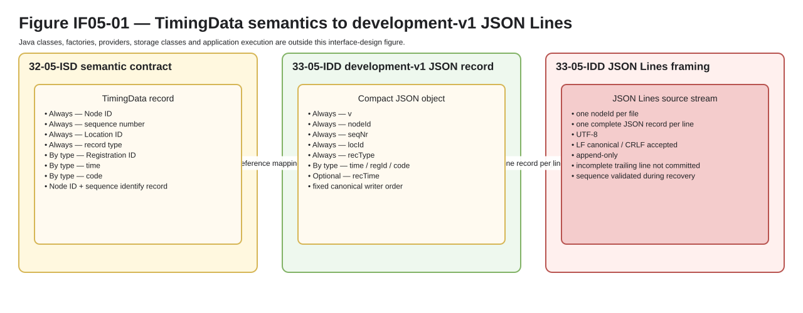

*Figure IF05-01 — IF-05 semantics mapped to v1 JSON and JSON Lines.*

### Semantic-to-JSON mapping

| Semantic value | Presence | v1 JSON member |
| --- | --- | --- |
| representation version | Always | `v` |
| Node ID | Always | `nodeId` |
| sequence number | Always | `seqNr` |
| Location ID | Always | `locId` |
| record type | Always | `recType` |
| time | By record type | `time` |
| Registration ID | By record type | `regId` |
| code | By record type | `code` |
| automatic registration origin | Optional, AUTO_REG only | `tagSrc` |
| automatic effective-time origin | Optional, AUTO_REG only | `timeSrc` |
| record creation time metadata | Optional | `recTime` |

The stable IF-05 record key `(Node ID, sequence number)` is represented by
`(nodeId, seqNr)`.

### Registration record mapping

#### AUTO_REG

Automatic registration add:

```text
recType = AUTO_REG
code    = [ADD]
```

The record type already carries the automatic-registration meaning, so `AUTO`
is not repeated in `code`.

Revoke mapping:

```text
recType = AUTO_REG
code    = [REV]
same regId
same time
```

#### Automatic registration audit provenance

For new default-profile `AUTO_REG` records, two short **optional** metadata
members identify the originating path and effective-time provenance:

| Member | Values | Meaning |
| --- | --- | --- |
| `tagSrc` | `API`, `ANT` | Direct engineering API, or antenna observation path (including a simulated antenna) |
| `timeSrc` | `API`, `NODE`, `OBS` | Explicit API timestamp, node's composed TimeSource, or observation-carried timestamp |

`API` with `NODE` describes a direct simulation that omitted `time`;
`API` with `API` describes an explicit API time; `ANT` with `OBS`
describes registration after an antenna observation. These are provenance
codes, **not** physical TagIds or an indication that the antenna was real
rather than simulated.

Both values are emitted together when provenance is known. Either both
must be present or both absent in a v1 record. Older v1 records without
these members remain valid and their provenance is unknown. The pair must
not appear in MAN_REG or NODE_INFO records. For AUTO_REG REV, metadata
describes the API revoke action; the effective `time` still refers to
the original registration as required by IF-05.

#### MAN_REG

Manual registration using client-selected time:

```text
recType = MAN_REG
code    = [ADD, AUTO]
```

Manual registration using operator-entered time:

```text
recType = MAN_REG
code    = [ADD, MAN]
```

Revoke mappings:

```text
[ADD, AUTO] -> [REV, AUTO]
[ADD, MAN]  -> [REV, MAN]
```

Canonical writer output places the action (`ADD` or `REV`) first.
Array order is not semantic to a reader; the valid code combination is.
Duplicate, contradictory or unknown codes for a known record type are invalid.

A revoke record repeats the original `locId`, `regId` and `time`, receives
a new `seqNr` and `recTime`, and never rewrites the original record. The
registration reference remains `regId + time`; repeated `locId` is record context. A `MAN_REG`
revoke also repeats the original `AUTO` or `MAN` subcode. Revoke does not
carry a sequence reference to the original ADD record.

### TimingNode lifecycle record mapping

The v1 reference representation uses one generic node-information
record type and carries the concrete lifecycle action in `code`:

```text
CLOSED -> OPEN
recType = NODE_INFO
code    = [OPEN]
time    = effective transition instant
locId   = location becoming active
```

```text
OPEN -> CLOSED
recType = NODE_INFO
code    = [CLOSE]
time    = effective transition instant
locId   = location active immediately before close
```

`NODE_INFO` lifecycle records do not carry `regId`. The `OPEN` or
`CLOSE` code contains the lifecycle meaning. `recTime`, when emitted,
remains optional record-creation metadata and does not replace lifecycle
`time`.

An idempotent/already-in-state lifecycle command or a command that fails before
commit produces no lifecycle JSON record.

### V1 record matrix

| Record type | Meaning | Required type-specific data | `code` |
| --- | --- | --- | --- |
| `AUTO_REG` | automatic registration | `regId`, `time` | `["ADD"]` or `["REV"]` |
| `MAN_REG` | manual registration | `regId`, `time` | `["ADD","AUTO"]`, `["ADD","MAN"]`, `["REV","AUTO"]` or `["REV","MAN"]` |
| `NODE_INFO` | TimingNode lifecycle information | `time` | `["OPEN"]` or `["CLOSE"]` |

### V1 JSON contract

Known members use the following JSON types and validation rules.

| Member | JSON type | Presence | v1 design rule |
| --- | --- | --- | --- |
| `v` | integer | Always | exactly `1` for the v1 format |
| `nodeId` | string | Always | non-empty Node ID |
| `seqNr` | integer | Always | `1..9007199254740991`; plain decimal; v1 reference-design limit |
| `locId` | integer | Always | positive Location ID representation |
| `recType` | string | Always | identifies the concrete v1 record type |
| `time` | string | By record type | required for `AUTO_REG`, `MAN_REG` and `NODE_INFO`; canonical UTC centisecond timestamp |
| `regId` | string | By record type | required for `AUTO_REG` and `MAN_REG`; absent for lifecycle records |
| `code` | array of strings | By record type | required for registration and `NODE_INFO` records |
| `tagSrc` | string | Optional, AUTO_REG only | `API` or `ANT`; accompanies `timeSrc` |
| `timeSrc` | string | Optional, AUTO_REG only | `API`, `NODE` or `OBS`; accompanies `tagSrc` |
| `recTime` | string | Optional | canonical UTC millisecond record-creation timestamp when emitted |

Canonical writer member order:

```text
v
nodeId
seqNr
locId
recType
time
regId
code
tagSrc    # when known, AUTO_REG only
timeSrc   # when known, AUTO_REG only
recTime   # when present
```

Validation rules:

- every `Always` member is present and non-null;
- every `By record type` member required by the selected `recType` is present and non-null;
- `Optional` members such as `recTime` may be omitted; on AUTO_REG, `tagSrc`
  and `timeSrc` must occur together if either occurs;
- `tagSrc`/`timeSrc` must be absent on MAN_REG and NODE_INFO records;
  unknown provenance code values are invalid;
- `nodeId` is not normalized, case-folded or derived by the reference reader/writer;
- the v1 `AUTO_REG` mapping accepts exactly `["ADD"]` or `["REV"]`;
- the v1 `MAN_REG` mapping accepts exactly one action (`ADD` or `REV`) plus exactly one of `AUTO` or `MAN`;
- `NODE_INFO` requires `time`, shall not contain `regId`, and accepts exactly one lifecycle code: `OPEN` or `CLOSE`;
- readers may accept a valid registration `code` combination in another array order;
- canonical writer output always emits action first;
- `seqNr` remains authoritative source order; no chronological ordering is
  inferred from `time` or `recTime`.

### Timestamp encoding

The v1 representation uses absolute UTC timestamps with field-specific fixed
precision.

| Member | Canonical form | Precision |
| --- | --- | --- |
| `time` | `YYYY-MM-DDTHH:mm:ss.SSZ` | centisecond, 10 ms |
| `recTime` | `YYYY-MM-DDTHH:mm:ss.SSSZ` | millisecond, 1 ms |

Rules:

- the literal `Z` represents UTC;
- `time` contains exactly two fractional digits;
- `recTime`, when present, contains exactly three fractional digits;
- trailing fractional zeroes are retained;
- offsets such as `+02:00`, implicit local time and timezone names are not
  canonical v1 values;
- a registration REV repeats the original registration `time` value;
- `recTime` is record-creation metadata and is not a durable-commit marker.

Examples:

```text
time    = 2026-10-01T12:00:00.00Z
time    = 2026-10-01T12:00:00.90Z
time    = 2026-10-01T12:00:00.25Z
recTime = 2026-10-02T10:57:43.444Z
recTime = 2026-10-02T10:57:45.100Z
```

A conforming v1 writer emits the canonical forms above. Broader input tolerance
for migration or recovery does not change the canonical v1 representation.

### JSON Lines file design

The default/reference v1 representation uses UTF-8 JSON Lines (`.jsonl`) and
contains records from exactly one `nodeId` source stream.

Rules:

- encoding is UTF-8 without BOM;
- there is no file header, footer or comment syntax;
- `v` is carried by every record;
- one complete TimingData JSON object is written per physical line;
- all records in one file use the same `nodeId`;
- canonical writer line ending is **LF** (`0x0A`);
- a reader may accept **CRLF** (`0x0D 0x0A`);
- a line terminator completes the record boundary;
- valid JSON bytes at EOF without LF/CRLF are an incomplete trailing record and
  are not committed;
- blank lines are invalid input;
- every complete line is independently JSON-decodable;
- canonical writer output is compact single-line JSON;
- insignificant JSON whitespace and member ordering are not semantic to readers;
- committed records are append-only and are not rewritten;
- valid complete records before an incomplete trailing line remain readable;
- recovery/import validates Node ID and sequence ordering and reports gaps,
  duplicates or regressions explicitly.

The exact filename, directory mapping, rotation/retention policy and filesystem
durability primitive are outside IF-05. A different TimingData representation
does not have to use `.jsonl`.

### Reference JSON examples

Automatic registration:

```json
{"v":1,"nodeId":"A","seqNr":1,"locId":24,"recType":"AUTO_REG","time":"2026-10-01T12:00:00.00Z","regId":"RT-A-0001","code":["ADD"],"tagSrc":"API","timeSrc":"API","recTime":"2026-10-02T10:57:43.444Z"}
```

Manual registration using client-selected time:

```json
{"v":1,"nodeId":"Test","seqNr":2,"locId":24,"recType":"MAN_REG","time":"2026-10-01T12:00:05.00Z","regId":"N0002","code":["ADD","AUTO"],"recTime":"2026-10-02T10:57:45.100Z"}
```

Manual registration using operator-entered time:

```json
{"v":1,"nodeId":"Test","seqNr":3,"locId":24,"recType":"MAN_REG","time":"2026-10-01T11:59:58.25Z","regId":"N0003","code":["ADD","MAN"],"recTime":"2026-10-02T10:57:46.000Z"}
```

Revoke examples:

```json
{"v":1,"nodeId":"Test","seqNr":4,"locId":24,"recType":"AUTO_REG","time":"2026-10-01T12:00:00.00Z","regId":"N0001","code":["REV"],"recTime":"2026-10-02T11:05:12.123Z"}
{"v":1,"nodeId":"Test","seqNr":5,"locId":24,"recType":"MAN_REG","time":"2026-10-01T11:59:58.25Z","regId":"N0003","code":["REV","MAN"],"recTime":"2026-10-02T11:05:14.000Z"}
```

The Registration IDs above are synthetic test/example data; IF-05 does not
impose their display convention. Historical examples without `tagSrc` and
`timeSrc` remain valid v1 records. A current direct simulation that
omitted API `time` would instead use `"tagSrc":"API","timeSrc":"NODE"`.


TimingNode lifecycle examples:

```json
{"v":1,"nodeId":"A","seqNr":6,"locId":24,"recType":"NODE_INFO","time":"2026-10-02T11:10:00.12Z","code":["OPEN"],"recTime":"2026-10-02T11:10:00.123Z"}
{"v":1,"nodeId":"A","seqNr":7,"locId":24,"recType":"NODE_INFO","time":"2026-10-02T12:05:30.25Z","code":["CLOSE"],"recTime":"2026-10-02T12:05:30.251Z"}
```

The examples show only successful state transitions. `ALREADY_OPEN`,
`ALREADY_CLOSED`, rejected and failed lifecycle commands do not produce a
reference record.

### Compatibility and versioning

The integer `v` member identifies the representation version. This document defines
the current development representation as `v = 1`.

Per the shared project convention in `12-GPD-documentation-guide.md`, odd `v` values
are development/unstable and even `v` values are stable/released. IF-05 is therefore
still using an unstable development representation while this IDD remains draft; a
future stabilization publishes the corresponding even representation version.

A v1 writer:

- emits `v = 1`;
- emits only members defined by this representation;
- emits canonical member values and timestamp forms defined by this IDD.

A v1 reader:

- validates required known members and their value constraints;
- may ignore additional JSON members when all required known members remain
  valid;
- reports an unknown `recType` as unsupported rather than reinterpreting it;
- treats malformed JSON, missing required fields, invalid field types or values,
  invalid `code` combinations and sequence violations as invalid records;
- treats an unsupported `v` as a representation-version compatibility failure.

Raw unsupported records may be retained or exported, but they are not decoded
using another representation version's semantics.

### ISD requirement realization

| ISD requirement | v1 design realization |
| --- | --- |
| IF05-REQ-001 | `nodeId`, `seqNr`, `locId` and `recType` form the common JSON envelope |
| IF05-REQ-002 | Node ID + `seqNr` identify a record when streams are combined |
| IF05-REQ-003 | `seqNr` starts at 1 and advances contiguously per Node ID source stream |
| IF05-REQ-004 | `recType` distinguishes `AUTO_REG` and `MAN_REG` |
| IF05-REQ-005 | registration records carry `regId` and `time` |
| IF05-REQ-006 | `code[]` represents ADD/REV while revoke repeats `regId` + `time` in a new record |
| IF05-REQ-007 | JSON Lines persistence is append-only; an existing committed record is not rewritten |
| IF05-REQ-008 | `NODE_INFO` with `OPEN`/`CLOSE` code represents successful lifecycle transitions in the normal source stream |
| IF05-REQ-009 | `NODE_INFO` lifecycle records carry transition `locId`, `time` and `OPEN`/`CLOSE` code while omitting `regId` |
| IF05-REQ-010 | no lifecycle JSON record is written for no-op/already/rejected/failed transitions |

JSON Lines completion rules, unknown-member handling, integer `v`, the v1
`seqNr` limit and optional `recTime` are concrete representation-design
choices. They are intentionally not additional IF-05 requirements.

Engineering backup files are byte-preserving snapshots of this same JSON Lines
representation; they do not define another record format or source stream. A
maintenance clear removes the active persisted stream only at the SI-01
restart boundary defined by SI01-REQ-088/SDD-01. The replacement stream then
starts again at sequence 1.


---

## Backend Integration Interface Specification (ISD)

**Source document:** [32-06-ISD-backend-integration.md](32-06-ISD-backend-integration.md)

Status: draft

System interface: **IF-06 — Backend Integration**

### Purpose

This Interface Specification Document defines the semantic contract between the
**Timing Point Application (SI-01)** and an external backend.

The interface is expressed in terms of **UpstreamData**. UpstreamData is the
transport-independent message model used to exchange:

- committed TimingData;
- node-scoped reference data;
- data synchronization information;
- backend/link status information.

UpstreamData is deliberately a small semantic layer around existing data models.
It does not replace TimingData and it does not redefine TimingData record identity,
ordering or registration semantics.

The concrete public/default JSON representation is defined in
`33-06-IDD-upstreamdata-json.md`. Other deployment-specific representations may
implement the same semantic contract behind the UpstreamData representation/codec
boundary.

The project-wide odd/even maturity convention for integer JSON `v` fields is guidance
owned by `12-GPD-documentation-guide.md`; IF-06 does not redefine that convention.

IF-06 does not define RabbitMQ queues/exchanges, HTTP routes, WebSocket event names,
Java classes, provider discovery or private deployment protocol details.

### Terms and abbreviations

- **IF** — system interface
- **ISD** — Interface Specification Document
- **IDD** — Interface Design Description
- **SI-01** — Timing Point Application
- **Backend** — external race/event backend system
- **TimingData** — committed timing record model defined by IF-05
- **UpstreamData** — transport-independent semantic message exchanged through IF-06
- **reference data** — backend-owned or backend-synchronized race/event data used by SI-01

### Relationship to other documents

IF-06 is allocated by
`31-SSSD-software-system-specification-document.md`.

TimingData semantics remain owned by
`32-05-ISD-timingdata-interchange.md`. When IF-06 carries TimingData, it carries
those same semantic values and record identities; it does not define another timing
record format.

SI-01 requirements consuming this interface are in
`41-01-SSD-timing-application-specification-document.md`.

The connector/transport design is elaborated by
`43-01-SDD-03-backoffice-transport-design.md`.

The public/default JSON representation is defined by
`33-06-IDD-upstreamdata-json.md`.

### Parties

```text
Backend
   ^
   | IF-06 UpstreamData
   v
SI-01 Timing Point Application
```

Both directions are supported. The meaning of a message is defined by its
UpstreamData family, not by the selected transport.

### Interface model


#### UpstreamData

UpstreamData is the common semantic boundary between application behaviour and
backend transports. The current packet-oriented contract separates delivery from
message meaning:

- `UP_PACKET` carries one semantic message from SI-01 to the Central System;
- `DN_PACKET` carries one semantic message from the Central System to SI-01.

Both packet directions have a `packetNr`. `packetNr` is the delivery/debug number and must not be confused with the IF-05/LogBook TimingData sequence. The
public/default representation includes packet numbers in both directions because they
make traces, logs and engineering inspection unambiguous. In the current contract only
a positive `DN_PACKET.packetNr` participates in `RECV`/resend handling. A normal
`UP_PACKET.packetNr` is not itself acknowledged.

The public/default JSON representation also carries integer `v`, separate from
`packetNr`. `v` is the representation version: odd values denote a development/
unstable representation and even values denote a stable/released representation.
It is not packet-delivery state, is not acknowledged by RECV, is not a replay cursor
and does not replace the TIMING_DATA/LogBook sequence. Delivery retry keeps the same
`packetNr` and semantic content; packet ordering or stability must not be inferred
from `v` or from packet-number parity.

The current semantic message families carried by those packets are:

| Message | Typical direction | Purpose |
| --- | --- | --- |
| `TIMING_DATA` | SI-01 -> Central System | transfer committed TimingData records using their existing LogBook/IF-05 sequence |
| `TIMING_DATA_REQ` | Central System -> SI-01 | request TimingData beginning at one IF-05/LogBook sequence |
| `SEQ` | bidirectional | request, answer or notify the current TIMING_DATA position |
| `TEAM_ASSIGNMENTS` | Central System -> SI-01 | deliver current RegistrationId -> TeamId assignments; no independent replay sequence is created |
| `STAGE_STARTS` | Central System -> SI-01 | deliver current RegistrationId-scoped stage starts; no independent replay sequence is created |
| `RECV` | SI-01 -> Central System | confirm the last successfully processed normal downstream packet or request a full downstream state resend |
| `PING` | bidirectional | immediate REQ/ANS liveness exchange without normal RECV handling |
| `STATUS` | bidirectional | expose upstream and connector health relevant to integration |

A deployment-specific adapter may encode the two packet directions differently while
preserving these semantics. Concrete private framing, field widths and legacy message
codes are outside this public contract.

#### TimingData relationship

When an UpstreamData message carries TimingData:

- the contained value is the same semantic TimingData defined by IF-05;
- Node ID + sequence number remains the TimingData record identity;
- the TimingData sequence remains the authoritative source order;
- batching or transport delivery does not renumber records;
- transport/message identifiers do not become TimingData record identifiers;
- retransmission of an already committed record does not create a new TimingData
  record merely because it is sent again.

One TIMING_DATA UpstreamData message carries **1..16** TimingData records. The
contained records retain their individual IF-05 identity and ordering. A larger
replay is split into multiple ordered TIMING_DATA messages; batching never creates
another TimingData sequence.


#### Current reference data relationship

`TEAM_ASSIGNMENTS` and `STAGE_STARTS` are two independent Central-owned current-state
message families for one addressed TimingNode. Neither is a durable historical stream and
neither has a source sequence. The containing `DN_PACKET.packetNr` provides delivery
numbering only.

`TEAM_ASSIGNMENTS` carries only live RegistrationId -> TeamId changes. Stable EventData
remains authoritative for RegistrationIds that already have a fixed TeamId mapping.

`STAGE_STARTS` carries only RegistrationId -> stage-start changes. A stage-start value
has no LocationId or StageId in IF-06. Which TimingNode receives the current value, and
whether its currently open WP projection uses it, is application/runtime routing outside
the stage-start value itself.

Each message uses explicit `SET` or `DEL` changes and carries **1..16** changes of its
own type. The two message families are not combined into one atomic unit and do not share
one message-size budget.

Normal Central-to-node delivery uses stop-and-wait semantics. For each TimingNode, Central
keeps at most one positive-numbered DN_PACKET outstanding. It does not send the next normal
positive-numbered DN_PACKET until the current one has been confirmed by RECV. If confirmation
is not received, Central may resend the **same packet with the same packetNr and semantic
content**.

SI-01 validates and applies one complete TEAM_ASSIGNMENTS or STAGE_STARTS message before
confirming its containing downstream packet with RECV. If that RECV is lost and the same
DN_PACKET is received again, SI-01 must not apply the same changes twice; it repeats the
confirmation for the already processed packet.

Central therefore needs no retained history of old TEAM_ASSIGNMENTS or STAGE_STARTS
packets. It keeps current downstream state plus the exact outstanding packet needed for
retry. A full downstream-state resend is requested with RECV position 0; Central rebuilds
the applicable current TEAM_ASSIGNMENTS and STAGE_STARTS state rather than replaying a
historical source sequence.

#### TimingData sequence and replay

Application-data synchronization in the current baseline applies only to
`TIMING_DATA`. The authoritative sequence is the existing IF-05/LogBook sequence for
one NodeId; IF-06 does not create another TimingData source sequence.

`SEQ` exchanges the current TIMING_DATA position and has three operations:

- `REQ`: ask the peer for its current TIMING_DATA position;
- `ANS`: answer a preceding REQ with `seq = N`;
- `NTF`: proactively notify the peer that the sender's current position is `seq = N`.

The meaning of the position follows the direction:

- SI-01 reports its current LogBook/IF-05 source head;
- Central reports the highest contiguous TIMING_DATA sequence it has accepted/processed.

Sequence 0 means that side currently has no TIMING_DATA position. REQ itself carries no
sequence. ANS and NTF carry the current sequence.

Either peer may send `SEQ REQ`. This allows Central to ask how many committed LogBook
records currently exist and allows SI-01 to ask how far Central has processed. SI-01 may
also send `SEQ NTF` when its LogBook head advances.

Actual record replay is a separate `TIMING_DATA_REQ` operation. Central sends
`TIMING_DATA_REQ(fromSeq=N)` to request retained TimingData beginning at IF-05 sequence
N. SI-01 answers with one or more bounded TIMING_DATA messages containing the original
records and identities.

The LogBook remains the replay source. On an available upstream session, proactive
live TIMING_DATA forwarding is normally enabled. After a fresh connection SI-01 publishes
its current source head through SEQ. Central compares that position with its highest
contiguous processed TIMING_DATA sequence. When Central is behind, it sends
TIMING_DATA_REQ from its next expected sequence. When both positions are equal, Central
does not need to send a synchronization message back.

When SI-01 handles an actual TIMING_DATA_REQ, that replay synchronization temporarily
pauses proactive live forwarding. SI-01 captures its current LogBook head and replays
from `fromSeq` through that captured head. Records committed after the captured head are
not interleaved into the replay range. After replay completes, proactive live forwarding
resumes from the sequence after the captured head. SEQ position exchange itself does not
enable, disable or gate live forwarding.

Loss does not require a second durable TimingData outbox. Central can request retained
TimingData again from the LogBook. Retransmission preserves the original IF-05 record
identity and content.

TEAM_ASSIGNMENTS and STAGE_STARTS are deliberately not synchronized by SEQ. Their recovery uses DN_PACKET delivery,
RECV/resend and, when the node no longer trusts its downstream state, an explicit full
state resend request.


#### PING request / answer lifecycle

`PING` is one bidirectional semantic message used to verify that the configured
upstream connection remains operational. A PING exchange has:

- **op** (required): `REQ` initiates a check; `ANS` responds to it;
- **mode** (optional): `HB` marks an automatically scheduled heartbeat; when
  `mode` is absent, the request is an explicitly initiated/manual check.

A receiver of a valid PING `op = REQ` replies immediately with one PING
`op = ANS`. The answer preserves the request's `mode`, including its absence for
a manual request. This applies in both directions.

PING is deliberately outside normal downstream confirmation. A packet carrying PING
uses packetNr 0 and is not followed by RECV. A PING packet carries no other semantic
message. The PING answer also uses packetNr 0. This keeps liveness response independent
from a normal positive-numbered DN_PACKET that may still be awaiting confirmation.

There is no separate PONG message type in the default model. A request/correlation
identifier is not part of the mandatory semantic contract; a representation may expose
one for engineering visibility.

For each active upstream connector initiated by SI-01:

- when the connector first reaches its operational **CONNECTED** state, SI-01 sends one
  heartbeat PING immediately;
- while that connection remains operational, SI-01 sends another heartbeat PING every
  **30 seconds**;
- when the connector leaves the operational connected state, periodic PING generation
  stops;
- after a later reconnect, a new cycle begins with another immediate PING followed by
  the 30-second period.

A manual PING may be initiated by either party and does not reset the heartbeat cycle.
PING is not TimingData, does not consume a TimingData sequence and does not create or
modify a LogBook record.

The timeout/failure policy for an unanswered PING is intentionally not fixed yet. A
transport may also have a lower-level keepalive mechanism, but that does not replace the
semantic PING request/answer exchange.

### Operation identifiers

Operations use stable semantic identifiers independent from transport.

| Operation | Direction | Meaning |
| --- | --- | --- |
| `IF06-OP-01 DELIVER_TIMING_DATA` | SI-01 -> Central System | deliver committed TimingData without changing IF-05 identity/order |
| `IF06-OP-02 APPLY_TEAM_ASSIGNMENTS` | Central System -> SI-01 | validate and apply current RegistrationId-to-TeamId assignments carried by one downstream packet |
| `IF06-OP-09 APPLY_STAGE_STARTS` | Central System -> SI-01 | validate and apply current RegistrationId-scoped stage starts carried by one downstream packet |
| `IF06-OP-03 TIMING_DATA_SEQUENCE` | bidirectional | request, answer or notify the current TIMING_DATA sequence position |
| `IF06-OP-04 STATUS` | bidirectional | exchange/observe integration status |
| `IF06-OP-05 PING_REQUEST` | bidirectional | initiate PING with op REQ and optional HB mode |
| `IF06-OP-06 PING_ANSWER` | bidirectional | answer a PING request with op ANS, retaining the request's optional mode |
| `IF06-OP-07 RECV` | SI-01 -> Central System | confirm the last processed normal DN_PACKET or request full downstream state resend |
| `IF06-OP-08 REQUEST_TIMING_DATA` | Central System -> SI-01 | request retained TimingData beginning at sequence N |

These identifiers describe semantic interaction. A concrete transport may map them to
messages, routes, topics, requests or events without changing their meaning.

### Semantic operations

#### IF06-OP-01 DELIVER_TIMING_DATA

Input:

- **1..16** already committed TimingData records;
- source/node scope sufficient to route the records.

Required behaviour:

- preserve each record's IF-05 semantic values and record key;
- preserve source ordering;
- permit retransmission for synchronization;
- never imply that packet delivery rewrites local committed data.

#### IF06-OP-02 APPLY_TEAM_ASSIGNMENTS

Input:

- addressed TimingNode;
- **1..16** RegistrationId-to-TeamId SET/DEL changes;
- containing DN_PACKET delivery number.

Outcome:

- a new valid packet: validate and apply all assignment changes as one unit, then confirm
  the containing downstream packet with RECV;
- a resend of an already processed packet: do not apply again; repeat RECV;
- invalid semantic content: do not advance the accepted downstream packet position and
  expose a diagnosable rejection/conflict.

TEAM_ASSIGNMENTS has no source sequence and no historical replay obligation.

#### IF06-OP-09 APPLY_STAGE_STARTS

Input:

- addressed TimingNode;
- **1..16** RegistrationId-scoped stage-start SET/DEL changes;
- containing DN_PACKET delivery number.

Outcome:

- a new valid packet: validate and apply all stage-start changes as one unit, then confirm
  the containing downstream packet with RECV;
- a resend of an already processed packet: do not apply again; repeat RECV;
- invalid semantic content: do not advance the accepted downstream packet position and
  expose a diagnosable rejection/conflict.

STAGE_STARTS carries no LocationId or StageId. It has no source sequence and no
historical replay obligation.

#### IF06-OP-03 TIMING_DATA_SEQUENCE

This bidirectional operation uses the SEQ message:

- `op = REQ`: ask the peer for its current TIMING_DATA position;
- `op = ANS, seq = N`: answer a request;
- `op = NTF, seq = N`: notify a new/current position without a request.

For SI-01, N is its LogBook/IF-05 source head. For Central, N is the highest contiguous
TIMING_DATA sequence it has accepted/processed. Sequence 0 means no position yet.

#### IF06-OP-07 RECV

RECV refers to downstream delivery, not to TimingData source identity. A positive value
confirms the last normal DN_PACKET that SI-01 has successfully processed. Central keeps
at most one positive-numbered downstream packet outstanding and resends that exact packet when
confirmation is absent.

If SI-01 observes that the current downstream delivery cannot be advanced because an
earlier packet is still missing, it reports the last successfully processed downstream
packet. Under normal stop-and-wait delivery Central never sends packet N+1 before N is
confirmed.

RECV position 0 is not acknowledgement of a normal packet. It requests a full resend of
the current Central-owned downstream state.

#### IF06-OP-08 REQUEST_TIMING_DATA

TIMING_DATA_REQ carries:

- addressed TimingNode;
- `fromSeq >= 1`.

Central uses it to request LogBook TimingData beginning at IF-05 sequence `fromSeq`.
The request does not create another source sequence. SI-01 serves the range from retained
LogBook data in bounded TIMING_DATA messages.

#### IF06-OP-04 STATUS

Integration status may expose:

- connector/backend availability;
- source/node synchronization state;
- pending outbound work;
- last accepted/rejected reference-data update;
- last successful inbound/outbound semantic exchange.

Transport-specific diagnostic detail may be added by an implementation, but the
common semantic status shall remain transport-independent.

#### IF06-OP-05 PING_REQUEST

A PING request has `op = REQ`. An automatically generated heartbeat
request adds `mode = HB`; a manually initiated request omits `mode`.
It has no TimingData payload or record identity.
Neither a legacy wire-level marker nor a sequence/correlation number is mandated
by IF-06.

For the SI-01 initiated heartbeat, the first PING REQUEST follows the connector
transition to operational CONNECTED immediately. Subsequent heartbeat requests
are generated at a 30-second period while that same connection remains operational.
Manual PING requests do not affect that schedule.

#### IF06-OP-06 PING_ANSWER

The receiver of a valid PING REQUEST responds with one PING message carrying
`op = ANS` and the request's unchanged optional `mode`. If the
request omits `mode`, the answer also omits it. An answer has no TimingData
payload or record identity and must not trigger another answer.

A PING ANSWER confirms receipt and handling of a liveness request.
Implementations may add correlation identifiers to match individual requests
and answers. IF-06 does not yet define how many unanswered PING requests,
or what elapsed time, changes connector health/state.

### Failure semantics

Stable semantic failure categories include:

- invalid or unsupported UpstreamData;
- unknown/unmapped source or node;
- unsupported reference-data family;
- stale/conflicting reference-data update;
- unsupported representation/version;
- backend/transport unavailable;
- delivery outcome unknown;
- synchronization incomplete.

Transport failure is not equivalent to failure of the local TimingData commit that
produced outbound work.

A caller/connector shall not claim semantic acceptance merely because bytes were
successfully written to a transport.

### Representation and transport independence

IF-06 separates three concerns:

```text
semantic UpstreamData
        |
UpstreamData representation / codec
        |
connector / transport
```

The public/default implementation uses the JSON representation defined by
`33-06-IDD-upstreamdata-json.md`.

Alternative representations may be supplied for a deployment through the same
UpstreamData representation/codec boundary. Such an implementation may use another
text, binary, fixed-field or proprietary representation as long as it preserves the
applicable IF-06 semantics.

The selected representation is independent from the transport selection. For
example, the default JSON UpstreamData representation may be carried through an
engineering API transport or RabbitMQ.

### Compatibility

Compatible representation extensions shall not silently change existing UpstreamData
semantics.

A concrete representation shall expose enough version/type information to reject
unsupported input deterministically.

A deployment-specific representation may support only the semantic families required
by that deployment, but unsupported required families shall be reported explicitly and
shall not be reinterpreted as another message family.

### IF-06 requirements

<a id="IF06-REQ-001"></a>

**IF06-REQ-001 — Transport-independent UpstreamData semantics**

IF-06 shall define backend integration in terms of transport-independent UpstreamData
rather than RabbitMQ-, HTTP-, WebSocket- or deployment-specific wire messages.

— — —

- **Type:** Interface Requirement
- **Status:** Draft
- **Required by:** [`SI01-REQ-064`](41-01-SSD-timing-application-specification-document.md#SI01-REQ-064)
- **Verified by:** [`VC-ST1-010`](61-01-VTS-timing-application-verification-test-specification.md#VC-ST1-010)

---


<a id="IF06-REQ-002"></a>

**IF06-REQ-002 — Preserve TimingData semantics**

When UpstreamData carries TimingData, it shall preserve every applicable IF-05 semantic
value, including Node ID, sequence number and record-type values, without renumbering or
rewriting the committed TimingData record.

— — —

- **Type:** Interface Requirement
- **Status:** Draft
- **Required by:** [`SI01-REQ-064`](41-01-SSD-timing-application-specification-document.md#SI01-REQ-064)
- **Verified by:** [`VC-ST1-010`](61-01-VTS-timing-application-verification-test-specification.md#VC-ST1-010)

---


<a id="IF06-REQ-003"></a>

**IF06-REQ-003 — Keep transport identity separate from TimingData identity**

Transport, delivery, batch or session identifiers shall not replace the IF-05
TimingData record key or source sequence.

— — —

- **Type:** Interface Requirement
- **Status:** Draft
- **Required by:** [`SI01-REQ-064`](41-01-SSD-timing-application-specification-document.md#SI01-REQ-064)
- **Verified by:** [`VC-ST1-010`](61-01-VTS-timing-application-verification-test-specification.md#VC-ST1-010)

---


<a id="IF06-REQ-004"></a>

**IF06-REQ-004 — Support node-scoped reference data**

IF-06 shall support Central System-to-SI-01 TEAM_ASSIGNMENTS and STAGE_STARTS messages.
Both are addressed to one NodeId and carry incremental RegistrationId-scoped current
state. Neither message shall carry LocationId or create an independent historical
source sequence.

— — —

- **Type:** Interface Requirement
- **Status:** Draft
- **Required by:** [`SI01-REQ-063`](41-01-SSD-timing-application-specification-document.md#SI01-REQ-063)
- **Verified by:** [`VC-ST1-011`](61-01-VTS-timing-application-verification-test-specification.md#VC-ST1-011)

---


<a id="IF06-REQ-005"></a>

**IF06-REQ-005 — Explicit reference-data outcome**

A TEAM_ASSIGNMENTS or STAGE_STARTS message shall be validated and applied before SI-01
confirms its containing DN_PACKET with RECV. A resend of an already processed DN_PACKET
shall not apply the same current-state change twice. Invalid content shall not advance
the accepted downstream packet position and shall remain diagnosable.

— — —

- **Type:** Interface Requirement
- **Status:** Draft
- **Required by:** [`SI01-REQ-063`](41-01-SSD-timing-application-specification-document.md#SI01-REQ-063)
- **Verified by:** [`VC-ST1-011`](61-01-VTS-timing-application-verification-test-specification.md#VC-ST1-011)

---


<a id="IF06-REQ-006"></a>

**IF06-REQ-006 — Synchronization preserves source identity**

Data synchronization shall preserve the authoritative identities/order of
the data being synchronized and shall not create a second source sequence for committed
TimingData.

— — —

- **Type:** Interface Requirement
- **Status:** Draft
- **Required by:** [`SI01-REQ-065`](41-01-SSD-timing-application-specification-document.md#SI01-REQ-065)

---


<a id="IF06-REQ-007"></a>

**IF06-REQ-007 — Local TimingData commit independent from backend delivery**

Backend transport/session unavailability shall not by itself invalidate or roll back an
already successful local TimingData commit. Pending backend synchronization shall
remain separately representable.

— — —

- **Type:** Interface Requirement
- **Status:** Draft
- **Required by:** [`SI01-REQ-065`](41-01-SSD-timing-application-specification-document.md#SI01-REQ-065)

---


<a id="IF06-REQ-008"></a>

**IF06-REQ-008 — Public default JSON representation**

The public/reference implementation shall provide a versioned JSON representation of
UpstreamData suitable for development, engineering and integration verification. It
shall represent the two directions explicitly as UP_PACKET and DN_PACKET, each with a
packetNr for traceability. Committed TimingData records shall be nested in a TIMING_DATA
message payload rather than being transmitted as standalone legacy log-line messages.

— — —

- **Type:** Interface Requirement
- **Status:** Draft
- **Verified by:** [`VC-ST1-010`](61-01-VTS-timing-application-verification-test-specification.md#VC-ST1-010)

---


<a id="IF06-REQ-009"></a>

**IF06-REQ-009 — Alternative representation support**

A deployment may provide an alternative UpstreamData representation behind the supported
representation/codec boundary without requiring the public application/domain model to
depend on deployment-specific wire-format classes or private source.

— — —

- **Type:** Interface Requirement
- **Status:** Draft

---


<a id="IF06-REQ-010"></a>

**IF06-REQ-010 — Connector transport independence**

The same applicable UpstreamData semantics shall be usable through different configured
backend connectors/transports. Selecting another transport shall not redefine TimingData,
reference-data or synchronization semantics.

— — —

- **Type:** Interface Requirement
- **Status:** Draft
- **Required by:** [`SI01-REQ-064`](41-01-SSD-timing-application-specification-document.md#SI01-REQ-064)
- **Verified by:** [`VC-ST1-010`](61-01-VTS-timing-application-verification-test-specification.md#VC-ST1-010)

---


<a id="IF06-REQ-017"></a>

**IF06-REQ-017 — Exchange the TimingData sequence position**

For one NodeId, SEQ shall exchange only the TIMING_DATA position. SEQ REQ asks the peer
for its current position; SEQ ANS returns that position; SEQ NTF reports it without a
request. SI-01's position is its current IF-05/LogBook source head. Central's position
is the highest contiguous TIMING_DATA sequence it has accepted/processed. Sequence 0
means no position yet.

— — —

- **Type:** Interface Requirement
- **Status:** Draft
- **Required by:** [`SI01-REQ-081`](41-01-SSD-timing-application-specification-document.md#SI01-REQ-081), [`SI01-REQ-084`](41-01-SSD-timing-application-specification-document.md#SI01-REQ-084)
- **Verified by:** [`VC-ST1-012`](61-01-VTS-timing-application-verification-test-specification.md#VC-ST1-012)

---


<a id="IF06-REQ-018"></a>

**IF06-REQ-018 — Separate packet numbering from TimingData synchronization**

Both public/default packet directions shall carry a packet number for traceability.
A positive DN_PACKET packetNr shall participate in RECV/resend handling; an UP_PACKET
packetNr shall not itself require acknowledgement in the current baseline. Packet numbering shall not replace or advance the IF-05/LogBook TIMING_DATA sequence.

— — —

- **Type:** Interface Requirement
- **Status:** Draft
- **Required by:** [`SI01-REQ-084`](41-01-SSD-timing-application-specification-document.md#SI01-REQ-084)
- **Verified by:** [`VC-ST1-010`](61-01-VTS-timing-application-verification-test-specification.md#VC-ST1-010), [`VC-ST1-011`](61-01-VTS-timing-application-verification-test-specification.md#VC-ST1-011)

---


<a id="IF06-REQ-019"></a>

**IF06-REQ-019 — Make TimingData retransmission idempotent by record identity**

Retransmission shall preserve the original NodeId, source sequence and TimingData
content. Re-receiving the same record key with the same semantic content shall be
idempotent. Re-receiving the same record key with different semantic content shall
be treated as a synchronization conflict and shall not silently overwrite data.

— — —

- **Type:** Interface Requirement
- **Status:** Draft
- **Required by:** [`SI01-REQ-082`](41-01-SSD-timing-application-specification-document.md#SI01-REQ-082)
- **Verified by:** [`VC-ST1-012`](61-01-VTS-timing-application-verification-test-specification.md#VC-ST1-012)

---


<a id="IF06-REQ-020"></a>

**IF06-REQ-020 — Request retained TimingData by source sequence**

Central System shall be able to request TIMING_DATA beginning at an inclusive
IF-05/LogBook sequence with TIMING_DATA_REQ. A request from sequence 1 means replay
from the retained beginning of the LogBook. TEAM_ASSIGNMENTS or STAGE_STARTS shall not use this replay
mechanism.

— — —

- **Type:** Interface Requirement
- **Status:** Draft
- **Required by:** [`SI01-REQ-082`](41-01-SSD-timing-application-specification-document.md#SI01-REQ-082)
- **Verified by:** [`VC-ST1-012`](61-01-VTS-timing-application-verification-test-specification.md#VC-ST1-012)

---


<a id="IF06-REQ-021"></a>

**IF06-REQ-021 — Re-establish TimingData synchronization after connection changes**

When an upstream semantic connection is established or re-established, SI-01 shall
first publish its current downstream receive position through RECV and shall publish its
current TIMING_DATA source head through SEQ. RECV position 0 means this SI-01 runtime
has not processed a normal DN_PACKET and therefore requests a full current-state resend.
A positive RECV position N means SI-01 has already processed DN_PACKET N; a Central peer
that has no local downstream baseline shall continue normal numbering at N+1 rather than
restart at packet 1. This receive-position announcement preserves TimingNode-owned
downstream state across transport reconnects and Central-process restarts.

When Central is behind the reported TIMING_DATA source head, Central shall send
TIMING_DATA_REQ from its next expected sequence. When Central's processed position already
equals SI-01's source head, Central need not send either an empty TIMING_DATA_REQ or an
equal-position SEQ notification.

Proactive live TIMING_DATA forwarding shall normally remain enabled while the session is
available. When SI-01 handles a TIMING_DATA_REQ it shall temporarily pause proactive live
forwarding, capture its current LogBook head, replay through that captured head, and
resume proactive live forwarding from the next sequence only after that replay completes.
SEQ position exchange itself shall not gate proactive live forwarding.

TEAM_ASSIGNMENTS and STAGE_STARTS recovery shall not depend on a retained Central source
sequence. When SI-01 cannot trust its downstream state it may request a full resend of
the current Central-owned downstream state through RECV position 0.

— — —

- **Type:** Interface Requirement
- **Status:** Draft
- **Required by:** [`SI01-REQ-085`](41-01-SSD-timing-application-specification-document.md#SI01-REQ-085)
- **Verified by:** [`VC-ST1-012`](61-01-VTS-timing-application-verification-test-specification.md#VC-ST1-012)

---


<a id="IF06-REQ-022"></a>

**IF06-REQ-022 — Bound IF-06 data-message size**

One TIMING_DATA message shall carry at most 16 TimingData records. One TEAM_ASSIGNMENTS
message shall carry at most 16 assignment changes. One STAGE_STARTS message shall carry
at most 16 stage-start changes. A producer with more retained TimingData shall split it
without changing the underlying IF-05 sequence. Larger current-state delivery may require
multiple confirmed DN_PACKET turns; it shall not create another source sequence.

— — —

- **Type:** Interface Requirement
- **Status:** Draft

---


<a id="IF06-REQ-014"></a>

**IF06-REQ-014 — Confirm downstream packets with stop-and-wait delivery**

For one TimingNode, Central shall keep at most one normal positive-numbered DN_PACKET
unconfirmed. It shall not send the next normal positive-numbered DN_PACKET until RECV confirms
the current one. If confirmation is absent, Central may resend the exact same packet
with the same packetNr and semantic content. SI-01 shall not apply a resent already
processed packet twice.

— — —

- **Type:** Interface Requirement
- **Status:** Draft
- **Required by:** [`SI01-REQ-078`](41-01-SSD-timing-application-specification-document.md#SI01-REQ-078)
- **Verified by:** [`VC-ST1-011`](61-01-VTS-timing-application-verification-test-specification.md#VC-ST1-011)

---


<a id="IF06-REQ-015"></a>

**IF06-REQ-015 — Separate stable EventData from live current reference data**

TEAM_ASSIGNMENTS shall carry incremental RegistrationId-to-TeamId assignments that are
not stable EventData profile identity.
The semantic contract is generic and does not classify an assignment by tag type.
It shall not redefine a stable RegistrationId-to-TeamId mapping supplied by EventData.
Physical TagIds remain resolved to their RegistrationId by EventData.

— — —

- **Type:** Interface Requirement
- **Status:** Draft
- **Required by:** [`SI01-REQ-077`](41-01-SSD-timing-application-specification-document.md#SI01-REQ-077), [`SI01-REQ-078`](41-01-SSD-timing-application-specification-document.md#SI01-REQ-078)

---


<a id="IF06-REQ-016"></a>

**IF06-REQ-016 — Define StageStartTimes reference semantics**

Central shall retain StageStartTimes source state by StageId and RegistrationId. STAGE_STARTS
shall carry the routed current-stage projection as incremental RegistrationId-scoped
stage-start-time changes. The message itself carries neither LocationId nor StageId.

Under the current event mapping, Stage N finishes at LocationId N. Central uses the addressed
TimingNode's current OPEN LocationId to select Stage N before constructing STAGE_STARTS. The
RegistrationId is the timing-domain identity whose start is being defined; consumers shall not
need an intermediate TeamId lookup to match a registration to its stage start.
A SET shall carry one `TimingTimestamp` value containing at least local race
time-of-day. The timestamp may also contain a local date or already be absolute
when the source knows that information. A source that knows only time-of-day
shall remain valid; no transport or codec layer shall invent a date or time zone.
DEL removes the current definition. Elapsed-time and race-time-zone interpretation
belong to SI-01 domain behaviour, not to transport or codec layers.

— — —

- **Type:** Interface Requirement
- **Status:** Draft
- **Required by:** [`SI01-REQ-079`](41-01-SSD-timing-application-specification-document.md#SI01-REQ-079)

---


<a id="IF06-REQ-011"></a>

**IF06-REQ-011 — Immediate upstream PING on connect**

When a configured upstream connector reaches its operational connected state, SI-01
shall send one PING message with `op = REQ` and `mode = HB` immediately
in a packet with packetNr 0. PING packets shall not use RECV.

— — —

- **Type:** Interface Requirement
- **Status:** Draft
- **Required by:** [`SI01-REQ-075`](41-01-SSD-timing-application-specification-document.md#SI01-REQ-075)
- **Verified by:** [`VC-ST1-009`](61-01-VTS-timing-application-verification-test-specification.md#VC-ST1-009)

---


<a id="IF06-REQ-012"></a>

**IF06-REQ-012 — Periodic upstream PING while connected**

While a configured upstream connector remains operationally connected after its initial
heartbeat PING, SI-01 shall send a further heartbeat PING every 30 seconds. Scheduled
PING generation shall stop when that connector is no longer operationally connected
and shall restart with an immediate heartbeat PING after a later reconnect.
An explicitly initiated manual PING shall not reset this schedule. PING shall not
consume TimingData sequence identity or create TimingData/LogBook records.

— — —

- **Type:** Interface Requirement
- **Status:** Draft
- **Required by:** [`SI01-REQ-075`](41-01-SSD-timing-application-specification-document.md#SI01-REQ-075)
- **Verified by:** [`VC-ST1-009`](61-01-VTS-timing-application-verification-test-specification.md#VC-ST1-009)

---


<a id="IF06-REQ-013"></a>

**IF06-REQ-013 — PING request op, answer and optional heartbeat mode**

IF-06 shall use one PING semantic message family with required
`op = REQ | ANS`, optional `mode = HB` and optional absolute UTC message
`time`. A PING REQUEST without `mode` denotes an explicitly initiated/manual
check; no `MANUAL` value is required. When present, `time` denotes the creation/send
time of that specific PING message. A PING ANSWER therefore creates its own message
time and shall not reuse the request's time as the answer time.

The receiver of a valid PING REQUEST shall send one PING ANSWER preserving the
request's `mode` (including its absence) as part of processing the request, without
waiting for the 30-second heartbeat schedule. A PING with `op = ANS` shall not itself
be answered. This applies in both directions. Unknown `mode` values shall not silently
be treated as manual checks. No separate PONG message type, PING sequence number or
correlation identifier is mandated by the interface; a representation/implementation
may add optional correlation. Reference producers should populate `time`, while
readers remain compatible with PING messages that omit it. PING REQUEST/ANSWER shall
not consume TimingData sequence identity or create TimingData/LogBook records.

— — —

- **Type:** Interface Requirement
- **Status:** Draft
- **Required by:** [`SI01-REQ-075`](41-01-SSD-timing-application-specification-document.md#SI01-REQ-075), [`SI01-REQ-076`](41-01-SSD-timing-application-specification-document.md#SI01-REQ-076)
- **Verified by:** [`VC-ST1-009`](61-01-VTS-timing-application-verification-test-specification.md#VC-ST1-009)

---


### Open points

- Exact producer-side rules for advancing  around a multi-packet state
  mutation/snapshot; the parity meaning is fixed (even stable, odd unstable), but the
  transition boundary still needs to be made explicit in the implementation design.

- Exact retry/backoff timing for an unconfirmed normal DN_PACKET; stop-and-wait
  identity/resend semantics are defined while connector timing remains an implementation
  concern.
- Whether all status is exchanged as UpstreamData or some connector diagnostics remain
  local-only implementation status.
- Timeout/health policy for missing or late PING ANSWER messages.


---

## UpstreamData JSON Interface Design Description (IDD)

**Source document:** [33-06-IDD-upstreamdata-json.md](33-06-IDD-upstreamdata-json.md)

Status: draft

Representation: **default/reference v1 JSON**

System interface: **IF-06 — Backend Integration**

### Purpose

This Interface Design Description defines the public/default JSON representation of
IF-06 UpstreamData.

The matching ISD owns the semantic contract. This IDD defines only the public/reference
representation used by development, SI-02 engineering tooling and integration tests.

The representation is deliberately generic. It does not encode deployment-specific
queue names, private identifiers or proprietary protocol fields.

### Relationship to other documents

This IDD implements the public/default representation of
`32-06-ISD-backend-integration.md`.

Contained TimingData values conform to IF-05 and its public/default JSON mapping in
`32-05-ISD-timingdata-interchange.md` and
`33-05-IDD-timingdata-interchange.md`.

Connector/session realization belongs to
`43-01-SDD-03-backoffice-transport-design.md`.

The shared odd/even maturity convention for integer JSON `v` fields is defined by
`12-GPD-documentation-guide.md`. This IDD remains the authority for the concrete IF-06
representation.


### Design baseline

The packet-oriented default/reference representation is version **1**. It uses one
UTF-8 JSON packet shape with an explicit direction:

- `UP_PACKET`: SI-01 -> Central System;
- `DN_PACKET`: Central System -> SI-01.

Each packet carries exactly one semantic message in v1. Keeping one semantic message per
packet makes packet numbering unambiguous and makes the PING isolation rule explicit.

A normal packet has this shape:

```json
{
  "v": 1,
  "type": "DN_PACKET",
  "nodeId": "A",
  "pckNr": 42,
  "msg": {
    "type": "SEQ",
    "data": {
      "op": "ANS",
      "seq": 1186
    }
  }
}
```

Top-level members:

| Member | Type | Meaning |
| --- | --- | --- |
| `v` | integer | IF-06 JSON representation version; current development value is 1 |
| `type` | `UP_PACKET` or `DN_PACKET` | packet direction |
| `nodeId` | string | TimingNode owning/addressed by this packet |
| `pckNr` | integer | packet delivery/debug number; 0 is reserved for PING |
| `msg` | object | exactly one semantic IF-06 message |

The wire name `pckNr` denotes packet delivery/debug number (`packetNr` in the typed Java model), while `seqNr` remains the IF-05 TimingData/LogBook sequence. The RECV wire name `rcvPckNr` denotes `receivedPacketNr` in the typed semantic model.

The packet number is separate from TimingData identity. In particular,
`pckNr=42` does not imply TimingData sequence 42.

Both directions use packet numbers because they materially improve engineering traces and
message inspection. In the current baseline only positive DN_PACKET numbers participate in
RECV/resend. UP_PACKET numbers are visible delivery/debug numbers and are not themselves
acknowledged.

Normal positive DN_PACKET numbers advance in send order. Central keeps at most one positive
DN_PACKET unconfirmed for a TimingNode. It does not advance to the next normal downstream
packet until the outstanding packet has been confirmed. A resend uses the same packetNr
and the same semantic message.

Packet number 0 is reserved for PING packets. A PING packet does not consume the normal
positive packet counter and is not confirmed with RECV.

### Message families

The semantic message object reserves:

- `TIMING_DATA`;
- `TIMING_DATA_REQ`;
- `SEQ` (REQ, ANS and NTF);
- `TEAM_ASSIGNMENTS`;
- `STAGE_STARTS`;
- `RECV`;
- `PING` (REQ and ANS);
- `STATUS`.

#### TIMING_DATA

TIMING_DATA ordinarily travels in an UP_PACKET and carries **1..16** committed
TimingData values as elements of its `data` array.

```json
{
  "v": 1,
  "type": "UP_PACKET",
  "nodeId": "A",
  "pckNr": 57,
  "msg": {
    "type": "TIMING_DATA",
    "data": [
      {
        "v": 1,
        "nodeId": "A",
        "seqNr": 42,
        "locId": 1,
        "recType": "AUTO_REG",
        "time": "2026-10-13T08:00:00.00Z",
        "regId": "A0042",
        "code": ["ADD"],
        "recTime": "2026-10-13T08:00:00.123Z"
      }
    ]
  }
}
```

The child values are the public IF-05 TimingData records themselves; IF-06 does not
define a second record mapping. In the default writer their record timestamps therefore
remain canonical UTC: `time` is the IF-05 effective time. Optional `recTime` is
record-creation/debug metadata when present. Both use literal `Z`. Batching never creates another TimingData
sequence; the original `seqNr` remains the record identity/order.

#### TIMING_DATA_REQ

Central requests retained TimingData with a normal DN_PACKET:

```json
{
  "v": 1,
  "type": "DN_PACKET",
  "nodeId": "A",
  "pckNr": 41,
  "msg": {
    "type": "TIMING_DATA_REQ",
    "data": {
      "fromSeq": 1171
    }
  }
}
```

`fromSeq` is inclusive and uses the IF-05/LogBook sequence. The request itself has no
TimingData source sequence.

Because this is a normal positive-numbered DN_PACKET, SI-01 confirms processing of the request
with RECV in its own UP_PACKET. Serving the requested TIMING_DATA remains a separate
semantic action from confirming receipt of the request packet.

#### SEQ

SEQ exchanges the current TIMING_DATA position and has one required `op`:

| op | seq | Meaning |
| --- | --- | --- |
| `REQ` | absent | ask the peer for its current TIMING_DATA position |
| `ANS` | required | answer a SEQ REQ |
| `NTF` | required | notify the peer of the sender's current position |

Request:

```json
{
  "v": 1,
  "type": "DN_PACKET",
  "nodeId": "A",
  "pckNr": 42,
  "msg": {
    "type": "SEQ",
    "data": {
      "op": "REQ"
    }
  }
}
```

Answer:

```json
{
  "v": 1,
  "type": "UP_PACKET",
  "nodeId": "A",
  "pckNr": 58,
  "msg": {
    "type": "SEQ",
    "data": {
      "op": "ANS",
      "seq": 1186
    }
  }
}
```

The same family works in either direction. SI-01's sequence value is its current
LogBook/IF-05 head. Central's sequence value is the highest contiguous TIMING_DATA
sequence it has accepted/processed. `seq=0` means no position yet.

A SEQ message never refers to TEAM_ASSIGNMENTS or STAGE_STARTS.

On a fresh or re-established upstream session, SI-01 may notify its current source head
with SEQ NTF. Central compares that value with its highest contiguous processed position.
If Central is behind it requests the missing suffix with TIMING_DATA_REQ. If both values
are equal, Central does not need to send a synchronization message back. SEQ reports
positions; it does not itself pause or resume proactive live TIMING_DATA forwarding.
A real TIMING_DATA_REQ temporarily pauses live forwarding while its captured replay range
is served, after which live forwarding resumes from the next sequence.

#### TEAM_ASSIGNMENTS

TEAM_ASSIGNMENTS travels in a normal DN_PACKET and carries current live
RegistrationId-to-TeamId assignment changes for the addressed TimingNode.

```json
{
  "v": 1,
  "type": "DN_PACKET",
  "nodeId": "A",
  "pckNr": 43,
  "msg": {
    "type": "TEAM_ASSIGNMENTS",
    "data": [
      {
        "op": "SET",
        "regId": "R0001",
        "teamId": "0042"
      }
    ]
  }
}
```

One TEAM_ASSIGNMENTS message carries **1..16** SET/DEL changes. The message has no
LocationId: an assignment is node-scoped current state keyed by RegistrationId, not by
the currently open WP.

TEAM_ASSIGNMENTS is current-state delivery, not retained source-history synchronization.
Central therefore need not retain old assignment packets after confirmation. It keeps the
current assignment state plus the exact outstanding packet required for retry.

#### STAGE_STARTS

STAGE_STARTS travels in a normal DN_PACKET and carries current RegistrationId-scoped
stage-start definitions for the addressed TimingNode.

```json
{
  "v": 1,
  "type": "DN_PACKET",
  "nodeId": "A",
  "pckNr": 44,
  "msg": {
    "type": "STAGE_STARTS",
    "data": [
      {
        "op": "SET",
        "regId": "R0001",
        "start": "23:59:50.00"
      }
    ]
  }
}
```

One STAGE_STARTS message carries **1..16** SET/DEL changes. It carries neither
LocationId nor StageId. Central source state is nevertheless StageId-scoped. Before
constructing the message, Central selects the stage applicable to the addressed TimingNode's
current runtime context; under the current event mapping, OPEN LocationId N selects Stage N.
The message then carries only that stage's RegistrationId-scoped start projection.

A resent DN_PACKET is identified by the same pckNr and must not cause the same changes
to be applied twice. STAGE_STARTS has no independent source sequence and no historical
replay obligation.

#### RECV

RECV is an UP_PACKET semantic message referring to downstream delivery:

```json
{
  "v": 1,
  "type": "UP_PACKET",
  "nodeId": "A",
  "pckNr": 59,
  "msg": {
    "type": "RECV",
    "data": {
      "rcvPckNr": 43
    }
  }
}
```

The outer `pckNr=59` identifies this upstream packet for tracing. The inner
`rcvSeqNr=43` is the downstream packet position being reported.

For a positive value, `rcvPckNr` is the last normal DN_PACKET that SI-01 has
successfully processed. In the normal stop-and-wait flow it equals Central's outstanding
packet number and confirms that packet. If confirmation is lost and Central resends the same
packet, SI-01 repeats RECV without reapplying the semantic message.

A receiver that detects it cannot advance because an earlier downstream packet is still
missing reports its last successfully processed downstream packet. Under the normal
stop-and-wait rule Central never sends packet N+1 before N is confirmed.

`rcvSeqNr=0` is special: it is not acknowledgement of a normal DN_PACKET. It
requests that Central rebuild and resend the applicable current downstream state. It
does not request historical TEAM_ASSIGNMENTS or STAGE_STARTS by source sequence.

#### PING

PING is carried in a packet with `pckNr=0` in either direction. It has `op=REQ|ANS`,
optional `mode=HB`, optional absolute UTC `time` and optional `pingId`.

Request:

```json
{
  "v": 1,
  "type": "UP_PACKET",
  "nodeId": "A",
  "pckNr": 0,
  "msg": {
    "type": "PING",
    "data": {
      "op": "REQ",
      "mode": "HB",
      "time": "2026-10-24T14:12:00.123Z"
    }
  }
}
```

Answer:

```json
{
  "v": 1,
  "type": "DN_PACKET",
  "nodeId": "A",
  "pckNr": 0,
  "msg": {
    "type": "PING",
    "data": {
      "op": "ANS",
      "mode": "HB",
      "time": "2026-10-24T14:12:00.130Z"
    }
  }
}
```

A PING REQ is answered immediately. PING packets are not followed by RECV and do not
consume the normal positive packet-id sequence. Each packet already carries one
semantic message, so a PING packet cannot contain another message.

#### STATUS

STATUS payload members remain an open design point. STATUS, when defined, uses an
ordinary UP_PACKET or DN_PACKET according to direction.


### JSON rules

The packet-oriented default/reference writer:

- emits UTF-8 JSON without BOM;
- emits integer `v = 1` for the current unstable/development representation;
- emits top-level `type = UP_PACKET | DN_PACKET`;
- emits one NodeId and one packetNr;
- emits exactly one semantic `msg`;
- uses positive pckNr for ordinary packets and pckNr 0 only for PING;
- emits at most 16 TimingData records, 16 TEAM_ASSIGNMENTS changes, or 16 STAGE_STARTS changes in one semantic message;
- does not copy transport-specific routing/session metadata into semantic message content.

The reader:

- rejects malformed JSON;
- rejects missing required members;
- rejects unsupported `v` representation versions;
- rejects pckNr 0 for non-PING messages;
- rejects a positive-numbered PING packet;
- rejects unknown semantic message types as unsupported rather than reinterpreting them;
- may ignore unknown additional members when all required known members remain valid.

### TimingData composition

The public UpstreamData codec shall compose the public TimingData representation rather
than invent another timing-record mapping.

Conceptually:

```text
DefaultUpstreamDataCodec
        |
        +--> DefaultTimingDataCodec
```

This relationship is representation composition only. IF-05 remains the semantic
authority for TimingData.

### Transport mapping

The same UpstreamData JSON envelope is used for inbound and outbound
messages; only its `type`, payload and any type-dependent scope differ. The
encoded semantic object can be carried by different connector transports.
Transport-specific or deployment-specific direction-dependent framing belongs
in the adapter/codec rather than defining a second default message format.

#### Engineering IF-03 transport

The Engineering API connector may map inbound UpstreamData to an IF-03 HTTP request and
outbound UpstreamData to a typed IF-03 WebSocket event.

The WebSocket event carries structured UpstreamData JSON; it does not tunnel a
pre-serialized RabbitMQ/private message as an opaque string.

#### RabbitMQ transport

The RabbitMQ connector may use the encoded UpstreamData JSON as its public/reference
message body while RabbitMQ exchanges, queues, routing keys, delivery tags and connection
state remain transport metadata outside the UpstreamData JSON object.

SI-02 may use the same JSON representation when acting as the backend-side RabbitMQ test
peer.

### Provider / codec boundary

The public/default implementation is expected to expose a typed provider/codec family
parallel to the existing TimingData representation boundary:

```text
UpstreamDataProvider
  id()
  createCodec()

UpstreamDataCodec
  encode(UpstreamData)
  decode(bytes)
```

The built-in public provider uses stable id `reference` and the JSON v1 codec.

A deployment-specific provider may supply a different representation without changing
the public UpstreamData semantic model or requiring private representation classes in
public application/domain code.

Concrete Java package/API details remain SI-01 detailed design and are not normative
IF-06 interface requirements.


### Compatibility and versioning

The integer `v` identifies the default UpstreamData JSON representation version.

This project uses the shared representation-maturity convention from
`12-GPD-documentation-guide.md`: odd versions are development/unstable and even
versions are stable/released. The current IF-06 packet representation is therefore
`v = 1` while the contract remains under active development. Stabilizing this
representation will use the corresponding even version.

The earlier flat implementation shape with SYNC/ACK/REQ control families is not a
released compatibility baseline. It is superseded by this packet model and may be
migrated directly while IF-06 remains on the unstable development version.

A custom representation is not required to use JSON or this `v` member. It conforms
through preservation of the applicable IF-06 semantics, not by copying the default wire
format.

### ISD mapping

| IF-06 requirement | Default JSON realization |
| --- | --- |
| IF06-REQ-001 | v1 represents transport-independent IF-06 packet/message semantics |
| IF06-REQ-002 | TIMING_DATA embeds IF-05-compatible TimingData values |
| IF06-REQ-003 | pckNr remains separate from NodeId + IF-05 sequence identity |
| IF06-REQ-004/005 | TEAM_ASSIGNMENTS and STAGE_STARTS carry node-scoped current changes and are confirmed through their DN_PACKET |
| IF06-REQ-014 | positive DN_PACKET uses stop-and-wait RECV/resend |
| IF06-REQ-015 | TEAM_ASSIGNMENTS carries live RegistrationId -> TeamId SET/DEL changes |
| IF06-REQ-016 | STAGE_STARTS carries RegistrationId-scoped SET/DEL changes without LocationId |
| IF06-REQ-006/017 | SEQ REQ/ANS/NTF exchanges only the TIMING_DATA position |
| IF06-REQ-018 | both packet directions expose packetNr; only downstream packetNr participates in current RECV handling |
| IF06-REQ-019 | TIMING_DATA replay reuses original TimingData identity/content |
| IF06-REQ-020 | TIMING_DATA_REQ uses inclusive `fromSeq` |
| IF06-REQ-021 | fresh SEQ reports TIMING_DATA positions; Central uses TIMING_DATA_REQ only for a missing suffix, and replay temporarily pauses otherwise-live forwarding; RECV 0 requests current downstream-state resend |
| IF06-REQ-022 | TIMING_DATA, TEAM_ASSIGNMENTS and STAGE_STARTS each have their own 16-item message bound |
| IF06-REQ-007 | representation does not couple local TimingData commit to delivery |
| IF06-REQ-008 | v1 JSON is the packet-oriented public/default representation |
| IF06-REQ-009 | provider/codec boundary permits alternative representations |
| IF06-REQ-010 | the same packet/message semantics can be mapped to IF-03 or RabbitMQ |
| IF06-REQ-011/012/013 | PING uses pckNr 0, immediate REQ/ANS and no RECV |

### Open design points

- Final common STATUS JSON members.
- Whether TIMING_DATA remains single-source per message or permits an explicit
  multi-source batch envelope in a later version.


---

## Application Configuration Interface Specification (ISD)

**Source document:** [32-11-ISD-application-configuration.md](32-11-ISD-application-configuration.md)

Status: review candidate

System interface: **IF-11 — Application Configuration**


### Purpose

This Interface Specification Document defines the deployment/configuration contract consumed by SI-01. It describes how a deployment identifies internal TimingSystems and their TimingNodes, I/O assets, presentation bindings, runtime settings and secret references before application composition starts.

It deliberately does **not** define domain behaviour, a Java class hierarchy, a specific YAML library or production secret values.

### Terms and abbreviations

- **IF** — system interface
- **ISD** — Interface Specification Document
- **SI** — Software Item
- **ApplicationConfig** — effective resolved application configuration


### Relationship to other documents

IF-11 is a system-owned deployment/configuration interface allocated by
`31-SSSD-software-system-specification-document.md`. Applicable system use cases and
deployment constraints provide upstream intent. The SI-01 SSD consumes this contract;
its internal architecture and Java SDD are downstream and are not inputs to the ISD.

### Boundary

```text
deployment configuration
        |
        | IF-11
        v
SI-01 configuration loading
        |
        v
effective ApplicationConfig
        |
        v
validation
        |
        v
application composition
```

Build provenance is outside IF-11. `BuildIdentity` comes from the built application artifact and remains separate from deployment configuration.

### Source template parameters

The external YAML source may define a small `parameters` mapping for deployment-local
string constants. Parameters are resolved before the effective `ApplicationConfig` is
created, so template syntax never becomes runtime/domain state.

Example:

```yaml
parameters:
  ID: A

timingSystems:
  - systemId: "{ID}"
    timingNodes:
      - nodeId: "{ID}"
```

Rules:

- parameter names are non-blank identifiers and parameter values are YAML strings;
- a string scalar may reference a configured parameter as `{Name}`;
- parameter substitution is deterministic text replacement only: it does not evaluate
  expressions, execute code, load includes or introduce recursive inheritance;
- unknown or unresolved parameter references are configuration errors;
- topology uses ordered `timingSystems` and `timingNodes` YAML lists;
  each entry declares identity with `systemId` or `nodeId`,
  not by a deployment-local mapping key;
- `{NodeId}` and `{SystemId}` are reserved contextual placeholders. They are resolved only
  where the owning field defines that context, currently TimingData storage paths;
- after substitution, the normal field-specific IF-11 validation rules still apply.

For a single-system/single-node configuration, `ID: A` makes both
`timingSystems[].id: "{ID}"` and `timingNodes[].id: "{ID}"` resolve to `A`.
Multi-system deployments may define separate parameters or explicit IDs as needed.

### Effective configuration model

The logical **effective** configuration root is:

The outline uses the architectural **SystemId** and **NodeId** concepts.
In YAML, their corresponding declaration and reference fields are `systemId` and
`nodeId`.


```text
ApplicationConfig
├── applicationId
├── timingSystems
│   └── <timingSystem>
│       ├── SystemId
│       ├── eventDataProvider
│       ├── timingDataProvider
│       ├── upstreamDataProvider
│       └── timingNodes
│           └── <timingNode>
│               ├── NodeId
│               ├── locationId
│               └── tagProcessing
├── io
│   ├── devices
│   │   └── antennaManagers
│   │       └── <manager entry>
│   │           ├── SystemId reference
│   │           ├── antennas
│   │           └── inventoryGroup (optional)
│   ├── deviceNetworks
│   │   ├── can
│   │   └── network
│   ├── messaging
│   │   └── upstream
│   │       └── connectors
│   └── storage
│       └── timingData
│           ├── path (single-TimingNode shorthand)
│           └── nodes (multi-TimingNode mapping)
│               └── <storageBinding>
│                   ├── nodeId
│                   └── path
├── presentation
├── logging
├── runtime
└── security
```

The structure is a contract for configuration ownership. It does not require one Java POJO for every node before a running slice needs it.

#### Application profile and baseline capabilities

A Timing Point Application may use a selected **application profile** as a
versioned default composition template. A profile can supply topology,
capability and compatibility defaults without introducing another domain model,
Java application subclass or software item.

This public baseline deliberately does not define concrete event/deployment
profile IDs, fixed TimingNode counts, device combinations or allowed LocationId
sets. Those details are added only when an explicit public requirement owns them;
private deployment profiles and compatibility mappings remain outside this
repository.

Explicit deployment configuration may override profile defaults where the
profile contract allows it. It must not bypass compatibility rules owned by the
selected profile.

Console, Remote Shell and API are baseline Timing Point Application capabilities,
not implicitly tied to one profile. Deployment configuration still controls
concrete listener/binding settings and may explicitly leave a network listener
unbound/disabled where appropriate.

Web remains a separate browser-facing capability whose per-TimingNode bindings
are composed when that capability is used.

#### Application identity

`ApplicationId` identifies the configured Timing Point Application instance.
It is a separate identity/type from `NodeId`.

For the current single-TimingNode deployment style, the intended starting
convention is to configure the same string value for `ApplicationId` and the
single `NodeId`. This equality is a deployment convention, not identity
aliasing: multi-TimingNode deployments may use one application id with several
different TimingNode ids.

Representative direction:

```text
applicationId: timing-node-01
```

#### TimingSystems and TimingNodes

The application composes 1..N internal `TimingSystem` contexts. Each
TimingSystem owns 1..N TimingNodes plus its own system-status/upstream-protocol
state. `SystemId` is a local composition/simulation identity and is not
part of the upstream functional addressing contract.

Representative source:

```yaml
parameters:
  ID: A

timingSystems:
  - systemId: "{ID}"
    eventDataProvider: reference
    timingDataProvider: reference
    upstreamDataProvider: reference
    timingNodes:
      - nodeId: "{ID}"
        tagProcessing:
          quietTimeoutMillis: 250
          maxBurstDurationMillis: 1000
          duplicateWindowMillis: 15000
          sweepCadenceMillis: 50
          observationQueueCapacity: 256
```

The same structure naturally represents multiple systems and nodes:

```yaml
timingSystems:
  - systemId: 9
    timingNodes:
      - nodeId: A
      - nodeId: B
  - systemId: C
    timingNodes:
      - nodeId: C
```

Within `timingSystems`, the `systemId` field identifies its TimingSystem;
within `timingNodes`, `nodeId` identifies the TimingNode. This is explicit,
compact, and consistent with the architectural **SystemId** and **NodeId**
concepts. I/O and presentation references to those objects also use
`systemId` and `nodeId` respectively.

Rules:

- `timingSystems` and each nested `timingNodes` are non-empty YAML lists;
  their elements are YAML objects with explicit identity fields;
  mapping-based topology collections are not part of the IF-11 syntax;
- `SystemId` is one character `A`..`Z` or `1`..`9` and unique among
  all TimingSystems hosted by the application;
- a TimingSystem with **one TimingNode** uses exactly the **same ID** as that node
  (system `A` contains node `A`, system `B` contains node `B`);
- a TimingSystem with **multiple TimingNodes** uses a **different** ID that does
  not equal any TimingNode ID in the application (for now, system `9`
  containing nodes `A` and `B`); no `SID-` prefix is used;
- `SystemId` distinguishes hosted/simulated TimingSystem contexts locally;
- each TimingSystem contains 1..N TimingNodes;
- `NodeId` identifies the logical TimingNode, is exactly one character `A`..`Z` or `1`..`9`, and remains application-wide unique;
- `LocationId` identifies the configured physical/event location and is not derived from `NodeId`;
- each configured `LocationId` must satisfy any compatibility constraint of the selected built-in application profile;
- presentation transport settings such as HTTP ports do not belong to the TimingNode;
- the internal TimingSystem grouping does not add a TimingSystem identifier to TimingData or upstream wire messages.

#### TimingNode tag-processing policy

`tagProcessing` belongs to one configured TimingNode because it controls that
TimingNode's TagProcessor semantics and bounded observation ingress. It is not
antenna/I/O routing configuration.

The reusable implementation owns usable compiled defaults. A deployment therefore
does not need to repeat these values merely to start:

```yaml
tagProcessing:
  quietTimeoutMillis: 250
  maxBurstDurationMillis: 1000
  duplicateWindowMillis: 15000
  sweepCadenceMillis: 50
  observationQueueCapacity: 256
```

The values above are the public first-executable defaults. A selected application
profile/platform/mode or explicit deployment configuration may override them where
that source deliberately specializes the policy.

Validation rules are:

- `quietTimeoutMillis`, `maxBurstDurationMillis` and `sweepCadenceMillis`
  must be positive;
- `duplicateWindowMillis` may be zero but must not be negative;
- `observationQueueCapacity` must be positive.

IF-11 owns the **effective startup configuration** only. After startup, IF-03 may
apply a temporary runtime override to fields explicitly marked runtime-adjustable.
Such an override changes current process state; it does not rewrite IF-11 deployment
configuration. Restart resolves the startup value again from compiled defaults plus
the configured override sources.

The current runtime-mutability baseline is:

| Field | Live override | Reason |
| --- | --- | --- |
| `quietTimeoutMillis` | yes | policy evaluation can change on the TagProcessor lane |
| `maxBurstDurationMillis` | yes | policy evaluation can change on the TagProcessor lane |
| `duplicateWindowMillis` | yes | duplicate-window evaluation can change on the TagProcessor lane |
| `sweepCadenceMillis` | yes | housekeeping registration can be replaced on the TagProcessor lane |
| `observationQueueCapacity` | no | it sizes the owned bounded queue and currently requires restart/recomposition |

A runtime API query may expose both the effective startup value and the currently
active value. Secrets remain excluded/redacted according to their own interface
rules.

#### I/O

I/O configuration selects concrete external I/O implementations and their
TimingNode mappings.

Representative device configuration direction:

```text
io
  devices
    antennaManagers (list)
      - systemId: 9
        antennas (list)
          - id: 1
            provider: simulated
            type: rfid
            timingNodes: [A, B]
            power
              controlRef: antenna-power-1
              stabilizationMillis: 1000
          - id: 2
            provider: simulated
            type: rfid
            timingNodes: [B]
            power
              controlRef: antenna-power-2
              stabilizationMillis: 1000
        inventoryGroup
          members: [1, 2]
          intervalMillis: 500

  deviceNetworks
    can
      enabled: true
      protocolProvider: reference

    network
      enabled: true
      displayProtocolProvider: reference
```

`AntennaManager` is an optional I/O capability per TimingSystem. The
`antennaManagers` list makes that ownership explicit: each binding contains
one `systemId` reference, without requiring an artificial name such as `primary`. A TimingSystem may have zero or one manager binding. When present the
manager owns 1..N antennas and accepts one shared inventory demand: enabled while
any TimingNode of that system is OPEN, otherwise disabled. Internal multiplex
rotation is distinct from future individual antenna-control features.

`AntennaId` is exactly one digit `1`..`9` and is distinct from
`NodeId`. One antenna may intentionally map to 1..N TimingNodes within
the manager's referenced TimingSystem; this fan-out does not merge their state
or sequence streams.

Antenna installation fields have these semantics:

- `systemId` on the manager binding must reference one configured
  TimingSystem and may occur only once across manager bindings;
- `timingNodes` routes antenna observations to one or more TimingNodes that
  belong to that same TimingSystem; this mapping does not imply independently
  starting/stopping inventory per antenna;
- `power.controlRef` optionally references an installation-owned external power
  capability rather than reader/vendor protocol;
- `power.stabilizationMillis` defines how long SI-01 waits after external power-on
  before self-testing or initializing that antenna.

One AntennaManager may define **zero or one** `inventoryGroup`. When present:

- `members` identifies 2..N configured antennas that cannot inventory concurrently;
- `intervalMillis` is the rotation interval between configured group members;
- the public/reference two-antenna baseline is 500 ms;
- antennas not listed in the group may inventory independently.

Omitting `inventoryGroup` means no mutual-exclusion multiplexing is required. The
configuration contract deliberately does not define several independently named groups
until a concrete deployment requirement needs that capability.

Omitting `power` means the antenna/provider is responsible for any internal power
mechanism or is continuously powered.

Startup self-test is per antenna and is diagnostic. A failed self-test does not
permanently disable that antenna and does not prevent a later inventory attempt.
Failure of one antenna does not prevent independent operation or later attempts of
other antennas merely because they share one AntennaManager.

The `deviceNetworks.can` section configures the CAN network boundary. Exact
bus/driver/discovery fields belong to the concrete device-network design.

The `deviceNetworks.network` section configures the bidirectional network-device
boundary. Detailed service-discovery, session and protocol-framing design is
outside IF-11; this interface only owns the deployment values needed to compose
the selected network-device service.

Concrete antenna configuration owns its driver/protocol/device settings. Its
`provider` value selects a registered `AntennaProvider`; `simulated` is the
built-in provider and therefore requires no external extension JAR. A separate
registration-asset identity is not part of the active software configuration
model.

Provider IDs are implementation-selection keys, not domain/device identities.
The same rule applies to configured EventData, TimingData, UpstreamData,
CAN-protocol and display-protocol providers.

For `eventDataProvider`, `reference` selects the built-in public/reference
EventData profile. Alternate/private providers may supply event-specific
TagId/RegistrationId semantics through the same shared EventData contract.

For `timingDataProvider`, `reference` selects the built-in implementation of
the canonical IF-05 representation. An alternate/private TimingData provider may
select another external representation/translator, but it still realises the
same IF-05 TimingData semantics; provider selection does not select a different
public record model.

For `upstreamDataProvider`, `reference` selects the built-in public/default IF-06
JSON representation. An alternate/private UpstreamData provider may select another
representation/translator while preserving the same applicable IF-06 semantics and
without exposing deployment-specific wire classes to normal application/domain code.

Provider selection and provider-specific translation configuration are resolved
during bootstrap, before the codec is used by persistence or inspection code.
A provider whose external representation omits information carried by the common
semantic model must receive enough validated configuration to make the
translation reversible. For a local event-time-only representation this may
include an event date/day-selection rule plus an event time zone or fixed
offset. Those values are translation configuration, not TimingNode/domain state.

The configured codec is then a normal immutable translator instance. Runtime
callers pass only `TimingData` or encoded record bytes to `encode`/`decode`;
they do not pass deployment configuration, UI state or the current host date on
every record operation.

The common IF-11 contract does not prescribe one generic bag of provider
configuration keys. A concrete provider owns validation of the configuration it
requires, while bootstrap owns obtaining that configuration, selecting the
provider and failing before composition when the combination is invalid.

Public examples use generic/reference provider IDs; private provider names and
protocol values remain outside this repository.

#### Upstream messaging

**Upstream** identifies the central/external system relationship from SI-01's
perspective; it does not define the direction of each message. The relationship
is bidirectional.

When upstream messaging is enabled, configuration associates each upstream
gateway/UpstreamData context with exactly one internal `TimingSystem`. That context
may use 1..N connectors. Lower transport resources may later be shared when that
does not blur the semantic system boundary.

Representative direction:

```text
io
  messaging
    upstream
      gateways
        upstream-01
          timingSystem: timing-system-01
          connectors
            connector-01
              type: rabbitmq
              credentials: rabbitmq-main
            connector-02
              type: engineering-api
```

The current executable subset has one selected upstream transport and exposes the
shared replay pacing setting directly under `upstream`:

```yaml
upstream:
  transport: engineering-api
  timingDataReplayPacketDelayMillis: 0
```

`timingDataReplayPacketDelayMillis` is a non-negative deployment value. Zero
means no artificial pacing. A positive value inserts that delay only between
successive outbound TIMING_DATA packets while SI-01 serves one
TIMING_DATA_REQ replay. The first replay packet is not delayed, there is no
trailing delay after the final replay packet, and normal live TIMING_DATA
forwarding is not throttled by this setting. The delay changes execution pacing
only; it does not change IF-06 packet/message content, packet numbering, replay
batch size, record order, captured replay head or the replay-to-live handoff.

The `timingSystem` reference is local composition information; it is not added
to UpstreamData merely for routing. `UpstreamGateway` owns the external
transport/session boundary. Shared Domain `UpstreamData` defines the semantic
message families; `UpstreamMessageRouter` resolves system- and TimingNode-targeted
messages by
`NodeId` to the corresponding bidirectional `UpstreamHandler`.

A connector owns transport resources such as RabbitMQ connections/channels or the
existing IF-03 engineering transport mapping. It does not own Domain/TimingNode selection or message
semantics. The router is upstream-specific and is not used as a generic internal
application message bus.

Storage settings remain under I/O because they configure external persistence.

#### TimingData storage

TimingData persistence remains an I/O/deployment concern. Each configured
TimingNode that uses the reference file store resolves to exactly one authoritative
append-only TimingData file.

A compact path template can resolve storage for one or more TimingNodes:

```yaml
io:
  storage:
    timingData:
      path: data/node-{NodeId}-logbook.jsonl
```

For a single TimingNode `A`, this resolves to `data/node-A-logbook.jsonl`.

For a multi-TimingNode composition, use explicit node bindings:

```yaml
io:
  storage:
    timingData:
      nodes:
        node-a:
          nodeId: A
          path: data/node_A_logbook.jsonl
        node-b:
          nodeId: B
          path: data/node_B_logbook.jsonl
```

The key below `nodes` is a deployment-local binding name only.
`nodeId` is the real application-wide TimingNode reference. The storage
binding does not become part of TimingNode domain state.

Rules:

- a literal `path` without contextual placeholders is the single-TimingNode shorthand
  and is valid only when the effective application composition contains exactly one
  TimingNode;
- a `path` containing `{NodeId}` and/or `{SystemId}` is resolved separately for
  every configured TimingNode and may therefore be used for multi-TimingNode composition;
- every expanded path must still be unique after normal filesystem normalization;
- `nodes` remains the explicit per-node alternative when different path shapes or
  additional deployment-specific bindings are required;
- `path` and `nodes` are mutually exclusive;
- every configured TimingNode using the reference file store must resolve to
  exactly one storage binding;
- every `nodes.*.nodeId` must reference a configured TimingNode and may
  occur only once in the storage mapping;
- two bindings must not resolve to the same normalized filesystem path;
- a path may be relative to the application working directory or absolute;
- the configured path selects the file location only; IF-05 and the Java
  persistence design own record encoding, append ordering, recovery and
  corruption handling;
- startup recovery opens/validates each resolved file and rebuilds that
  TimingNode's committed LogBook state before the TimingNode begins accepting
  operational work;
- public examples use generic local paths and do not disclose deployment paths;
- the reference/example filename convention is
  `node-<NodeId>-logbook.jsonl`, for example
  `node-A-logbook.jsonl`; the configured path remains authoritative.

Because `NodeId` is application-wide unique, the same storage mapping
works for one or multiple TimingSystems without adding `SystemId` to the
persistence binding.

The storage path does not contain a LocationId or RegistrationId policy. Those
identifier domains remain event/profile/reference-data concerns.

#### Presentation

Presentation configuration follows the same function-first ownership as the presentation architecture. Transport configuration is nested under the functional interface that owns it.

Representative direction:

```text
presentation
  web
    endpoints (1 per TimingNode)
      web-timing-node-01
        nodeId: A
        bindAddress
        port
      ...
  api
    http
    webSocket
  remoteShell
```

The intended Web topology has exactly one configured Web binding for each
configured TimingNode. Each binding references a `NodeId` and owns its
own bind address/port; a multi-TimingNode process therefore exposes 1..N Web
ports. Those listener settings remain Presentation configuration and do not
become fields of the TimingNode domain object.

A TimingNode therefore does not need to know that an HTTP listener, WebSocket, shell or external GUI/test client exists. Presentation interfaces map their requests to the application boundary.

The current executable subset is:

```yaml
presentation:
  remoteShell:
    bindAddress: 127.0.0.1
    port: 8023
  api:
    http:
      bindAddress: 127.0.0.1
      port: 8081
    webSocket:
      bindAddress: 127.0.0.1
      port: 8082
```

Remote Shell and API are baseline software capabilities. Their concrete network
bindings are deployment settings rather than profile choices. A deployment may
explicitly omit/disable a listener binding; when an API HTTP/WebSocket binding is
present it requires its `bindAddress` and `port`. The committed development
example uses loopback for all listeners. External GUI/test clients connect to the
API and do not require their own SI-01 presentation configuration section. These
settings configure presentation listeners and do not become TimingNode fields.

#### Logging

Logging is cross-cutting deployment configuration and is not TimingNode/domain state.
The logging configuration provides a startup level, a retained file sink and an optional
engineering live-diagnostics listener.

Representative direction:

```yaml
logging:
  level: INFO
  file:
    path: logs
    rotateBytes: 1048576
    retainedFiles: 5
  live:
    bindAddress: 127.0.0.1
    port: 8030
```

Rules:

- `level` is the configured global startup level; the implementation accepts the
  semantic levels `TRACE`, `DEBUG`, `INFO`, `WARN` and `ERROR`;
- `file.path` identifies the directory used for retained operational text logs;
  the executable creates it when needed;
- each new runtime log file uses local wall-clock date/time in the filename,
  normally `yyyyMMdd-HHmmss.txt` (for example `20250514-101657.txt`);
- retained log records use `HH:mm:ss.SSS - [LEVEL] - message - [sourceClass.sourceMethod]`
  as the compact first-line format; exception stack traces follow when present;
- `rotateBytes` starts a new timestamped file when the current file reaches the configured size,
  and `retainedFiles` limits the number of timestamped files kept in the configured directory;
  both values must be positive;
- `live` is optional and owns its own bind address/listen port. The development
  example is loopback-only;
- an engineering client initiates the live connection to SI-01 and may query/set
  a temporary runtime log-level override on that diagnostics connection;
- runtime level overrides are process state only: they are not written back into
  IF-11 configuration and restart restores the configured `logging.level`;
- live log delivery is best effort and is not the durable log store;
- this diagnostics listener is separate from Presentation/IF-03 status/events;
  configuring it does not add fields to a TimingNode.

Per-package levels, persistent runtime overrides and general-purpose diagnostics
routing are deliberately outside the A08 baseline.

#### Runtime

Runtime configuration contains process/executor/queue settings that affect application execution but are not domain identity.

Exact fields remain capability-driven and should be added when the corresponding runtime behaviour exists.

#### Security and credentials

Committed configuration may state **which** credential is required, but not contain production secrets.

Example:

```text
rabbitmq
  host: rabbit.example
  port: 5672
  virtualHost: /timing
  username: timing-node
  passwordSecret: RABBITMQ_PASSWORD
```

The referenced secret value is resolved from environment/deployment secret storage at startup. The same principle applies to upstream credentials, certificates and similar sensitive values.

This baseline does not require a general `SecretProvider` hierarchy.

### Configuration sources and precedence

Source template parameters are resolved within the explicit deployment YAML before that
source participates in effective-configuration validation. They are a convenience for
writing one source file, not an additional precedence layer and not a runtime override.

The application resolves configuration **from compiled defaults toward explicit
deployment intent**. Explicit deployment values win over lower-precedence defaults,
but they do not override built-in profile compatibility constraints.

```text
compiled component defaults
        ↓
selected built-in application profile defaults
        ↓
selected platform defaults
        ↓
selected operating-mode defaults
        ↓
explicit deployment application.yml overrides
        ↓
secret resolution
        ↓
effective startup ApplicationConfig
```

Runtime overrides are deliberately not another IF-11 source. They are temporary
process state applied after startup through the application-control interface.

This is deliberately not arbitrary inheritance. The compiled component defaults provide a complete usable baseline for settings
that do not require deployment-specific identity or topology. The three selected
default sources then answer orthogonal questions:

- **application profile** — what Timing Point topology/capabilities are normally
  composed for the selected deployment family;
- **platform** — the execution/deployment environment, such as Pi Zero or Windows;
- **operating mode** — how concrete adapters are realised, such as normal/real
  operation versus simulation.

A representative source layout may eventually be:

```text
built-in defaults/
  profile/
    <profile-id>.yml
  platform/
    pi-zero.yml
    windows.yml
  mode/
    normal.yml
    simulation.yml

config/
  application.yml       explicit deployment overrides
```

The default source files above are conceptual/versioned application resources;
their exact storage form is an implementation decision. The external IF-11
deployment contract remains independent of a particular YAML merge library.

General recursive inheritance, arbitrary include graphs, profile-to-profile
inheritance and Kubernetes-like overlay machinery are intentionally outside this
baseline.

### Application profile, platform and operating-mode semantics

The three selectors are intentionally independent:

- **application profile** selects topology/capability defaults;
- **platform** selects execution-environment defaults;
- **operating mode** selects how concrete adapters are realised, for example
  normal operation versus simulation.

Simulation changes concrete adapter/provider defaults while preserving the same
application/domain model:

```text
normal:     TimingNode -> configured Antenna provider
simulation: TimingNode -> built-in SimulatedAntenna
```

A profile may provide a topology skeleton/cardinality, capability defaults and
compatibility constraints. Deployment-specific externally meaningful identities
and locations must either be supplied explicitly or follow a separately
specified deterministic public rule; profile resolution must not invent
ambiguous functional identities.

The exact selector syntax and any concrete public profile set are not defined by
this semantic configuration contract.

### Validation

SI-01 validates the complete effective configuration before normal application composition proceeds.

Validation includes, where applicable:

- missing/invalid `ApplicationId`;
- invalid template parameter names or non-string parameter values;
- unknown or unresolved `{Parameter}` references;
- unresolved contextual `{NodeId}` / `{SystemId}` references outside fields that own
  those contexts;
- missing/invalid, non-compact, or duplicate internal `SystemId` values;
- one-node TimingSystems with IDs different from their NodeId;
- multi-node TimingSystems with IDs matching any configured NodeId;
- TimingSystems without at least one configured TimingNode;
- duplicate application-wide `NodeId` values;
- a configured TimingNode `LocationId` that violates an explicitly defined compatibility rule of the selected application profile;
- references to unknown TimingSystems or TimingNodes;
- AntennaManager bindings that reference an unknown TimingSystem;
- more than one AntennaManager binding for the same TimingSystem;
- invalid/duplicate `AntennaId` values;
- empty or invalid antenna-routing targets;
- antenna-routing targets that do not belong to the manager's referenced
  TimingSystem;
- duplicate discovered provider IDs;
- unknown configured TimingData/UpstreamData/Antenna/CAN/display provider IDs;
- provider/configuration combinations rejected by the selected provider;
- invalid CAN device-network settings when CAN is enabled;
- invalid network-device service settings when the network device service is enabled;
- duplicate/conflicting upstream connector identifiers;
- upstream message mappings/targets that reference unknown TimingNodes;
- conflicting presentation/logging listener bind address/port combinations;
- invalid logging level, file rotation/retention values or live-listener settings;
- unsupported adapter/driver types;
- missing required secret references or unresolved required secret values;
- invalid runtime values such as impossible queue/executor settings;
- missing/blank TimingData storage paths when the reference file store is part
  of the effective composition;
- use of a literal single-node `io.storage.timingData.path` with more than one configured
  TimingNode, or a multi-node path template whose expansion is not unique;
- simultaneous use of `io.storage.timingData.path` and
  `io.storage.timingData.nodes`;
- missing, duplicate or unknown `nodeId` references in
  `io.storage.timingData.nodes`;
- duplicate normalized TimingData file paths across node storage bindings.

Configuration loading, configuration validation and application composition are distinct responsibilities even when the initial implementation keeps them small.

### Startup contract

Conceptually startup is:

```text
main()
  -> obtain BuildIdentity from the built artifact
  -> select built-in application profile / platform / operating-mode defaults
  -> apply explicit IF-11 deployment overrides
  -> resolve secrets
  -> produce effective ApplicationConfig
  -> discover built-in and configured external extension providers
  -> validate effective configuration, profile constraints and provider references
  -> configure executable runtime logging
  -> runtime TimingApplication.create(...) constructs and wires the application and selected implementations
  -> recover configured TimingData storage into the TimingNode LogBook
  -> start application lifecycle
```

The executable may use a dedicated `ApplicationConfigLoader` once real configuration loading/overlay behaviour exists. A class must not be introduced merely to mirror this document before it owns real behaviour.

Reusable application/runtime behaviour should be shared through composition. IF-11 does not define or require a `BaseApplication` inheritance hierarchy.

### Public/private boundary

Public configuration examples use synthetic identities and endpoints.

Real deployment identities, production topology, credentials, encryption keys, proprietary mappings, private provider names and private protocol values remain outside the public repositories. Public examples use only generic/reference provider IDs and synthetic configuration.

### Current baseline coverage

The current configuration contract includes:

- external configuration loading;
- stable application and TimingNode identity;
- presentation listener/binding settings;
- logging configuration;
- the reference TimingData storage path and startup recovery dependency.

Hardware-specific settings, upstream connector details and multi-node storage
mapping are included only where their configuration semantics are defined.

### Traceability

| IF-11 concern | SI-01 SSD requirement / architecture |
| --- | --- |
| external effective configuration | SI01-REQ-001 |
| built-in application-profile defaults + explicit deployment overrides | SI01-REQ-001 / configuration-composition architecture |
| configured TimingSystem/TimingNode composition | SI01-REQ-003 |
| presentation listen/binding settings | SI01-REQ-032 + IF-03 |
| TimingData storage path + startup recovery | SI01-REQ-042 + IF-05 / Java persistence design |
| deployment/composition separation | SI-01 SSD configuration/composition architecture |
| Java composition/type growth | SI-01 Java component SDD |


---

## Timing Application Specification Document (SSD)

**Source document:** [41-01-SSD-timing-application-specification-document.md](41-01-SSD-timing-application-specification-document.md)

Status: working/review baseline

Software item: **SI-01 — Timing Point Application**


### Purpose

This document combines the SI-01 requirements and architecture in one baseline.
Requirements keep their `SI01-REQ-...` identifiers. Detailed SDDs build on this
architecture instead of repeating it.

### Terms and abbreviations

- **SSD** — Software Specification Document
- **SI** — Software Item
- **SSSD** — Software System Specification Document
- **ISD** — Interface Specification Document
- **SDD** — Software Design Description


### Relationship to other documents

The SI-01 specification consumes the software-system allocation and the interface obligations that apply to SI-01:

- `31-SSSD-software-system-specification-document.md` for SI-01 allocation and software-system constraints;
- `32-03-ISD-application-control-status.md` for IF-03 obligations;
- `32-04-ISD-web-interface.md` for IF-04 Web interface obligations;
- `32-05-ISD-timingdata-interchange.md` for IF-05 TimingData obligations;
- `32-06-ISD-backend-integration.md` for IF-06 UpstreamData/backend obligations;
- `32-11-ISD-application-configuration.md` for IF-11 obligations;
- applicable parent/external-system inputs registered by `20-EXT-external-system-inputs.md` when an obligation is allocated directly to SI-01.

`30-UC-system-use-cases.md` provides operational traceability. If SI-01 behaviour later benefits from a separate software-item use-case decomposition, that may be added as an optional software-item use-case document and referenced here; its numbering range will be assigned when such documents are actually introduced, rather than reusing the SSD/SDD ranges.

`03-domain-baseline.md` supplies shared terminology/domain facts. It is supporting source knowledge rather than a substitute for a released requirement/interface baseline.

When documents are independently released, each released SSD shall identify the exact revision/version of its SSSD, applicable external inputs and ISD inputs. While this repository releases the local document set together, the repository release/tag/commit is the shared local baseline identifier.

### Design boundary

Use this SSD for the **requirements and architecture** of SI-01: what the main
parts are responsible for, how they relate, and which constraints detailed
design must respect.

Implementation detail is split over focused SDDs:

| Document | What belongs there |
| --- | --- |
| `43-01-SDD-01-data-and-display-design.md` | internal data/runtime behaviour: LogBook recording, commit ordering, persistence/recovery algorithms, query isolation, prepare-team/reference/display data |
| `43-01-SDD-02-java-component-design.md` | concrete Java realisation: modules, packages, classes/interfaces, queue/executor/thread choices, provider discovery and dependency enforcement |
| `43-01-SDD-03-backoffice-transport-design.md` | concrete transport realisation below the system/upstream semantic boundary |
| applicable ISD | externally visible interface/file/protocol requirements/semantics; an SDD shall not redefine them |

An SDD may choose the concrete mechanism, as long as it still fits this SSD and
the applicable ISD. Keep class names, queue types, worker threads, file-recovery
steps and package layout out of the SSD unless they change the architecture.

### Software-item requirements

#### Requirement identifier convention

Requirements in this slice use:

```text
SI01-REQ-<number>
```

Requirement identifiers in this document remain stable. Add new requirements under new identifiers; do not renumber existing requirements solely for document neatness.

#### Functional requirements

The functional requirements are grouped by externally observable registration
system behaviour, starting with the operator's OPEN and CLOSE operations.
Technical requirements follow and state cross-cutting software constraints.
Grouping is for navigation only: the stable requirement IDs and their authored
Need relationships define identity and traceability. Technical requirements
do not need an artificial use-case link when their authority is a software
configuration, interface or platform constraint.
##### Registration operation

<a id="SI01-REQ-040"></a>

**SI01-REQ-040 — Open registration point at a location**

An OPEN command for a CLOSED TimingNode shall include a valid `LocationId`.
When the command is accepted, SI-01 shall apply that LocationId and the
CLOSED-to-OPEN runtime transition as one operation. That transition determines
whether the TimingNode accepts new registrations. The active LocationId shall
remain unchanged while the TimingNode is OPEN.

Recording the corresponding NODE_OPEN TimingData fact is specified separately
by SI01-REQ-087. Failure to queue or commit that history record shall not by
itself roll back an OPEN runtime state that has already been applied.

— — —

- **Type:** Requirement
- **Status:** Review
- **Specifies:** [`UC-001`](30-UC-system-use-cases.md#UC-001), [`UC-009`](30-UC-system-use-cases.md#UC-009)
- **Refined by:** [`IF03-REQ-011`](32-03-ISD-application-control-status.md#IF03-REQ-011), [`IF04-REQ-003`](32-04-ISD-web-interface.md#IF04-REQ-003), [`IF04-REQ-005`](32-04-ISD-web-interface.md#IF04-REQ-005), [`SI02-REQ-008`](41-02-SSD-gui-application-specification-document.md#SI02-REQ-008)
- **Required by:** [`SI01-REQ-026`](41-01-SSD-timing-application-specification-document.md#SI01-REQ-026), [`SI01-REQ-087`](41-01-SSD-timing-application-specification-document.md#SI01-REQ-087)
- **Verified by:** [`VC-ST1-002`](61-01-VTS-timing-application-verification-test-specification.md#VC-ST1-002)

---


<a id="SI01-REQ-072"></a>

**SI01-REQ-072 — Close registration point**

For an OPEN TimingNode, SI-01 shall provide a CLOSE operation that changes the
runtime lifecycle state to `CLOSED` and stops acceptance of new participant
registrations at the same registration-admission boundary. A registration
admitted before that transition may still complete; a registration arriving
after the transition shall be rejected even when antenna inventory is still
stopping asynchronously.

Previously committed registrations shall remain unchanged. Detected problems
that still permit a safe controlled CLOSE shall not block the runtime transition.
Recording the corresponding NODE_CLOSE TimingData fact is specified separately
by SI01-REQ-087 and shall not determine whether the runtime state is CLOSED.

— — —

- **Type:** Requirement
- **Status:** Draft
- **Specifies:** [`UC-002`](30-UC-system-use-cases.md#UC-002)
- **Refined by:** [`IF03-REQ-011`](32-03-ISD-application-control-status.md#IF03-REQ-011), [`IF04-REQ-004`](32-04-ISD-web-interface.md#IF04-REQ-004), [`IF04-REQ-005`](32-04-ISD-web-interface.md#IF04-REQ-005)
- **Depends on:** [`SI01-REQ-024`](41-01-SSD-timing-application-specification-document.md#SI01-REQ-024), [`SI01-REQ-046`](41-01-SSD-timing-application-specification-document.md#SI01-REQ-046)
- **Required by:** [`SI01-REQ-087`](41-01-SSD-timing-application-specification-document.md#SI01-REQ-087)

---


<a id="SI01-REQ-087"></a>

**SI01-REQ-087 — Record applied lifecycle transitions as TimingData**

For every applied CLOSED-to-OPEN or OPEN-to-CLOSED TimingNode transition,
SI-01 shall submit exactly one corresponding NODE_OPEN or NODE_CLOSE record to
that node's LogBook. Submission shall be ordered with automatic-registration
admission so that a registration admitted before CLOSE is queued before the
NODE_CLOSE record, while a registration arriving after the CLOSED transition is
not admitted.

The lifecycle record shall use the TimingData commit rules of SI01-REQ-046.
Failure to queue, persist or commit that record shall not roll back or reverse
the already applied functional state. The failure remains owned by the LogBook/
persistence path and diagnostic logging; this baseline does not introduce a
second TimingNode health-state value for it.


— — —

- **Type:** Requirement
- **Status:** Draft
- **Specifies:** [`UC-001`](30-UC-system-use-cases.md#UC-001), [`UC-002`](30-UC-system-use-cases.md#UC-002), [`UC-009`](30-UC-system-use-cases.md#UC-009)
- **Depends on:** [`SI01-REQ-024`](41-01-SSD-timing-application-specification-document.md#SI01-REQ-024), [`SI01-REQ-040`](41-01-SSD-timing-application-specification-document.md#SI01-REQ-040), [`SI01-REQ-046`](41-01-SSD-timing-application-specification-document.md#SI01-REQ-046), [`SI01-REQ-072`](41-01-SSD-timing-application-specification-document.md#SI01-REQ-072)

---


<a id="SI01-REQ-074"></a>

**SI01-REQ-074 — Reject opening when a required capability is unavailable**

When a capability required for safe registration at the selected registration
point is unavailable, SI-01 shall reject the OPEN request through the normal
operation-failure contract. A diagnostic warning that does not prevent safe
registration shall not by itself block OPEN. An unsuccessful OPEN shall not be
reported as an OPEN transition.

— — —

- **Type:** Requirement
- **Status:** Draft
- **Depends on:** [`SI01-REQ-024`](41-01-SSD-timing-application-specification-document.md#SI01-REQ-024), [`SI01-REQ-049`](41-01-SSD-timing-application-specification-document.md#SI01-REQ-049), [`SI01-REQ-052`](41-01-SSD-timing-application-specification-document.md#SI01-REQ-052)

---


<a id="SI01-REQ-073"></a>

**SI01-REQ-073 — Registration lifecycle independent of operator sessions**

Connecting, disconnecting or reconnecting an operator Web client shall not by
itself open, close, or change the active location of a registration point.
SI-01 shall retain the authoritative lifecycle state independently of the
browser session and expose the actual current state after reconnection.

— — —

- **Type:** Requirement
- **Status:** Draft
- **Specifies:** [`UC-001`](30-UC-system-use-cases.md#UC-001), [`UC-002`](30-UC-system-use-cases.md#UC-002)
- **Depends on:** [`SI01-REQ-024`](41-01-SSD-timing-application-specification-document.md#SI01-REQ-024)

---


<a id="SI01-REQ-026"></a>

**SI01-REQ-026 — Lifecycle command outcome**

A processed lifecycle/location command shall return an explicit semantic result for
the state transition, such as applied or already in the requested state. Invalid input
and technical execution failure are handled separately and shall not be encoded as
additional TimingNode state or result-enum values. Command result remains distinct from
the subsequently observed TimingNode state and from the success or failure of the
separate lifecycle-history recording required by SI01-REQ-087.

— — —

- **Type:** Requirement
- **Status:** Review
- **Specifies:** [`UC-001`](30-UC-system-use-cases.md#UC-001), [`UC-002`](30-UC-system-use-cases.md#UC-002), [`UC-009`](30-UC-system-use-cases.md#UC-009)
- **Refined by:** [`IF03-REQ-008`](32-03-ISD-application-control-status.md#IF03-REQ-008), [`IF04-REQ-006`](32-04-ISD-web-interface.md#IF04-REQ-006), [`SI02-REQ-008`](41-02-SSD-gui-application-specification-document.md#SI02-REQ-008)
- **Depends on:** [`SI01-REQ-024`](41-01-SSD-timing-application-specification-document.md#SI01-REQ-024), [`SI01-REQ-040`](41-01-SSD-timing-application-specification-document.md#SI01-REQ-040)
- **Required by:** [`SI01-REQ-086`](41-01-SSD-timing-application-specification-document.md#SI01-REQ-086)

---


<a id="SI01-REQ-086"></a>

**SI01-REQ-086 — Log result-bearing TimingNode operation failures**

When a result-bearing TimingNode command or ordered LogBook query cannot return
its normal result, SI-01 shall emit an operational log record containing at least
the TimingNode identity, operation name and diagnostic failure category. These
categories are retained operational diagnostics and shall not require a second
caller-visible TimingNode operation-state model.

A caller wait timeout shall include the configured wait duration. For an accepted
state-changing command, the log shall state that the final outcome may be unknown.
An ordered-query timeout reports that no query result was obtained and shall not
imply an unknown state-change outcome. `TIMEOUT` and execution/commit `FAILED`
conditions shall be logged at ERROR level. `BUSY`, `UNAVAILABLE` and
`INTERRUPTED` conditions shall be logged at WARN level or higher.

When a TimingData persistence or in-memory commit step fails, the retained
operational log shall include available commit context such as sequence, record
type and location in addition to the underlying failure.

— — —

- **Type:** Requirement
- **Status:** Draft
- **Specifies:** [`UC-001`](30-UC-system-use-cases.md#UC-001), [`UC-002`](30-UC-system-use-cases.md#UC-002), [`UC-009`](30-UC-system-use-cases.md#UC-009), [`UC-020`](30-UC-system-use-cases.md#UC-020), [`UC-021`](30-UC-system-use-cases.md#UC-021)
- **Depends on:** [`SI01-REQ-026`](41-01-SSD-timing-application-specification-document.md#SI01-REQ-026), [`SI01-REQ-046`](41-01-SSD-timing-application-specification-document.md#SI01-REQ-046)

---


##### Participant registration

<a id="SI01-REQ-041"></a>

**SI01-REQ-041 — Accepted registration commit semantics**

For an already-accepted registration, SI-01 shall commit TimingData using the
supplied supported registration action, resolved `RegistrationId` and accepted
`time`, together with the TimingNode's source identity, active `LocationId` and
next committed sequence. For automatic registration SI-01 shall support `ADD`
and shall reject actions whose TimingData semantics are not defined.

— — —

- **Type:** Requirement
- **Status:** Review
- **Specifies:** [`UC-003`](30-UC-system-use-cases.md#UC-003), [`UC-009`](30-UC-system-use-cases.md#UC-009), [`UC-021`](30-UC-system-use-cases.md#UC-021)
- **Refined by:** [`IF03-REQ-013`](32-03-ISD-application-control-status.md#IF03-REQ-013)
- **Required by:** [`SI01-REQ-071`](41-01-SSD-timing-application-specification-document.md#SI01-REQ-071)
- **Verified by:** [`VC-ST1-002`](61-01-VTS-timing-application-verification-test-specification.md#VC-ST1-002), [`VC-ST1-007`](61-01-VTS-timing-application-verification-test-specification.md#VC-ST1-007), [`VC-ST1-008`](61-01-VTS-timing-application-verification-test-specification.md#VC-ST1-008)

---


<a id="SI01-REQ-071"></a>

**SI01-REQ-071 — Operator manual registration**

For an OPEN TimingNode, SI-01 shall accept a normal manual registration with a
resolved RegistrationId, effective registration time and client-selected
AUTO/MAN time-source classification. SI-01 shall preserve that effective time,
use the currently active location and commit a manual-registration ADD through
the normal registration path. A closed TimingNode or invalid input shall not
produce a successful registration.

— — —

- **Type:** Requirement
- **Status:** Draft
- **Specifies:** [`UC-021`](30-UC-system-use-cases.md#UC-021)
- **Refined by:** [`IF03-REQ-023`](32-03-ISD-application-control-status.md#IF03-REQ-023), [`IF04-REQ-010`](32-04-ISD-web-interface.md#IF04-REQ-010)
- **Depends on:** [`SI01-REQ-041`](41-01-SSD-timing-application-specification-document.md#SI01-REQ-041), [`SI01-REQ-042`](41-01-SSD-timing-application-specification-document.md#SI01-REQ-042)

---


<a id="SI01-REQ-042"></a>

**SI01-REQ-042 — Committed registration observability**

SI-01 shall make committed registration TimingData observable through current
history and live post-commit notification without exposing uncommitted records
as committed state.

— — —

- **Type:** Requirement
- **Status:** Review
- **Specifies:** [`UC-003`](30-UC-system-use-cases.md#UC-003), [`UC-009`](30-UC-system-use-cases.md#UC-009), [`UC-011`](30-UC-system-use-cases.md#UC-011), [`UC-021`](30-UC-system-use-cases.md#UC-021)
- **Refined by:** [`IF03-REQ-014`](32-03-ISD-application-control-status.md#IF03-REQ-014), [`IF03-REQ-015`](32-03-ISD-application-control-status.md#IF03-REQ-015), [`IF04-REQ-012`](32-04-ISD-web-interface.md#IF04-REQ-012), [`SI02-REQ-007`](41-02-SSD-gui-application-specification-document.md#SI02-REQ-007)
- **Required by:** [`SI01-REQ-064`](41-01-SSD-timing-application-specification-document.md#SI01-REQ-064), [`SI01-REQ-071`](41-01-SSD-timing-application-specification-document.md#SI01-REQ-071), [`SI01-REQ-080`](41-01-SSD-timing-application-specification-document.md#SI01-REQ-080), [`SI01-REQ-081`](41-01-SSD-timing-application-specification-document.md#SI01-REQ-081), [`SI01-REQ-083`](41-01-SSD-timing-application-specification-document.md#SI01-REQ-083)
- **Verified by:** [`VC-ST1-002`](61-01-VTS-timing-application-verification-test-specification.md#VC-ST1-002), [`VC-ST1-007`](61-01-VTS-timing-application-verification-test-specification.md#VC-ST1-007), [`VC-ST1-008`](61-01-VTS-timing-application-verification-test-specification.md#VC-ST1-008)

---


<a id="SI01-REQ-050"></a>

**SI01-REQ-050 — Use maximum-RSSI tag observation for registration**

SI-01 shall use the tag observation with the maximum RSSI as the registration observation
and shall finalize that selection after a configured timeout without a new observation.

— — —

- **Type:** Requirement
- **Status:** Draft
- **Specifies:** [`UC-003`](30-UC-system-use-cases.md#UC-003)

---


For this requirement, the registration time is the original timestamp of the selected
observation. The timeout closes the observation group; it does not replace the selected
maximum-RSSI observation with the last observation. A maximum group duration, equal-RSSI
tie handling and implementation scheduling belong to the detailed design.

This requirement does not introduce a minimum-RSSI rejection threshold.

<a id="SI01-REQ-051"></a>

**SI01-REQ-051 — Keep local registration independent from presentation, logging and upstream delivery**

SI-01 shall not require presentation clients, diagnostic logging or upstream
delivery for a local RFID registration to be accepted and committed. Failure or
unavailability of those functions shall not by itself stop an operational TimingNode
from accepting and committing local registrations.

— — —

- **Type:** Requirement
- **Status:** Draft
- **Specifies:** [`UC-003`](30-UC-system-use-cases.md#UC-003), [`UC-012`](30-UC-system-use-cases.md#UC-012)

---


<a id="SI01-REQ-053"></a>

**SI01-REQ-053 — Couple antenna operation to assigned TimingNode lifecycle**

Within each TimingSystem, SI-01 shall request inventory from its AntennaManager
while at least one of that system's TimingNodes is OPEN. It shall request inventory
to stop when none is OPEN. The manager applies this shared demand to its entire
antenna set, including internal multiplexing, power preparation and power-down.
A prior diagnostic self-test FAIL or inventory failure shall not suppress a
later new attempt.

Antenna-to-TimingNode observation routing remains separate from this
manager-wide inventory control. Individual antenna start/stop/cycle commands
are not part of the current interface.

— — —

- **Type:** Requirement
- **Status:** Draft
- **Specifies:** [`UC-003`](30-UC-system-use-cases.md#UC-003)
- **Realized by:** [`TimingSystemConductor`](41-01-SSD-timing-application-specification-document.md#TimingSystemConductor)

---


<a id="SI01-REQ-054"></a>

**SI01-REQ-054 — Multiplex mutually exclusive antenna inventory**

For antennas configured in the same inventory mutual-exclusion group, SI-01 shall
keep at most one group member inventorying at a time and shall rotate attempts using
the configured inventory interval.

If one member fails to prepare or start inventory, SI-01 shall record that failed
attempt and may continue with another group member. The failed member shall remain
eligible for a later explicit inventory attempt.

— — —

- **Type:** Requirement
- **Status:** Draft
- **Specifies:** [`UC-003`](30-UC-system-use-cases.md#UC-003)

---


<a id="SI01-REQ-070"></a>

**SI01-REQ-070 — Preserve public provider semantic classification**

When an input provider exposes a semantic classification as part of its public
contract, SI-01 shall preserve that classification through application policy
and normal TimingNode processing where required, while provider-private codes
and mapping tables remain behind the provider boundary.

— — —

- **Type:** Requirement
- **Status:** Draft
- **Specifies:** [`UC-019`](30-UC-system-use-cases.md#UC-019)

---


##### Operational status and client continuity

<a id="SI01-REQ-024"></a>

**SI01-REQ-024 — Current TimingNode states**

For each configured TimingNode, SI-01 shall provide these current values:

- the `NodeId`;
- functional state `CLOSED` or `OPEN`;
- the current `LocationId`, or no assigned location.

Functional state determines whether participant registrations may be admitted.
Committed LogBook NODE_OPEN/NODE_CLOSE records are historical TimingData facts
and shall not by themselves reconstruct or change current functional state.

Startup/recovery and LogBook failures are not represented as a second
TimingNode health-state value in this baseline.

— — —

- **Type:** Requirement
- **Status:** Review
- **Specifies:** [`UC-001`](30-UC-system-use-cases.md#UC-001), [`UC-002`](30-UC-system-use-cases.md#UC-002), [`UC-009`](30-UC-system-use-cases.md#UC-009)
- **Refined by:** [`IF03-REQ-004`](32-03-ISD-application-control-status.md#IF03-REQ-004), [`IF03-REQ-017`](32-03-ISD-application-control-status.md#IF03-REQ-017), [`IF04-REQ-002`](32-04-ISD-web-interface.md#IF04-REQ-002), [`SI02-REQ-004`](41-02-SSD-gui-application-specification-document.md#SI02-REQ-004)
- **Required by:** [`SI01-REQ-021`](41-01-SSD-timing-application-specification-document.md#SI01-REQ-021), [`SI01-REQ-023`](41-01-SSD-timing-application-specification-document.md#SI01-REQ-023), [`SI01-REQ-025`](41-01-SSD-timing-application-specification-document.md#SI01-REQ-025), [`SI01-REQ-026`](41-01-SSD-timing-application-specification-document.md#SI01-REQ-026), [`SI01-REQ-072`](41-01-SSD-timing-application-specification-document.md#SI01-REQ-072), [`SI01-REQ-073`](41-01-SSD-timing-application-specification-document.md#SI01-REQ-073), [`SI01-REQ-074`](41-01-SSD-timing-application-specification-document.md#SI01-REQ-074), [`SI01-REQ-087`](41-01-SSD-timing-application-specification-document.md#SI01-REQ-087)
- **Realized by:** [`TimingNode`](41-01-SSD-timing-application-specification-document.md#TimingNode)

---


<a id="SI01-REQ-020"></a>

**SI01-REQ-020 — Current application status snapshot**

SI-01 shall provide a queryable current application status snapshot independently
of diagnostic log output.

— — —

- **Type:** Requirement
- **Status:** Review
- **Specifies:** [`UC-009`](30-UC-system-use-cases.md#UC-009)
- **Realized by:** [`TimingNode`](41-01-SSD-timing-application-specification-document.md#TimingNode)
- **Verified by:** [`VC-ST1-001`](61-01-VTS-timing-application-verification-test-specification.md#VC-ST1-001)

---


<a id="SI01-REQ-021"></a>

**SI01-REQ-021 — Application status content**

The current application status snapshot shall contain at least:

- every configured `NodeId`;
- the current functional state and LocationId of every configured TimingNode as
  defined by SI01-REQ-024.

Build/version identity remains available through the dedicated version interface.
Diagnostic failures remain available through the interface/logging path that owns
the failed capability rather than being folded into TimingNode current state.

— — —

- **Type:** Requirement
- **Status:** Review
- **Specifies:** [`UC-009`](30-UC-system-use-cases.md#UC-009)
- **Depends on:** [`SI01-REQ-024`](41-01-SSD-timing-application-specification-document.md#SI01-REQ-024)
- **Realized by:** [`TimingNode`](41-01-SSD-timing-application-specification-document.md#TimingNode)
- **Verified by:** [`VC-ST1-001`](61-01-VTS-timing-application-verification-test-specification.md#VC-ST1-001)

---


The IF-03 status semantics are defined by `32-03-ISD-application-control-status.md`; the current wire schema is defined by `33-03-IDD-api-http-websocket.md`.

<a id="SI01-REQ-023"></a>

**SI01-REQ-023 — TimingNode current-state change publication**

When the TimingNode functional state or current LocationId changes, SI-01 shall
make the corresponding current-state change available to supported presentation
interfaces that provide live-state delivery. The application owns the semantic
change; an individual interface owns only its transport-specific delivery.

— — —

- **Type:** Requirement
- **Status:** Review
- **Specifies:** [`UC-001`](30-UC-system-use-cases.md#UC-001), [`UC-002`](30-UC-system-use-cases.md#UC-002), [`UC-009`](30-UC-system-use-cases.md#UC-009)
- **Refined by:** [`IF03-REQ-005`](32-03-ISD-application-control-status.md#IF03-REQ-005), [`IF04-REQ-009`](32-04-ISD-web-interface.md#IF04-REQ-009)
- **Depends on:** [`SI01-REQ-024`](41-01-SSD-timing-application-specification-document.md#SI01-REQ-024)
- **Required by:** [`SI01-REQ-025`](41-01-SSD-timing-application-specification-document.md#SI01-REQ-025)

---


<a id="SI01-REQ-025"></a>

**SI01-REQ-025 — Presentation current-state recovery**

After initial connection or reconnection, SI-01 shall allow a presentation
client to establish a complete current state before later live state changes are
treated as current. If that baseline cannot be established, the presentation
state shall remain explicitly non-current rather than presenting cached state as
live.

— — —

- **Type:** Requirement
- **Status:** Review
- **Specifies:** [`UC-001`](30-UC-system-use-cases.md#UC-001), [`UC-002`](30-UC-system-use-cases.md#UC-002), [`UC-009`](30-UC-system-use-cases.md#UC-009)
- **Refined by:** [`IF03-REQ-006`](32-03-ISD-application-control-status.md#IF03-REQ-006), [`IF04-REQ-008`](32-04-ISD-web-interface.md#IF04-REQ-008), [`SI02-REQ-005`](41-02-SSD-gui-application-specification-document.md#SI02-REQ-005), [`SI02-REQ-006`](41-02-SSD-gui-application-specification-document.md#SI02-REQ-006)
- **Depends on:** [`SI01-REQ-023`](41-01-SSD-timing-application-specification-document.md#SI01-REQ-023), [`SI01-REQ-024`](41-01-SSD-timing-application-specification-document.md#SI01-REQ-024)

---


<a id="SI01-REQ-044"></a>

**SI01-REQ-044 — Reconnect rebuild before live presentation**

After IF-03 reconnect, an engineering/operator client shall be able to rebuild
current status and committed registration history before treating subsequent
updates as a live view. Duplicate TimingData observed through history plus live
delivery shall be identifiable by Node ID together with sequence number.

— — —

- **Type:** Requirement
- **Status:** Review
- **Specifies:** [`UC-009`](30-UC-system-use-cases.md#UC-009)
- **Refined by:** [`IF03-REQ-016`](32-03-ISD-application-control-status.md#IF03-REQ-016)
- **Verified by:** [`VC-ST1-003`](61-01-VTS-timing-application-verification-test-specification.md#VC-ST1-003)

---


##### Ready teams

<a id="SI01-REQ-060"></a>

**SI01-REQ-060 — Traceable ready-team registry**

SI-01 shall maintain the current prepare-team registry separately from participant
TimingData. Accepted add/remove actions from keypad or operator input shall pass
through the normal controlled TimingNode state-change path and shall remain
traceable as ready-team history.

— — —

- **Type:** Requirement
- **Status:** Draft
- **Specifies:** [`UC-005`](30-UC-system-use-cases.md#UC-005)
- **Required by:** [`SI01-REQ-061`](41-01-SSD-timing-application-specification-document.md#SI01-REQ-061)

---


##### Display control

<a id="SI01-REQ-061"></a>

**SI01-REQ-061 — Drive passive CAN display from current application state**

For a configured passive CAN display, SI-01 shall derive the complete/current
display state from authoritative application state and actively refresh the
display after relevant state changes or device rediscovery. The passive display
shall not be required to reconstruct domain history.

— — —

- **Type:** Requirement
- **Status:** Draft
- **Specifies:** [`UC-006`](30-UC-system-use-cases.md#UC-006)
- **Depends on:** [`SI01-REQ-060`](41-01-SSD-timing-application-specification-document.md#SI01-REQ-060)

---


<a id="SI01-REQ-062"></a>

**SI01-REQ-062 — Provide synchronisable data to smart displays**

SI-01 shall make the current timing, ready-team and reference data required by a
configured smart display available through a network-facing application
boundary. A connecting or reconnecting smart display shall be able to obtain a
complete current snapshot before relying on later incremental changes; rendering
state remains owned by the smart display.

— — —

- **Type:** Requirement
- **Status:** Draft
- **Specifies:** [`UC-007`](30-UC-system-use-cases.md#UC-007)

---


##### Registration cabinet and upstream Central System

<a id="SI01-REQ-063"></a>

**SI01-REQ-063 — Apply TimingNode-scoped RaceData from the Central System**

SI-01 shall accept decoded semantic RACE_DATA from a configured upstream boundary,
resolve the addressed TimingNode, validate the complete change set and apply accepted
changes only to that TimingNode's live race state. RACE_DATA shall be processed within
the containing DN_PACKET delivery contract: a new valid packet is applied before RECV,
and a resend of an already processed packet shall not apply the same changes twice.
packetNr and rejection/error state shall be observable.

— — —

- **Type:** Requirement
- **Status:** Draft
- **Specifies:** [`UC-010`](30-UC-system-use-cases.md#UC-010)
- **Depends on:** [`IF06-REQ-004`](32-06-ISD-backend-integration.md#IF06-REQ-004), [`IF06-REQ-005`](32-06-ISD-backend-integration.md#IF06-REQ-005)
- **Required by:** [`SI01-REQ-077`](41-01-SSD-timing-application-specification-document.md#SI01-REQ-077), [`SI01-REQ-078`](41-01-SSD-timing-application-specification-document.md#SI01-REQ-078)
- **Verified by:** [`VC-ST1-011`](61-01-VTS-timing-application-verification-test-specification.md#VC-ST1-011)

---


<a id="SI01-REQ-064"></a>

**SI01-REQ-064 — Transport-independent upstream synchronization**

SI-01 shall expose committed TimingNode-scoped outbound TimingData and protocol
messages to configured upstream connectors through transport-independent UpstreamData
packets while preserving TimingData source identity and ordering. The public/default
packet model shall keep packetNr and semantic message content separate.
Concrete connector routing shall not redefine TimingNode identity or registration
semantics.

— — —

- **Type:** Requirement
- **Status:** Draft
- **Specifies:** [`UC-011`](30-UC-system-use-cases.md#UC-011)
- **Depends on:** [`IF06-REQ-001`](32-06-ISD-backend-integration.md#IF06-REQ-001), [`IF06-REQ-002`](32-06-ISD-backend-integration.md#IF06-REQ-002), [`IF06-REQ-003`](32-06-ISD-backend-integration.md#IF06-REQ-003), [`IF06-REQ-010`](32-06-ISD-backend-integration.md#IF06-REQ-010), [`SI01-REQ-042`](41-01-SSD-timing-application-specification-document.md#SI01-REQ-042), [`SI01-REQ-045`](41-01-SSD-timing-application-specification-document.md#SI01-REQ-045)
- **Required by:** [`SI01-REQ-065`](41-01-SSD-timing-application-specification-document.md#SI01-REQ-065), [`SI01-REQ-068`](41-01-SSD-timing-application-specification-document.md#SI01-REQ-068), [`SI01-REQ-069`](41-01-SSD-timing-application-specification-document.md#SI01-REQ-069), [`SI01-REQ-081`](41-01-SSD-timing-application-specification-document.md#SI01-REQ-081)

---


<a id="SI01-REQ-065"></a>

**SI01-REQ-065 — Preserve replayability across upstream outage**

Loss of a configured upstream transport shall not discard locally committed TimingData
or corrupt current RaceData state. After transport recovery, TIMING_DATA positions shall
be refreshed through SEQ and Central may request missing retained records through
TIMING_DATA_REQ. Downstream Central-owned state shall recover through DN_PACKET
RECV/resend and, when required, a full current-state resend rather than a retained
RACE_DATA source history.

— — —

- **Type:** Requirement
- **Status:** Draft
- **Specifies:** [`UC-011`](30-UC-system-use-cases.md#UC-011), [`UC-012`](30-UC-system-use-cases.md#UC-012)
- **Depends on:** [`IF06-REQ-006`](32-06-ISD-backend-integration.md#IF06-REQ-006), [`IF06-REQ-007`](32-06-ISD-backend-integration.md#IF06-REQ-007), [`SI01-REQ-064`](41-01-SSD-timing-application-specification-document.md#SI01-REQ-064)
- **Required by:** [`SI01-REQ-069`](41-01-SSD-timing-application-specification-document.md#SI01-REQ-069), [`SI01-REQ-081`](41-01-SSD-timing-application-specification-document.md#SI01-REQ-081)

---


<a id="SI01-REQ-081"></a>

**SI01-REQ-081 — Exchange TimingData sequence position**

For each TimingNode, SI-01 shall support SEQ REQ/ANS/NTF for TIMING_DATA position.
Its own reported position is the last committed LogBook/IF-05 sequence, or 0 when the
LogBook is empty. SI-01 shall answer a peer SEQ REQ and may notify a new LogBook head
with SEQ NTF. SI-01 shall also be able to request Central's highest contiguous processed
TIMING_DATA sequence. None of these operations allocate another source sequence.

— — —

- **Type:** Requirement
- **Status:** Draft
- **Specifies:** [`UC-011`](30-UC-system-use-cases.md#UC-011), [`UC-012`](30-UC-system-use-cases.md#UC-012)
- **Depends on:** [`IF06-REQ-017`](32-06-ISD-backend-integration.md#IF06-REQ-017), [`SI01-REQ-042`](41-01-SSD-timing-application-specification-document.md#SI01-REQ-042), [`SI01-REQ-064`](41-01-SSD-timing-application-specification-document.md#SI01-REQ-064), [`SI01-REQ-065`](41-01-SSD-timing-application-specification-document.md#SI01-REQ-065)
- **Required by:** [`SI01-REQ-082`](41-01-SSD-timing-application-specification-document.md#SI01-REQ-082), [`SI01-REQ-083`](41-01-SSD-timing-application-specification-document.md#SI01-REQ-083), [`SI01-REQ-084`](41-01-SSD-timing-application-specification-document.md#SI01-REQ-084), [`SI01-REQ-085`](41-01-SSD-timing-application-specification-document.md#SI01-REQ-085)
- **Verified by:** [`VC-ST1-012`](61-01-VTS-timing-application-verification-test-specification.md#VC-ST1-012)

---


<a id="SI01-REQ-082"></a>

**SI01-REQ-082 — Serve TimingData requests from the retained LogBook**

When the Central System sends `TIMING_DATA_REQ(fromSeq=N)`, SI-01 shall replay
retained committed TimingData from LogBook sequence N in source order using each
record's original NodeId, sequence and semantic content. A request from sequence 1 shall
represent replay from the retained beginning of the LogBook.

— — —

- **Type:** Requirement
- **Status:** Draft
- **Specifies:** [`UC-011`](30-UC-system-use-cases.md#UC-011), [`UC-012`](30-UC-system-use-cases.md#UC-012)
- **Depends on:** [`IF06-REQ-019`](32-06-ISD-backend-integration.md#IF06-REQ-019), [`IF06-REQ-020`](32-06-ISD-backend-integration.md#IF06-REQ-020), [`SI01-REQ-081`](41-01-SSD-timing-application-specification-document.md#SI01-REQ-081)
- **Required by:** [`SI01-REQ-085`](41-01-SSD-timing-application-specification-document.md#SI01-REQ-085)
- **Verified by:** [`VC-ST1-012`](61-01-VTS-timing-application-verification-test-specification.md#VC-ST1-012)

---


<a id="SI01-REQ-083"></a>

**SI01-REQ-083 — Rebuild TimingData pending work without a second payload history**

The authoritative payload source for TimingData replay shall remain the TimingNode
LogBook. SI-01 shall not require a second durable copy of the same TimingData merely
to represent an outbound outbox. Loss of an upstream delivery is recovered by the
Central System requesting the required LogBook sequence again.

— — —

- **Type:** Requirement
- **Status:** Draft
- **Specifies:** [`UC-012`](30-UC-system-use-cases.md#UC-012), [`UC-013`](30-UC-system-use-cases.md#UC-013)
- **Depends on:** [`SI01-REQ-042`](41-01-SSD-timing-application-specification-document.md#SI01-REQ-042), [`SI01-REQ-081`](41-01-SSD-timing-application-specification-document.md#SI01-REQ-081)
- **Verified by:** [`VC-ST1-012`](61-01-VTS-timing-application-verification-test-specification.md#VC-ST1-012)

---


<a id="SI01-REQ-084"></a>

**SI01-REQ-084 — Expose diagnosable packet and TimingData synchronization state**

For each TimingNode, SI-01 shall expose at least the current TIMING_DATA LogBook head,
the known Central processed TIMING_DATA position, the last accepted downstream packet
identity, plus any outstanding/rejected packet state
needed for diagnosis. Transport connection state shall remain separately observable.

— — —

- **Type:** Requirement
- **Status:** Draft
- **Refined by:** [`IF03-REQ-027`](32-03-ISD-application-control-status.md#IF03-REQ-027)
- **Depends on:** [`IF06-REQ-017`](32-06-ISD-backend-integration.md#IF06-REQ-017), [`IF06-REQ-018`](32-06-ISD-backend-integration.md#IF06-REQ-018), [`SI01-REQ-078`](41-01-SSD-timing-application-specification-document.md#SI01-REQ-078), [`SI01-REQ-081`](41-01-SSD-timing-application-specification-document.md#SI01-REQ-081)
- **Verified by:** [`VC-ST1-011`](61-01-VTS-timing-application-verification-test-specification.md#VC-ST1-011), [`VC-ST1-012`](61-01-VTS-timing-application-verification-test-specification.md#VC-ST1-012)

---


<a id="SI01-REQ-085"></a>

**SI01-REQ-085 — Re-establish packet delivery and TimingData synchronization on reconnect**

When a configured upstream connection becomes operational or reconnects, SI-01 shall
announce its retained downstream receive position through RECV before refreshing the
TIMING_DATA positions through SEQ. RECV 0 shall request a full current-state resend when
this runtime has processed no normal DN_PACKET; a positive RECV N shall preserve the
already processed downstream position so a restarted Central peer can continue at N+1
without resetting TimingNode protocol state.

SI-01 shall serve any resulting TIMING_DATA_REQ from the LogBook. RACE_DATA shall not use
a source-head replay sequence. An earlier transport session shall not cause TimingData
sequence recovery to be skipped.

— — —

- **Type:** Requirement
- **Status:** Draft
- **Specifies:** [`UC-011`](30-UC-system-use-cases.md#UC-011), [`UC-012`](30-UC-system-use-cases.md#UC-012)
- **Refined by:** [`IF03-REQ-027`](32-03-ISD-application-control-status.md#IF03-REQ-027)
- **Depends on:** [`IF06-REQ-021`](32-06-ISD-backend-integration.md#IF06-REQ-021), [`SI01-REQ-078`](41-01-SSD-timing-application-specification-document.md#SI01-REQ-078), [`SI01-REQ-081`](41-01-SSD-timing-application-specification-document.md#SI01-REQ-081), [`SI01-REQ-082`](41-01-SSD-timing-application-specification-document.md#SI01-REQ-082)
- **Verified by:** [`VC-ST1-012`](61-01-VTS-timing-application-verification-test-specification.md#VC-ST1-012)

---


<a id="SI01-REQ-077"></a>

**SI01-REQ-077 — Resolve TeamId without rewriting TimingData**

For a RegistrationId, SI-01 shall use a non-null stable TeamId supplied by the
configured EventData profile as authoritative. Only when EventData has no stable
TeamId for that RegistrationId may the current TimingNode TeamAssignments assignment
supply the TeamId. If neither source resolves a TeamId, the registration remains
valid committed TimingData but derived team/stage views shall treat it as unresolved.
RaceData updates shall not rewrite committed RegistrationId or TimingData sequence
identity.

— — —

- **Type:** Requirement
- **Status:** Draft
- **Specifies:** [`UC-010`](30-UC-system-use-cases.md#UC-010)
- **Depends on:** [`IF06-REQ-015`](32-06-ISD-backend-integration.md#IF06-REQ-015), [`SI01-REQ-063`](41-01-SSD-timing-application-specification-document.md#SI01-REQ-063)
- **Required by:** [`SI01-REQ-078`](41-01-SSD-timing-application-specification-document.md#SI01-REQ-078), [`SI01-REQ-080`](41-01-SSD-timing-application-specification-document.md#SI01-REQ-080)

---


<a id="SI01-REQ-078"></a>

**SI01-REQ-078 — Apply RaceData once and confirm downstream delivery**

For each TimingNode, SI-01 shall validate and apply a new RACE_DATA change set as one
semantic unit before confirming its containing normal DN_PACKET with RECV. A resend of
an already processed packet shall not apply the same RACE_DATA changes again and shall
repeat the applicable RECV. Invalid changes shall not advance the accepted downstream
packet position.

RACE_DATA shall not maintain an independent source sequence or historical replay cursor.

— — —

- **Type:** Requirement
- **Status:** Draft
- **Specifies:** [`UC-010`](30-UC-system-use-cases.md#UC-010), [`UC-012`](30-UC-system-use-cases.md#UC-012)
- **Depends on:** [`IF06-REQ-014`](32-06-ISD-backend-integration.md#IF06-REQ-014), [`IF06-REQ-015`](32-06-ISD-backend-integration.md#IF06-REQ-015), [`SI01-REQ-063`](41-01-SSD-timing-application-specification-document.md#SI01-REQ-063), [`SI01-REQ-077`](41-01-SSD-timing-application-specification-document.md#SI01-REQ-077)
- **Required by:** [`SI01-REQ-079`](41-01-SSD-timing-application-specification-document.md#SI01-REQ-079), [`SI01-REQ-084`](41-01-SSD-timing-application-specification-document.md#SI01-REQ-084), [`SI01-REQ-085`](41-01-SSD-timing-application-specification-document.md#SI01-REQ-085)
- **Verified by:** [`VC-ST1-011`](61-01-VTS-timing-application-verification-test-specification.md#VC-ST1-011)

---


<a id="SI01-REQ-079"></a>

**SI01-REQ-079 — Apply RaceData stage-start-time changes**

Within an accepted RACE_DATA message, SI-01 shall apply StageStartTimes
changes by RegistrationId. SET shall create/replace the current start definition and DEL
shall remove it. A SET definition shall contain local race time-of-day and may
contain an explicit local date. A start-time change may be valid before the
corresponding reserve mapping exists; the two RaceData sections shall not create a
false delivery-order dependency.

— — —

- **Type:** Requirement
- **Status:** Draft
- **Specifies:** [`UC-010`](30-UC-system-use-cases.md#UC-010)
- **Depends on:** [`IF06-REQ-016`](32-06-ISD-backend-integration.md#IF06-REQ-016), [`SI01-REQ-078`](41-01-SSD-timing-application-specification-document.md#SI01-REQ-078)
- **Required by:** [`SI01-REQ-080`](41-01-SSD-timing-application-specification-document.md#SI01-REQ-080)

---


<a id="SI01-REQ-080"></a>

**SI01-REQ-080 — Derive StageTiming from committed timing and current race state**

StageTiming shall expose the current derived list of team stage times and their
ranking from committed TimingData, resolved TeamId values and current
StageStartTimes state. The ranking shall order resolved teams by ascending elapsed
stage time; equal elapsed times share the same rank. A RaceData change may change
the derived StageTiming view but shall not alter, remove, renumber or recommit the
underlying TimingData.

Registrations for which TeamId or stage-start data cannot currently be resolved
shall not receive an invented elapsed time or ranking position. Such incomplete
input may be exposed separately for diagnostics, but it is not a separate
StageTiming result/status hierarchy.

— — —

- **Type:** Requirement
- **Status:** Draft
- **Depends on:** [`SI01-REQ-042`](41-01-SSD-timing-application-specification-document.md#SI01-REQ-042), [`SI01-REQ-077`](41-01-SSD-timing-application-specification-document.md#SI01-REQ-077), [`SI01-REQ-079`](41-01-SSD-timing-application-specification-document.md#SI01-REQ-079)

---


<a id="SI01-REQ-075"></a>

**SI01-REQ-075 — Maintain upstream PING request/answer lifecycle**

For each configured upstream connector, SI-01 shall send one
`PING(op=REQ, mode=HB)` immediately when the connector
reaches its operational connected state and shall continue sending a heartbeat
PING REQUEST every 30 seconds while that connection remains operational.
SI-01 shall process PING ANSWER responses preserving the request's optional
mode, including its absence for a manual check. Disconnect/deactivation shall stop that connector's periodic heartbeat task.
A later reconnect shall start a new cycle with an immediate heartbeat PING REQUEST.
Explicit manual PING requests shall not reset the heartbeat schedule. Correlation
identifiers may be supported by a specific implementation but are not mandatory
IF-06 semantics. PING request/answer activity shall not append TimingData or
consume TimingData sequence identity.

— — —

- **Type:** Requirement
- **Status:** Draft
- **Depends on:** [`IF06-REQ-011`](32-06-ISD-backend-integration.md#IF06-REQ-011), [`IF06-REQ-012`](32-06-ISD-backend-integration.md#IF06-REQ-012), [`IF06-REQ-013`](32-06-ISD-backend-integration.md#IF06-REQ-013)
- **Verified by:** [`VC-ST1-009`](61-01-VTS-timing-application-verification-test-specification.md#VC-ST1-009)

---


<a id="SI01-REQ-076"></a>

**SI01-REQ-076 — Answer inbound upstream PING**

When SI-01 receives a valid upstream PING with `op = REQ`, it shall
send one PING with `op = ANS` preserving the request's optional `mode`
through the same configured upstream semantic connection. For a manual request
(no `mode`) its answer shall likewise omit `mode`.
SI-01 shall not reply to a PING ANSWER with another answer. An optional
implementation-specific correlation identifier, if supplied, shall be echoed
according to that representation. The response shall not append TimingData or
consume TimingData sequence identity.

— — —

- **Type:** Requirement
- **Status:** Draft
- **Depends on:** [`IF06-REQ-013`](32-06-ISD-backend-integration.md#IF06-REQ-013)
- **Verified by:** [`VC-ST1-009`](61-01-VTS-timing-application-verification-test-specification.md#VC-ST1-009)

---


##### Errors and recovery

<a id="SI01-REQ-052"></a>

**SI01-REQ-052 — Contain and expose antenna startup and runtime failure**

At application startup SI-01 shall attempt one self-test for every configured antenna.
The PASS/FAIL result is diagnostic information only. A FAIL shall not by itself prevent
a later initialization or inventory attempt for that antenna.

Failure of one antenna operation shall not prevent independent operation or later
attempts of other configured antennas. The latest failed operation shall remain visible
in antenna status until a later attempt updates that status.

— — —

- **Type:** Requirement
- **Status:** Draft
- **Specifies:** [`UC-003`](30-UC-system-use-cases.md#UC-003), [`UC-004`](30-UC-system-use-cases.md#UC-004)
- **Required by:** [`SI01-REQ-074`](41-01-SSD-timing-application-specification-document.md#SI01-REQ-074)

---


<a id="SI01-REQ-055"></a>

**SI01-REQ-055 — Allow antenna recovery without process restart**

After a self-test, initialization or inventory attempt fails, SI-01 shall allow a
later inventory demand to start a new preparation and inventory attempt without
requiring SI-01 process restart.

A later inventory demand is created at least when:
- a mapped TimingNode changes from not requiring inventory to OPEN; or
- an operator/API operation explicitly requests another inventory/start attempt.

SI-01 shall not automatically loop retries solely because an attempt failed. A failed
attempt shall not be marked applied. A later demand shall not be rejected solely because
an earlier self-test or inventory attempt failed.

— — —

- **Type:** Requirement
- **Status:** Draft
- **Specifies:** [`UC-004`](30-UC-system-use-cases.md#UC-004)

---


<a id="SI01-REQ-047"></a>

**SI01-REQ-047 — Restore committed TimingData after restart**

On startup, SI-01 shall rebuild each configured TimingNode's committed TimingData
history from valid complete persisted records in sequence-number order before
accepting new TimingData commit work for that TimingNode. The next sequence
shall be 1 when no committed record exists, otherwise the last committed
sequence plus 1.

Recovery of committed TimingData shall not by itself restore the previous
operational Location ID or OPEN state.

— — —

- **Type:** Requirement
- **Status:** Draft
- **Specifies:** [`UC-013`](30-UC-system-use-cases.md#UC-013)
- **Depends on:** [`IF05-REQ-002`](32-05-ISD-timingdata-interchange.md#IF05-REQ-002), [`IF05-REQ-003`](32-05-ISD-timingdata-interchange.md#IF05-REQ-003), [`IF05-REQ-007`](32-05-ISD-timingdata-interchange.md#IF05-REQ-007)
- **Required by:** [`SI01-REQ-088`](41-01-SSD-timing-application-specification-document.md#SI01-REQ-088)
- **Verified by:** [`VC-ST1-002`](61-01-VTS-timing-application-verification-test-specification.md#VC-ST1-002), [`VC-ST1-007`](61-01-VTS-timing-application-verification-test-specification.md#VC-ST1-007), [`VC-ST1-008`](61-01-VTS-timing-application-verification-test-specification.md#VC-ST1-008)

---


<a id="SI01-REQ-048"></a>

**SI01-REQ-048 — Reject invalid TimingData recovery input**

When recovering the reference TimingData representation, SI-01 shall not treat an
incomplete trailing record as committed. A malformed complete record,
unsupported representation version, Node ID mismatch, duplicate sequence,
sequence gap or sequence regression shall produce an explicit recovery failure
for that TimingNode rather than being silently skipped or renumbered.

— — —

- **Type:** Requirement
- **Status:** Draft
- **Specifies:** [`UC-013`](30-UC-system-use-cases.md#UC-013)
- **Required by:** [`SI01-REQ-088`](41-01-SSD-timing-application-specification-document.md#SI01-REQ-088)
- **Verified by:** [`VC-ST1-004`](61-01-VTS-timing-application-verification-test-specification.md#VC-ST1-004)

---


<a id="SI01-REQ-049"></a>

**SI01-REQ-049 — Contain TimingNode recovery failure**

A failure while restoring or validating recoverable state for one configured
TimingNode shall not by itself prevent independently functioning TimingNodes or
diagnostic interfaces from starting and remaining available.

For the affected TimingNode, SI-01 shall:

- retain its independent functional `OPEN`/`CLOSED` state and LocationId;
- continue functional behaviour that does not depend on the failed component;
- return an explicit failure for operations that require the unavailable or
  failed component;
- continue starting/running the application and its diagnostic presentation
  interfaces; and
- keep independently functioning TimingNodes available in a multi-node composition.

The failure remains owned by the recovery/LogBook path and diagnostic logging.
An implementation-internal TimingNode startup/execution readiness value is separate from
child-component health: a LogBook recovery failure shall not by itself put that node
execution state in ERROR. Such internal readiness is not part of the public current-state
contract in SI01-REQ-024.

— — —

- **Type:** Requirement
- **Status:** Draft
- **Specifies:** [`UC-020`](30-UC-system-use-cases.md#UC-020)
- **Required by:** [`SI01-REQ-074`](41-01-SSD-timing-application-specification-document.md#SI01-REQ-074)

---


##### Development, engineering and system testing

<a id="SI01-REQ-043"></a>

**SI01-REQ-043 — Gate development auto-registration by capability**

The development auto-registration control shall be usable only when SI-01
advertises the corresponding engineering capability as both supported and
enabled. The control shall inject an already-accepted automatic registration at
the registration boundary after antenna/tag processing. A client using this
control shall not supply final TimingData, source sequence, active `LocationId`
or source identity.

— — —

- **Type:** Requirement
- **Status:** Review
- **Specifies:** [`UC-009`](30-UC-system-use-cases.md#UC-009)
- **Verified by:** [`VC-ST1-002`](61-01-VTS-timing-application-verification-test-specification.md#VC-ST1-002)

---


<a id="SI01-REQ-031"></a>

**SI01-REQ-031 — Externally testable executable**

SI-01 shall support system verification while running as a separate process
through its public application interfaces, without requiring test-only mutation
of internal application or domain state.

— — —

- **Type:** Requirement
- **Status:** Review
- **Specifies:** [`UC-015`](30-UC-system-use-cases.md#UC-015), [`UC-016`](30-UC-system-use-cases.md#UC-016)
- **Required by:** [`SI01-REQ-066`](41-01-SSD-timing-application-specification-document.md#SI01-REQ-066), [`SI01-REQ-067`](41-01-SSD-timing-application-specification-document.md#SI01-REQ-067)
- **Realized by:** [`Api`](41-01-SSD-timing-application-specification-document.md#Api), [`PresentationGateway`](41-01-SSD-timing-application-specification-document.md#PresentationGateway)
- **Verified by:** [`VC-ST1-001`](61-01-VTS-timing-application-verification-test-specification.md#VC-ST1-001)

---


<a id="SI01-REQ-066"></a>

**SI01-REQ-066 — Simulate complete multi-node behaviour through normal application paths**

A simulation composition shall be able to host multiple TimingNodes, inject
synthetic device behaviour through normal adapter boundaries and exercise the
same TimingNode, persistence and upstream paths as a production composition
without introducing a second domain/application implementation.

— — —

- **Type:** Requirement
- **Status:** Draft
- **Specifies:** [`UC-015`](30-UC-system-use-cases.md#UC-015), [`UC-024`](30-UC-system-use-cases.md#UC-024)
- **Depends on:** [`SI01-REQ-003`](41-01-SSD-timing-application-specification-document.md#SI01-REQ-003), [`SI01-REQ-031`](41-01-SSD-timing-application-specification-document.md#SI01-REQ-031)

---


<a id="SI01-REQ-067"></a>

**SI01-REQ-067 — Substitute controllable stubs through public contracts**

External hardware and transport adapters used by SI-01 shall be replaceable in a
test composition by controllable stubs that implement the same public contracts,
so injected reads, discovery, disconnects, faults and recovery traverse normal
application/domain paths.

— — —

- **Type:** Requirement
- **Status:** Draft
- **Specifies:** [`UC-016`](30-UC-system-use-cases.md#UC-016), [`UC-024`](30-UC-system-use-cases.md#UC-024)
- **Depends on:** [`SI01-REQ-031`](41-01-SSD-timing-application-specification-document.md#SI01-REQ-031)

---


<a id="SI01-REQ-068"></a>

**SI01-REQ-068 — Select alternative upstream transport for loop testing**

Upstream transport shall be selectable through external
configuration/composition. An Engineering API upstream connector shall use the supported
IF-03 WebSocket boundary for loop/integration testing of UpstreamData without
requiring RabbitMQ. The upstream-role WebSocket is bidirectional and carries both
Central-System-to-SI-01 and SI-01-to-Central-System UpstreamData on one connection;
no second SI-01 listener port or second SI-02 connection lifecycle is required. The connector shall enter the same semantic
UpstreamData routing boundary as other upstream connectors.

— — —

- **Type:** Requirement
- **Status:** Draft
- **Specifies:** [`UC-017`](30-UC-system-use-cases.md#UC-017)
- **Refined by:** [`IF03-REQ-025`](32-03-ISD-application-control-status.md#IF03-REQ-025), [`IF03-REQ-026`](32-03-ISD-application-control-status.md#IF03-REQ-026), [`IF03-REQ-027`](32-03-ISD-application-control-status.md#IF03-REQ-027), [`IF03-REQ-028`](32-03-ISD-application-control-status.md#IF03-REQ-028)
- **Depends on:** [`SI01-REQ-064`](41-01-SSD-timing-application-specification-document.md#SI01-REQ-064)

---


<a id="SI01-REQ-069"></a>

**SI01-REQ-069 — Verify production-shaped RabbitMQ connector behaviour**

The RabbitMQ upstream connector shall support automated or repeatable external
integration testing against a test broker for source-specific inbound/outbound
routing, connection recovery, consumer restoration, DN_PACKET/RECV resend and resumed TIMING_DATA SEQ/TIMING_DATA_REQ replay. The public test fixture shall not embed production credentials, private
topology or deployment-specific message representations.

— — —

- **Type:** Requirement
- **Status:** Draft
- **Specifies:** [`UC-018`](30-UC-system-use-cases.md#UC-018)
- **Depends on:** [`SI01-REQ-064`](41-01-SSD-timing-application-specification-document.md#SI01-REQ-064), [`SI01-REQ-065`](41-01-SSD-timing-application-specification-document.md#SI01-REQ-065)

---


#### Technical requirements

##### Application process and configuration

<a id="SI01-REQ-001"></a>

**SI01-REQ-001 — Start from external configuration**

SI-01 shall start using externally supplied configuration rather than requiring production/deployment values to be compiled into application code. The deployment/configuration contract is defined by IF-11.

— — —

- **Type:** Requirement
- **Status:** Review
- **Required by:** [`IF03-REQ-018`](32-03-ISD-application-control-status.md#IF03-REQ-018), [`IF03-REQ-019`](32-03-ISD-application-control-status.md#IF03-REQ-019), [`IF03-REQ-020`](32-03-ISD-application-control-status.md#IF03-REQ-020)
- **Verified by:** [`VC-ST1-001`](61-01-VTS-timing-application-verification-test-specification.md#VC-ST1-001)

---


<a id="SI01-REQ-002"></a>

**SI01-REQ-002 — Clean process shutdown**

SI-01 shall provide a controlled shutdown operation that can terminate the running
application without requiring operating-system-level forced process termination.

— — —

- **Type:** Requirement
- **Status:** Review
- **Verified by:** [`VC-ST1-001`](61-01-VTS-timing-application-verification-test-specification.md#VC-ST1-001)

---


<a id="SI01-REQ-003"></a>

**SI01-REQ-003 — Configured TimingNode availability**

SI-01 shall support configuration of one or more `TimingNode` instances, each
identified by a stable `NodeId`.

— — —

- **Type:** Requirement
- **Status:** Review
- **Specifies:** [`UC-014`](30-UC-system-use-cases.md#UC-014), [`UC-015`](30-UC-system-use-cases.md#UC-015)
- **Required by:** [`SI01-REQ-066`](41-01-SSD-timing-application-specification-document.md#SI01-REQ-066)
- **Realized by:** [`TimingNode`](41-01-SSD-timing-application-specification-document.md#TimingNode)
- **Verified by:** [`VC-ST1-001`](61-01-VTS-timing-application-verification-test-specification.md#VC-ST1-001), [`VC-ST1-007`](61-01-VTS-timing-application-verification-test-specification.md#VC-ST1-007), [`VC-ST1-008`](61-01-VTS-timing-application-verification-test-specification.md#VC-ST1-008)

---


IF-11 defines the internal TimingSystem/TimingNode configuration hierarchy and how a configured TimingNode is referenced from presentation and I/O configuration while keeping `SystemId` internal and `NodeId`, antenna identity and location identity distinct. Detailed operational RFID behaviour is owned by its functional requirements and device/input design rather than by the configuration contract.

##### Build and version identity

<a id="SI01-REQ-010"></a>

**SI01-REQ-010 — Single application build identity**

A running SI-01 process shall expose one build/version identity that identifies
the application artifact being executed.

— — —

- **Type:** Requirement
- **Status:** Review
- **Verified by:** [`VC-ST1-001`](61-01-VTS-timing-application-verification-test-specification.md#VC-ST1-001)

---


<a id="SI01-REQ-011"></a>

**SI01-REQ-011 — Consistent identity across interfaces**

Every supported SI-01 interface that exposes build/version identity shall report
the same build identity for the same running process.

— — —

- **Type:** Requirement
- **Status:** Review

---


The semantic build identity is defined by IF-03. The current v1 wire fields are defined by `33-03-IDD-api-http-websocket.md`.

##### Persistence and data integrity

<a id="SI01-REQ-045"></a>

**SI01-REQ-045 — Reference TimingData representation support**

SI-01 shall support the reference TimingData representation defined by
`33-05-IDD-timingdata-interchange.md` for local persistence and engineering
interchange. For every supported record type, encoding and decoding shall
preserve the applicable IF-05 semantic values.

— — —

- **Type:** Requirement
- **Status:** Draft
- **Specifies:** [`UC-011`](30-UC-system-use-cases.md#UC-011)
- **Depends on:** [`IF05-REQ-001`](32-05-ISD-timingdata-interchange.md#IF05-REQ-001), [`IF05-REQ-002`](32-05-ISD-timingdata-interchange.md#IF05-REQ-002), [`IF05-REQ-003`](32-05-ISD-timingdata-interchange.md#IF05-REQ-003), [`IF05-REQ-004`](32-05-ISD-timingdata-interchange.md#IF05-REQ-004), [`IF05-REQ-005`](32-05-ISD-timingdata-interchange.md#IF05-REQ-005), [`IF05-REQ-006`](32-05-ISD-timingdata-interchange.md#IF05-REQ-006), [`IF05-REQ-007`](32-05-ISD-timingdata-interchange.md#IF05-REQ-007)
- **Required by:** [`SI01-REQ-064`](41-01-SSD-timing-application-specification-document.md#SI01-REQ-064), [`SI01-REQ-088`](41-01-SSD-timing-application-specification-document.md#SI01-REQ-088)

---


<a id="SI01-REQ-046"></a>

**SI01-REQ-046 — Write TimingData before commit completion**

SI-01 shall successfully write one complete TimingData record to the configured
local TimingData store before completing that TimingData commit. Only after
that write succeeds may SI-01 add the record to committed LogBook state,
publish a committed live event or report the commit as successful.

If the write fails or remains incomplete, the commit shall fail and the record
shall not be treated as committed.

— — —

- **Type:** Requirement
- **Status:** Draft
- **Specifies:** [`UC-003`](30-UC-system-use-cases.md#UC-003), [`UC-012`](30-UC-system-use-cases.md#UC-012), [`UC-021`](30-UC-system-use-cases.md#UC-021)
- **Required by:** [`SI01-REQ-072`](41-01-SSD-timing-application-specification-document.md#SI01-REQ-072), [`SI01-REQ-086`](41-01-SSD-timing-application-specification-document.md#SI01-REQ-086), [`SI01-REQ-087`](41-01-SSD-timing-application-specification-document.md#SI01-REQ-087), [`SI01-REQ-088`](41-01-SSD-timing-application-specification-document.md#SI01-REQ-088)
- **Verified by:** [`VC-ST1-007`](61-01-VTS-timing-application-verification-test-specification.md#VC-ST1-007), [`VC-ST1-008`](61-01-VTS-timing-application-verification-test-specification.md#VC-ST1-008)

---


<a id="SI01-REQ-088"></a>

**SI01-REQ-088 — Engineering backup and clear of persisted TimingData**

SI-01 shall provide node-scoped engineering maintenance to create a consistent
backup of the configured persisted TimingData and to clear that persisted stream
without allowing the running LogBook's committed sequence/projection state to
diverge from the physical file.

A clear shall require the addressed TimingNode to be CLOSED, shall preserve the
pre-clear persisted stream in a backup, and shall take effect only between runtime
instances after the old runtime can no longer append and before the replacement
runtime performs startup recovery. After a successful clear, the replacement
runtime shall observe an empty persisted stream and allocate its next committed
sequence from 1.

If a requested clear cannot complete before process interruption, the request
shall remain recoverable so a later startup can complete the maintenance rather
than silently resuming from an ambiguous partial state.

— — —

- **Type:** Requirement
- **Status:** Draft
- **Depends on:** [`SI01-REQ-045`](41-01-SSD-timing-application-specification-document.md#SI01-REQ-045), [`SI01-REQ-046`](41-01-SSD-timing-application-specification-document.md#SI01-REQ-046), [`SI01-REQ-047`](41-01-SSD-timing-application-specification-document.md#SI01-REQ-047), [`SI01-REQ-048`](41-01-SSD-timing-application-specification-document.md#SI01-REQ-048)

---


##### Transport semantics, network exposure and compatibility

<a id="SI01-REQ-022"></a>

**SI01-REQ-022 — Equivalent status semantics across interfaces**

For each application-status value exposed by more than one supported SI-01
interface, those interfaces shall report the same semantic value for the same
running application state. Transport-specific encoding may differ.

— — —

- **Type:** Requirement
- **Status:** Review
- **Specifies:** [`UC-001`](30-UC-system-use-cases.md#UC-001), [`UC-002`](30-UC-system-use-cases.md#UC-002), [`UC-009`](30-UC-system-use-cases.md#UC-009)
- **Realized by:** [`PresentationGateway`](41-01-SSD-timing-application-specification-document.md#PresentationGateway)

---


<a id="SI01-REQ-030"></a>

**SI01-REQ-030 — Equivalent command/query semantics across transports**

For an SI-01 command or query exposed through more than one transport, the
transport used shall not change its defined preconditions, effects, result
semantics or failure semantics.

— — —

- **Type:** Requirement
- **Status:** Review
- **Realized by:** [`PresentationGateway`](41-01-SSD-timing-application-specification-document.md#PresentationGateway)

---


<a id="SI01-REQ-032"></a>

**SI01-REQ-032 — Safe default network exposure**

Each IF-03 listener shall bind only to loopback interfaces by default. Binding
an IF-03 listener to a non-loopback interface shall require explicit
configuration.

— — —

- **Type:** Requirement
- **Status:** Review

---


<a id="SI01-REQ-033"></a>

**SI01-REQ-033 — Compatible IF-03 evolution**

Compatible IF-03 additions shall preserve the meaning of existing operations and
values. A change that breaks existing IF-03 semantics shall use a new major
interface version or a separately specified migration contract.

— — —

- **Type:** Requirement
- **Status:** Review

---


#### Lifecycle interpretation

The first registration baseline uses the following TimingNode lifecycle semantics:

- at least one configured TimingNode is represented;
- functional `OPEN`/`CLOSED` and current LocationId are the TimingNode's
  current operator-facing values;
- recovery or LogBook failure does not replace or reconstruct functional state;
- explicit LocationId assignment is allowed only while CLOSED;
- normal OPEN carries the requested valid LocationId and applies that LocationId
  together with the CLOSED-to-OPEN transition as one ordered operation;
- a restarted TimingNode begins CLOSED with no current operational location;
- the current location cannot change while OPEN;
- an accepted semantic registration can commit only while OPEN;
- committed registration history and live post-commit updates are observable
  through the applicable presentation interface;
- physical RFID observation/filtering is outside the accepted-registration
  application operation.

#### Traceability view

| Requirement | Upstream authority | Interface/design allocation |
| --- | --- | --- |
| SI01-REQ-001/002 | SSSD deployment/operability allocation | IF-11 + SI-01 composition/runtime |
| SI01-REQ-003 | UC-014/015; SSSD software-item topology | IF-11 + SI-01 runtime composition |
| SI01-REQ-010/011 | UC-009; SSSD IF-03 allocation | IF-01/02/03; shared query boundary |
| SI01-REQ-020/021/022 | UC-001/009/020; SSSD application-status allocation | Status service/model + IF-01/02/03 |
| SI01-REQ-023/024/025/026 | UC-001/002/009/020; shared presentation-state and lifecycle-result semantics | TimingNode current-state model + presentation adapters |
| SI01-REQ-030/031 | UC-009/014/015/016; SSSD interface/testability separation | shared application boundary |
| SI01-REQ-032 | IF03-REQ-002/009 | API binding/configuration |
| SI01-REQ-033 | IF03-REQ-010 | interface compatibility/evolution |
| SI01-REQ-040/072/073/074 | UC-001/002/009 | OPEN/CLOSE runtime state transitions, session independence and required-capability failure policy |
| SI01-REQ-087 | UC-001/002/009 + SI01-REQ-046 | lifecycle TimingData recording ordered with registration admission, without owning runtime state |
| SI01-REQ-041/043 | UC-003/009 | TimingNode accepted-registration operation + IF-03 engineering control |
| SI01-REQ-042/044 | UC-003/009/011 | LogBook/TimingData event + IF-03 bounded history/event delivery |
| SI01-REQ-045 | UC-011 + IF05-REQ-001..007 + 33-05-IDD | reference TimingData codec/persistence boundary |
| SI01-REQ-046 | UC-003/012 | local TimingData commit ordering |
| SI01-REQ-088 | engineering maintenance + SI01-REQ-045..048 | consistent TimingData backup and restart-boundary clear |
| SI01-REQ-047 | UC-013 + IF05-REQ-002/003/007 | startup TimingData recovery |
| SI01-REQ-048 | UC-013 + 33-05-IDD | reference-store recovery validation |
| SI01-REQ-049 | UC-020 + SI01-REQ-021/022 | recovery-failure containment without redefining TimingNode current state |
| SI01-REQ-050 | UC-003 | RFID passage aggregation + strongest-observation selection |
| SI01-REQ-051 | UC-003/012 | local registration independent from presentation, diagnostic logging and upstream delivery |
| SI01-REQ-052 | UC-003/004 | per-antenna startup/runtime failure containment + observable antenna status |
| SI01-REQ-053 | UC-003 + IF-11 antenna mapping | TimingNode-driven antenna inventory/power lifecycle |
| SI01-REQ-054 | UC-003 + IF-11 antenna manager policy | mutually exclusive antenna inventory scheduling |
| SI01-REQ-055 | UC-004 | retry/recovery of antenna operation without process restart |
| SI01-REQ-060 | UC-005 | ready-team state/history + keypad/operator input |
| SI01-REQ-061 | UC-006 | passive CAN display adapter |
| SI01-REQ-062 | UC-007 | smart-display network boundary |
| SI01-REQ-063 | UC-010 + IF06-REQ-004/005 | UpstreamData reference-data ingress |
| SI01-REQ-064/065 | UC-011/012 + IF06-REQ-001/002/003/006/007/010 | transport-independent packet handling + outage recovery |
| SI01-REQ-075 | IF06-REQ-011/012/013 | immediate + 30-second heartbeat PING REQUEST with PING ANSWER handling |
| SI01-REQ-076 | IF06-REQ-013 | answer inbound PING REQUEST with optional-mode-preserving PING ANSWER |
| SI01-REQ-077 | UC-010 + IF06-REQ-015 | stable EventData TeamId first; TeamAssignments fallback only |
| SI01-REQ-078 | UC-010/012 + IF06-REQ-014/015 | idempotent RACE_DATA apply + DN_PACKET RECV |
| SI01-REQ-079 | UC-010 + IF06-REQ-016 | incremental stage-start SET/DEL inside RACE_DATA |
| SI01-REQ-080 | SI01-REQ-042/077/079 | derived StageTiming without TimingData mutation |
| SI01-REQ-081 | UC-011/012 + IF06-REQ-017 | TIMING_DATA SEQ REQ/ANS/NTF positions |
| SI01-REQ-082 | UC-011/012 + IF06-REQ-019/020 | serve TIMING_DATA_REQ from LogBook |
| SI01-REQ-083 | UC-012/013 + SI01-REQ-042 | LogBook is replay payload source; no duplicate durable outbox history |
| SI01-REQ-084 | IF06-REQ-017/018 + SI01-REQ-078/081 | observable TimingData positions + downstream packet state |
| SI01-REQ-085 | UC-011/012 + IF06-REQ-021 | fresh SEQ/TIMING_DATA_REQ plus downstream-state recovery after reconnect |
| SI01-REQ-086 | UC-001/002/009/020/021 + SI01-REQ-026/046 | result-bearing operation failure logging |
| SI01-REQ-066 | UC-015 | simulation composition through production paths |
| SI01-REQ-067 | UC-016 | public-contract test stubs |
| SI01-REQ-068 | UC-017 + IF06-REQ-010 | Engineering API UpstreamData transport |
| SI01-REQ-069 | UC-018 + IF06-REQ-010 | RabbitMQ UpstreamData integration verification |
| SI01-REQ-070 | UC-019 | provider semantic-classification boundary |

### Software-item architecture

#### Architecture drivers

The **Timing Point Application** (SI-01) architecture is driven by these concerns:

- run on the original Raspberry Pi Zero / Zero W target; actual runtime/resource constraints are established by measurement;
- remain usable on Linux/Windows development and test hosts;
- keep timing/domain state in the application;
- support 1..N internal TimingSystems, each with 1..N logical TimingNodes, without state leakage;
- preserve deterministic ordering of state-changing work;
- isolate external I/O concurrency from application/domain state mutation;
- keep the local registration work from antenna observation through TagProcessor,
  TimingNode queue admission, the required TimingData write and LogBook commit
  independent from presentation, diagnostic logging and upstream delivery;
- preserve unambiguous time semantics across local time zones, daylight-saving transitions and wall-clock corrections;
- remain testable without production RFID, CAN, upstream transport or proprietary implementations;
- expose one coherent command/query/status/event model to local and network presentation adapters;
- support local persistence/recovery and disconnected operation;
- keep the public reference/core implementation independent of private production source;
- allow selected concrete implementations to be supplied through a small Java-8-compatible provider/extension mechanism without making normal domain/application code plugin-aware;
- avoid reusable-core or extension complexity that is not justified by the application.

#### +1 scenarios used to validate the architecture

The existing use cases in `30-UC-system-use-cases.md` are the scenario source. The SSD should not create a second competing use-case catalogue.

Representative architecture-validation scenarios include:

1. start the **Timing Point Application** (SI-01), load configuration, expose version/status and shut down cleanly;
2. accept an operator command through local or network presentation and route it to the correct logical TimingNode;
3. accept a device observation from an external callback without allowing that callback thread to change application state directly;
4. persist accepted TimingData and rebuild LogBook-owned history after restart;
5. continue local operation while a GUI/test client or upstream connection is unavailable;
6. host several independent TimingSystems, each with one or more TimingNodes, in a development/simulation composition without state leakage;
7. substitute public stubs for production devices/transports while exercising the same application/domain paths;
8. capture and process observations correctly when local civil time crosses a daylight-saving transition or the operating-system wall clock is corrected forwards/backwards.

These scenarios are used to check the logical, process, development and deployment views below.

#### Logical view

##### Layered application architecture

The primary logical view is a responsibility/layer view. It describes semantic ownership and dependency direction; it does **not** prescribe one Maven artifact per layer.

<a id="TimingApplicationRuntime"></a>

**TimingApplicationRuntime — TimingApplicationRuntime**

`TimingApplicationRuntime` is the top-level Runtime composition and lifecycle
owner for one running SI-01 process. It constructs and owns the concrete object
graph from validated effective configuration, including the Domain, I/O,
Application, Platform and Presentation runtime parts. Composition is behaviour
of this runtime object, not a separate architectural component.

— — —

- **Type:** Architecture Element
- **Elaborated by:** [`DD-ExecutableComposition`](43-01-SDD-02-java-component-design.md#DD-ExecutableComposition)

---


<a id="SimulationRuntime"></a>

**SimulationRuntime — SimulationRuntime**

`SimulationRuntime` is the optional Runtime composition entry for simulated
installations and scenarios. It selects simulation-specific inputs but reuses
the same TimingApplicationRuntime, Application, Domain and I/O processing path;
it is not a second application architecture.

— — —

- **Type:** Architecture Element

---


<a id="PresentationRuntime"></a>

**PresentationRuntime — PresentationRuntime**

`PresentationRuntime` is the Runtime-owned child that contains the concrete
presentation adapters and their lifecycle. It activates after the core
Domain/I/O/Application graph is ready and deactivates before those dependencies
are torn down.

— — —

- **Type:** Architecture Element
- **Elaborated by:** [`DD-ExecutableComposition`](43-01-SDD-02-java-component-design.md#DD-ExecutableComposition)

---


<a id="RuntimeExecutors"></a>

**RuntimeExecutors — RuntimeExecutors**

`RuntimeExecutors` owns the physical execution resources used by the logical
component lanes. It owns worker lifecycle but not Domain/Application semantics.

— — —

- **Type:** Architecture Element
- **Elaborated by:** [`DD-RuntimeExecution`](43-01-SDD-02-java-component-design.md#DD-RuntimeExecution), [`DD-RuntimeWorkAndMeasurements`](43-01-SDD-02-java-component-design.md#DD-RuntimeWorkAndMeasurements)

---


<a id="RuntimeTimeSources"></a>

**RuntimeTimeSources — RuntimeTimeSources**

`RuntimeTimeSources` composes semantic timing `TimeSource` instances from the
raw platform wall-clock basis. It does not decide TimingSystem/TimingNode ownership;
the composition root decides which components share one returned source.

— — —

- **Type:** Architecture Element
- **Elaborated by:** [`DD-TimingTimeComposition`](43-01-SDD-02-java-component-design.md#DD-TimingTimeComposition)

---


The executable has one visible composition flow. From validated configuration it proceeds in a deliberately simple order:

```text
resolve effective configuration
  -> create PlatformEnvironment
  -> construct Runtime resources
  -> construct Domain, I/O, Application and Presentation objects
  -> construct each Domain TimingSystem and fix its internal event graph
  -> Runtime execution resources start
  -> Application Conductor orchestrates complete TimingSystem(s)
       TimingSystem
         uses AntennaManager
         contains TimingSystemConductor
         contains TimingNode(s)
  -> Presentation activates
```

Construction itself must not start physical application threads or install hidden runtime behaviour. Runtime constructs the object graph, resolves configuration/mapping data and owns physical execution resources. Each Domain `TimingSystem` fixes the event graph for the components it contains or uses before activation and controls their lifecycle: AntennaManager before TimingSystemConductor, reverse on shutdown. The Application `Conductor` orchestrates activation and rollback across complete TimingSystems rather than implementing TimingSystem behaviour. Concrete Presentation adapters are composed by Runtime and activate after the coordinated application core. Normal application/domain interactions do not route through Runtime after activation.

The compact software/domain ownership model is intentionally also kept as copyable text:

```text
Application
  +-- ApplicationId
  +-- ApplicationConductor      starts/stops 1..N TimingSystems

Domain
  +-- TimingSystem
        +-- SystemId            internal composition/simulation identity
        +-- TimingSystemConductor  system-local coordination / inventory
        +-- uses AntennaManager
        +-- contains 1..N TimingNode
        |     +-- NodeId        functional upstream/timing-data identity
        |     +-- LocationId
        |     +-- lifecycle / status
        |     +-- NextUpTeams            teams expected next
              +-- processing
              |     +-- TagProcessor
              +-- racedata
              |     +-- TeamAssignments
              |     +-- StageStartTimes
              +-- timing
              |     +-- ActiveRegistrations
              |     +-- RegisteredTeams
              |     +-- RegisteredTeams
        |     +-- Data
        |           +-- LogBook
        |           |     +-- 0..N TimingData
        |           +-- Persistence
        +-- Upstream
              +-- NodeUpstream (1 per TimingNode)
                    +-- RaceData synchronization
                    +-- TimingData replay / synchronization
                    +-- Heartbeat

Shared Domain contracts:
  +-- EventData
  +-- TimingData
  +-- UpstreamData
```

<a id="fig-si01-01"></a>
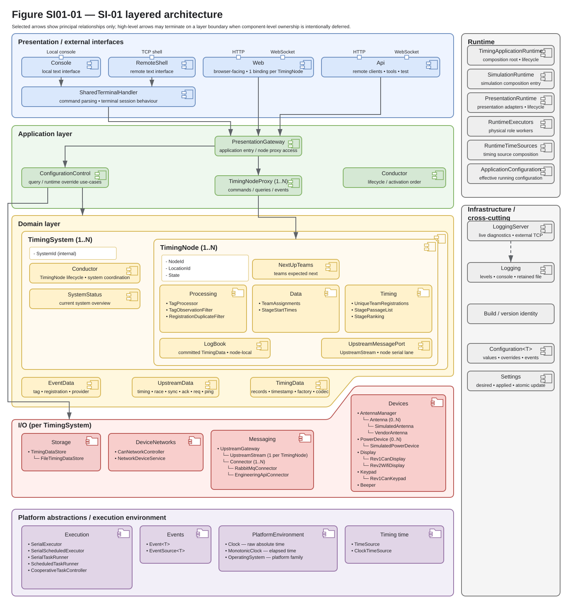
*Figure SI01-01 — SI-01 layered architecture.*

The source for this view is `docs/_diagrams/layered-architecture.yaml`.

Figure SI01-01 is the **logical view** of the 4+1 architecture:
its contained blocks name functional responsibilities (Processing, Registration,
RaceData, Data with LogBook, Upstream and NextUpTeams), not execution lanes.
The Data Lane, Task Lane, scheduled ingress and physical workers belong to the
**process view**, with implementation detail in SDD-02.

In Figure SI01-01, `TimingSystem` and `TimingNode` are shown as UML-style
component containers. They name architecture responsibilities, not UML class
declarations. A small neutral inner property block lists important identity/state
concepts without prescribing Java fields or a concrete class shape. Geometric
containment plus the `TimingNode (1..N)` label expresses that one TimingSystem
contains 1..N TimingNodes.

Domain and I/O have separate responsibilities, but a Domain component may
call an I/O component that belongs to the same TimingSystem. For example,
`TimingSystemConductor` calls its `AntennaManager` to request inventory;
AntennaManager handles device operations. The figure shows this relationship
without suggesting that I/O owns the TimingNode's state.

##### Presentation

Presentation owns client-facing interfaces and their external representations. Its structure is **functional interface first, transport second**:

```text
presentation/
  interfaces/
    console/
    shell/
    web/
    api/        primary API transport/message classes
  common/
    terminal/         behaviour genuinely shared by console + shell
```

In Figure SI01-01, a small port glyph on the outer edge of a Presentation
component denotes an externally visible interface of that **in-process SI-01
adapter**. Distinct externally meaningful endpoints are shown separately. Both Web and
API expose separate HTTP and WebSocket interface ports on their owning Presentation
component. These are architectural interface ports and do not by themselves imply that
HTTP and WebSocket must use different TCP port numbers. The lines from
Presentation components down toward `SharedTerminalHandler` or
`PresentationGateway` are ordinary in-process relationships, not sockets between
separate processes. `PresentationGateway` is an internal Application-layer component
and therefore has no external interface port.

<a id="Api"></a>

**Api — API**

The **API** is the general programmable interface of
the **Timing Point Application** (SI-01) for remote
clients, engineering tools and headless
black-box/integration tests. A06/A07 implement only its
first version/status/event slice; later supported control
and diagnostic operations grow inside the same functional
interface.

— — —

- **Type:** Architecture Element
- **Realizes:** [`IF03-REQ-001`](32-03-ISD-application-control-status.md#IF03-REQ-001), [`IF03-REQ-002`](32-03-ISD-application-control-status.md#IF03-REQ-002), [`IF03-REQ-004`](32-03-ISD-application-control-status.md#IF03-REQ-004), [`SI01-REQ-031`](41-01-SSD-timing-application-specification-document.md#SI01-REQ-031)
- **Elaborated by:** [`DD-ExecutableComposition`](43-01-SDD-02-java-component-design.md#DD-ExecutableComposition)

---


<a id="Web"></a>

**Web — Web**

**Web** is the browser-facing presentation interface of SI-01. Each configured
`TimingNode` has exactly one Web binding. That binding exposes an HTTP
request/response interface and a WebSocket live-update interface, shown as two
ports on the same Web component in Figure SI01-01. The binding targets that
TimingNode; concrete bind address/port settings remain Presentation configuration
and are not properties of the TimingNode domain aggregate. A multi-TimingNode
process therefore exposes 1..N Web bindings, each with the same HTTP + WebSocket
interface shape. Web may reuse application queries/events and transport
facilities, but it remains a separate browser-facing interface rather than being
collapsed into API.

— — —

- **Type:** Architecture Element

---


<a id="Console"></a>

**Console — Console**

`Console` is the local text presentation interface. It delegates common
terminal parsing/session behaviour to `SharedTerminalHandler` and reaches
application behaviour through the shared `PresentationGateway`; it does not own
application/domain state.

— — —

- **Type:** Architecture Element
- **Elaborated by:** [`DD-ExecutableComposition`](43-01-SDD-02-java-component-design.md#DD-ExecutableComposition)

---


<a id="RemoteShell"></a>

**RemoteShell — RemoteShell**

`RemoteShell` is the remote text presentation interface. It shares terminal
session behaviour with Console through `SharedTerminalHandler` while remaining
a separate external interface and transport concern.

— — —

- **Type:** Architecture Element
- **Elaborated by:** [`DD-ExecutableComposition`](43-01-SDD-02-java-component-design.md#DD-ExecutableComposition)

---


<a id="SharedTerminalHandler"></a>

**SharedTerminalHandler — SharedTerminalHandler**

`SharedTerminalHandler` owns command parsing and terminal-session behaviour that
is genuinely shared by Console and RemoteShell. It converges those interfaces on
the same `PresentationGateway` used by other presentation interfaces.

— — —

- **Type:** Architecture Element
- **Elaborated by:** [`DD-ExecutableComposition`](43-01-SDD-02-java-component-design.md#DD-ExecutableComposition)

---


`presentation.common` is reserved for behaviour genuinely shared across
presentation interfaces. Terminal behaviour shared by Console and RemoteShell
belongs under `presentation.common.terminal`. API HTTP, WebSocket and
wire-message mapping remain together at the `interfaces.api` component
package root while that implementation is still small; deeper transport/message
subpackages are introduced only when they contain a real cohesive decomposition.

Presentation converts external requests to application calls and application results to client representations. It does not own mutable application/domain state.

##### Application

The application responsibility coordinates use cases:

```text
application/
  ApplicationConductor
    application component lifecycle / activation order

  PresentationGateway
    shared presentation-facing application gateway

  TimingNodeProxy
    node-scoped presentation-facing application boundary

  ConfigurationControl
    configuration query/update use-cases
```

<a id="ApplicationConductor"></a>

**ApplicationConductor — Application Conductor**

`application.ApplicationConductor` starts complete TimingSystems in order and
stops them in reverse order. If startup fails, it stops those already started.
It does not control the AntennaManager or individual TimingNodes inside a system.
Each TimingSystem owns that graph and activates AntennaManager before its
TimingSystemConductor. The Application Conductor does not decide inventory state
or process tag observations.

— — —

- **Type:** Architecture Element

---


<a id="ConfigurationControl"></a>

**ConfigurationControl — Configuration control**

`ConfigurationControl` is the Application-layer use-case boundary for reading
running configuration and requesting validated runtime overrides. Presentation
interfaces call this boundary rather than mutating the Runtime configuration tree
or generic configuration values directly.

— — —

- **Type:** Architecture Element
- **Elaborated by:** [`DD-RunningConfiguration`](43-01-SDD-02-java-component-design.md#DD-RunningConfiguration)

---


<a id="PresentationGateway"></a>

**PresentationGateway — PresentationGateway**

`PresentationGateway` is the shared entry point for presentation
requests. It is owned by the Application layer; `Presentation` in the name identifies
the adjacent side whose traffic the gateway mediates, not the layer that owns it.
This uses the same directional naming principle as `UpstreamGateway`, while the two
remain separate responsibilities: `PresentationGateway` is transport-independent
application access and `UpstreamGateway` owns external upstream transport/integration.
The gateway exposes application-wide information such as `version()` and capabilities.
Application-wide component lifecycle is coordinated by `application.ApplicationConductor`.
Node-scoped work is exposed through `TimingNodeProxy`, so operations such as
`open(...)` belong to a selected TimingNode. The TimingSystem `Conductor` is
not a mandatory hop for normal node commands.

— — —

- **Type:** Architecture Element
- **Realizes:** [`IF03-REQ-001`](32-03-ISD-application-control-status.md#IF03-REQ-001), [`IF03-REQ-004`](32-03-ISD-application-control-status.md#IF03-REQ-004), [`SI01-REQ-022`](41-01-SSD-timing-application-specification-document.md#SI01-REQ-022), [`SI01-REQ-030`](41-01-SSD-timing-application-specification-document.md#SI01-REQ-030), [`SI01-REQ-031`](41-01-SSD-timing-application-specification-document.md#SI01-REQ-031)
- **Elaborated by:** [`DD-PresentationAccess`](43-01-SDD-02-java-component-design.md#DD-PresentationAccess)

---


<a id="TimingNodeProxy"></a>

**TimingNodeProxy — TimingNodeProxy**

`TimingNodeProxy` is the Application-layer boundary object for one addressed
`TimingNode`. The architectural multiplicity is therefore **1..N TimingNodeProxy
instances per application composition: one proxy per composed TimingNode**. The default
executable composition currently instantiates one TimingNode and therefore one proxy;
multi-node composition does not change the boundary shape. Each proxy exposes presentation-facing
node status, commands, bounded LogBook queries and post-fact events while keeping the
Domain `TimingNode` itself behind the Application boundary.

The proxy does not own mutable TimingNode state. It maps node status to the
node-scoped, presentation-facing `TimingNodeStatus`. Normal OPEN is
`open(LocationId)`; there is no separate Set Location presentation operation.

For presentation-triggered TimingData writes, the proxy builds the typed LogBook command
and uses the TimingNode's synchronous locked operation scope when that write must stay
ordered with OPEN/CLOSE. A new registration checks OPEN and reads the current LocationId
inside that scope. A revoke operation keeps the original LocationId and record values
supplied by the interpreting layer and does not gain a new OPEN requirement. LogBook reads
remain direct through the node's LogBook access boundary. This keeps TimingNode from
growing one public method for every future ADD/REV TimingData record family.

— — —

- **Type:** Architecture Element
- **Elaborated by:** [`DD-PresentationAccess`](43-01-SDD-02-java-component-design.md#DD-PresentationAccess)

---


Once code is executing for a TimingNode, normal direct Java calls are preferred;
do not introduce messages merely to preserve a layer diagram.

##### Domain

The domain owns timing semantics, per-TimingSystem system semantics and
TimingNode state. The main responsibilities are deliberately not represented as
one parent/child tree:

```text
TimingSystem (1..N per Application)
  SystemId                    internal only
  Conductor                   system coordinator; TimingNodes + inventory
  1..N TimingNode
    NodeId                    functional protocol/data identity
    LocationId
    State
    NextUpTeams               teams expected next
    processing
      TagProcessor
    registration
      ActiveRegistrations
      RegisteredTeams
    racedata
      TeamAssignments
      StageStartTimes
    data
      LogBook
        0..N TimingData
      Persistence
  Upstream
    NodeUpstream (1 per TimingNode)
      RaceData synchronization
      TimingData replay / synchronization
      Heartbeat

Shared Domain contracts
  EventData
  TimingData
    common semantic contracts
    configured concrete profile
    factory / codec / compatibility
  UpstreamData
    TimingData + reference data + synchronization/status
    configured representation / codec / compatibility
```

`TimingSystem` is a Domain component. One Timing Point Application hosts 1..N TimingSystems; each TimingSystem contains an internal `SystemId`, one `TimingSystemConductor`, 1..N TimingNodes and one `Upstream` responsibility with one `NodeUpstream` per TimingNode. `SystemId` exists to separate local runtime/simulation instances and is not assumed to be visible to the upstream peer. Upstream communication remains node-oriented: Messaging exposes one bidirectional node-scoped `UpstreamStream` to each `NodeUpstream`.

<a id="TimingSystemConductor"></a>

**TimingSystemConductor — TimingSystem Conductor**

One `domain.system.TimingSystemConductor` belongs to each TimingSystem.
It starts and stops the system's TimingNodes and decides whether antenna
inventory is needed. If any TimingNode is OPEN, it calls
`AntennaManager.setInventoryRequired(true)`; otherwise it passes `false`.
AntennaManager decides how to power, initialize and control the antennas.

When a TimingNode changes state, its event wakes the Conductor's task.
That task reads the nodes' **current** states before making a decision.
Multiple events can be handled by one task run. The Conductor does not
route tag observations or wait for the antenna hardware to respond.

— — —

- **Type:** Architecture Element
- **Realizes:** [`SI01-REQ-053`](41-01-SSD-timing-application-specification-document.md#SI01-REQ-053)
- **Elaborated by:** [`DD-CooperativeExecution`](43-01-SDD-02-java-component-design.md#DD-CooperativeExecution)

---


`TimingNode` is the per-location domain aggregate inside one `TimingSystem`. It owns its
identity (`NodeId` and `LocationId`), lifecycle/state and the per-node
components shown inside the TimingNode aggregate in Figure SI01-01.

A TimingNode owns two distinct bounded logical execution lanes, potentially
backed by the **same Runtime-owned physical ExecutorService**:

- **Data Lane:** the single writer of lifecycle/location TimingData records,
  TimingData sequence allocation, durable TimingData persistence and committed
  LogBook contents. TimingData commands and ORDERED LogBook/history reads execute
  here. Current TimingNode OPEN/CLOSED + LocationId state remains TimingNode-owned.
- **Task Lane:** the single writer of live RaceData and task-derived timing state:
  TeamAssignments, StageStartTimes and ActiveRegistrations. It owns
  task-derived timing views such as StageTiming. System-owned `NodeUpstream`
  coordinates upstream protocol work and calls the node service boundary when
  node state must be changed.

The two lanes have independent FIFO queues, admission, metrics and lifecycle.
Serialization is guaranteed **within** a lane, not between the two lanes.
Cross-lane state access therefore uses explicit bounded asynchronous commands
and immutable replies, or a safely published immutable CURRENT snapshot.
Neither lane may synchronously wait for work queued on the other lane when both
might share a one-worker pool. The contained data objects remain passive; they
do not receive individual execution threads or runners.

The LogBook keeps 0..N committed immutable TimingData values. Durable append
and LogBook visibility remain one ordered Data Lane transaction, with
recovery/failure semantics that prevent a later commit from overtaking a failed
one. After recovery and after each successful commit, the Data Lane publishes an
immutable TimingData fact/snapshot for Task Lane-derived state. The Task Lane
updates ActiveRegistrations and its timing views from those facts; it never
receives the mutable LogBook.

<a id="TimingSystemUpstream"></a>

**TimingSystemUpstream — TimingSystem Upstream**

One `Upstream` responsibility belongs to each TimingSystem. It contains one
`NodeUpstream` per TimingNode and owns the semantic protocol state that must remain
node-scoped: downstream DN_PACKET/RECV delivery,
TIMING_DATA SEQ/replay and PING/heartbeat state.

Each `NodeUpstream` consumes one bidirectional non-blocking `UpstreamStream`
provided by Messaging. The stream hides transport topology: a WebSocket connector may
use one full-duplex session, while a RabbitMQ connector may use several inbound queues
and a separate publisher. Those transport mechanics do not change NodeUpstream.

When a protocol operation changes TimingNode state, NodeUpstream calls the normal node
service boundary. Protocol ordering prevents a later inbound message from overtaking an
earlier message that is still awaiting node or LogBook work.

— — —

- **Type:** Architecture Element
- **Elaborated by:** [`DD-DomainIntegration`](43-01-SDD-02-java-component-design.md#DD-DomainIntegration)

---


<a id="NodeUpstream"></a>

**NodeUpstream — NodeUpstream**

One `NodeUpstream` belongs to one TimingNode within the TimingSystem-owned
`Upstream` component. It owns that node's semantic upstream protocol ordering:
downstream packet duplicate/RECV state, TimingData SEQ/TIMING_DATA_REQ replay
coordination, and heartbeat request/answer state.

NodeUpstream exchanges semantic UpstreamData only through its bidirectional
node-scoped `UpstreamStream`. It does not know whether the active connector uses
WebSocket, RabbitMQ or another transport. When an inbound protocol operation must
change node-owned state, NodeUpstream calls the normal NodeService boundary; retained
TimingData replay uses the node LogBook access boundary.

— — —

- **Type:** Architecture Element

---


<a id="NextUpTeams"></a>

**NextUpTeams — NextUpTeams**

`NextUpTeams` is the TimingNode-local ready-team registry defined by
SI01-REQ-060 / UC-005. It maintains the current teams preparing next, accepts
controlled add/remove changes from keypad or operator input through the TimingNode
state-change path, and keeps the required ready-team change history traceable
separately from participant TimingData. SI01-REQ-061 consumes this current state for
passive-display refresh/recovery. It remains separate from `TimingNodeData`
because it is not received RACE_DATA, and separate from `TimingNodeRegistration`
because it is not part of the active-WP registration projections.

— — —

- **Type:** Architecture Element

---


<a id="TimingNodeProcessing"></a>

**TimingNodeProcessing — TimingNode Processing**

`TimingNodeProcessing` groups the node-local registration processing capability.
It contains `TagProcessor` and its observation/duplicate filters. This group
explains code and execution ownership; it is not an additional runtime aggregate
or message bus.

— — —

- **Type:** Architecture Element

---


<a id="TimingNodeRaceData"></a>

**TimingNodeRaceData — TimingNode RaceData**

`RaceData` groups current node reference data: `TeamAssignments` and
`StageStartTimes`, received from ordered upstream RACE_DATA. It holds passive
data; ordering and execution ownership are defined in the process view.

— — —

- **Type:** Architecture Element

---


<a id="TimingNodeData"></a>

**TimingNodeData — TimingNode Data**

`Data` groups the node-local committed TimingData history under `LogBook`
and its persistence responsibility. It is a functional grouping, not a
separate Data Lane or worker. `TimingDataPersistence` and
`DefaultTimingDataPersistence` are detailed in SDD-02.

— — —

- **Type:** Architecture Element

---


<a id="TimingNodeRegistration"></a>

**TimingNodeRegistration — TimingNode Registration**

`TimingNodeRegistration` groups the active-WP registration projections shown as **Registration** in Figure SI01-01. `ActiveRegistrations` retains the chronological ADD/REV projection reconstructed from committed TimingData for the currently open WP. `RegisteredTeams` derives the current unique-team set from valid registrations plus current RaceData assignments. The LogBook remains the historical authority; these projections are rebuilt on OPEN and cleared on CLOSE.

— — —

- **Type:** Architecture Element

---


<a id="TagProcessor"></a>

**TagProcessor — TagProcessor**

`TagProcessor` owns TimingNode-local processing of decoded tag observations and
the registration semantics needed by the TimingNode. It resolves the semantic
TagId through EventData before registration-level duplicate suppression and
passage aggregation. Passage state is keyed by RegistrationId while preserving
per-TagId attribution for diagnostics/engineering inspection. It does not write
files from the antenna callback. State-changing registration work crosses the
TimingNode's bounded serial execution boundary and is completed by that node's
worker.

— — —

- **Type:** Architecture Element
- **Elaborated by:** [`DD-EventTagProcessing`](43-01-SDD-02-java-component-design.md#DD-EventTagProcessing), [`DD-RuntimeWorkAndMeasurements`](43-01-SDD-02-java-component-design.md#DD-RuntimeWorkAndMeasurements)

---


<a id="StageStartTimes"></a>

**StageStartTimes — StageStartTimes**

`StageStartTimes` is passive TimingNode-local live race state containing the
current `TeamId -> TimingTimestamp` values produced by accepted RACE_DATA SET/DEL
changes. A stage-start timestamp may contain time-of-day only, local date/time, or
an already absolute time. The state object owns data only; it never invents a
missing date or time zone. The TimingNode execution boundary owns mutation/order
and RegisteredTeams owns passage/elapsed-time interpretation.

— — —

- **Type:** Architecture Element

---


<a id="TeamAssignments"></a>

**TeamAssignments — TeamAssignments**

`TeamAssignments` is passive TimingNode-local live state populated by accepted
RACE_DATA messages. It maps `RegistrationId -> TeamId` where live assignment data
is needed and never overrides a stable TeamId supplied by EventData. SET/DEL
mutations occur on the owning TimingNode execution boundary and never rewrite
EventData or committed TimingData.

— — —

- **Type:** Architecture Element

---


<a id="ActiveRegistrations"></a>

**ActiveRegistrations — ActiveRegistrations**

`ActiveRegistrations` is the active-WP chronological registration projection for one
TimingNode. OPEN activates one LocationId, clears the previous projection and rebuilds
it from committed LogBook TimingData. Matching registration ADD records are retained in
original sequence order; matching REV records invalidate the corresponding retained
row without rewriting history. CLOSE deactivates and clears the projection.

The LogBook remains the complete historical authority. ActiveRegistrations owns no
persistence, RaceData assignment state or transport concerns.

— — —

- **Type:** Architecture Element

---


<a id="EventData"></a>

**EventData — EventData**

`EventData` is a shared Domain capability parallel to `TimingData`. A
configured EventData profile defines stable event-specific source/reference
semantics, including the 1..N relationship between `RegistrationId` and
`TagId`. SI-01 and engineering tools consume the common contract while an
event-specific typed provider/profile library supplies the concrete profile.
That provider may be discovered and loaded at Runtime through the same typed
extension architecture used for TimingData providers, without coupling the
EventData and TimingData provider families to each other. Live race state remains
separate TimingNode-local state populated by ordered RaceData messages.

— — —

- **Type:** Architecture Element
- **Elaborated by:** [`DD-EventTagProcessing`](43-01-SDD-02-java-component-design.md#DD-EventTagProcessing), [`DD-ExtensionAndComposition`](43-01-SDD-02-java-component-design.md#DD-ExtensionAndComposition)

---


<a id="RegisteredTeams"></a>

**RegisteredTeams — RegisteredTeams**

`RegisteredTeams` is the active-WP unique-team projection for one TimingNode.
It consumes actual ADD/REV validity transitions from `ActiveRegistrations` and
resolves them through the current RaceData RegistrationId-to-TeamId assignments.
Repeated passages change occurrence counts without duplicating team membership.

During LogBook reconstruction the projection is rebuilt silently. After catch-up,
only real zero-to-nonzero and nonzero-to-zero team membership transitions are
published. A later RaceData team-assignment change reaccounts existing active
occurrences without rewriting committed TimingData.

— — —

- **Type:** Architecture Element

---


`LogBook` is passive state contained by one TimingNode and keeps that node's
committed timing history as 0..N immutable `TimingData` values. Concrete objects
may come from different compatible TimingData profiles; LogBook does not maintain
a second logbook-specific record representation.

`EventData` is a separate SI-01/domain capability alongside `TimingData`.
EventData owns event-specific source/reference relationships; TimingData owns
committed timing facts. One RegistrationId may map from multiple TagIds. The
antenna/provider layer performs physical decoding/decryption but exposes a
semantic TagId to generic processing.

`TimingData` is the SI-01/domain capability that realises the system-owned
IF-05 TimingData Interchange contract. IF-05 defines the common semantic
contracts, identity/ordering rules and compatibility obligations. A configured
TimingData profile supplies the concrete immutable TimingData classes plus the
matching factory and codec.

A `TimingDataProvider` supplies that coherent profile family. Its factory is
stateless and constructs concrete TimingData values from explicit construction
values; it does not own TimingNode lifecycle policy, sequence allocation,
persistence or event publication. The same common provider/API boundary is
reusable by SI-01 and engineering tools such as the JavaFX Development Client;
normal domain users remain unaware of provider discovery mechanics.

`UpstreamData` is a shared Domain capability alongside `EventData` and
`TimingData`. It realises the semantic message model of IF-06 and is a small layer
above/around existing data models: it may carry canonical `TimingData` and also
reference-data, synchronization and status messages needed by upstream integration.
It does not create another TimingData identity or sequence.

An `UpstreamDataProvider` supplies one coherent concrete representation/codec
family. The built-in public/reference family is JSON-oriented; deployment-specific
representations may be supplied behind the same provider/codec boundary without
leaking their wire classes into public Domain/Application code.

`PlatformEnvironment` supplies the process/runtime environment capabilities used by
SI-01: a raw absolute wall-clock `Clock`, a `MonotonicClock` for elapsed-time
semantics and a normalized `OperatingSystem` identity used by Runtime composition.
Runtime composes the timing `TimeSource` from the wall-clock basis and decides which
Domain and I/O components share that source. The TimeSource contract itself is not tied
to TimingSystem or TimingNode. Platform-specific defaults use the normalized
operating-system identity rather than scattered JVM property checks.

Detailed domain semantics belong in `03-domain-baseline.md`.

##### Runtime execution model

Each TimingNode has two **logical serial responsibilities**. The Data Lane processes
LogBook commands and ordered history queries. The Task Lane runs cooperative node tasks
for startup, upstream messages and derived timing state. A lane/task runner is **not** a
thread.

The Data Lane uses `SerialLane<T>`. The Task Lane uses `SerialTaskRunner`.
Both use the same Runtime-owned single-worker `timingNodeExecutor`, but keep
independent bounded admission state. The runner submits each eligible cooperative task
step directly to that JDK scheduler; it does not introduce another `SerialLane`.

`RuntimeExecutors` creates and shuts down the physical executors. The current Java
implementation uses four executor roles:

```text
RuntimeExecutors
  timingNodeExecutor              (one scheduled worker)
    TimingNode A: Data Lane       (SerialLane<TimingNodeDataItem>)
    TimingNode A: Task Lane       (SerialTaskRunner)
    TimingNode B: Data Lane       (SerialLane<TimingNodeDataItem>)
    TimingNode B: Task Lane       (SerialTaskRunner)

  tagProcessorScheduledExecutor   (one scheduled worker)
    TagProcessor A                (SerialLane<TagObservation> + direct scheduled callbacks)
    TagProcessor B                (SerialLane<TagObservation> + direct scheduled callbacks)

  timingSystemConductorExecutor   (one scheduled worker)
    TimingSystem A Conductor      (SerialTaskRunner)
    TimingSystem B Conductor      (SerialTaskRunner)

  sharedIoScheduledExecutor       (one scheduled worker)
    AntennaManager                (SerialTaskRunner)
    other bounded I/O/simulation work
```

Components own their queues/tasks and mutable state. Runtime owns the physical workers.
Two logical lanes can take turns on one worker, but they cannot execute in parallel on
that worker. In particular, a slow LogBook write can delay Task Lane work that shares the
same node executor. Tag processing, system coordination and scheduled I/O use separate
executor roles for this reason.

The Java execution types have distinct jobs:

- `SerialLane<T>` keeps bounded typed items in FIFO order and processes them in bounded batches.
- `SerialTaskRunner` bounds pending cooperative steps and submits each eligible
  `YieldingTask` step directly to its supplied single-thread JDK scheduler.
- `TaskStep.AGAIN` submits the next step at the executor queue back.
- `TaskStep.AFTER` uses the JDK scheduler as a timer before the next step becomes eligible.
- `TaskStep.AWAIT` releases the worker and consumes no pending-step slot until an
  asynchronous completion becomes ready.
- `TaskStep.DONE` completes the task run.
- `AbstractTask` manages reusable run/wake/cancellation lifecycle while the concrete task owns its decisions.
- JDK `ScheduledExecutorService` callbacks may also run directly where no serial task queue is required; TagProcessor uses this for filter/housekeeping work on the same single thread as its observation lane.

For example, `TimingNode.MainTask` loads persisted LogBook data asynchronously after
node activation has returned. `TimingSystemConductor` uses a task to read current
OPEN/CLOSED state and tell AntennaManager whether inventory is required. AntennaManager
uses tasks for startup, inventory changes and shutdown.

A Task Lane must not synchronously wait for Data Lane work when both share a worker.
A task queues the Data Lane operation, returns `AWAIT`, and resumes only after the
completion is ready. Long network/device waits likewise must not occupy a shared worker
indefinitely.

Worker counts and priorities are **not** based on the number of TimingNodes or CPU cores.
The reference configuration starts with one worker for each role and default Java thread
priority. More workers require runtime measurements on the intended target. SDD-02
describes the concrete queues, runners and measurements.

##### I/O

I/O contains adapters that move data between the application and the outside world. Figure SI01-01 shows one logical I/O layer, but the runtime composition is per `TimingSystem`: with 1..N TimingSystems, the corresponding Storage/Devices/Messaging/DeviceNetworks composition is instantiated 1..N times unless a lower-level implementation explicitly multiplexes a shared physical resource.

```text
io/
  Devices
    AntennaManager
      Antenna (0..N)
        SimulatedAntenna
    PowerDevice (0..N)
      SimulatedPowerDevice
    Display
      Rev1CanDisplay
      Rev2WifiDisplay
    Keypad
      Rev1CanKeypad
    Beeper

  DeviceNetworks
    CanNetworkController
    NetworkDeviceService

  Messaging
    UpstreamGateway
      Connector (1..N)
        RabbitMqConnector
        SocketConnector

  Storage
    file
    db
```

Presentation stays separate because it owns client-facing API/view semantics.
I/O owns the external boundary and its mapping to TimingNodes. In Figure SI01-01
Domain and I/O both use explicit polygon outlines. The I/O outline rises around
Devices, so Devices remains completely inside its owning layer while being drawn
beside the lower Domain area. The normal I/O band and its Storage, Messaging and
DeviceNetworks cards stay compact because they no longer need to inherit the
height required by Devices. The contained Storage, Devices, Messaging and
DeviceNetworks elements carry packaging-component notation where the
package-like ownership/decomposition semantics are meaningful. For compactness,
Figure SI01-01 shows their contained software components as an indented hierarchy
rather than as nested component boxes.

<a id="Storage"></a>

**Storage — Storage**

`Storage` owns generic lower-layer persistence mechanisms plus backup/restore mechanics. Storage contracts are independent of higher Application/Domain types. TimingData-specific encoding, identity/sequence validation and commit semantics remain above Storage; Runtime composition connects that semantic persistence component to the selected generic file/database mechanism.

— — —

- **Type:** Architecture Element

---


<a id="Devices"></a>

**Devices — Devices**

`Devices` groups the software components that represent external device roles in
SI-01. A TimingSystem may be configured without RFID antennas. When one or more
antennas are configured, one `AntennaManager` coordinates that 1..N `Antenna`
set for the TimingSystem. Optional `PowerDevice` capabilities represent generic
installation-owned external power channels used by AntennaManager; they are peers of
the antenna/provider role rather than hidden vendor-driver behaviour.
`SimulatedAntenna` and `SimulatedPowerDevice` are the built-in
reference/simulation implementations.
`Display`, `Keypad` and `Beeper` name software-facing device roles; their
concrete variants remain subordinate to this package/component boundary.

— — —

- **Type:** Architecture Element

---


<a id="DeviceNetworks"></a>

**DeviceNetworks — DeviceNetworks**

`DeviceNetworks` owns communication/network responsibilities used to reach
devices. `CanNetworkController` owns CAN-bus lifecycle, discovery/scanning,
online state and CAN-device communication. `NetworkDeviceService` owns the
bidirectional network-device boundary for smart/network-attached devices.

Service discovery, connection/session handling and protocol framing are
subordinate design concerns of `NetworkDeviceService`, not peer high-level
components. The boundary is not Wi-Fi specific and does not own smart-display
rendering/domain behaviour.

— — —

- **Type:** Architecture Element

---


<a id="Messaging"></a>

**Messaging — Messaging**

`Messaging` owns the external upstream transport/session package. When upstream
messaging is configured it contains one `UpstreamGateway`; the gateway uses
1..N connectors and exposes one node-scoped `UpstreamStream` per `NodeUpstream`.
Concrete connectors own transport resources, delivery/session mechanics,
transport-specific addressing and any demultiplexing required when one physical
connection carries messages for multiple NodeIds.

The semantic `UpstreamData` model remains in Domain. Messaging transports and
decodes the configured UpstreamData representation without interpreting
`TimingData` fields or reimplementing synchronization/reference-data rules.
Each `NodeUpstream` consumes only its own node-scoped stream; no separate application-level router is required.

— — —

- **Type:** Architecture Element

---


#### Nested I/O component identities

The compact I/O cards in Figure SI01-01 keep their subordinate software
components as structured rows rather than expanding each component into a
separate box. The following rows are nevertheless stable architecture objects
and use the same engineering identity model as top-level diagram nodes.

<a id="AntennaManager"></a>

**AntennaManager — AntennaManager**

`AntennaManager` coordinates 1..N configured Antenna components for one
TimingSystem. If that TimingSystem has no configured antenna, no AntennaManager
is required.

— — —

- **Type:** Architecture Element
- **Elaborated by:** [`DD-AntennaRuntime`](43-01-SDD-02-java-component-design.md#DD-AntennaRuntime)

---


<a id="Antenna"></a>

**Antenna — Antenna**

`Antenna` is the software-facing RFID antenna/reader role consumed by
AntennaManager. Concrete vendor or simulated implementations remain behind this
role.

— — —

- **Type:** Architecture Element
- **Elaborated by:** [`DD-AntennaRuntime`](43-01-SDD-02-java-component-design.md#DD-AntennaRuntime)

---


<a id="PowerDevice"></a>

**PowerDevice — PowerDevice**

`PowerDevice` is the optional generic software-facing I/O capability for an
installation-owned external power channel. AntennaManager may use one to order
power-on, stabilization and power-off around self-test and normal operation. It remains
separate from `Antenna` because a relay, GPIO-controlled supply or other power device
is not part of the antenna vendor protocol and may be reusable for other device roles.

— — —

- **Type:** Architecture Element
- **Elaborated by:** [`DD-AntennaRuntime`](43-01-SDD-02-java-component-design.md#DD-AntennaRuntime)

---


<a id="SimulatedPowerDevice"></a>

**SimulatedPowerDevice — SimulatedPowerDevice**

`SimulatedPowerDevice` is the deterministic built-in implementation used with
`SimulatedAntenna` to verify powered/unpowered state, stabilization sequencing and
power-cycle behaviour without physical relay or reader hardware.

— — —

- **Type:** Architecture Element
- **Elaborated by:** [`DD-AntennaRuntime`](43-01-SDD-02-java-component-design.md#DD-AntennaRuntime)

---


<a id="SimulatedAntenna"></a>

**SimulatedAntenna — SimulatedAntenna**

`SimulatedAntenna` is the built-in controllable Antenna implementation used for
development, simulation and hardware-independent verification.

— — —

- **Type:** Architecture Element
- **Elaborated by:** [`DD-AntennaRuntime`](43-01-SDD-02-java-component-design.md#DD-AntennaRuntime)

---


<a id="VendorAntenna"></a>

**VendorAntenna — VendorAntenna**

`VendorAntenna` is the generic architecture role for an extension-provided
production Antenna implementation beside the built-in simulator. It establishes
that production/vendor implementations use the same Antenna contract and
AntennaProvider extension path; an actual vendor integration may receive a more
specific implementation name when selected.

— — —

- **Type:** Architecture Element

---


<a id="Display"></a>

**Display — Display**

`Display` is the software-facing output-device role for presenting timing
information without coupling Domain/Application behaviour to one physical
display generation or transport.

— — —

- **Type:** Architecture Element

---


<a id="Rev1CanDisplay"></a>

**Rev1CanDisplay — Rev1CanDisplay**

`Rev1CanDisplay` is the CAN-connected revision-1 implementation of the Display
role.

— — —

- **Type:** Architecture Element

---


<a id="Rev2WifiDisplay"></a>

**Rev2WifiDisplay — Rev2WifiDisplay**

`Rev2WifiDisplay` is the network-attached revision-2 implementation of the
Display role.

— — —

- **Type:** Architecture Element

---


<a id="Keypad"></a>

**Keypad — Keypad**

`Keypad` is the software-facing operator-input device role used for keypad
events without making the timing domain depend on a concrete bus implementation.

— — —

- **Type:** Architecture Element

---


<a id="Rev1CanKeypad"></a>

**Rev1CanKeypad — Rev1CanKeypad**

`Rev1CanKeypad` is the CAN-connected revision-1 implementation of the Keypad
role.

— — —

- **Type:** Architecture Element

---


<a id="Beeper"></a>

**Beeper — Beeper**

`Beeper` is the transport-neutral audible-feedback device role. A concrete
connection/implementation is selected only when required by deployment design.

— — —

- **Type:** Architecture Element

---


<a id="CanNetworkController"></a>

**CanNetworkController — CanNetworkController**

`CanNetworkController` owns CAN-bus lifecycle, discovery/scanning, online state
and CAN-device communication for the DeviceNetworks package.

— — —

- **Type:** Architecture Element
- **Elaborated by:** [`DD-IOComposition`](43-01-SDD-02-java-component-design.md#DD-IOComposition)

---


<a id="NetworkDeviceService"></a>

**NetworkDeviceService — NetworkDeviceService**

`NetworkDeviceService` owns the bidirectional boundary for
network-attached/smart devices, including data sent outward and device-originated
messages/events received inward.

— — —

- **Type:** Architecture Element
- **Elaborated by:** [`DD-IOComposition`](43-01-SDD-02-java-component-design.md#DD-IOComposition)

---


<a id="UpstreamGateway"></a>

**UpstreamGateway — UpstreamGateway**

`UpstreamGateway` is the Messaging-owned external upstream transport/session
boundary. It owns connector coordination and the mapping from configured connectors
to node-scoped `UpstreamStream` instances, but not UpstreamData semantics.

— — —

- **Type:** Architecture Element
- **Elaborated by:** [`DD-DomainIntegration`](43-01-SDD-02-java-component-design.md#DD-DomainIntegration)

---


<a id="UpstreamStream"></a>

**UpstreamStream — UpstreamStream**

`UpstreamStream` is the non-blocking bidirectional semantic mailbox presented by Messaging to
one `NodeUpstream`. It reports whether communication is available, exposes queued
inbound UpstreamData, and accepts outbound UpstreamData for transport. Real
RabbitMQ/API/socket I/O never blocks the TimingNode Data Lane.

— — —

- **Type:** Architecture Element
- **Elaborated by:** [`DD-DomainIntegration`](43-01-SDD-02-java-component-design.md#DD-DomainIntegration)

---


<a id="Connector"></a>

**Connector — Connector**

`Connector` is the transport/session role used 1..N times by UpstreamGateway.
Concrete connectors own transport resources, delivery/session mechanics and
transport-specific addressing.

— — —

- **Type:** Architecture Element

---


<a id="RabbitMqConnector"></a>

**RabbitMqConnector — RabbitMqConnector**

`RabbitMqConnector` is the RabbitMQ implementation of the Connector role for
production-shaped upstream messaging.

— — —

- **Type:** Architecture Element

---


<a id="EngineeringApiConnector"></a>

**EngineeringApiConnector — EngineeringApiConnector**

`EngineeringApiConnector` is the development/engineering implementation of the
Connector role. It carries the public/reference UpstreamData representation over the
existing full-duplex IF-03 upstream-role WebSocket so SI-02 can exercise the normal
upstream semantic path without direct access to SI-01 Domain objects.

— — —

- **Type:** Architecture Element

---


##### Platform

Platform contains reusable execution, time and event helpers.
It does not know about TimingNodes, devices or user interfaces.

```text
execution/
  ExecutionMetrics
  lanes/       SerialLane
  tasks/       SerialTaskRunner, YieldingTask, TaskStep, AbstractTask
events/        Event<T>, EventSource<T>
environment/   Clock, MonotonicClock, OperatingSystem
time/          TimeSource, ClockTimeSource
```

<a id="PlatformExecution"></a>

**PlatformExecution — PlatformExecution**

`PlatformExecution` provides the typed serial queue and cooperative task classes.
Runtime supplies their JDK executors.

— — —

- **Type:** Architecture Element
- **Elaborated by:** [`DD-CooperativeExecution`](43-01-SDD-02-java-component-design.md#DD-CooperativeExecution), [`DD-RuntimeExecution`](43-01-SDD-02-java-component-design.md#DD-RuntimeExecution), [`DD-RuntimeWorkAndMeasurements`](43-01-SDD-02-java-component-design.md#DD-RuntimeWorkAndMeasurements)

---


<a id="SerialLane"></a>

**SerialLane — SerialLane**

`SerialLane<T>` admits bounded typed items and processes them FIFO with one fixed worker
scheduled on an externally owned executor. It owns queue/backpressure/metrics, not a thread
or domain result policy.

— — —

- **Type:** Architecture Element
- **Elaborated by:** [`DD-RuntimeExecution`](43-01-SDD-02-java-component-design.md#DD-RuntimeExecution)

---


<a id="SerialTaskRunner"></a>

**SerialTaskRunner — SerialTaskRunner**

`SerialTaskRunner` independently bounds pending cooperative task steps and submits each
eligible `YieldingTask` step directly to its Runtime-supplied single-thread JDK scheduler.
`AGAIN` submits a continuation at the executor queue back; `AFTER` and `AWAIT` consume no
pending-step slot while waiting.

— — —

- **Type:** Architecture Element
- **Elaborated by:** [`DD-CooperativeExecution`](43-01-SDD-02-java-component-design.md#DD-CooperativeExecution), [`DD-RuntimeExecution`](43-01-SDD-02-java-component-design.md#DD-RuntimeExecution)

---


<a id="YieldingTask"></a>

**YieldingTask — YieldingTask**

A `YieldingTask` supplies one `runStep()` method. Each invocation performs one
cooperative step and returns the continuation decision.

— — —

- **Type:** Architecture Element
- **Elaborated by:** [`DD-CooperativeExecution`](43-01-SDD-02-java-component-design.md#DD-CooperativeExecution)

---


<a id="TaskStep"></a>

**TaskStep — TaskStep**

`TaskStep` tells `SerialTaskRunner` whether to re-admit now (`AGAIN`), after a delay
(`AFTER`), after an asynchronous completion (`AWAIT`), or finish (`DONE`).

— — —

- **Type:** Architecture Element
- **Elaborated by:** [`DD-CooperativeExecution`](43-01-SDD-02-java-component-design.md#DD-CooperativeExecution)

---


<a id="AbstractTask"></a>

**AbstractTask — AbstractTask**

`AbstractTask` provides reusable run, wake and cancellation handling. The concrete task
owns its operation state and decisions.

— — —

- **Type:** Architecture Element
- **Elaborated by:** [`DD-CooperativeExecution`](43-01-SDD-02-java-component-design.md#DD-CooperativeExecution)

---


<a id="PlatformEvents"></a>

**PlatformEvents — PlatformEvents**

`PlatformEvents` supplies the small typed `Event<T>` / `EventSource<T>` local-event mechanism used for
post-fact notifications. Event instances remain owned by the component that
publishes them; Platform does not provide a central event bus.

— — —

- **Type:** Architecture Element
- **Elaborated by:** [`DD-TimingNodeExecution`](43-01-SDD-02-java-component-design.md#DD-TimingNodeExecution)

---


<a id="Event"></a>

**Event — Event**

`Event<T>` is the owned typed local publisher used for synchronous post-fact
notification within the process.

— — —

- **Type:** Architecture Element
- **Elaborated by:** [`DD-TimingNodeExecution`](43-01-SDD-02-java-component-design.md#DD-TimingNodeExecution)

---


<a id="EventSource"></a>

**EventSource — EventSource**

`EventSource<T>` is the subscription-only view exposed by an event owner so
consumers cannot publish through the source reference.

— — —

- **Type:** Architecture Element
- **Elaborated by:** [`DD-TimingNodeExecution`](43-01-SDD-02-java-component-design.md#DD-TimingNodeExecution)

---


<a id="PlatformEnvironment"></a>

**PlatformEnvironment — PlatformEnvironment**

`PlatformEnvironment` is the small process/platform boundary composed by Runtime.
It provides the raw absolute wall-clock `Clock`, the `MonotonicClock` used for
elapsed time, timeouts, filtering windows and metrics, and a normalized
`OperatingSystem` family for platform-dependent Runtime composition defaults.
It is deliberately not a general service locator for filesystem, networking or
other OS facilities.

— — —

- **Type:** Architecture Element
- **Elaborated by:** [`DD-TimingTimeComposition`](43-01-SDD-02-java-component-design.md#DD-TimingTimeComposition)

---


<a id="MonotonicClock"></a>

**MonotonicClock — MonotonicClock**

`MonotonicClock` supplies process-local elapsed time for delays, timeouts,
filtering windows and metrics. It is never used as a persisted/event timestamp.

— — —

- **Type:** Architecture Element

---


<a id="OperatingSystem"></a>

**OperatingSystem — OperatingSystem**

`OperatingSystem` is the normalized platform-family identity used by Runtime
when selecting platform-dependent composition defaults.

— — —

- **Type:** Architecture Element

---


<a id="PlatformTime"></a>

**PlatformTime — PlatformTime**

`PlatformTime` groups the shared absolute timing-time capability below Domain
and I/O. Runtime selects/composes the concrete source; this grouping owns no
TimingSystem, TimingNode or device state.

— — —

- **Type:** Architecture Element
- **Elaborated by:** [`DD-TimingTimeComposition`](43-01-SDD-02-java-component-design.md#DD-TimingTimeComposition)

---


<a id="TimeSource"></a>

**TimeSource — TimeSource**

`TimeSource` is the shared lower-level capability for semantic absolute timing time.
It exposes an absolute `Instant` without importing TimingData/domain types. Domain and
I/O components consume it when they must use the same timing basis.
The type itself has no TimingSystem/TimingNode ownership; Runtime composition chooses
which components receive the same instance.

— — —

- **Type:** Architecture Element
- **Elaborated by:** [`DD-TimingTimeComposition`](43-01-SDD-02-java-component-design.md#DD-TimingTimeComposition)

---


<a id="ClockTimeSource"></a>

**ClockTimeSource — ClockTimeSource**

`ClockTimeSource` is the baseline `TimeSource` implementation backed by the raw
`PlatformEnvironment` wall clock. It applies no timing correction itself.

— — —

- **Type:** Architecture Element
- **Elaborated by:** [`DD-TimingTimeComposition`](43-01-SDD-02-java-component-design.md#DD-TimingTimeComposition)

---


##### Runtime and infrastructure

The right-hand side of the layered view separates two technical responsibilities:

- **Runtime** — `TimingApplicationRuntime` as the top-level composition/lifecycle owner, its child `PresentationRuntime`, Runtime-owned physical execution resources and the concrete running configuration tree;
- **Infrastructure / cross-cutting** — supporting facilities such as logging, diagnostics, build identity, typed configuration, configuration mapping and extension discovery.

<a id="ApplicationConfiguration"></a>

**ApplicationConfiguration — Application configuration**

`ApplicationConfiguration` is the concrete Runtime configuration tree for the
currently composed SI-01 process. It contains typed branches such as per-TimingNode
configuration and references Infrastructure configuration values, but it does not
own external YAML parsing or presentation-facing control use-cases.

— — —

- **Type:** Architecture Element
- **Elaborated by:** [`DD-RunningConfiguration`](43-01-SDD-02-java-component-design.md#DD-RunningConfiguration)

---


<a id="Configuration"></a>

**Configuration — Typed configuration values**

`Configuration<T>` represents the reusable Infrastructure responsibility for
typed startup/current values, validated runtime override state and post-change
notification. These mechanics contain no knowledge of TimingNode, TagProcessor,
IF-11 paths or IF-03 routes.

— — —

- **Type:** Architecture Element
- **Elaborated by:** [`DD-RunningConfiguration`](43-01-SDD-02-java-component-design.md#DD-RunningConfiguration)

---


##### Cross-cutting concerns

Cross-cutting technical concerns include logging, diagnostics, metrics and
build/version identity. In Java, `infra` is reserved for concrete cross-cutting
support such as `BuildIdentity`; it is not the I/O layer.

<a id="Logging"></a>

**Logging — Logging**

`Logging` is reusable runtime logging infrastructure owned by the core artifact. Reusable
application-core/domain code emits records through SLF4J; the default executable selects
`slf4j-jdk14 -> java.util.logging` and starts the core-provided logging composition.
Logging owns backend/sink lifecycle and the current global logging level; it does not own
application or domain state.

— — —

- **Type:** Architecture Element
- **Elaborated by:** [`DD-LoggingRuntime`](43-01-SDD-02-java-component-design.md#DD-LoggingRuntime)

---


<a id="LoggingServer"></a>

**LoggingServer — LoggingServer**

`LoggingServer` is the optional external engineering interface for live log records and
temporary global-level control. The engineering client initiates the connection. This
logging-specific TCP boundary is separate from the IF-03 API/status/event
interface and live delivery remains best effort.

— — —

- **Type:** Architecture Element
- **Elaborated by:** [`DD-LoggingRuntime`](43-01-SDD-02-java-component-design.md#DD-LoggingRuntime)

---


`TimingApplicationRuntime` owns concrete knowledge of the running application graph. Infrastructure remains supporting/cross-cutting: the default YAML loader maps deployment input to effective runtime configuration, logging and diagnostics provide technical services, and extension discovery supplies selected implementations. The executable supplies the configuration path rather than owning the parser. `LoggingServer` depends on the narrow `Logging` surface for level control/common formatting; `Logging` does not depend on or own `LoggingServer`.

#### Principal runtime abstractions

<a id="TimingSystem"></a>

**TimingSystem — TimingSystem**

A `TimingSystem` is a Domain component.
One **Timing Point Application** (SI-01) may host 1..N TimingSystems, for example
to run multiple independent simulation contexts. Each TimingSystem contains one
`TimingSystemConductor` and 1..N TimingNodes, and uses associated I/O components
such as `AntennaManager`. Its internal `SystemId` is not
assumed to be part of the upstream wire contract; current upstream routing resolves
the globally configured `NodeId` target at application scope.

— — —

- **Type:** Architecture Element
- **Elaborated by:** [`DD-DomainIntegration`](43-01-SDD-02-java-component-design.md#DD-DomainIntegration), [`DD-IOComposition`](43-01-SDD-02-java-component-design.md#DD-IOComposition)

---


<a id="TimingNode"></a>

**TimingNode — TimingNode**

A `TimingNode` is the independently addressed operational/domain
component at one timing location. It belongs to exactly one `TimingSystem`
and owns composition and lifecycle of its children. It exposes the public
command/query/event facade but does not itself execute serial data or protocol
tasks. The upstream and TimingData contracts remain centred on `NodeId`.

— — —

- **Type:** Architecture Element
- **Realizes:** [`SI01-REQ-003`](41-01-SSD-timing-application-specification-document.md#SI01-REQ-003), [`SI01-REQ-020`](41-01-SSD-timing-application-specification-document.md#SI01-REQ-020), [`SI01-REQ-021`](41-01-SSD-timing-application-specification-document.md#SI01-REQ-021), [`SI01-REQ-024`](41-01-SSD-timing-application-specification-document.md#SI01-REQ-024)
- **Elaborated by:** [`DD-RuntimeWorkAndMeasurements`](43-01-SDD-02-java-component-design.md#DD-RuntimeWorkAndMeasurements), [`DD-TimingNodeExecution`](43-01-SDD-02-java-component-design.md#DD-TimingNodeExecution)

---


<a id="LogBook"></a>

**LogBook — LogBook**

A `LogBook` is passive state contained by one TimingNode.
It holds that node's committed immutable `TimingData` values.
The current design does not introduce a second
logbook-specific timing-record representation.

— — —

- **Type:** Architecture Element
- **Elaborated by:** [`DD-TimingNodeExecution`](43-01-SDD-02-java-component-design.md#DD-TimingNodeExecution)

---


<a id="TimingData"></a>

**TimingData — TimingData**

`TimingData` is the shared Domain capability that realises
system-owned IF-05 inside SI-01. It exposes the typed
common `TimingData` semantic interfaces plus configured factory/codec services needed
by application code. Canonical record/file semantics and
compatibility remain defined by IF-05; Storage, Web and upstream
integration code consume that contract without redefining it.

— — —

- **Type:** Architecture Element
- **Elaborated by:** [`DD-ExtensionAndComposition`](43-01-SDD-02-java-component-design.md#DD-ExtensionAndComposition), [`DD-TimingDataProfiles`](43-01-SDD-02-java-component-design.md#DD-TimingDataProfiles)

---


<a id="UpstreamData"></a>

**UpstreamData — UpstreamData**

`UpstreamData` is the shared Domain capability that realises IF-06 inside SI-01.
It may carry canonical TimingData plus reference-data, synchronization and status
messages. Its representation/codec boundary is independent from connector transport;
the public/reference representation is JSON-oriented.

— — —

- **Type:** Architecture Element
- **Elaborated by:** [`DD-DomainIntegration`](43-01-SDD-02-java-component-design.md#DD-DomainIntegration)

---


The architecture deliberately uses **separate views** for software/domain decomposition, hardware/deployment topology and configuration/identity mapping. These views must not be collapsed into one ownership tree.

##### Software/domain decomposition

```text
Application
  +-- ApplicationId
  +-- Conductor                 application lifecycle / activation order
  |
  +-- 1..N TimingSystem
        +-- SystemId            internal composition/simulation identity
        +-- Conductor           system-local coordination / inventory
        +-- 1..N TimingNode
              +-- NodeId        functional upstream/timing-data identity
              +-- LocationId
              +-- lifecycle / status
              +-- Upstream                 node-scoped protocol handling
              +-- NextUpTeams            teams expected next
              +-- processing
              |     +-- TagProcessor
              +-- racedata
              |     +-- TeamAssignments
              |     +-- StageStartTimes
              +-- timing
              |     +-- ActiveRegistrations
              |     +-- RegisteredTeams
              |     +-- RegisteredTeams
              +-- Data
                    +-- LogBook
                    |     +-- 0..N TimingData
                    +-- Persistence

Shared Domain contracts:
  +-- EventData
  +-- TimingData
  +-- UpstreamData
```

`ApplicationId` identifies the running Timing Point Application instance. `SystemId` is an internal identity used only to distinguish 1..N hosted TimingSystem contexts. `NodeId` remains the functional identity used by TimingData and upstream node addressing and scopes the node's registration sequence and synchronisation semantics. `LocationId` is the separately configured physical event location. The upstream contract therefore does not gain a TimingSystem identifier merely because one process can host multiple systems.

<a id="fig-si01-02"></a>
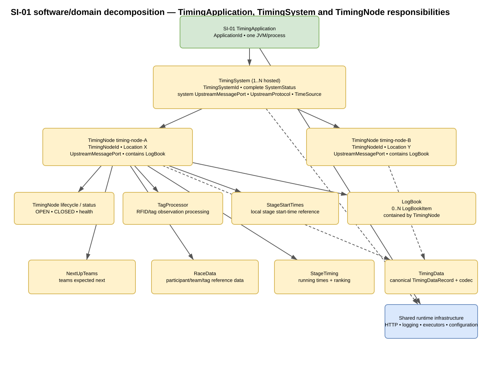
*Figure SI01-02 — SI-01 software/domain decomposition.*

The exact Java class/package boundaries may evolve as implementation evidence appears, but the `TimingNode` aggregate is the semantic owner of the operational TimingNode state. The physical registration asset is not a child component of this software tree.

##### Devices and device-network topology

The high-level I/O model separates device concepts from the communication
responsibilities that serve them:

```text
Devices
  +-- Antenna (0..N)
  +-- Rev1CanDisplay
  +-- Keypad
  +-- Beeper
  +-- Rev2WifiDisplay

Device Networks
  +-- CanNetworkController
  +-- NetworkDeviceService
```

An `Antenna` remains an I/O source with its own `AntennaId` and concrete
driver/connection settings. Grouping it under Devices does not change its
TimingNode routing semantics: one antenna may intentionally feed one or more
TimingNodes.

`CanNetworkController` represents the actively managed CAN network rather than
one particular CAN device. `NetworkDeviceService` represents the general
bidirectional service boundary for network-attached devices. It may support
outbound SI-01 data and inbound device requests/events without requiring the
device/domain object itself to know about sockets, discovery or transport
sessions.

The current smart-display direction remains client initiated: SI-01 makes its
service discoverable and Rev2WifiDisplay connects to it. The exact discovery,
listener/session and packet-framing design belongs below this high-level view.

##### Configuration, routing and identity mapping

Configuration connects identities without collapsing them:

```text
Application
    +-- ApplicationId

Devices
    +-- Antenna (0..N)
    |     +-- each Antenna -> 1..N NodeId
    +-- Rev1CanDisplay
    +-- Keypad
    +-- Beeper
    +-- Rev2WifiDisplay

Device Networks
    +-- CanNetworkController
    +-- NetworkDeviceService

Messaging
    +-- UpstreamGateway
          +-- UpstreamStream (1 per NodeUpstream)
          +-- Connector (1..N)
                +-- RabbitMqConnector
                +-- EngineeringApiConnector
```

<a id="fig-si01-03"></a>
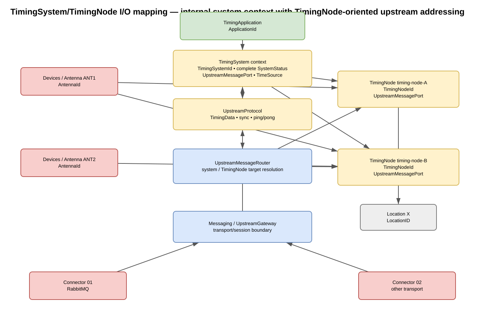
*Figure SI01-03 — TimingNode, hardware and upstream-system messaging routing.*

`NodeId` is the stable identity of a `TimingNode`, uses exactly one character `A`..`Z` or `1`..`9`, and scopes its sequence, persistence and synchronisation semantics. `LocationId` is a separate namespace. `AntennaId` is also separate and uses one digit `1`..`9`.

Configured antenna mappings associate each `AntennaId` with one or more TimingNodes. Fan-out is explicit: if one antenna feeds two TimingNodes, each target TimingNode processes the observation through its own serialized state boundary and keeps its own NodeId-scoped sequence/state while the original `AntennaId` remains available as context.

CAN and smart-network controllers are not alternate presentation layers. They are
I/O/device-network responsibilities. A keypad, beeper or display may interact with or present information
to a human, but it is still an external device from SI-01's architecture
perspective.

`UpstreamGateway` is the I/O upstream-messaging boundary. It routes semantic
UpstreamData between configured connectors and one bidirectional node-scoped
`UpstreamStream` per `NodeUpstream`. Transport connectors do not need a
TimingSystem abstraction to address a node, and no external `SystemId` field is
required.

Connectors do not own domain semantics. A connector-specific external name or
routing key may participate in NodeId demultiplexing, but it does not replace the
stable functional `NodeId`. Internal `SystemId` is local composition context
rather than a new upstream routing identity. One gateway may use multiple
connectors. `RabbitMqConnector` represents the production-shaped transport and
may use asymmetric broker resources internally; `EngineeringApiConnector`
provides the engineering transport over one full-duplex WebSocket. Both preserve
the same UpstreamData/gateway/stream boundary.

`ApplicationId` remains a runtime/application identity and is not assumed to be an upstream address. System-level upstream exchanges are scoped by the configured TimingSystem/gateway context; TimingNode-specific exchanges remain addressed by `NodeId`.

Runtime-wide infrastructure may be shared where that does not leak mutable TimingNode state. The Java baseline shares physical execution workers by functional role while each TimingNode keeps its own bounded serial command lane and node-local TagProcessor state. Logging infrastructure, HTTP server infrastructure, connector infrastructure, configuration loading and network monitoring may likewise be shared where their semantics remain isolated.

Stable domain facts behind these views are maintained in `03-domain-baseline.md`; this SSD owns their software-architecture composition and execution implications.

#### Command, query and event model

All presentation transports converge on one shared application model. The Java design uses a deliberately small `PresentationGateway.version()` query rather than a generic messaging framework; request methods are added only when a concrete client use case requires them.

```text
local console ----------------+
remote shell -----------------+
API HTTP/JSON ---------+--> typed command/query boundary --> application runtime
API WebSocket <---------+<--------------------------------------------+
optional Web interface --------+
```

Working rules:

- commands request state changes;
- a state-dependent command may wait for the domain result produced when that command reaches the TimingNode's ordered execution path;
- submission-only ingress is explicit: acceptance means only that bounded work was accepted for later processing;
- queries do not become alternate owners of state; current observation may use an immutable published snapshot, while reads that require sequencing run on the TimingNode's ordered path;
- events report facts/results that have occurred;
- queue admission, domain result and caller wait timeout are different outcomes and shall not be represented as though they mean the same thing;
- a caller timeout does not prove rejection or rollback of already accepted work; until state is queried or another result is observed, the final outcome is unknown to that caller;
- external protocol DTOs are mapped at the presentation/I/O boundary rather than used as the internal domain model;
- messages crossing thread/process boundaries should be immutable where practical;
- post-fact notifications may use a small typed `Event<T>` abstraction with explicit `subscribe` / `unsubscribe` / `emit`; commands and queries are not routed through that mechanism.

The event mechanism is deliberately local and simple. The generic `Event<T>`
mechanism is a small reusable Platform primitive; a producing component owns a concrete
event such as `timingDataCommittedEvent : Event<TimingData>` and interested listeners
subscribe directly to that event. There are no string topics, central event
dispatcher or global static bus. Emitting an event reports that a fact has
already occurred; it does not transfer ownership of TimingNode state.

#### Process view: ordering and concurrency

SI-01 receives work from several places at once: operator interfaces, devices,
timers and upstream connections. State changes for one `TimingNode` still have
to happen in a clear order.

The process view refines the logical TimingNode component into execution
ownership. These two lanes are not additional functional subsystems in Figure SI01-01.
SDD-02 describes how `LogBook`, `NodeService` and their `SerialLane`
adapters implement them.

<a id="TimingNodeDataLane"></a>

**TimingNodeDataLane — TimingNode Data Lane**

The Data Lane handles normal ordered `LogBook` commands and queries plus durable
TimingData commits. `TimingNodeDataLane` owns the typed
`SerialLane<TimingNodeDataItem>`; `LogBookDataLane` owns command/query completion and
bounded result waiting. Persisted-data recovery is not a Data Lane item: it runs from
`TimingNode.MainTask` on the same physical node worker after Data Lane admission has
started. The lane publishes committed TimingData through events and does not own live
RaceData or a separate worker thread.

— — —

- **Type:** Architecture Element

---


<a id="TimingNodeTaskLane"></a>

**TimingNodeTaskLane — TimingNode Task Lane**

The Task Lane is the TimingNode's `SerialTaskRunner`. It handles node startup work,
live RaceData, derived timing state and node-scoped upstream messages. `NodeService`
submits one-step tasks directly to that runner; multi-step tasks may yield, delay or
`AWAIT` asynchronous work. Task-owned code consumes committed TimingData events and
ordered LogBook requests rather than reading LogBook mutable data directly. It never
waits synchronously for Data Lane work when both lanes share one worker.

— — —

- **Type:** Architecture Element

---


Architecture rules:

- callbacks do not change TimingNode state directly;
- resolve the target TimingNode before state-dependent work enters its ordered path;
- code outside a TimingNode does not directly inspect or mutate that node's mutable state;
- two mutations of the same lane-owned state do not run over each other;
- each TimingNode has a Data Lane for TimingData/LogBook ownership and a Task
  Lane for RaceData, derived timing and protocol coordination;
- Data Lane recovery/commit publishes immutable TimingData facts to the Task
  Lane; no mutable LogBook object crosses that boundary;
- state-dependent validation is performed on the lane that owns that state,
  not from a stale pre-queue read;
- LogBook, TeamAssignments, StageStartTimes, ActiveRegistrations and
  EventData remain passive objects and do not each receive their own execution
  thread;
- short read operations may capture immutable snapshots for longer calculations outside the Data Lane;
- different TimingNodes may make progress at the same time;
- file writes must not hold up RFID/device/operator callbacks;
- a slow query or ranking calculation must not hold up LogBook commits;
- a slow network connection must not hold up a local commit;
- queues/resources are bounded and overload is visible instead of silently dropping work;
- during shutdown, stop new input first and give accepted work time to finish.

The primary latency risk is therefore **producer backpressure**, not whether every TimingNode operation is asynchronous. Device/RFID/TagProcessor ingress must use the submission-only path and return after bounded-queue admission; it does not wait for persistence or a domain result. Presentation/application callers may use a result-bearing command path when they need that result.

ORDERED queries execute on the lane that owns the queried mutable state.
LogBook/history queries therefore use the Data Lane; RaceData and derived
StageTiming queries use the Task Lane. CURRENT queries may instead read an
explicit safely published immutable representation without entering a lane.
Mutable LogBook traversal remains Data Lane-ordered. Longer
ranking/formatting work must not become a second writer or unboundedly hold up
TimingData commits. Synchronous persistence may occupy the Data Lane; its impact
is controlled through bounded queues and observable queue/store latency.

Post-commit listeners are subject to the same rule: network/backpressure work must not execute synchronously on the Data Lane unless the adapter is proven to enqueue/buffer and return promptly.

The SSD only sets these rules. SDD-01 describes state ordering, persistence and
consumer visibility. SDD-02 chooses the Java queue/worker implementation. The
current direction is the Active Object pattern implemented by composition, not a
mandatory `TimingNode extends ActiveObject` class hierarchy.

External ingress still keeps its functional routing responsibilities:

- `PresentationGateway` exposes application-wide presentation metadata/capabilities and node proxies;
- `TimingNodeProxy` exposes node-scoped presentation operations, reads and events;
- configured device/antenna mappings resolve device observations to TimingNodes;
- scheduled work retains its owning target.

There is no central dispatcher through which commands and queries must pass. Components may expose local typed events such as `timingDataCommittedEvent` for post-fact notification; those events are not the owner or execution path for TimingNode state.

<a id="fig-si01-04"></a>
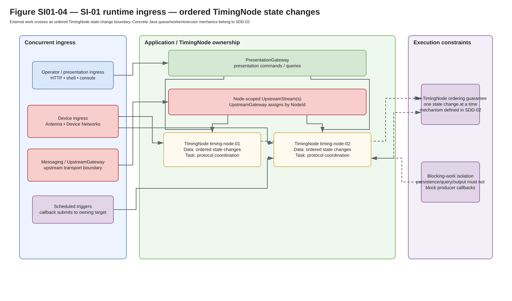
*Figure SI01-04 — Concurrent ingress resolves to ordered TimingNode state-change boundaries; concrete execution mechanics belong to detailed design.*

The source for this process view is
`docs/_diagrams/runtime-dispatch-process.yaml`.

#### Time and clock architecture

Time is an explicit architecture concern rather than an incidental use of `Date`, `Calendar`, `LocalDateTime`, Java/SQL timestamp classes or raw millisecond values throughout the codebase.

##### `TimingTimestamp` value

The **Timing Point Application** (SI-01) uses one dedicated immutable application/domain class named `TimingTimestamp` for semantically meaningful timing values. The same type can represent different levels of known temporal information: local time-of-day only, local date/time, or an absolute point on the UTC time line. Missing date, zone or offset information remains explicitly unknown and shall not be invented merely to construct a timestamp.

Working semantics:

- `TimingTimestamp` records which temporal information is known;
- `TIME_ONLY` means local time-of-day is known while the calendar date is not;
- `LOCAL_DATE_TIME` means local date and time are known while zone/offset is not;
- `ABSOLUTE` identifies one absolute point on the UTC-based time line;
- conversion or resolution that requires missing date/zone context happens only in the domain or integration behaviour that owns that context;
- domain/application APIs pass `TimingTimestamp` rather than unrelated `LocalTime`, `LocalDate`, `Instant`, raw `long`, `Date` or generic Java timestamp values as parallel representations of the same semantic time.

The dedicated class may internally use suitable `java.time` primitives, but its public semantic contract remains project-owned. Protocol-specific formatting, accepted forms and output precision remain profile/codec responsibilities. IF-05 requires absolute timestamps. IF-06 and event-specific upstream profiles may validly supply a time-only `TimingTimestamp`. A codec therefore maps the external representation to the generic value without inventing a date or time zone.

When a race/stage start is defined only by local time-of-day, elapsed-time calculation shall resolve that clock time against the accepted registration timestamp using the configured event/race time zone. The resolved start is the most recent valid occurrence of that time-of-day that is not after the registration. This deliberately supports one civil-day rollover: a start at `23:59:50` followed by a registration at `00:00:10` resolves to an elapsed time of 20 seconds rather than a negative value. If an explicit start date is supplied, that date is authoritative. A time-only definition cannot by itself distinguish elapsed durations of 24 hours or more; such cases require an explicit date or another higher-level race-day reference.

##### Time sources

SI-01 separates the raw process/platform clocks from the timing-time source used
by timing components.

```text
PlatformEnvironment
  Clock
    raw absolute wall-clock basis
        |
        v
  Runtime composition
        |
        +--> TimeSource
        |      shared absolute timing basis
        |      observation/event timestamps
        |      recordedAt / persistence semantics
        |
        +--> MonotonicClock
               elapsed time only
               filtering windows
               scheduling delays
               timeouts / metrics
```

`TimeSource` is a lower-level timing capability usable by both Domain and I/O.
Its Java type does not encode whether one instance belongs to one TimingNode,
one future TimingSystem or another composition scope. Runtime decides that
sharing explicitly. When multiple TimingNodes and their devices must use the
same programmed/corrected time basis, Runtime supplies the same TimeSource
instance to those components.

The current baseline `ClockTimeSource` simply exposes corrected absolute `Instant`
values derived from `PlatformEnvironment.clock()`. A consuming Domain/I/O semantic
boundary converts that instant to `TimingTimestamp` when the timing-data model requires it. A later synchronization/correction design may
replace it with a TimeSource that applies a programmable correction without
changing consumers. That correction is not applied to `MonotonicClock`.

The raw wall clock may be controlled by simulation composition when a
deterministic scenario requires it. Monotonic values are process-local and are
never persisted as event timestamps. Device/provider code that must attach a
timestamp at the earliest accepted decoded-observation point uses the composed
TimeSource rather than bypassing it through the raw platform Clock, unless the
device supplies its own trustworthy source timestamp.


##### Architecture risk — wall-clock discontinuity and local-time ambiguity

This is an explicit architecture risk because timing software can produce plausible but incorrect results when local civil time and elapsed time are conflated.

| Risk | Possible consequence | Architectural mitigation / open work |
| --- | --- | --- |
| daylight-saving transition repeats or skips local civil times | ambiguous/non-existent local timestamps and wrong ordering if local time is persisted directly | persist/use absolute `TimingTimestamp` values for event facts; resolve time-only `TimingTimestamp` stage starts through an explicit event-zone rule and require more context where a local time is ambiguous/non-existent; add DST transition tests |
| NTP, manual correction or platform synchronisation steps wall clock backwards/forwards | negative/large elapsed differences; a later observation can have an earlier wall-clock timestamp | use monotonic time for durations; source sequence for ordering; expose/inject wall clock; define correction/health policy |
| clock offset/drift differs between the application and external systems | incorrect elapsed/race-time calculations or synchronization disagreement | define clock synchronisation/offset acceptance requirements and verification before timing accuracy is accepted |
| restart loses monotonic origin | process-local duration marks cannot be compared across restart | never persist monotonic marks as event timestamps; restore from absolute `TimingTimestamp` plus domain/source state |

Daylight-saving time by itself does **not** change UTC/absolute time; the ambiguity appears when a local civil time is treated as if it were an absolute timestamp. Conversely, using an absolute `TimingTimestamp` does not make the operating-system clock monotonic: a wall-clock correction can still cause newly captured absolute timestamps to move backwards.

Before physical timing behaviour is accepted, the project must decide how an active timing system reacts to a material clock correction: whether it is merely diagnosed, blocks/marks the system degraded, records an audit event, or uses an explicit correction/offset mechanism. That policy needs requirements and verification evidence rather than being hidden inside the `TimingTimestamp` class.

#### Internal messaging direction

Internal messaging exists at asynchronous/ownership boundaries; it is **not** a requirement to turn ordinary in-lane Java calls into messages.

Working semantic categories are:

```text
state-dependent command
  request a state change
  caller may wait for the processed domain result

submission-only input
  request bounded admission for later processing
  admission is not the later domain result

current-state query
  read a safely published immutable representation of completed state

ordered query
  read state on the TimingNode serial path after earlier accepted work

event
  report an observation, fact, completion or failure that has occurred
```

These are interaction semantics, not a requirement for public `Command` or `Query`
classes. The caller-facing TimingNode API may remain ordinary synchronous methods.
A Future/Promise is a suitable internal Active Object mechanism for connecting a
queued operation to a caller that waits for its result; that mechanism need not
appear in the public application/domain API.

Rules:

- use typed internal work only where work crosses an asynchronous or TimingNode execution boundary;
- resolve command/query targets explicitly; do not route commands or mutable-state access through events; local typed events are only for post-fact notification;
- once running in a TimingNode's serial execution lane, use normal direct Java calls;
- do not call a blocking public TimingNode operation recursively from that same lane;
- submit asynchronous I/O completion back to the owning TimingNode before changing its state;
- RabbitMQ is external I/O, not an in-process message bus.

SDD-01 illustrates the interaction cases. SDD-02 owns the concrete Java Future,
queue, timeout and worker mechanics.

#### Status and diagnostics architecture

Status is a first-class current-state model and is distinct from logging.

Status should allow presentation and diagnostics to observe application, timing-system and subsystem health without parsing log text. Representative areas include:

- application version / uptime / overall health;
- TimingNode lifecycle;
- registration asset/source state;
- TimingNode queue depth/high-water/overload health;
- RFID power/startup/protocol/heartbeat;
- CAN/device availability;
- persistence/backup state;
- race-data freshness;
- local clock/time-source health where relevant to timing validity;
- network/upstream connectivity;
- inbound/outbound synchronisation state.

Status returned to a client is read-only from that client's point of view. The transport response does not define the internal Java class structure used to produce it.

Logging records diagnostic/history information; status represents current functional state. One must not be used as a substitute for the other.

#### Logging architecture

Logging is a SSD architecture-level cross-cutting technology decision because it affects almost every
component, operational diagnostics, footprint and engineering support.

The A08 baseline keeps application-core logging calls independent from the concrete runtime backend:

```text
application core / domain code
        |
        v
      SLF4J API
        |
        v
application-core infrastructure: Logging
        |
        +-- initial provider: slf4j-jdk14
                         |
                         v
                  java.util.logging
                     |
                     +-- ConsoleHandler
                     +-- TimestampedFileLogHandler
                     +-- LiveLogHandler
                              |
                              v
                       LoggingServer
                              ^
                              |
                    engineering client connects
```

Working decisions:

- reusable application-core code logs through the SLF4J API;
- `timing-point-core.jar` depends on `slf4j-api` only and must not impose a provider/backend on consumers;
- the executable composition selects exactly one provider;
- the initial Java-8/Pi-Zero application composition uses `slf4j-jdk14`, delegating SLF4J records to the JDK `java.util.logging` backend configured by the core-provided `Logging` infrastructure;
- `timing-point-core.jar` provides reusable `oss.relay.timing.timingpoint.infra.logging.Logging` and separate `oss.relay.timing.timingpoint.infra.loggingserver.LoggingServer` infrastructure; both use JDK JUL facilities and introduce no external backend dependency because JUL is part of the Java runtime;
- the startup configuration defines one global semantic log level; the A08 baseline uses the normal `TRACE / DEBUG / INFO / WARN / ERROR` vocabulary and maps it to the selected backend;
- `LoggingControl` owns the current global level and may apply a **temporary runtime override**. A runtime override is intentionally not written back to `application.yml` and resets to the configured level on restart;
- the durable operational sink is a human-readable rotating `TimestampedFileLogHandler` with configured size limit and retained generations; its wall-clock filename is for operator readability, not uniqueness, so stale/repeated Raspberry Pi startup time must never overwrite an existing log or cause retention to prune the active file;
- console logging remains available for local startup/development feedback;
- an optional `LoggingServer` is independently composed beside `Logging`, attaches its own live handler, accepts a connection initiated by the JavaFX engineering client and streams new log records through a dedicated diagnostics channel;
- the diagnostics connection may query/change the temporary runtime log level;
- Local Console and Remote Shell expose the same logging-specific control with `log` and `log T|D|I|W|E`, where the letters mean TRACE, DEBUG, INFO, WARN and ERROR;
- runtime log-level control remains logging-specific rather than becoming a generic application command bus;
- live delivery is best effort: a missing, slow or disconnected engineering client must not block TimingNode/application execution, and live records need not be retained for later replay;
- the file sink is the retained source for historical operational logs; A08 does not add an in-memory log-history model or ring buffer;
- the live diagnostics channel is **separate from IF-03 `/api/v1/events`**. Log records are diagnostics, not application/domain status events;
- high-frequency observations should not automatically produce one INFO record per observation; detailed per-observation diagnostics belong at controlled diagnostic levels while current health/counters remain part of status/metrics;
- stable TimingNode/data-source/device/correlation identifiers should be represented consistently in diagnostic messages/context, without making logging context the owner of application state;
- logging is not the mechanism for application status, registration history, audit/domain records or upstream synchronisation state;
- Logback/reload4j or another backend is not part of the baseline unless later operational requirements justify it.

<a id="fig-si01-05"></a>
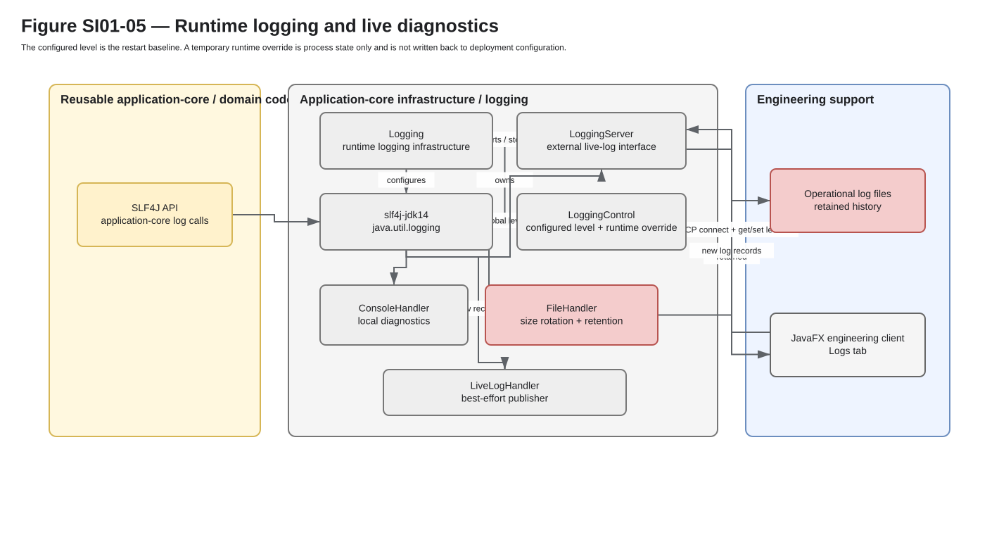
*Figure SI01-05 — Runtime logging, retained file sink and engineering live diagnostics.*

The exact default file size, retention count and production log level remain deployment choices
and must be measured on the target platform before being treated as accepted field defaults.
Per-package levels, persistent runtime overrides, JSON file logging and a general-purpose
diagnostics framework are outside A08.

SLF4J 2.0.x is compatible with the Java-8 baseline; the implementation repository should pin
the API/provider patch version together through Maven dependency management.

#### Configuration and composition architecture

Configuration describes deployment/composition rather than domain behaviour hard-coded in source. The concrete deployment/configuration contract is owned by **IF-11** in `32-11-ISD-application-configuration.md`.

The main configuration groups are:

```text
ApplicationConfig
├── applicationId
├── timingSystems
│   └── <timingSystem>
│       ├── timingSystemId
│       └── timingNodes
├── io
│   ├── devices
│   │   └── antennas
│   ├── deviceNetworks
│   │   ├── can
│   │   └── network
│   ├── registrationRouting
│   ├── messaging
│   │   └── upstream
│   │       └── connectors (1..N when UpstreamGateway is configured)
│   └── storage
├── presentation
├── logging
├── runtime
└── security
```

The identity boundaries are deliberate:

- the application owns a stable `ApplicationId`;
- the application composes 1..N internal `TimingSystem` contexts, each with an internal `SystemId`;
- each TimingSystem owns 1..N TimingNodes;
- a `TimingNode` owns its stable functional `NodeId` and configured `LocationId`;
- `SystemId` is local composition/simulation identity and is not added to TimingData/upstream addressing;
- the high-level I/O model separates Devices from Device Networks;
- Devices names the functional device endpoints/concepts, including antennas, keypads, beepers, passive CAN devices and smart network devices;
- the application may compose 0..N configured antennas; each antenna has its own `AntennaId` and may map to 1..N `NodeId` targets;
- Device Networks contains `CanNetworkController` for the actively managed CAN network and `NetworkDeviceService` for bidirectional network-device communication;
- when upstream messaging is configured for a TimingSystem, its protocol/gateway context uses 1..N connectors; multiple hosted TimingSystems keep those semantic contexts separate;
- connector-specific external names/routing identities do not replace `NodeId`;
- presentation endpoints reference TimingNodes explicitly; an HTTP port, tablet or shell binding is not a property of the TimingNode domain object.

Deployment composition is intentionally small and default-driven:

```text
built-in application profile defaults
        +
platform defaults
        +
operating-mode defaults
        +
explicit deployment overrides
        +
resolved secret values
        =
effective ApplicationConfig
```

The selected **application profile** defines a topology/capability template for
the Timing Point Application. Concrete deployment profile IDs, TimingNode counts,
device combinations and compatibility mappings are not defined by this public
architecture unless an explicit public requirement owns them.

Profiles do not create different application/domain models. They resolve to the
same TimingSystem/TimingNode architecture and may be combined with platform and
operating-mode defaults plus explicit deployment configuration within the
profile's compatibility rules.

Platform and operating mode remain independent dimensions. Simulation may replace
concrete adapters while preserving the same TimingNode/domain implementation.

Console, Remote Shell and API form the baseline control/automation capability set
of the Timing Point Application and are not selected by the application profile.
Deployment configuration still controls concrete listener/binding settings. Web
remains a separate per-TimingNode browser-facing capability.

Startup follows distinct responsibilities:

```text
select defaults
  -> apply explicit deployment overrides
  -> resolve effective typed configuration
  -> validate references/settings
  -> runtime Composition composes the application
```

Profile/platform/mode resolution is configuration infrastructure. It is complete
before `Composition` receives the effective runtime `Config`; composition
does not contain profile-specific branches.

Build provenance remains separate from deployment configuration. `BuildIdentity` describes the built artifact; it is not loaded from IF-11 deployment settings. Core `EmbeddedBuildIdentityLoader` interprets the standard embedded provenance resource, while the concrete executable owns and filters that resource with its own application/build values. The embedded provenance contains stable build inputs/context — version, exact revision, source ref, build origin and dirty-state — but deliberately omits wall-clock build time, CI run identifiers and actor/user data. This keeps the artifact self-identifying for test/support work without introducing per-run variability solely from timestamp/run metadata.

Working rules:

- keep secrets/credentials out of committed configuration and store only secret references there;
- prefer explicit/manual composition rather than adding a dependency-injection framework without a demonstrated need;
- keep overlay rules deliberately limited rather than creating general inheritance/includes;
- use YAML as the current default IF-11 file syntax and keep its SnakeYAML parser/mapping inside application-core infrastructure; the logical IF-11 contract is not coupled to the SnakeYAML API;
- create Java configuration types only as real executable slices need them rather than mirroring the entire conceptual tree in advance.

#### Data and persistence architecture

Keep the data roles simple:

- `LogBook` is passive state and holds committed immutable `TimingData` values;
- `TeamAssignments` and `StageStartTimes` are separate passive
  per-node state objects; `EventData` is the shared stable profile capability;
- the TimingNode worker is the single writer for those mutable per-node objects;
- each state type that needs persistence owns its semantic persistence rules above the lower Storage layer;
- `TimingDataPersistence` is the durable/recovery semantic boundary for committed timing data;
- lower Storage contracts remain generic and contain no TimingData/TimingNode semantics;
- when TeamAssignments or StageStartTimes require persistence, that persistence follows the same dependency direction rather than adding Domain interfaces implemented by I/O;
- queries read consistent state without becoming another owner of it.

If live RaceData state is not persisted across reboot, the TimingNode starts its
applied RACE_DATA sequence at 0 and rebuilds TeamAssignments/StageStartTimes by requesting
RACE_DATA from sequence 1. Optional persistence may later optimize this without changing
the source-order protocol.

The persistence architecture permits simple local files and does not require an
embedded database. SDD-01 defines ordering, commit/visibility and the different persistence
roles. SDD-02 defines the Java worker and store boundaries.

Practical detailed-design work includes a half-written last TimingData record,
corrupt-file reporting, durable flush/fsync behaviour, file rotation and bounded
consumer reads. Analysis stores may use simpler append/snapshot formats because
they do not define the TimingData commit point.

#### Integration architecture

The **external device and network topology is owned by the SSSD**, because RFID/CAN devices, local LAN clients, displays and the upstream system are system-level deployment/interface relationships. This SSD starts at the **Timing Point Application** (SI-01) boundary and explains how the application realises those system interfaces internally through ports, adapters, callbacks, status handling and transport implementations.

##### Upstream messaging

Upstream messaging is a semantic system boundary, not a RabbitMQ API.
`UpstreamData` in Domain defines the transport-independent semantic messages exchanged
through IF-06. It may carry canonical `TimingData` and also reference-data,
synchronization and status messages. TimingData identity/order remains owned by IF-05.

`UpstreamGateway` and its 1..N connectors remain I/O responsibilities. They carry
UpstreamData and own transport/session resources; they do not become owners of
TimingData fields or UpstreamData semantics. The gateway presents one bidirectional
node-scoped `UpstreamStream` per `NodeUpstream`.

```text
external upstream / SI-02 backend peer
        |
        +--> RabbitMqConnector --------+
        +--> EngineeringApiConnector --+--> UpstreamGateway
                                             |
                                      NodeId routing
                                             |
                               UpstreamStream (per node)
                                             |
                                             v
                                      NodeUpstream
                                             |
                                      NodeService
                               /                     \
                       RaceData state           LogBook replay
```

NodeUpstream owns protocol ordering and does not know whether the connector uses
a full-duplex WebSocket, multiple RabbitMQ consumer queues, or a separate publisher.

Exact RabbitMQ connection/channel topology, routing keys and retry mechanics are
connector-level decisions. Product/deployment-specific upstream-system names and
private transport details remain outside the public architecture documentation.
Public UpstreamData semantics and TimingData compatibility remain owned by Domain.

`SystemId` and `ApplicationId` are not required on the upstream wire. If one
physical connection carries several NodeIds, demultiplexing belongs to the Messaging
adapter that creates the node-scoped streams, not to a separate Application router.

##### RFID

RFID integration is an adapter boundary. Raw vendor callbacks/protocol frames do not
directly mutate application state. A concrete antenna provider owns protocol/device
interaction and emits decoded observations through the common antenna capability.

The stable decoded observation contains at least:

```text
TagObservation
  TagId
  RSSI
  TimingTimestamp
```

The timestamp is attached at the earliest accepted point at which SI-01 can identify the
observation as a decoded tag observation. When a provider exposes a trustworthy source
timestamp that can be mapped to the SI-01 time model, the adapter may use it; otherwise the
adapter uses the Runtime-composed TimeSource at the observation boundary. Timestamp
assignment is not delayed until registration commit.

An antenna publishes observations through the normal local typed event mechanism. The
antenna owns `Event<TagObservation>`; consumers receive only the
`EventSource<TagObservation>` view. Delivery is synchronous on the provider/device
callback thread, so downstream processing must remain short and must not wait for
TimingData persistence.

Antenna operation has a lifecycle around observation delivery. An
`AntennaManager` owns one or more configured antenna instances and coordinates:

- optional power switching where the deployment provides it;
- open/startup and initialization;
- a one-shot startup self-test that can power/open the antenna, perform a
  hello/identity/version check and close it again without starting normal inventory;
- inventory start/stop per antenna so multiple configured antennas can be controlled
  independently;
- normal shutdown and recovery/reinitialization.

Concrete vendor commands, framing, crypto/proprietary codecs and retry sequences remain
inside the provider/private implementation. A provider may hide device-specific power
control behind its antenna implementation, or runtime composition may provide an optional
power-control capability to the manager; external power switching is not required of every
antenna.

Antenna lifecycle/device-control calls are separate from observation delivery. One AntennaManager belongs to one TimingSystem and owns ordered control state
for its configured antennas. Self-test, power, initialize, inventory start/stop and shutdown
are submitted as bounded control work so potentially blocking device I/O does not run on
a Data Lane or on a presentation callback. Application startup may wait for a
result-bearing manager operation because readiness depends on that outcome.

The Java realization should use a shared bounded I/O `ExecutorService` rather than a
dedicated thread per AntennaManager or per antenna. Per-manager ordering is a logical
serialization constraint layered on that executor; it does not imply permanent thread
ownership. Other device/network capabilities may use the same bounded I/O execution
facility where their blocking characteristics fit the same policy, while retaining their
own state/ordering ownership.

Observation delivery does not run on the manager control lane. Concrete providers emit
`TagObservation` from their device/library callback context through the synchronous local
event. TagProcessor therefore only attempts a bounded, non-blocking handoff on
that callback thread. Mapping, filtering and duplicate suppression run later through its
bounded `SerialLane<TagObservation>`; timed filter/housekeeping callbacks run directly on
the same Runtime-owned single-thread `ScheduledExecutorService`. Accepted registrations
are then submitted without waiting to the TimingNode Data Lane through LogBook.

Raw TagObservation retention is optional non-critical diagnostic persistence. When enabled,
it subscribes to the same observation event but only performs a bounded non-blocking handoff
from the provider callback. File/storage I/O executes later on the shared bounded I/O
executor. Queue saturation or diagnostic-store failure must not block or reject the normal
registration path; it is reported through diagnostics/counters and may drop raw diagnostic
observations according to the configured retention policy.

This is deliberately different from TimingData/LogBook persistence. TimingData durability
is part of the committed-domain-record contract and remains ordered with commit before
LogBook visibility. A raw observation log is not TimingData, is not used to rebuild LogBook and does not
participate in registration commit success.

After decoding, generic SI-01 tag processing is distinct from vendor protocol handling.
Repeated reads of one physical passage are first aggregated as one observation burst.

```text
Antenna Event<TagObservation>
          |
          v
   observation burst per TagId
     - update strongest RSSI/timestamp
     - close after configured quiet time
     - force close at configured maximum burst duration
          |
          v
      TagProcessor
        - choose strongest observation/timestamp
        - TagId -> RegistrationId mapping
        - registration duplicate suppression
          |
          v
      TimingNode bounded submission
```

The absence of a new observation is significant: once no observation for that TagId has
arrived during the configured quiet timeout, the open burst is closed and its selected
candidate continues immediately to filtering/mapping/admission. Registration therefore
does not depend on a later tag callback arriving.

A maximum burst duration prevents a continuously visible tag from postponing processing
indefinitely. When that maximum expires, the current burst is closed even if observations
continue. A subsequent observation may open a new burst, while the longer
registration-duplicate window prevents an already accepted RegistrationId from being
registered again too soon.

Burst aggregation and registration duplicate suppression solve different problems.
Low-strength reads remain part of the burst because the purpose is to find the strongest
observation of the passage, not to register as quickly as possible.

The selected event timestamp is the timestamp of the observation with the highest RSSI in
the closed burst. That strongest observation is used as the best available approximation
of the participant being closest to the antenna, giving a more uniform registration point
than the first/last read of a variable RF read zone. For equal maximum RSSI, the first
observation at that maximum is kept.

D04 does **not** define a minimum-RSSI rejection threshold. If later evidence shows that
signal-strength rejection is needed, that is a separate requirement/design decision and
must not be inferred from the presence of RSSI in TagObservation.

Burst deadlines and the registration duplicate window use monotonic elapsed time.
Their durations are configuration/profile decisions. The processor must remain safe
when observations from multiple antennas arrive concurrently and must not add an unbounded
worker merely to serialize them.

`TagId -> RegistrationId` resolution is owned by `EventData`. One RegistrationId
may be associated with multiple TagIds; TagProcessor resolves the semantic TagId
before RegistrationId-keyed duplicate suppression and passage aggregation.

Source/provider-specific decoding and mapping policy must not be guessed by a generic
adapter. Built-in `SimulatedAntenna` uses the same lifecycle, observation event and
TagProcessor path as a real provider and does not call TimingNode/TimingData through a
test-only bypass.

##### CAN, keypad, beeper and displays

`CanNetworkController` owns the active CAN network: bus lifecycle, discovery/scanning,
device online state and communication. CAN/device callbacks do not mutate
TimingNode state directly; accepted work crosses the normal application/serial
boundary.

`Rev1CanDisplay` is the passive CAN display generation. SI-01 owns the
display-specific `DisplayModel` for this path and actively translates that model
into CAN/device commands. The display does not own the ready-team/domain model.

`Rev2WifiDisplay` is deliberately different. It is a smart external client with
its own rendering and synchronisation behaviour. `NetworkDeviceService` provides the bidirectional network-device boundary.
In the current IF-09 design it makes the SI-01 data service discoverable and
accepts the session initiated by Rev2WifiDisplay. Rev2WifiDisplay owns
reconnect/resynchronisation behaviour. The concrete discovery/listener/session
mechanics are detailed below the high-level architecture rather than represented
as additional peer components.

SI-01 therefore publishes current timing/status/reference data to smart clients;
it does **not** drive Rev2WifiDisplay through the passive-display `DisplayModel`
and does not need to know how that smart display renders the data. Exact mDNS
service names and the application protocol (for example TCP/WebSocket) remain
deferred until IF-09 implementation needs them.

##### Connectivity

Status must distinguish at least local network reachability from external/upstream session health where those distinctions affect operator decisions. Temporary external connectivity loss must not silently invalidate otherwise available local operation.

#### Development view

##### Development boundaries

The development structure shall preserve the architecture dependency direction
without assuming that every architecture layer is a package or Maven artifact.

Architecture-level boundaries are:

- SI-01 has a reusable application-core implementation and a deployable
  executable application;
- the public IF-05 Java contract must be independently consumable by SI-01 and
  engineering/test tooling without depending on SI-01 internal Domain packages;
- dependencies normally follow the layer order downward; I/O code does not import Application or Domain merely to reverse a dependency;
- Domain may call a concrete I/O component when the design requires that relationship; for example, `domain.system.TimingSystemConductor` calls `AntennaManager` for inventory control;
- public reference/core implementation code compiles and verifies without private
  production implementations.

The exact Maven reactor, artifact names, Java package layout, shared
`timing-data-api` placement and dependency checks are owned by SDD-02.

##### Public/private extension model

Private repositories may provide production device control, protocol implementations, deployment mappings and production data/codecs. Public core/reference implementation code defines supported contracts and must compile/test without those private implementations.

SI-01 uses one small **typed provider/extension mechanism** for implementation families that may cross the public/private boundary. The currently expected provider contracts are:

```text
TimingDataProvider
UpstreamDataProvider
AntennaProvider
CanProtocolProvider
DisplayProtocolProvider
```

The provider contracts are capability-specific; there is no generic domain-level
`Plugin` abstraction. Infrastructure extension-discovery support finds built-in and external providers at startup; `Composition` uses the resulting typed registry, validates configured provider IDs and then builds the normal runtime graph. Runtime/domain components receive normal typed
interfaces and never interact with class loaders or provider discovery.

Provider discovery/loading is a startup/composition responsibility. Provider IDs
must remain unambiguous and configuration errors must fail explicitly. The
concrete Java discovery/class-loading mechanism is detailed in SDD-02.

Built-in reference/simulation implementations remain part of the normal public
software where they are needed for development and verification. In particular,
`SimulatedAntenna` is always built in. Figure SI01-01 labels the generic
extension-provided alternative `VendorAntenna`; that label is illustrative, not
a fixed public implementation type. A deployment can select an
extension-provided implementation without changing the application/domain path
used by the built-in implementation. IF-11 owns provider selection in deployment
configuration; the concrete external-JAR packaging/search path remains a detailed
implementation concern.

#### Runtime execution and target-resource architecture

SI-01 runs on constrained Raspberry Pi-class targets as well as development
hosts. Runtime resource rules therefore apply across component boundaries rather than
belonging to one Java helper class:

- keep each TimingNode work queue bounded;
- prefer explicit bounded queues over hidden or unbounded executor queues;
- keep contained Domain state passive and single-writer where practical;
- keep concrete TimingData values immutable after creation;
- avoid routine LogBook list copies or deep copies when direct bounded traversal is
  sufficient;
- introduce reusable scratch storage, compact indexes or incremental derived state only
  when measurement demonstrates a concrete benefit;
- keep blocking network/retry work behind capability-specific output boundaries rather
  than on the TimingNode execution lane;
- move analysis-store writes off the Data Lane only when measurement shows that
  synchronous writes cause unacceptable delay;
- measure queue high-water, storage latency, LogBook/query cost, heap/GC behaviour and
  scheduling/CPU effects before increasing concurrency or adding runtime complexity.

These rules apply regardless of which Java executor backs a lane. SDD-02
explains the current Data, Task, TagProcessor, Conductor and I/O lanes; the verification/environment documents define how runtime
characterization evidence is collected.

#### Technology decision register

This table intentionally lives in the architecture section of this SSD because these choices shape the whole **Timing Point Application** (SI-01) architecture.

| Concern | Current direction | Current rationale / open point |
| --- | --- | --- |
| Java baseline | Java SE 8 is the current SI-01 baseline | architecture baseline; verify the selected runtime on the Pi target |
| Extension mechanism | typed capability-specific provider contracts with startup composition; runtime/domain code remains provider-discovery agnostic | concrete Java discovery/loading is owned by SDD-02 |
| Build | Maven | accepted |
| Concurrency | Each TimingNode owns a Data Lane for TimingData/LogBook mutation and a Task Lane for RaceData, derived timing and protocol state; lane-owned mutable state has one writer, lanes may share a physical ExecutorService, and cross-lane data is immutable/bounded | SDD-02 defines lane ownership, bounded async handoffs and executor composition |
| Internal messaging | typed immutable command/event/query objects only at async/ownership boundaries + explicit TimingNode mapping/routing at the owning boundary; no central generic dispatcher; direct calls inside a TimingNode task | architecture baseline; add/refine consumer API signatures only for concrete needs |
| Time model | dedicated `TimingTimestamp`; raw `PlatformEnvironment.Clock`; Runtime-composed shared `TimeSource`; separate `MonotonicClock` | IF-05 fixes canonical external timestamp serialization; RuntimeTimeSources selects the timing source implementation/sharing scope; synchronization/correction policy remains to be completed |
| Dependency injection | explicit/manual composition | add a framework only if measured/maintainability complexity justifies it |
| Logging | SLF4J API in reusable application core; default executable provider `slf4j-jdk14` / `java.util.logging` | handlers/retention remain configuration and operational concerns |
| Configuration | IF-11 effective `ApplicationConfig`: base + platform + optional profile + secret resolution; YAML/SnakeYAML is the default Java input realization | profile/platform/mode resolution is architecturally defined but not yet fully implemented |
| Persistence | Domain-owned TimingDataPersistence over generic lower-layer storage; file/database mechanisms do not import Domain/Application types | ordering and visibility in SDD-01; Java storage/persistence split in SDD-02; record contract in IF-05 |
| API HTTP | JDK `HttpServer` for IF-03 request/response | selected transport; belongs to the API functional interface |
| API WebSocket | `org.java-websocket:Java-WebSocket:1.6.0` on a dedicated configured listener | selected transport; Java 8+, pure Java/NIO and existing SLF4J boundary; keep the HTTP transport separate |
| Remote shell | Java 8 JDK `ServerSocket`, line-oriented TCP, shared command semantics | development/service interface with one active session and reconnect; SSH/Telnet/authentication are outside the current public design |
| Upstream messaging | semantic ports + socket test adapter + RabbitMQ production-shaped adapter | architecture direction established; implementation detail deferred |
| Test doubles | public controllable stubs through the same supported ports | established direction |

Technology choices should fit the actual application and target. Pi compatibility is verified on real hardware; memory/thread footprint becomes a design concern only when measurements make it one.

#### Physical/deployment view

Representative **Timing Point Application** (SI-01) deployments are:

```text
Production field host
  Raspberry Pi Zero / Zero W
    one Timing Point Application process
      one or more TimingSystem aggregates
        each with 1..N TimingNodes
      local devices + local files
      optional network/upstream connectivity

Development/test host
  Linux or Windows
    same Timing Point Application core/application behaviour
    real or stub adapters
    may host multiple independent TimingSystems for simulation
```

The architecture should not require a different domain implementation for simulation. Different compositions select different adapters/topologies around the same application/domain behaviour. The system-level placement of the Timing Point Application relative to devices, operator clients, LAN/Wi-Fi and the upstream system is defined in the SSSD rather than duplicated here.

#### Testability and failure/recovery architecture


Testability is an architecture property. Application/domain code should where practical:

- avoid uncontrolled threads and global mutable state;
- receive absolute time through an injectable abstraction;
- receive duration/timeout measurements through a controllable monotonic abstraction where needed;
- include tests that step the wall clock forwards/backwards and cross representative DST/local-time transitions;
- exercise per-TimingNode ordering/non-overlap, fair progress between node-local lanes on shared role workers, and bounded-ingress overload behaviour deterministically;
- depend on semantic ports rather than concrete device/network libraries;
- keep protocol parsing in adapters;
- use deterministic handlers that can run synchronously in unit tests;
- expose observable status for degraded/failure conditions;
- avoid `Thread.sleep()` as a domain timing mechanism.

Failures should stay visible and should not silently lose timing history. Retry
counts, timeouts and the exact durability guarantee are detailed-design choices
once we have real implementation/measurement evidence.


#### Detailed-design documents

Keep this SSD at architecture level. Put implementation detail in the focused
SDDs below instead of repeating it here.

Current focused SDDs:

```text
43-01-SDD-01-data-and-display-design.md
  internal data/runtime algorithms:
  LogBook recording, TimingData persistence/recovery, query isolation,
  prepare-team/reference/display behaviour

43-01-SDD-02-java-component-design.md
  concrete Java realisation:
  Maven artifacts, packages, classes/interfaces, queue/thread/executor choices,
  provider discovery and dependency checks

43-01-SDD-03-backoffice-transport-design.md
  transport realisation below the upstream semantic boundary
```

IDDs define the external/file/API contracts. The SDDs use those contracts; they
do not define a second version of them.

#### Open architecture decisions

Only keep questions here if the answer could change the SI-01 architecture.
Implementation questions go in the relevant SDD.

Open architecture questions include:

- operational policy for material wall-clock corrections when it affects timing
  correctness or operator action;
- final upstream/backoffice semantic responsibilities as IF-06 is promoted;
- whether measured multi-TimingNode/Pi resource behaviour ever requires changing
  the current ordered-per-node responsibility model;
- any target-runtime limitation that forces a change to the Java-8/application
  architecture baseline.

Queue sizes, Java signatures, executor choice, fsync/atomic file operations,
rotation and LogBook indexes belong in SDD-01/SDD-02, not here.


---

## Data and display detailed design

**Source document:** [43-01-SDD-01-data-and-display-design.md](43-01-SDD-01-data-and-display-design.md)

Status: working draft / focused detailed design

Software item: **SI-01 — Timing Point Application**

### Purpose

This SDD explains **how the data flows inside SI-01**: how LogBook entries are
recorded, when a TimingData record is committed, how persisted TimingData is loaded after restart, how an interrupted final write is repaired, and
how queries, prepare-team data and display data use that state.

### Terms and abbreviations

- **SDD** — Software Design Description
- **SSD** — Software Specification Document
- **SI** — Software Item
- **IF-05** — TimingData Interchange


### Relationship to other documents

This SDD refines the SI-01 SSD for internal data/runtime behaviour. It consumes the
SI-01 architecture and applicable interface contracts, especially IF-05. SDD-02 then
maps this design to concrete Java components, packages, queues and threads.

The SSD still defines the architecture. IF-05 still defines the TimingData
record/file format. SDD-02 chooses the concrete Java classes, queues and worker
threads.

The first version does **not** need an embedded database. Committed LogBook
entries are written as append-only IF-05 TimingData. After a restart, SI-01 can
read those records back and rebuild the LogBook. Other state, such as RaceData or
prepare-team state, can use its own simpler backup/sync mechanism.

Identifiers and known ranges come from `03-domain-baseline.md`. This SDD only
describes how SI-01 uses them.

### Design scope and data ownership

#### Two traceable information models

Two information flows must not be conflated:

1. **registration stream/ledger** — timing and operational entries that are synchronised as an ordered source stream;
2. **prepare-team registry history/state** — keypad/operator actions that prepare/remove teams and drive current display state.

Both need traceability and persistence, but they have different semantics and sequence scopes.

#### TimingNode source and location identity

Every `TimingNode` has a `TimingNodeId`. A registration fact also captures
the applicable configured `LocationId`.

`TimingNodeId`, `LocationId` and `AntennaId` are separate namespaces. I/O
configuration relates observations to TimingNodes; code must not infer one
identity from another.

The shared `LocationId` Java value type owns only the common positive numeric
representation. Concrete event/profile LocationId meaning, allowed sets and
source-to-node mappings are deployment/reference information and are not defined
by this public SDD.

#### LogBook and IF-05 TimingData

The runtime `LogBook` stores committed immutable `TimingData` values.
The current design does not add a second logbook-specific timing-data type.

That choice is deliberate. The old/reference software already treats one LBR
record as both the logged timing fact and the object consumers read. The new
design keeps that useful property while giving the file format a clear IF-05
contract.

The system-owned **IF-05 TimingData Interchange** contract is defined by
`32-05-ISD-timingdata-interchange.md`. It owns the common TimingData semantics, shared `LocationId` and
`RegistrationId` value representations, sequence/key semantics and compatibility
rules. The configured event/profile/reference model owns the concrete identifier
domains, while the configured TimingData profile owns its concrete classes and
matching representation/codec. The default/reference JSON + JSON Lines representation is described separately by `33-05-IDD-timingdata-interchange.md`.

The same immutable `TimingData` object can therefore be:

- appended by `TimingDataPersistence`;
- added to `LogBook` after that append is durable;
- read by runtime consumers;
- offered to downstream/upstream delivery.

A `TimingDataProvider` supplies the configured concrete TimingData factory and
codec. Different profiles may return different concrete classes while SI-01
continues to use the common TimingData interfaces.

#### Registration identity resolution

All participant registrations are committed with one shared `RegistrationId`
representation defined by IF-05. The concrete RegistrationId domain and meaning
may be event/profile-specific.

The automatic and manual source paths share the canonical RegistrationId boundary but do
not require the same resolver:

```text
TagObservation
  TagId + RSSI + time
        |
        v
   TagProcessor
        |
        v
TagRegistrationMapper -------------------------\
                                                +--> RegistrationId
TeamId -> team/reference resolution -----------/
```

`TagId` belongs to the RFID/tag input path. `TeamId` belongs to the
team/reference-data/manual path. Only the resolved `RegistrationId` is passed
to the TimingData factory.

The tag mapper is an EventData/profile policy boundary. It may perform a
deterministic transformation, provider/profile-specific conversion or a
RaceData/reference-data lookup. A lookup table is not the generic design.

The public default/reference EventData profile uses a deterministic convention.
For a four-digit positive number NNNN from 0001 through 9999, TagIds
`TT-A-NNNN-1` and `TT-A-NNNN-2` both resolve to RegistrationId
`RT-A-NNNN`, which resolves directly to TeamId `NNNN`. Reserve TagIds
`TT-R-NNNN-1` and `TT-R-NNNN-2` both resolve to RegistrationId
`RT-R-NNNN`; that reserve RegistrationId requires reserve-assignment reference
data to resolve a TeamId. The numeric value 0000 is invalid.

The final tag suffix identifies the physical member of a two-tag set and is not
part of the logical RegistrationId. Live RaceData reserve assignments may
override stable EventData reference relationships where applicable.

This convention belongs to the default/reference EventData profile. Other
providers may define different TagId, RegistrationId and TeamId semantics. The
generic IF-05 RegistrationId therefore remains opaque outside the selected
profile.

### TimingNode lane ownership and timing-data commit

#### Data Lane and Task Lane boundaries

A `TimingNode` is the top-level component boundary for one timing point.
Mutable responsibilities are split over two bounded serial lanes; contained data
objects remain passive:

```text
TimingNode
  +-- LogBookProcessor / Data Lane
  |     +-- lifecycle/location
  |     +-- TimingData sequence + durable commit
  |     +-- LogBook
  |     +-- TimingDataPersistence
  |
  +-- NodeTaskProcessor / Task Lane
        +-- RaceDataState
        |     +-- TeamAssignments
        |     +-- StageStartTimes
        +-- UniqueTeamRegistrations
        +-- StageTiming
        +-- UpstreamHandler / protocol state
```

The Active Object pattern is implemented by composition; neither processor
requires an inheritance hierarchy or a dedicated physical thread. The two
logical lanes may use the same Runtime-owned worker.

Public/application calls stay ordinary methods. The TimingNode hides the
asynchronous hand-off used by its Active Object implementation.

For a state-dependent operation such as `open(locationId)`, `close()` or a
consistency-sensitive status query, the public call does not
report success merely because work entered the queue. The TimingNode queues an
internal work item, executes it later against the then-current ordered state and
returns the processed result to the caller. A Java implementation may connect
those two moments with an internal `Future`; that Future is not part of the
caller-facing domain API.

Submission-only ingress is a separate contract. A device callback may need only
to know whether bounded work was admitted so that the callback thread can
continue immediately. In that case `ACCEPTED` means only accepted for later
processing.

The contained state objects are passive but not globally readable. TimingNode
owns current lifecycle/location state and serializes its changes with registration
admission. LogBook mutation remains on the Data Lane. RaceData and derived timing
mutations occur only on the Task Lane. TimingData sequence allocation therefore
needs no producer lock because only the Data Lane performs the commit step.
Cross-lane information is immutable and bounded: initial-load/commit facts flow
Data -> Task; LogBook replay requests/results flow Task -> Data.

#### TimingData commit and sequence

A producer may have completed work that belongs before the TimingNode boundary,
such as device decoding/filtering or translation into a semantic registration
request. That does not let the producer decide state-dependent TimingNode
conditions from outside the node.

When the work item reaches the serial lane, the TimingNode checks the current
state needed by that operation. Examples include whether the node is open, which
location is active and which current reference data is needed. Only then does the
worker create/commit the resulting TimingData.

For a caller that waits for a registration result, successful return therefore
means the registration operation has reached its defined commit/visibility point;
for submission-only device ingress there is no synchronous caller waiting for
that later result.


OPEN/CLOSE runtime state and lifecycle TimingData have different ownership.
For a real `CLOSED -> OPEN` transition, TimingNode applies the requested
LocationId and OPEN state at its registration-admission boundary. For
`OPEN -> CLOSED`, it applies CLOSED while retaining the current LocationId.
That runtime transition immediately determines whether later registrations may
be admitted.

While holding the same admission boundary, TimingNode submits the corresponding
NODE_OPEN or NODE_CLOSE command to the LogBook Data Lane. This gives one clear
source order:

- a registration admitted before CLOSE is queued before NODE_CLOSE;
- after CLOSED is applied, later antenna observations cannot admit a registration;
- after OPEN is applied, the NODE_OPEN command is submitted before a later
  automatic registration can be admitted.

The lifecycle-history command is fire-and-forget from the OPEN/CLOSE caller's
perspective. Queue rejection or later persistence/commit failure is reported as a
LogBook/persistence problem but does not roll back the already applied runtime
state. Consequently STATUS_CHANGED and TIMING_DATA_COMMITTED are separate facts;
their delivery order is not used to define current lifecycle state.

`ALREADY_OPEN` and `ALREADY_CLOSED` do not submit another lifecycle record.
There is no second lifecycle-event store or lifecycle-specific sequence owner.

Manual registration ADD uses the same TimingNode-owned commit path. The
Presentation/Application caller supplies the resolved RegistrationId, effective
registration time and AUTO/MAN time-source classification. AUTO means the client
selected/captured that time automatically; MAN means the operator entered or edited it.
TimingNode does not substitute server current time for an AUTO-classified manual
registration.

Registration REV uses the same append-only commit path. The caller supplies the
registration family plus the Registration ID and original effective time; for a
manual registration it also supplies the original AUTO/MAN time-source
classification. TimingNode assigns only the new record sequence/recorded-at
context and commits the resulting REV record.

TimingNode and LogBook carry absolute timing values internally as UTC epoch-millisecond
scalars. The default IF-05 profile applies its field-specific canonical precision at the
TimingRecord commit boundary: effective `time` is canonicalized to centiseconds
(10 ms), while newly sampled record-creation time retains full millisecond precision for
`recTime`. Registration effective time remains caller/observation-supplied timing
information; the 10 ms canonicalization is a default IF-05 representation rule rather
than a generic TimingData/Timestamp storage model.

LogBook and this commit boundary are bookkeeping, not the owner of interpreted
registration business state. They do not search prior history to decide whether
an ADD is currently active, whether a matching REV already exists or whether a
requested revoke is meaningful. Higher processing/application logic may interpret
ADD/REV history and decide what operation to request.

Only when the worker is ready to commit does it ask the LogBook for the next
sequence. Sequence is therefore not assigned when work is placed on the queue.

Conceptually:

```java
void processRegistration(RegistrationInput input) {
    long sequence = logBook.nextSequence();

    TimingDataFactory.Context context =
        timingDataContext(sequence, activeLocationId, input.effectiveTime(), timeSource.now());

    RegistrationId registrationId = raceData.resolveRegistrationId(input);

    TimingData data;
    if (input.isAutomatic()) {
        data = timingDataFactory.createAutomaticRegistration(context, registrationId);
    } else {
        data = timingDataFactory.createManualRegistration(
                context, registrationId, input.timeSource());
    }

    timingDataStore.append(data);     // returns after durable append
    logBook.add(data);                // consumer visibility point
    timingDataCommittedEvent.emit(data);
}
```

`LogBook.nextSequence()` is based on committed state:

```text
empty LogBook                  -> 1
last committed sequence = N    -> N + 1
```

Calling `nextSequence()` does not consume the number. If persistence fails,
the record is not added to LogBook and the next attempt still uses the same
sequence. A later work item may not overtake the failed timing-data commit.

The important ordering is:

```text
TimingNode worker
  -> choose next sequence
  -> build typed immutable registration TimingData through configured factory
  -> TimingDataPersistence.append(record)
  -> durable
  -> LogBook.add(record)            <-- committed domain state
  -> timingDataCommittedEvent.emit(record)
  -> subscribed listeners are notified
```

There is no direct producer-to-store path and no second TimingNode serial worker.

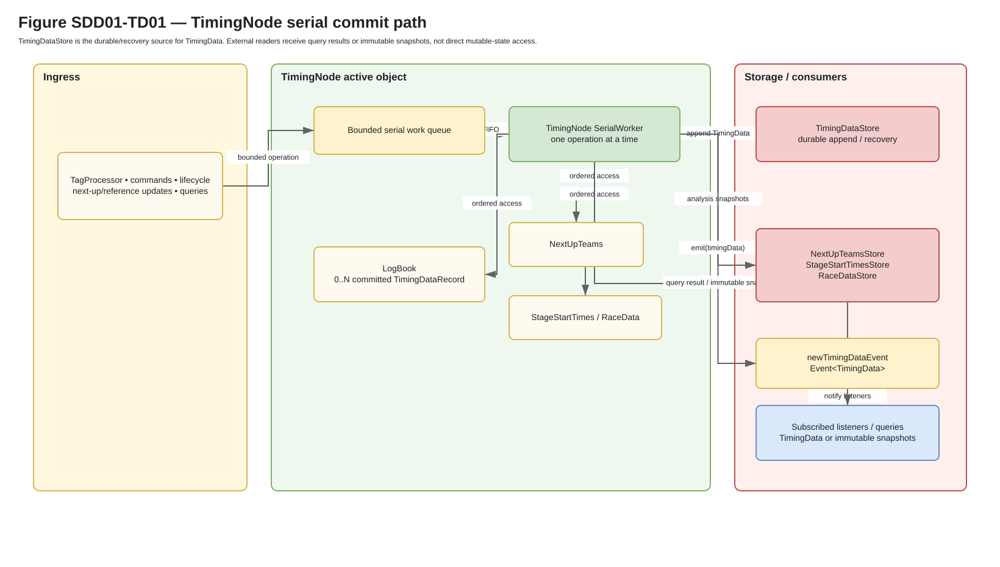

*Figure SDD01-TD01 — State-changing input enters the TimingNode serial boundary; the concrete TimingData value created by the configured factory becomes visible only after durable persistence.*

#### Other TimingNode state and per-type stores

Not every state type has the same durability semantics.

`TimingDataPersistence` is special: successful durable append is part of the timing
record commit. The LogBook is rebuilt from committed TimingData after restart.

`NextUpTeamsStore`, `StageStartTimesStore` and `RaceDataStore` serve a
different purpose: preserve accepted state changes/snapshots for
post-event analysis. Their stored data lets engineers later answer questions
such as which teams were next-up or which stage-start times/reference data were
known when a timing decision was made.

Those files are not automatically the runtime source after reboot. For example,
StageStartTimes can be sent again when the node is opened. Keeping its historical
file is still valuable for later analysis.

State-changing operations execute on the lane that owns the state. TimingData,
LogBook and lifecycle/location changes are ordered by the Data Lane. RaceData,
TeamAssignments, StageStartTimes, UniqueTeamRegistrations and derived timing
changes are ordered by the Task Lane. Small/infrequent analysis-store writes
may execute during the owning lane turn only when measured latency permits it;
otherwise an immutable snapshot may be handed to a bounded persistence executor.
That optimization must not change lane ownership or introduce an unbounded
hidden queue.

#### Query/consumer visibility

Consumers do not read mutable TimingNode-owned objects directly.

An ORDERED query enters the lane that owns the queried mutable state. LogBook
history and lifecycle/status ordering use the Data Lane; RaceData and derived
StageTiming queries use the Task Lane. If a read requires expensive calculation,
only the short ordered capture/traversal step runs on the owning lane; longer
calculation continues outside it.

A CURRENT query may instead read a safely published immutable representation of
completed TimingNode state without entering the lane. CURRENT is therefore not a
weaker implementation of ORDERED: it answers a different question and may legitimately
precede work that has been accepted but has not completed yet.

Conceptually:

```text
CURRENT query
  -> published immutable completed state

ORDERED query
  -> owning TimingNode lane (Data or Task)
       -> read/capture state after earlier accepted work on that lane
       -> return immutable view/result
  -> optional long calculation outside lane
```

For LogBook history, the read strategy may use direct bounded traversal or a
shallow immutable reference view because `TimingData` values are immutable.
The exact representation and allocation strategy belong to SDD-02 and
measurement evidence. A reusable internal buffer is acceptable only if callers cannot observe
it being mutated/reused after the query returns.

An ORDERED query before a new commit may legitimately see the earlier state;
an ORDERED query after that commit sees the new state. A CURRENT status query
returns the latest safely published completed state at the time of the read and
does not wait for merely accepted work. Neither form makes the underlying mutable
state globally readable.

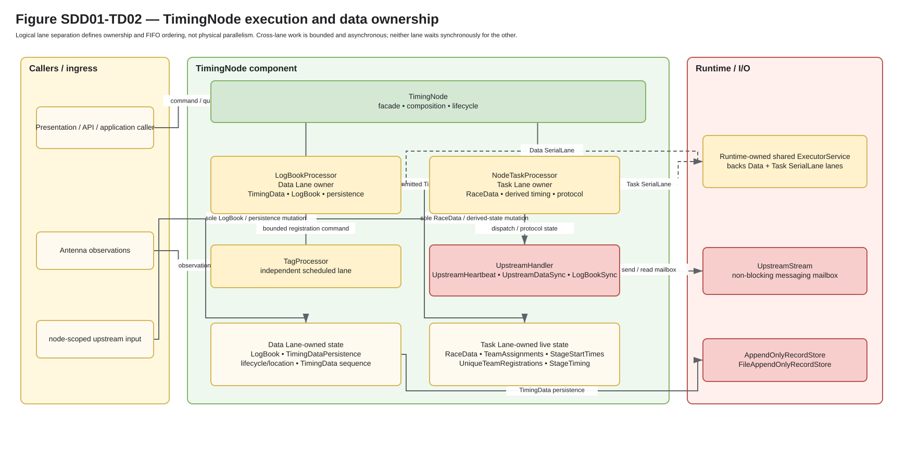

*Figure SDD01-TD02 — Process/execution refinement of TimingNode: the Data Lane owns TimingData/LogBook/persistence; the Task Lane owns RaceData, derived timing and protocol state. Both may share one physical worker. This is not the logical component diagram (SI01-01).*

#### Runtime flows

The sequence diagrams below show the different caller contracts explicitly.
They deliberately distinguish queue admission from the domain result produced
when work executes against current TimingNode state. SDD-02 owns the concrete
Java queue, Future and worker mechanism.

##### Automatic RFID registration

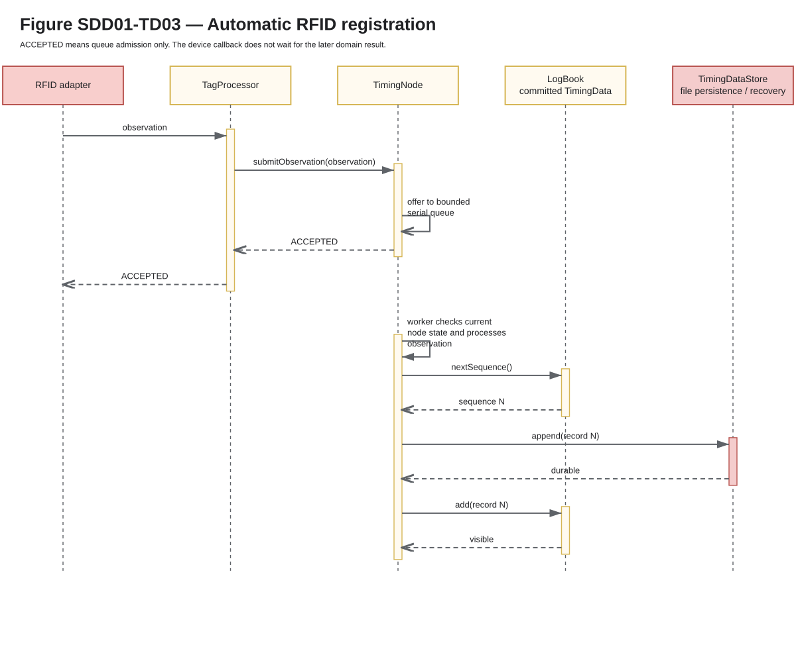

*Figure SDD01-TD03 — A device callback receives only bounded admission status and returns; later TimingNode processing uses current state and has no synchronous callback waiting for the domain result.*

##### Manual registration

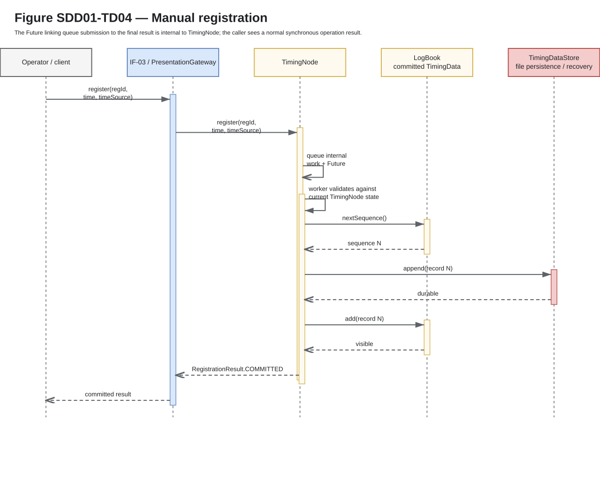

*Figure SDD01-TD04 — A presentation-driven registration call waits for its actual processed/committed result while the Future remains internal to TimingNode.*

##### Long query while registrations continue

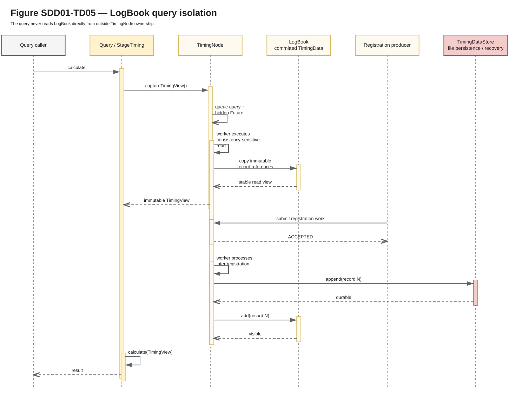

*Figure SDD01-TD05 — The query captures its read view on the TimingNode lane and performs longer calculation outside the lane; it does not read LogBook directly.*

##### Additional producer paths

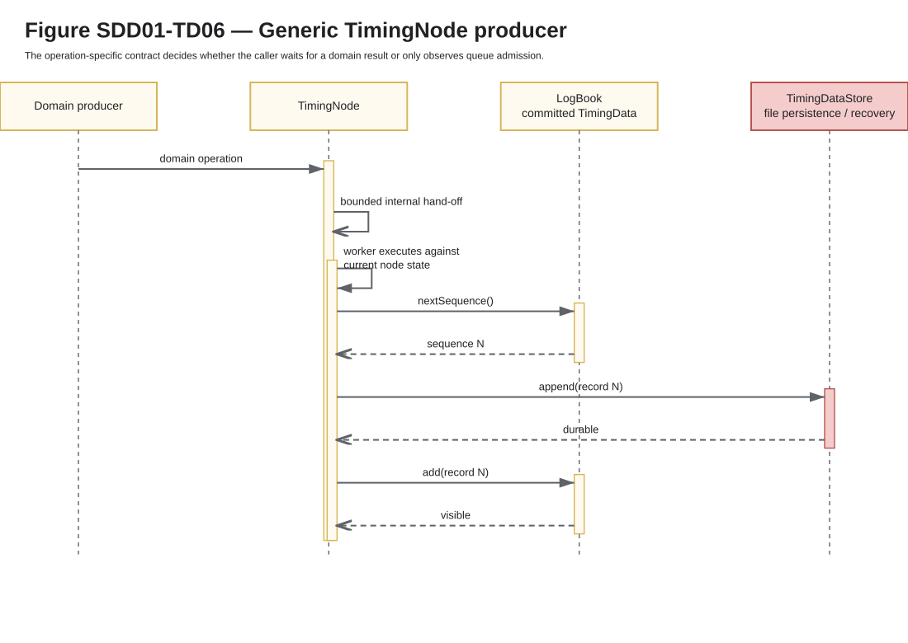

*Figure SDD01-TD06 — Additional state-dependent operations use the same TimingNode ownership/ordering boundary; their caller contract must still state whether they wait for a result or are submission-only.*

##### State-dependent OPEN waits for its processed result

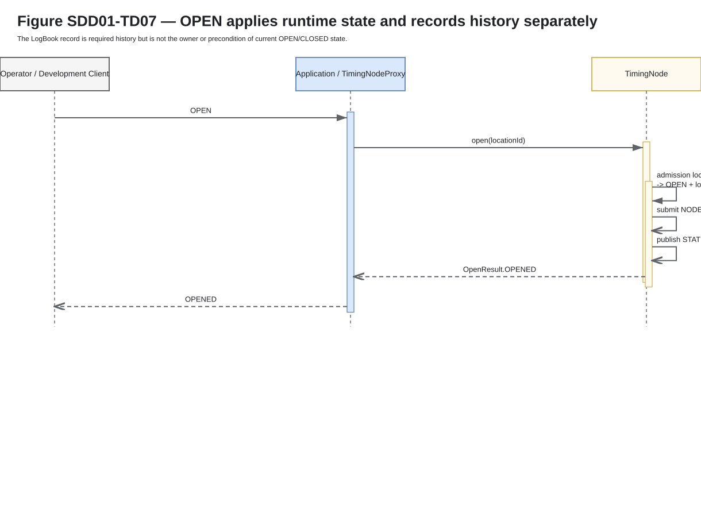

*Figure SDD01-TD07 — `open(locationId)` returns only after the queued operation has executed against current TimingNode state; the internal Future is not exposed to the caller.*

##### Concurrent OPEN and CLOSE are ordered by the TimingNode

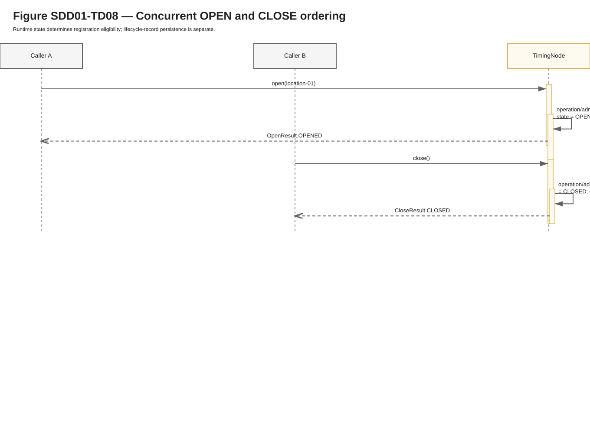

*Figure SDD01-TD08 — State-dependent validation happens when each operation reaches the serial lane; callers do not decide validity from a pre-queue state read.*

##### Timeout means outcome unknown, not rollback

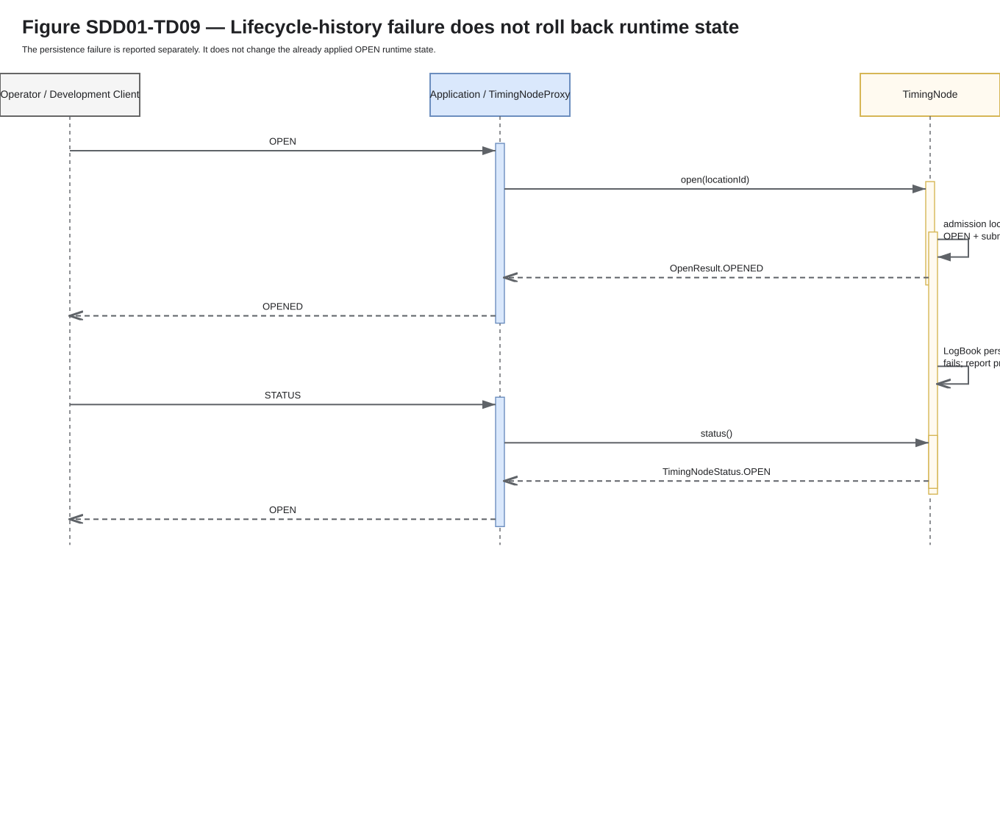

*Figure SDD01-TD09 — A caller timeout stops waiting but does not cancel already accepted work; the caller re-queries state before deciding what happened.*

##### Thread/ownership responsibilities

| Execution role | May block on | Must not do |
| --- | --- | --- |
| presentation caller waiting for a state-dependent result | bounded TimingNode operation wait | read/mutate TimingNode-owned state directly |
| device/callback ingress | short validation + bounded submission | wait for durable commit, run long domain work, read node state directly |
| Data Lane turn | TimingData/lifecycle operation; required local persistence; short LogBook read/capture | mutate Task Lane RaceData/derived state, client rendering, slow network retry |
| Task Lane turn | RaceData/protocol/derived-state operation; short task-owned query | mutate LogBook/persistence, synchronously wait for Data Lane work |
| query caller/worker | bounded wait for its owning lane; long calculation on immutable view | retain a mutable internal buffer or bypass TimingNode ownership |
| signalling/upstream worker | its own delivery/retry policy | mutate lane-owned state directly or block TimingData commit |

Each TimingNode has two bounded logical serial lanes. Physical worker threads may
be shared across both lanes and across nodes. FIFO/one-at-a-time ordering is
guaranteed within each lane; cross-lane ordering is expressed only through the
explicit immutable handoffs defined above.

### TimingData persistence and startup loading

This design implements `SI01-REQ-045..048` together with the applicable IF-05
semantics and the reference representation in
`33-05-IDD-timingdata-interchange.md`.

#### Loading persisted TimingData and determining the next sequence

No separate sequence-counter file is required.
The TimingData file already tells us the last committed sequence:

```text
no committed records       -> nextSequence = 1
last committed sequence N  -> nextSequence = N + 1
```

At startup, `LogBookProcessor` queues this load as the **first ordered Data Lane task**.
`NodeTaskProcessor` has an independent lifecycle: its Task Lane may already be running
while the persisted TimingData is being read. The initial loaded-data snapshot is input
to Task-owned derived timing state; it is not a precondition for Task Lane activation:

- read complete IF-05 records in order;
- check that the file belongs to one TimingNode;
- check that the committed sequence increases without duplicates or unexpected gaps;
- ignore/remove only a half-written final record that has no complete line ending;
- rebuild the node-owned LogBook/state before publishing CURRENT status;
- never reuse a committed `(TimingNodeId, SequenceNumber)`.

The lane ownership is about ordering and single-writer semantics, not physical
parallelism. Multiple TimingNode lanes may share one physical TimingNode worker,
so startup file reads may intentionally execute one at a time.

A half-written **last** record after power loss can be repaired: truncate back to
the last complete record and continue from there. This tail repair is recovery behaviour;
the normal act of reading existing complete records is not.

A corrupt **complete** record, duplicate sequence or gap is different. Do not
silently skip or renumber it. Stop the startup load for that TimingNode and report the
problem so support/operator tooling can see it.

If a cached sequence-counter file is introduced for faster startup, it is only a
cache. The committed TimingData file remains the source used to check/rebuild it.

#### Engineering backup and clear maintenance

Technical maintenance never truncates the TimingData file underneath a live
LogBook. A point-in-time **backup** is serialized with physical append so the copy
ends on a complete record boundary.

A **clear** follows a restart-boundary protocol:

1. the addressed TimingNode must currently be CLOSED;
2. the terminal creates a durable node/file-scoped clear request and asks the
   application to perform its normal controlled restart;
3. normal runtime deactivation stops Presentation, upstream and node execution so
   no further LogBook append can occur;
4. before the replacement runtime is composed, process startup sees the durable
   request, copies the final persisted TimingData to the reserved timestamped
   backup and only then removes the active TimingData file;
5. the durable request is removed only after backup + clear succeeds;
6. the replacement runtime loads the now-empty stream and therefore starts its
   next committed sequence at 1.

The marker makes the operation restart/crash tolerant. If the process stops after
the request is recorded but before maintenance runs, the next cold startup applies
it. If the backup was already created but the process stops before the marker is
removed, startup reuses that reserved backup identity and completes the clear.
No in-memory LogBook reset is attempted inside the old runtime.

The shared terminal exposes this as node-scoped `lb backup` and `lb clear`;
multi-node strict addressing continues to use `lb:<NodeId> ...`. `lb clear`
implicitly performs the required application restart; it is not an ordinary
LogBook mutation.

#### Persistence roles

TimingData has the strongest rule:

- a TimingData record is committed only after writing its complete reference
  representation to the configured local store has completed successfully;
- only then is the same concrete `TimingData` value added to LogBook, published
  as a committed live event or returned as a successful commit result;
- the TimingData file is used to rebuild LogBook after restart.

Other per-node stores have a different purpose:

- `NextUpTeamsStore` preserves accepted next-up state/history for analysis;
- `StageStartTimesStore` preserves accepted start-time snapshots for analysis;
- `RaceDataStore` preserves accepted reference-data snapshots/versions for
  analysis.

Those historical stores do not automatically restore live state after reboot.
The live protocol may resend the current data, for example when a TimingNode is
opened. Those stores do not restore live state unless an operational requirement
explicitly defines such recovery semantics.

The successful write above is the software commit boundary. The stronger
guarantee against sudden power loss depends on the concrete filesystem and flush
primitive and remains a target-specific design/verification point.

Implementation points to verify on the target Pi:

- what exact flush/fsync call provides the required power-loss durability level;
- what happens if power disappears halfway through the final line;
- whether truncating the incomplete tail is safe on the target filesystem;
- how a corrupt complete record is reported instead of silently ignored;
- file rotation/retention for TimingData and analysis stores;
- whether any non-critical store write needs asynchronous offload after
  measurement.

We do not need a database just to solve these cases.

#### Operational TimingData and LogBook logging

TimingData/LogBook logging is part of this detailed design because the useful
level depends on the domain commit and startup-load semantics above. The generic
level meanings remain defined by Java design rule DR-09.

The normal INFO stream is intended to reconstruct meaningful timing operation
without becoming a raw RFID trace. In particular, a durable TimingData commit is
logged only after both persistence append and LogBook visibility have succeeded.

| Event/fact | Level | Design intent |
| --- | --- | --- |
| TimingData load starts | INFO | show node startup loading progress |
| TimingData load completes | INFO | include TimingNodeId, loaded record count and tail-repair flag |
| incomplete final record tail repaired | WARN | startup load succeeded after repairing evidence of an interrupted previous write |
| one tag passage/semantic automatic-registration candidate selected | INFO | include RegistrationId plus selected TagId/RSSI/time; this is one passage decision, not every raw observation |
| successful TimingData commit | INFO | emit only after durable append + LogBook add; include node, sequence, type and relevant registration/location/time provenance |
| raw TagObservation | TRACE | potentially high rate; never normal INFO |
| unmapped TagId / duplicate suppression / filter decision | DEBUG | useful for diagnosis without polluting normal operation logs |
| ordinary LogBook range/latest/count query | no INFO | query traffic is not an operational state transition; DEBUG only when diagnosis specifically needs it |
| recoverable queue/admission or automatic-repair anomaly | WARN | operation is degraded/rejected but component may continue |
| TimingData load/validation or persistence failure that makes the node unreliable | ERROR | node cannot safely continue its TimingData role |

Two distinct INFO facts may therefore appear for the automatic RFID path:

```text
Tag passage selected
    -> TimingNode registration command
    -> durable TimingData append
    -> LogBook.add
TimingData committed
```

The first proves that the passage/filter produced a semantic registration
candidate. The second proves that the resulting record crossed the durable
commit/LogBook visibility boundary. They must not be collapsed into one premature
"written" message.

The LogBook and TimingData file remain authoritative. Logs are a human-readable
operational narrative and must not be used to rebuild runtime state.

The same commit boundary owns the generic committed-TimingData event. `LogBook`
emits that fact only after durable persistence and committed in-memory visibility have
succeeded. Startup reconstruction does not replay persisted records through the new-data
event; instead, `LogBook` publishes one immutable initial-history fact for consumers that
need to rebuild derived state. Upstream delivery, post-processing and presentation remain
optional consumers and do not participate in commit success.

#### Startup flow

Lifecycle activation and persisted-data loading are deliberately separate. TimingNode
starts with independent values: functional state `CLOSED`, no LocationId and
operational state `INIT`:

```text
start process
   |
   v
load configuration / compose components
   |
   v
construct TimingNode
   |
   +--> functionalState = CLOSED
   +--> locationId = none
   +--> operationalState = INIT
   |
   v
TimingNode activation
   |
   +--> activate NodeService
   |       +--> start Task Lane
   |
   +--> activate LogBook
   |       +--> start Data Lane
   |       +--> queue persisted-TimingData load as first Data Lane task
   |
   +--> activate TagProcessor
   +--> return; other components may continue activation
   |
   +------------------------------+
                                  |
Data Lane                         | other application startup may continue
   |                              |
   v                              v
read and validate complete    other nodes / interfaces / devices activate
IF-05 records
   |
   +--> half-written final line: truncate to last complete record + report repair
   |
   +--> corrupt complete record / duplicate / gap: record recovery failure
   |
   v
rebuild committed LogBook history
   |
   +--> publish immutable initial TimingData history to Task Lane consumers
   |
   +--> publish LogBook recovery result
   |
   v
later ordered LogBook commands continue
```

The persisted-data load is the first ordered Data Lane task, so later ordered commands
naturally wait behind it. A caller does not perform a separate LogBook-readiness check.
TimingNode functional state remains readable as `CLOSED` with no LocationId during
loading, while operational state remains `INIT`. Successful recovery changes only
operational state to `OK`; failed recovery changes only operational state to `ERROR`
with problem detail. Later operations that need the LogBook fail through the normal
TimingNode operation-failure contract.

A new/empty TimingData file starts at sequence 1.

Rebuilding the LogBook does **not** automatically reopen a TimingNode. Even when
the last historical state record says `OPEN`, a process restart starts the node
as `CLOSED` with no LocationId. New observations are not accepted for timing
until an explicit new `open(...)` operation succeeds.

If prepare-team or reference-data backup is corrupt, report that explicitly too;
do not silently present the system as healthy.

### Prepare-team and reference data

#### Prepare-team registry

Keypad input indicates which teams should prepare at the timing node/exchange point. A keypad action is not itself a passage/start/penalty registration.

The keypad can:

```text
add team to prepare registry
remove team from prepare registry
```

Those actions must remain traceable so operator history is auditable and the registry can be recovered after restart.

Conceptually:

```text
PrepareTeamRegistry
  current teams to prepare: [456]

  internal traceable history:
    501  TEAM_ADDED     123
    502  TEAM_ADDED     456
    503  TEAM_REMOVED   123
```

The registry owns both:

- **current state** — which teams must currently prepare at the timing node/exchange point;
- **traceable history** — the keypad/operator add/remove mutations needed for audit and restore.

The history is an internal persistence/state aspect of the registry, not a separate architecture component.

Illustrative internal history record:

```java
final class PrepareTeamEvent {
    private long sequenceNumber;
    private TimingNodeId timingNodeId;
    private PrepareTeamEventType type; // ADDED / REMOVED
    private TeamNumber teamNumber;
    private Instant createdAt;
    private InputSource source;         // keypad / UI / API / test
}
```

The prepare-team history sequence is a separate design question from the `TimingNodeId`-scoped sequence. It may use its own internal registry sequence or later a broader operational-event sequence, but it must not accidentally consume/alter a `TimingNodeId` registration sequence unless requirements explicitly make a prepare-team action a registration-stream entry.

#### Reference-data synchronisation

Start-time and participant/reference mappings supplied by an external system may also need to be available locally.

The start-time semantic model uses the same project-owned `TimingTimestamp` value at protocol boundaries while allowing the source to provide only the information it actually knows. A race/stage source may therefore provide **time-of-day only**; a date may be present when known, and an already absolute timestamp is also representable. Consumers shall not invent missing date/zone context. SI-01 normalizes accepted stage starts once to a compact UTC long while preserving whether a date was present: time-only uses `HHmmsscc`, dated values use `yyyyMMddHHmmsscc`. For elapsed-time calculation, a time-only start is matched against the absolute registration passage using same/previous UTC-day rollover and is accepted only when the unique result is within `0 <= elapsed < 12 hours`; ambiguous values remain unresolved and do not rank.

The application maintains local in-memory repositories and synchronises accepted data from the backoffice.

A useful model is snapshot/version based:

```text
Backoffice
   |
   | ReferenceDataSnapshot(version, entries)
   v
Backoffice adapter
   |
   v
TimingSystem/application message queue
   |
   v
ReferenceDataService
   |
   +--> validate version/content
   +--> replace/update repositories
   +--> write simple backup file
   +--> publish status/data-changed event
```

Pseudocode:

```java
void handle(StartTimeSnapshotReceived message) {
    StartTimeSnapshot incoming = message.getSnapshot();

    if (!startTimeValidator.accept(incoming, startTimes.snapshot())) {
        status.referenceData().recordRejectedUpdate(incoming.getVersion());
        return;
    }

    startTimes.replace(incoming);
    referenceBackup.save(referenceData.snapshot());
    status.referenceData().recordStartTimesSynced(incoming.getVersion());
    displayService.referenceDataChanged();
}
```

The same pattern can be used for other participant/reference mappings. Full-snapshot versus delta updates, version identifiers and correction semantics still need requirements/ISD design.

#### Keypad behaviour

The CAN keypad can both add and remove team numbers from prepare-team registry.

Possible incoming messages:

```text
KeypadTeamAddRequested(teamNumber)
KeypadTeamRemoveRequested(teamNumber)
```

Both enter the normal serialized state-change path. The handler mutates `PrepareTeamRegistry`; the registry records the traceable mutation and updates its current set atomically from the application/domain point of view. The handler then rebuilds/publishes display data.

```java
void handle(KeypadTeamAddRequested command) {
    prepareTeams.add(
        command.getTeamNumber(),
        KEYPAD,
        clock.instant());

    backupCoordinator.prepareTeamsChanged(prepareTeams);
    displayService.prepareTeamsChanged(prepareTeams.currentTeams());
}
```

Removing a team follows the same path with `REMOVED`.

The application, not the keypad, remains authoritative for current prepare-team registry. Duplicate-add, remove-not-present, ordering and capacity behaviour need explicit requirements.

### Display data

#### Display model

Display data is derived from **current state**, not by forwarding keypad history directly.

```text
PrepareTeamRegistry         StageStartTimeRegistry
      |                          |
      +--------------------------+
      |                          |
      +----> DisplayModelBuilder <+
                    |
                    v
              DisplayModel
              /          \
             v            v
      V1 CAN adapter    V2 data session
```

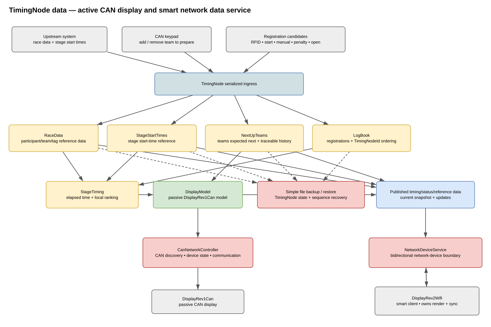

A conceptual model might contain:

```java
final class DisplayModel {
    private List<TeamDisplayData> prepareTeams;
    private Instant generatedAt;
    private long revision;
}

final class TeamDisplayData {
    private TeamNumber teamNumber;
    private StartTime startTime;
    private Duration elapsedTime;
    private LocalRank rank;
}
```

Fields are illustrative. The display ISD will ultimately define the system contract; a separate IDD is needed only if concrete design deserves its own baseline.

#### Display V1 — passive CAN display

Display V1 is relatively passive and must be actively driven by the timing application.

V1 does not reconstruct add/remove history. The application derives the **current prepare-team list** and writes the appropriate complete/current display state.

```java
void refreshV1() {
    DisplayModel current = displayModelService.current();
    canDisplayV1.apply(current);
}
```

Implications:

- `TEAM_ADDED` updates `PrepareTeamRegistry`, then triggers a refreshed current list;
- `TEAM_REMOVED` updates `PrepareTeamRegistry`, then triggers a refreshed current list;
- after discovery/reconnect/reset, send a full refresh from current state;
- a V1 reset does not destroy application prepare-team registry;
- status distinguishes discovered/reachable/last successfully updated.

#### Display V2 — smart Wi-Fi display

Display V2 is a smarter network client. The timing application communicates domain/display **data**, while V2 owns presentation/rendering behaviour.

Intended connection direction:

1. timing application advertises an mDNS service;
2. V2 discovers the service;
3. V2 connects to the timing application;
4. application sends current ready-team/reference/result data;
5. application and V2 keep data synchronised while connected.

The data can be represented as a revisioned snapshot/model even though V2 renders it differently from V1.

```java
void onDisplayV2Connected(DisplaySession session) {
    session.send(displayModelService.current());
}
```

Delta delivery is an allowed optimisation, but reconnect must always be recoverable through a complete current snapshot.

#### Registration versus ready-team display state

These flows remain separate:

```text
RFID / manual / lifecycle / start / penalty logic
          |
          v
      TimingNode
   bounded serial work
          |
          v
    TimingData
          |
          +--> TimingDataPersistence (durable)
          +--> LogBook (visible after durable append)
          +--> StageTiming / ranking inputs
          +--> downstream integration

keypad/UI prepare/remove team
          |
          v
    PrepareTeamRegistry
      current state + internal history
          |
          +--> V1 current list
          +--> V2 synchronised data
```

A team can be ready for display without having produced a registration, and a registration can exist independently from whether that team is currently ready.

Later interactions (for example automatically removing a team after a successful start/passage) must be explicit domain requirements rather than accidental display side effects.

### Rules when implementing IF-05

The TimingData record/file contract is not re-specified here. SI-01 design shall
conform to **IF05-REQ-001..007** in
`32-05-ISD-timingdata-interchange.md`.

The following temporary design constraints cover only the internal realisation
needed around that interface:

#### TimingNode state and record pipeline

- **CAND-PIPE-001** — Each TimingNode shall provide two bounded logical serial
  execution boundaries: Data Lane for TimingData/LogBook/persistence and Task
  Lane for RaceData/derived timing/protocol state. Contained state objects such
  as LogBook, TeamAssignments and StageStartTimes remain passive.
- **CAND-PIPE-002** — Registration sequence shall be selected by the TimingNode
  worker immediately before commit, not when ingress work is queued.
- **CAND-PIPE-003** — A TimingData record shall become visible in LogBook only
  after `TimingDataPersistence` reports the complete append durable.
- **CAND-PIPE-004** — The LogBook shall hold the same canonical
  immutable `TimingData` values used by the TimingData persistence/interchange
  boundary; no second logbook-specific timing-record type is required.
- **CAND-PIPE-005** — Potentially long queries and network delivery/retry shall
  execute outside the TimingNode serial worker.
- **CAND-PIPE-006** — Consumers needing a stable LogBook view shall use a short
  read/copy operation and perform long calculations after releasing LogBook
  synchronization; implementations should avoid unnecessary per-query garbage.

#### Identity resolution before IF-05 commit

- **CAND-ID-001** — An automatic/tag registration shall resolve its `TagId`
  to the canonical IF-05 `RegistrationId` before the definitive TimingData
  value is created.
- **CAND-ID-002** — A manual/reference-data registration shall resolve its
  `TeamId` to the same canonical `RegistrationId` concept before TimingData
  creation.
- **CAND-ID-003** — Concrete source encodings, category/range rules and mapping
  tables shall stay behind their provider/reference-data boundary unless a public
  interface requirement explicitly promotes them.

#### Local data and per-type stores

- **CAND-DATA-001** — The initial implementation shall maintain committed
  LogBook state, next-up state and reference state in typed in-memory objects
  without requiring an external database engine.
- **CAND-DATA-002** — `TimingDataPersistence` shall be the durable source used to rebuild LogBook after restart
  for committed TimingData.
- **CAND-DATA-003** — NextUpTeams, StageStartTimes and RaceData shall each use a
  type-specific store when their accepted state/snapshots are preserved for
  analysis; these stores shall not be treated as runtime recovery authority
  unless a requirement explicitly says so.
- **CAND-DATA-004** — TimingData startup-load/validation faults and analysis-store failures
  shall be visible in system status/diagnostics.
- **CAND-DATA-005** — The system shall track enough reference-data
  synchronisation metadata to determine whether local data is current/stale
  relative to the latest accepted update.

#### Ready-team/keypad data

- **CAND-READY-001** — The system shall maintain prepare-team registry logically separate from timing/registration records.
- **CAND-READY-002** — Adding or removing a team from prepare-team registry shall create a traceable persisted ready-team event.
- **CAND-READY-003** — Ready-team events shall be processed through the normal controlled state-change path.
- **CAND-READY-004** — Prepare-team registry state shall be recoverable after application restart from locally persisted information.
- **CAND-READY-005** — The keypad shall be able to request both addition and removal of a team number.

#### Displays

- **CAND-DISP-004** — The application shall derive display data from current timing/reference/prepare-team registry rather than requiring displays to reconstruct operational event history.
- **CAND-DISP-005** — Display V1 shall be actively controlled by the application and shall receive current ready-team display state/list after relevant changes or reconnect.
- **CAND-DISP-006** — Display V2 shall consume synchronised timing/ready-team/reference data from the application and shall own local presentation/rendering behaviour.
- **CAND-DISP-007** — When Display V2 connects or reconnects, the application shall be able to provide a complete current data snapshot independent of previously delivered incremental updates.
- **CAND-DISP-008** — Display data shall support a revision/version mechanism or equivalent means of detecting stale/missed state.

### Open questions

- What exact identifiers represent virtual registration systems?
- How are physical producers mapped to one or more `TimingNodeId` values in deployment configuration?
- What exact filesystem durability primitive/policy is required before a completed append is considered durable on each deployment platform?
- Which additional producer/domain paths should emit future IF-05 record families after their requirements are promoted?
- Should ready-team events use their own sequence stream or a broader operational event sequence?
- Should ready-team recovery use an append persistent file, a current-state snapshot, or both?
- How frequently may simple backup files be written without unnecessary SD-card wear?
- Should reference data use one combined backup snapshot or separate files per data set?
- Is start-time synchronisation always a full snapshot, or can the backoffice send deltas/corrections?
- What is the keypad protocol for distinguishing add versus remove?
- What should happen on duplicate add or removal of a team that is not ready?
- Is ready-team ordering significant and, if so, is it insertion order, start-time order, or another rule?
- How many teams can be ready concurrently?
- Should a successful start/passage automatically affect the prepare-team list, or must that always be an explicit action?
- Does V1 retain any useful state across reconnect/power interruption or must every connection be treated as blank/unknown?
- What exact data fields does V2 need, and which presentation decisions belong exclusively inside V2?


---

## Java component, package and artifact detailed design

**Source document:** [43-01-SDD-02-java-component-design.md](43-01-SDD-02-java-component-design.md)

Status: working draft / focused detailed design

Software item: **SI-01 — Timing Point Application**

### Purpose

This SDD describes the **Java implementation** of the SI-01 design: Maven
modules, packages, classes/interfaces, composition, queues/threads and provider
loading.

### Terms and abbreviations

- **SDD** — Software Design Description
- **SSD** — Software Specification Document
- **SI** — Software Item
- **JAR** — Java archive
- **Maven** — Java build and dependency tool


### Relationship to other documents

This SDD refines the SI-01 SSD and SDD-01 into concrete Java structure. Applicable
ISDs/IDDs remain the external contract; this document selects Java mechanisms that
realise those decisions. The Java implementation and component tests are downstream.

`44-01-GPD-java-design-rules.md` collects recurring non-normative Java implementation
and review checks derived from this design. It supports code review but does not override
this SDD or introduce product behaviour.

The SSD says what the architecture must do. SDD-01 describes the LogBook/data
flow. IDDs such as IF-05 define external/file contracts. This document picks the
Java mechanisms that implement those decisions.

### Why this SDD exists

This detail is separate because module/package choices directly affect the Java
repository, dependencies and what can be reused by other applications.

The central rule is:

> **An architecture layer or Java package is not automatically a Maven artifact.**

Keep these concepts distinct:

1. **Architecture responsibility** — semantic ownership and dependency direction, defined by the SSD architecture.
2. **Java package** — cohesive source organisation and enforceable dependency discipline.
3. **Maven artifact** — reusable library or deployable application with a concrete consumer/lifecycle reason to exist.
4. **Application composition** — assembly of application-core code and selected implementations into an executable.
5. **Contract/port** — semantic boundary placed with the responsibility that owns its meaning.

A separate artifact is justified only by a real consumer, reuse, dependency, lifecycle, deployment, ownership, public/private, release or versioning boundary.

### Maven reactor

The current reactor has two reusable artifacts plus one executable application.
The shared TimingData library artifact is justified by the independent SI-01 and
Development Client consumers. It intentionally remains one artifact containing the
semantic contracts, default/reference profile, codec and factory/provider; these
responsibilities are not split into separate API/default JARs:

```text
reactor/
├── pom.xml                    timing-point-parent
├── shared/
│   └── timing-data/
│       └── pom.xml            event-timing-data.jar
├── core/
│   └── pom.xml                timing-point-core.jar
└── app/
    └── pom.xml                timing-point-app.jar
```

Working coordinates:

```text
groupId: oss.relay.timing

parent:          timing-point-parent
TimingData:      event-timing-data
core:            timing-point-core
executable:      timing-point-app
```

The root POM only groups/configures the build; it is not a runtime component.

The `core/` Maven module is the reusable **application core of SI-01**. It contains
the main application, domain, presentation, I/O, infrastructure, runtime and
Platform implementation that is shared by executable compositions. The name
`core` is an artifact/source boundary only: it does **not** reintroduce a
separate Core architecture layer in Figure SI01-01. The executable `app/`
module stays deliberately thin and adds the launcher, concrete runtime-provider
selection and packaging needed to run that core.

The Maven `groupId` remains the **event-timing software-system/product-family** coordinate. SI-01 Java code is more specific: the reusable application core and default executable live under `oss.relay.timing.timingpoint`. `TimingPoint` names the local software/deployment role; it does **not** replace the internal `TimingNode` domain aggregate. One Timing Point Application process may host 1..N TimingSystems and therefore multiple TimingNodes.

### Package direction

The current Java structure should grow from real code, not from the architecture
diagram.

Likely top-level packages are:

```text
oss.relay.timing/timingpoint/
  application/
  domain/
  platform/
    execution/
    events/
    environment/
  presentation/
    interfaces/
      api/
      console/
      shell/
      web/
    common/
      terminal/
  io/
    devices/
      antenna/
      display/
      keypad/
      beeper/
    devicenetworks/
      can/
      network/
    messaging/
    storage/
  infra/
    configuration/
    setting/
    logging/
    loggingserver/
  runtime/
    config/
```

Presentation subpackages are organised by **functional interface first**. Console, Remote Shell, Web and API are separate presentation interfaces. The intended Web topology is one configured Web endpoint/binding per TimingNode (1..N), each with its own presentation port and a `TimingNodeId` reference. HTTP/WebSocket are implementation transports inside a functional interface, not global presentation categories. The primary API classes stay directly at `presentation.interfaces.api` while that component is small; a one-class `http`, `websocket` or `messages` package would hide the component overview without adding a useful boundary. `presentation.common.terminal` contains only terminal handling genuinely shared by Console and Remote Shell; `presentation.common` is not a generic dumping ground.

These are source-organisation boundaries, not automatically Maven modules.

Use these rules:

- create a class only when current behaviour needs it;
- keep small enums with the object that owns them until reuse justifies a
  separate type;
- do not create marker classes to represent layers;
- place a type by what it means, not by which layer happens to call it;
- keep primary component/capability classes visible at that component package
  root so opening the package gives a useful architecture overview;
- do not introduce a subpackage merely to classify one class by transport,
  message shape or implementation role;
- use a deeper subpackage for a cohesive supporting family when it materially
  improves navigation, or when multiple real sub-capabilities need their own
  namespace;
- preserve Java encapsulation when choosing package boundaries: subpackages do
  not share package-private access, so do not split implementation helpers only
  to make a tree look tidy if that would force a wider API;
- use capability-oriented subpackages when a domain concept has a main object plus
  closely related value/supporting types; keep that small group together rather
  than introducing generic `helper`, `model` or single-type `identity`
  subpackages;
- reserve `platform` for small JDK-only reusable primitives and execution-environment abstractions, including bounded/serial execution and typed local events;
- reserve `infra` for concrete cross-cutting support such as `BuildIdentity`, logging, diagnostics, configuration, shared Setting mechanics and extension adapters;
- reserve `runtime` for concrete application composition, the running application container and lifecycle;
- use `io` for external hardware, messaging and storage adapters.

The shared EventData artifact has its own package root:

```text
shared/event-data/
  oss.relay.timing.eventdata/
    EventData.java
    TagId.java
    TeamId.java
    EventDataProvider.java
    defaultprofile/
      DefaultEventData.java
      DefaultEventDataProvider.java
```

The common EventData API is intentionally independent of SI-01 runtime classes
and JavaFX so both the Timing Point Application and engineering tools can consume
the same event-profile semantics. Event-specific provider JARs may supply
alternative EventData profiles through the normal typed extension mechanism.
Runtime discovery treats `EventDataProvider` as a typed provider family parallel
to `TimingDataProvider`; neither provider API depends on the other. Live race state
such as `TeamAssignments` and `StageStartTimes` remains separate TimingNode-local
mutable state and is not part of the shared EventData artifact.

The shared TimingData artifact has its own package root:

```text
shared/timing-data/
  oss.relay.timing.timingdata/
    TimingData.java
      AutomaticRegistration
      ManualRegistration
      ManualTimeSource
      RecordKey
    LocationId.java
    RegistrationId.java
    TimingTimestamp.java
    TimingDataFactory.java
      Context
    TimingDataCodec.java
      CodecException
    TimingDataProvider.java
    defaultprofile/
      DefaultTimingDataFactory.java
      DefaultTimingDataCodec.java
      private automatic/manual default value implementations
```

The Step-7 UpstreamData capability follows the same shared-capability direction:

```text
shared/upstream-data/
  oss.relay.timing.upstreamdata/
    UpstreamData.java
    UpstreamDataCodec.java
    UpstreamDataProvider.java
    defaultprofile/
      DefaultUpstreamDataCodec.java        public/reference JSON
      DefaultUpstreamDataProvider.java
      public/reference UpstreamData values
```

`UpstreamData` is not a replacement TimingData hierarchy. Message variants that carry
TimingData hold/use the existing shared `TimingData` contract so NodeId + sequence and
record semantics stay IF-05-owned. The shared UpstreamData artifact may therefore depend
on the shared TimingData artifact; the reverse dependency is forbidden.

`TimingDataFactory.Context` is the one immutable value-only construction context for
fields shared by every TimingData variant. Do not mirror the semantic type tree
with `AutomaticRegistrationContext`, `ManualRegistrationContext` or nested
per-variant context types.

The TimingNode implementation is grouped as:

```text
application/
  ApplicationId.java
  ApplicationConductor.java        application lifecycle / TimingSystem activation order
  ConfigurationControl.java        configuration query/update use-cases
infra/
  lifecycle/
    AbstractConductor.java          reusable TimingSystem-coordinator lifecycle template
    LifecycleComponent.java        hidden internal component lifecycle base
    ComponentLifecycleManager.java  ordered activation, rollback and reverse deactivation
  setting/
    Setting.java                   passive requested/applied tracking (manager-owned)
  extension/
    ExtensionRegistry.java          typed provider discovery/selection
  configuration/
    ReadOnlyConfiguration.java     startup/current value + change observation
    DynamicConfiguration.java      validated runtime override/clear primitive
    ConfigurationChange.java       immutable typed change notification
    ConfigurationUpdateResult.java APPLIED/NO_CHANGE/INVALID/RESTART_REQUIRED

runtime/
  configuration/
    ApplicationConfiguration.java  concrete running configuration tree
    TimingNodeConfiguration.java   node-local runtime configuration branch

domain/
  system/
    TimingSystem.java                   TimingSystem component; contains TimingNodes and uses system I/O
    TimingSystemConductor.java          TimingSystem coordination and TimingNode lifecycle
  node/
    TimingNode.java                     top-level facade / composition / lifecycle
    logbook/
      LogBook.java                      Data Lane component facade + command/query/event boundary
      LogBookAccessor.java              intentional external/internal access boundary
      LogBookDataLane.java              LogBook-specific ordered execution/wait adapter
      LogBookOperations.java            state-changing operations + TimingData commit/load
      LogBookState.java                 passive node/logbook facts + committed-TimingData owner
      LogBookData.java                  passive committed TimingData records
      persistence/
        TimingDataPersistence.java      TimingData load/append domain port
        DefaultTimingDataPersistence.java codec/node/sequence mapping to I/O storage
    service/
      NodeService.java                  Task Lane processing + lifecycle/status coordination
      state/
        NodeState.java                  retained live/derived node data + boundary implementation
        NodeStateAccessor.java          read-only ordered/catch-up-aware state boundary
        NodeStateTestControl.java       engineering/test mutation boundary
        DataTask.java                   bounded active-WP TimingData catch-up from LogBook
        StateQuery.java                 ordered result-bearing state read task
domain/
  system/
    upstream/
      Upstream.java                     TimingSystem-owned upstream protocol group
      node/
        NodeUpstream.java               one node-scoped semantic protocol owner
        DownstreamDelivery.java         DN_PACKET/RECV resend + accepted packet/version state
        TimingDataSync.java             SEQ/TIMING_DATA_REQ head/replay state
        Heartbeat.java                  node-scoped PING protocol state
    racedata/
      RaceDataState.java                Task Lane-owned transactional RACE_DATA state
      TeamAssignments.java              package-private RegistrationId -> TeamId state
      StageStartTimes.java              package-private compact UTC stage starts
    processing/
      TagProcessor.java                 registration-passage processing
      TagObservationFilter.java         observation selection
      RegistrationDuplicateFilter.java registration duplicate suppression
      TagProcessingPolicy.java          compiled processing policy
    registration/
      package-info.java                 retained registration-state boundary and exclusions
      ActiveRegistrations.java          compact chronological ADD rows for the open WP
      RegisteredTeams.java              open-WP unique teams, full visit and + / - changes
      StageTiming.java                   compact UTC normalization + elapsed/rollover rules
io/
  messaging/
    UpstreamStream.java                 node-scoped non-blocking semantic mailbox
    UnavailableUpstreamStream.java      no-transport default implementation
  devices/
    antenna/
      AntennaId.java                    configured software identity of one antenna
      AntennaInfo.java                  self-test identity/version result
      TagObservation.java               TagId + RSSI + absolute/monotonic primitive times
      model/
        Antenna.java                    device/provider lifecycle + observation contract
        SimulatedAntenna.java           built-in reference/simulation implementation
      manager/
        AntennaManager.java             lifecycle/status + control state machine
        AntennaSet.java                 composition-time antenna set + multiplex configuration
        ManagedAntenna.java             direct one-antenna operations + runtime status
        AntennaManagerTypes.java        manager/status value types
        task/
          SelfTestTask.java             complete startup self-test round
          InventoryTask.java            enable/disable/multiplex inventory state machine
          AntennaShutdownTask.java      cooperative device shutdown
          AntennaTaskResult.java        task completion success/failure value
    power/
      PowerDevice.java                  external power-device contract
      SimulatedPowerDevice.java         deterministic simulated power device
    display/
      DisplayProtocolProvider.java      typed protocol-extension provider contract
      Rev1CanDisplay.java               passive CAN display support when implemented
    keypad/                        only when device-specific code justifies it
    beeper/                         transport-specific implementation only when justified

  devicenetworks/
    can/
      CanNetworkController.java    CAN lifecycle, discovery and device state
      CanProtocolProvider.java     typed protocol-extension provider contract
    network/
      NetworkDeviceService.java    bidirectional network-device boundary

  messaging/
    UpstreamGateway.java            resolves transport NodeId to fixed application ports
    UpstreamStream.java             concrete node-scoped application port
    UpstreamConnector.java          abstract transport base with input binding + lifecycle events
    engineering/
      EngineerApiConnector.java          IF-03 engineering transport/session adapter
      UpstreamApiMessage.java            Engineering API / IF-06 routing adaptation
    rabbitmq/
      RabbitMqConnector.java             production-shaped upstream transport
  storage/
    AppendOnlyRecordStore.java             generic opaque-record storage contract
    FileAppendOnlyRecordStore.java         LF framing • file append/recovery
    # generic lower-layer storage mechanisms only as real needs appear

platform/
  execution/
    ExecutionMetrics.java                    common bounded-admission/execution metrics
    lanes/
      SerialLane.java                        bounded typed serial FIFO
    tasks/
      SerialTaskRunner.java                  direct cooperative task-step scheduling
      YieldingTask.java                      one cooperative step contract
      AbstractTask.java                      reusable run/wake/cancel lifecycle
      TaskStep.java                          AGAIN / AFTER / AWAIT / DONE continuation
  events/
    Event.java                            owner-side typed emit primitive
    EventSource.java                      subscription-only consumer view
  environment/
    PlatformEnvironment.java              raw wall-clock + monotonic-clock + OS boundary
    MonotonicClock.java                   elapsed-time source
    SystemMonotonicClock.java             JVM monotonic implementation
  time/
    TimeSource.java                       shared Instant + configured civil-time zone contract
    ClockTimeSource.java                  Clock-backed time/zone implementation
  metrics/
    RuntimeObservation.java               explicit on-demand JVM/GC/thread observation
```

The names above record ownership/direction, not a requirement to create empty
types early. Lower layers expose generic contracts that do not import higher
layers. TimingData-specific persistence semantics stay in Domain and use the
generic `io.storage.AppendOnlyRecordStore`; the file implementation remains
completely unaware of TimingData, TimingNode and Domain types.
The architecture distinguishes two logical serial responsibilities **per TimingNode**:
a **Data Lane** for ordered lifecycle/registration commits, LogBook persistence and
ORDERED LogBook reads, and a **Task Lane** for live RaceData, derived timing state,
heartbeat and upstream protocol state.

The Data Lane is a typed `SerialLane<TimingNodeDataItem>`. The Task Lane is a
`SerialTaskRunner`. Both use the **same Runtime-owned single-worker
`timingNodeExecutor`**, but they keep independent bounded admission state.

`SerialLane<T>` owns one bounded `ArrayBlockingQueue`, one fixed queue worker and
`maxItemsPerRun` batching. The backing executor sees only that worker, never one
executor task per domain item. `SerialTaskRunner` does not wrap task runs in another
`SerialLane`: it submits each eligible cooperative task step directly to the supplied
single-thread `ScheduledExecutorService` and bounds how many of its own steps may be
pending there. `AGAIN` submits a new step at the executor queue back; `AFTER` and
`AWAIT` keep no pending-step slot while waiting.

Each TagProcessor owns exactly one `SerialLane<TagObservation>` for bounded antenna
ingress. The same Runtime-owned single-thread `tagProcessorScheduledExecutor` backs
that lane and runs the processor's JDK scheduled filter/housekeeping callbacks directly.
Because both paths use the same physical thread, TagProcessor mutable state remains
serialized without a second scheduled-lane wrapper or timer-item queue.

The Task Lane cannot read or mutate Data Lane-owned collections directly.
Cross-lane commands, reads and immutable replies must be non-blocking and bounded.
A cooperative task that needs Data Lane work queues it, returns `TaskStep.await(...)`,
and is re-admitted only after the asynchronous completion becomes ready. It must never
block the shared worker on `Future.get()`.

```text
RuntimeExecutors

timingNodeExecutor — ScheduledThreadPoolExecutor, 1 physical worker
  ├── TimingNode A: Data Lane -> SerialLane<TimingNodeDataItem>
  ├── TimingNode A: Task Lane -> SerialTaskRunner
  ├── TimingNode B: Data Lane -> SerialLane<TimingNodeDataItem>
  └── TimingNode B: Task Lane -> SerialTaskRunner

tagProcessorScheduledExecutor — ScheduledThreadPoolExecutor, 1 physical worker
  ├── TimingNode A: SerialLane<TagObservation>
  ├── TimingNode A: direct filter/housekeeping scheduled callbacks
  ├── TimingNode B: SerialLane<TagObservation>
  └── TimingNode B: direct filter/housekeeping scheduled callbacks

timingSystemConductorExecutor — ScheduledThreadPoolExecutor, 1 physical worker
  └── one SerialTaskRunner per TimingSystemConductor

sharedIoScheduledExecutor — ScheduledThreadPoolExecutor, 1 physical worker baseline
  ├── one SerialTaskRunner per AntennaManager
  └── bounded scheduled I/O/simulation work as composed
```

Runtime owns physical workers. Components own their logical queues/tasks and mutable
state. A single physical worker cannot execute two lane/task turns concurrently, so
slow durable persistence can temporarily delay Task Lane work that shares the node
executor. Physical parallelism remains measurement-driven rather than derived from
node or CPU count.

#### TimingSystem upstream decomposition

Upstream protocol handling belongs to the TimingSystem-level `Upstream` component, with
one `NodeUpstream` per TimingNode. Transport remains in I/O and node state remains in
TimingNode/NodeService:

```text
I/O Messaging
  Connector (1..N)
        |
        v
  UpstreamGateway
        |
        +--> UpstreamStream A <--> NodeUpstream A
        +--> UpstreamStream B <--> NodeUpstream B

NodeUpstream A
  ├── DownstreamDelivery
  ├── TimingDataSync
  └── Heartbeat
        |
        +--> NodeService A for node-state changes
        +--> LogBookAccessor A for retained TimingData replay
```

The ownership rule is responsibility-based:

- `UpstreamGateway` resolves NodeId only on the transport-to-application ingress path.
  It selects one already composed node-scoped `UpstreamStream` application port and
  hands the unchanged encoded payload to that port.
- `UpstreamStream` is the fixed application port for one NodeUpstream. The NodeId and
  connector binding are resolved once during composition; normal `read()`,
  `send(...)` and availability checks do not route through the gateway again.
- Generic Messaging has no `UpstreamMessage(NodeId, payload)` envelope. Routing
  identity is command context at the connector/gateway boundary, not data duplicated
  inside every application-side message.
- `UpstreamConnector` is an abstract shared transport base. It owns one fixed internal
  gateway-input reference plus public `CONNECTED`/`DISCONNECTED` EventSource ports whose
  payload is the producing connector object. Concrete connectors implement only transport-
  specific availability, session/framing and send behavior.
- Runtime composition constructs all node-scoped `UpstreamStream` values first from their
  fixed NodeId + connector bindings, then constructs one complete `UpstreamGateway` from
  that connector and the complete NodeId-to-stream routing map. Runtime operation does not
  create, register or replace application ports.
- Inbound transport admission is intentionally not an event because it returns
  ACCEPTED/UNKNOWN_NODE/INPUT_FULL. The connector forwards `NodeId + encodedMessage`
  through its fixed Messaging-internal gateway input; that setup mechanism is not public
  application API.
- `NodeUpstream` owns the `UpstreamDataCodec`, node-scoped packet/protocol
  ordering, validation and heartbeat cadence/state. Only one decoded inbound semantic
  message operation is active per node.
- `UpstreamData` is one node-scoped packet value with direction
  `UP_PACKET | DN_PACKET`, packetNr and one semantic message.
  Semantic message values include TimingDataTransfer, TimingDataRequest, Sequence,
  RaceData, Receive and Ping. The public semantic type is the stored value itself;
  there is no subtype-interface plus hidden implementation-object hierarchy.
- `DefaultUpstreamData` is only the reference-profile factory/convenience layer.
  It does not own an alternative runtime representation.
- `UpstreamStream.CONNECTED` and `DATA_AVAILABLE` are typed local events whose
  payload is the producing stream object. NodeId is not repeated because fixed
  composition already identifies the node.
- `NodeUpstream` exposes ordinary semantic input methods for connection-available
  and data-available facts; it does not expose composition-only EventInput objects.
- The owning `TimingSystem` installs each fixed `UpstreamStream -> NodeUpstream`
  subscription before activation, using the node mapping already resolved by Runtime.
- `DownstreamDelivery` owns the accepted normal DN_PACKET number and RECV/resend
  rules. RACE_DATA changes are applied through the node service
  boundary before the containing packet is confirmed.
- `TimingDataSync` owns SEQ position exchange and retained TIMING_DATA_REQ replay
  coordination through LogBookAccessor.
- `Heartbeat` owns node-scoped PING request/answer state; NodeUpstream schedules the
  protocol cadence on its Runtime-owned scheduler.
- RabbitMQ queue/exchange topology and WebSocket mechanics stay below the stream and
  never leak into Domain.

These project types exist to realize the SSD execution model; they are not justification
for reimplementing JDK executor internals.

#### Cooperative task execution

<a id="DD-CooperativeExecution"></a>

**DD-CooperativeExecution — Cooperative execution and TimingSystem coordination**

Detailed Java design for cooperative task execution and the TimingSystem-scoped
coordination pattern used by `domain.system.TimingSystemConductor`.

Both coordinators are labeled **Conductor** in Figure SI01-01, one in the
Application layer and one inside TimingSystem. Their Java implementations are
`application.ApplicationConductor` and `domain.system.TimingSystemConductor`.

Some operations consist of several ordered steps. One step must stay short enough to
release the shared worker; an elapsed-time wait or asynchronous dependency must not hold
that worker. `SerialTaskRunner` provides that execution policy while concrete work
implements `YieldingTask`.

```text
YieldingTask.runStep()
        |
        v
    TaskStep
 /      |       |       \
AGAIN AFTER(t) AWAIT(c) DONE
  |      |       |       |
  |      |       |       +--> complete this run
  |      |       +----------> completion callback; later re-admit
  |      +------------------> JDK timer; later re-admit
  +-------------------------> submit next step at executor queue back
```

`SerialTaskRunner` owns runner-local bounded pending-step admission plus a reference to
the Runtime-owned single-thread `ScheduledExecutorService`. One submitted `TaskRun` step
executes exactly one `runStep()`. `AGAIN` submits the same run's next step at the executor
queue back. `AFTER(delay)` uses the JDK scheduler as a timer and submits the next step only
after the delay. `AWAIT(completion)` registers an asynchronous completion callback and
submits the next step only when that dependency finishes. `DONE` completes the run.

There is no task-specific serial-lane layer between a cooperative task and the JDK
scheduler. Delays and asynchronous waits control **when** a `TaskRun` becomes eligible
again and consume no runner pending-step slot while waiting.

`AbstractTask` is the reusable lifecycle owner for recurring state machines. A concrete
task still owns its operation state; the base class only owns run/wake mechanics:

```text
event/request/completion
        |
        v
 AbstractTask.wake(SerialTaskRunner)
        |
        +-- no run active ----> resetForRun() + SerialTaskRunner.runTask(...)
        |
        +-- run active -------> remember one pending wake

run completes
        |
        +-- success + wake pending --> start one fresh current-state run
        +-- otherwise ---------------> idle
```

Repeated wakes during one run therefore coalesce into one follow-up run. Cancellation drops
the pending wake and cancels the current run. The concrete `runStep()` reads current state;
event payloads are not replayed as an implicit queue of state-machine transitions.

The responsibilities are:

```text
YieldingTask
  one cooperative step contract
  component/operation state remains in the concrete task

TaskStep
  continuation decision: AGAIN / AFTER(delay) / AWAIT(completion) / DONE

AbstractTask
  reusable run lifecycle, wake coalescing, cancellation and completion hook

SerialTaskRunner
  bounded cooperative pending-step admission directly on one JDK scheduler
  JDK-timer and asynchronous-completion continuation
  optional caller-side bounded wait support

SerialLane<T>
  one typed bounded FIFO, one fixed queue worker, batching and metrics

RuntimeExecutors
  physical role-executor creation, sharing and lifecycle
```

Antenna control is a concrete consumer. `AntennaManager` owns a reusable main
`AbstractTask` plus reusable `SelfTestTask`, `InventoryTask` and
`AntennaShutdownTask`. Inventory requests and child-task completions wake the main task;
the later step derives the next transition from current manager/device state.

`InventoryTask` drives requested inventory state to applied device state and owns power
preparation, initialization, direct-antenna start/stop and multiplex rotation:

```text
InventoryTask
  POWER_ON
      |
      +-- AFTER(powerStabilization)
      v
  INITIALIZE
      |
      +-- AGAIN
      v
  START_DIRECT / START_GROUP
      |
      +-- AFTER(inventoryInterval) when multiplexing
      v
  SWITCH / DONE
```

Each `TimingSystemConductor` owns a `MainTask extends AbstractTask` executed by its
`SerialTaskRunner`. `TimingNode.PROPERTIES.CHANGED` only wakes that task. The later run
reads every TimingNode's current functional state, derives
`inventoryRequired = any node OPEN`, and calls the optional
`AntennaManager.setInventoryRequired(boolean)`.

The call records desired inventory state without waiting for hardware. Repeating the same
value is idempotent and does not become an implicit retry. Explicit repeated engineering
requests remain separate retry attempts owned by AntennaManager.

The cooperative model is optional. A component that only needs typed FIFO item processing
uses a normal `SerialLane<T>`. A TimingNode Data Lane is such a lane. Its Task Lane uses
`SerialTaskRunner` because startup and upstream work can yield or await another lane.
Delayed/cooperative capability is composed only where it has a concrete responsibility.

A device/provider implementation may itself use the same pattern when its protocol requires
multiple commands, waits or retries. That state machine remains inside the device boundary.
No parent may block a shared worker while waiting for work that still requires that worker or
the same serial lane.

This model realizes the SSD requirement for component-local ordered execution with a small,
measurement-driven number of physical workers. It does not change component ownership or add
parallel execution within one serial lane.


— — —

- **Type:** Detailed Design
- **Elaborates:** [`AbstractTask`](41-01-SSD-timing-application-specification-document.md#AbstractTask), [`PlatformExecution`](41-01-SSD-timing-application-specification-document.md#PlatformExecution), [`SerialTaskRunner`](41-01-SSD-timing-application-specification-document.md#SerialTaskRunner), [`TaskStep`](41-01-SSD-timing-application-specification-document.md#TaskStep), [`TimingSystemConductor`](41-01-SSD-timing-application-specification-document.md#TimingSystemConductor), [`YieldingTask`](41-01-SSD-timing-application-specification-document.md#YieldingTask)

---


#### EventData and TagProcessor realization

<a id="DD-EventTagProcessing"></a>

**DD-EventTagProcessing — EventData and TagProcessor realization**

Detailed Java realization of EventData-backed tag resolution, TagProcessor
filtering/passage state and the boundary into TimingNode registration work.

The Java design consumes the shared `event-data` capability beside the shared
TimingData capability. `EventData` owns the stable event-profile identity
relationships needed to resolve TagId, RegistrationId and TeamId. The top-level
`TimingApplicationRuntime.create(...)` API does not accept loose tag or team
mapper dependencies.

The default/reference profile performs normal identity translation
algorithmically rather than materialising thousands of map entries:

- `TT-A-NNNN-1` and `TT-A-NNNN-2` resolve to `RT-A-NNNN`;
- `TT-R-NNNN-1` and `TT-R-NNNN-2` resolve to `RT-R-NNNN`;
- `RT-A-NNNN` resolves to TeamId `NNNN`;
- reserve `RT-R-NNNN` resolves to TeamId only when reserve-assignment data is
  available;
- `NNNN` is `0001` through `9999`; `0000` is invalid.

The generic EventData API continues to expose semantic values rather than making
TagProcessor understand this concrete string format. The intended shared API shape is:

```text
RegistrationId registrationIdFor(TagId tagId)
List<TagId> tagIdsFor(RegistrationId registrationId)
TeamId teamIdFor(RegistrationId registrationId)
RegistrationId registrationIdFor(TeamId teamId)
```

A missing stable mapping is represented explicitly by the API contract. In the
default/reference profile, normal RegistrationId/TeamId conversion is
algorithmic while reserve RegistrationId/TeamId conversion has no stable
EventData answer until assignment data exists. Runtime TeamId resolution may layer TimingNode `TeamAssignments` on top of
EventData without changing TagProcessor's TagId-to-RegistrationId responsibility.

The provider/antenna implementation may decode or decrypt proprietary source
bytes, but after that boundary generic code uses the shared `eventdata.TagId`.
`TagObservation` therefore carries TagId, RSSI, absolute UTC epoch milliseconds and
process-local monotonic nanoseconds. The absolute value may later become TimingData;
the monotonic value is used only for elapsed passage rules. Generic tag processing does
not reconstruct a `TimingTimestamp` wrapper.

TagProcessor resolves each observation through EventData and keeps its
`TagObservationFilter` keyed by RegistrationId. The existing registration-keyed
filtering model is retained rather than creating independent per-tag filters.

The burst/passsage state is extended with per-TagId statistics and the selected
observation identity. A package-level immutable diagnostic snapshot exposes this
state read-only for Presentation/engineering use. The snapshot is diagnostic;
it is not persisted as TimingData and cannot mutate TagProcessor state.

The duplicate filter remains keyed by RegistrationId. Once TimingNode accepts a
registration, every TagId resolving to that RegistrationId is suppressed by the
same duplicate window.

`RACE_DATA` is semantic Central-owned current-state input, not a mutable domain
object and not a historical source-sequenced stream. Its incremental changes are
applied on the Task Lane to passive state such as
`TeamAssignments` and `StageStartTimes`. EventData remains the owner of stable
TagId/RegistrationId/TeamId profile semantics; TeamAssignments owns only live
RegistrationId-to-TeamId overrides where EventData has no stable TeamId.

`TimingNode` remains the visible Domain component boundary used by higher layers,
but it is a composition/lifecycle facade rather than a queue implementation.
It composes `LogBook`, `NodeService`, its node-local `TagProcessor` and one
`SerialTaskRunner`.

`LogBook` owns Data Lane command/query execution, durable TimingData commit, load status
and post-commit publication. Normal Data Lane items use
`TimingNodeDataLane -> SerialLane<TimingNodeDataItem>`. Persisted-data loading is **not**
a Data Lane item: `TimingNode.MainTask` calls `LogBook.loadPersistedData()` as its
startup step on the shared node worker.

NodeService owns Task Lane input processing, lifecycle and LogBook-status coordination.
Its MainTask handles only LogBook availability. `NodeState` owns the retained live and
derived node data and directly implements both the read-only `NodeStateAccessor` and the
separate engineering/test `NodeStateTestControl`. Normal consumers receive only the
read-only accessor; engineering composition receives the test control explicitly.
`DataTask` owns bounded active-WP TimingData catch-up and `StateQuery` owns
result-bearing ordered state reads. `RaceDataState`, `ActiveRegistrations` and
`RegisteredTeams` keep their specialized data responsibilities behind NodeState rather
than becoming fields on TimingNode. Other node-owned cooperative tasks use the same runner
and therefore the same bounded TaskRun FIFO.

TagProcessor owns one `SerialLane<TagObservation>`. Runtime supplies the same
single-thread `ScheduledExecutorService` both as that lane's backing executor and as the
processor's direct timer/execution facility for policy changes, passage expiry and duplicate
housekeeping. No second scheduled lane or observation queue is layered around it.

TimingNode itself owns functional OPEN/CLOSED state, current LocationId and its internal
startup/execution readiness. A LogBook load failure remains LogBook health; it does not
make the TimingNode execution path itself ERROR and does not replace functional state.

A production `TimingNode` is always constructed as a complete capability.
`TimingDataPersistence`, `TimingDataFactory`, the injected absolute-time supplier,
EventData/tag-processing configuration and both execution lanes are constructor dependencies; there is no
lifecycle-only or partially configured production node. The only non-public construction
seam exists for deterministic TimingNode execution-boundary tests and is documented as
test-only in code.

TimingNode extends `LifecycleComponent`; the base class owns the generic active/inactive
lifecycle fact. TimingNode therefore does not keep a second `active` field. Its protected
activation hook first starts the node `SerialTaskRunner`, then uses
`ComponentLifecycleManager` to activate `NodeService`, `LogBook` and `TagProcessor`.
LogBook activation starts normal Data Lane admission; TagProcessor activation starts its
observation `SerialLane`. TimingNode then admits `MainTask` and returns without waiting
for persisted-data loading. No public TimingNode activate/deactivate API is exposed.

When a public component operation must reject an inactive lifecycle, the reusable
`failIfInactive()` guard belongs to `LifecycleComponent` together with the active/inactive
fact. A concrete component supplies the failure factory; TimingNode uses an ordinary
`IllegalStateException` because inactive lifecycle is not a second domain-result state.
The lifecycle package therefore remains independent from TimingNode-specific failure types.

Functional state is immediately available as CLOSED with no LocationId. Persisted
TimingData loading runs asynchronously in `TimingNode.MainTask` on the shared node
worker and rebuilds LogBookData outside the Data Lane item queue. Loading never defines
or reconstructs functional OPEN/CLOSED state. A load failure remains LogBook health
and does not by itself make the TimingNode execution path ERROR.

LogBook queries expose two explicit consistency modes:

```text
CURRENT
  latest safely published completed snapshot; no lane queue/wait/timeout

ORDERED
  execute on the Data Lane after earlier queued LogBook work
```

The one-argument LogBook query remains ORDERED. A caller chooses CURRENT only
when that LogBookQuery explicitly supports it. Status and the published LogBook
head support CURRENT; count and record/range reads remain ORDERED. Task-owned state reads use `NodeStateAccessor` and execute on the NodeService Task Lane.

State-changing TimingData commands still execute on the Data Lane. After durable append and
in-memory commit, LogBook publishes one immutable committed-TimingData fact through
`NEW_DATA_ENTRY`.

TimingNode owns functional OPEN/CLOSED state and current LocationId as separate
`Property<T>` values in one `PropertyContainer`. `open()` and `close()` set the
typed properties and then call `PropertyContainer.update()`. The container compares
against its previous baseline and publishes one `PropertyUpdate` containing all
properties that changed in that logical update.

Lifecycle deactivation resets the transient values to CLOSED/no-location and calls
`PropertyContainer.sync()`, so teardown does not emit a normal runtime state-change
event. LogBook load/commit failures remain owned by LogBook/diagnostic behaviour and
do not create a second TimingNode health-state model.

The runtime transition and lifecycle-record submission share the same short
TimingNode state/admission lock used by automatic-registration admission. The
transition is applied first, then the corresponding NODE_OPEN/NODE_CLOSE command
is submitted to LogBook before the lock is released. A registration admitted
before CLOSE is therefore already queued before NODE_CLOSE; a later registration
sees CLOSED and is rejected. Antenna inventory may stop asynchronously after
CLOSED without requiring a CLOSING state or a second registration-block flag.

TimingNode republishes LogBook `NEW_DATA_ENTRY` as the node-level
`TIMING_DATA_COMMITTED` event, but that event reports only committed TimingData.
Queue rejection or later NODE_OPEN/NODE_CLOSE record persistence failure does not reverse
current functional TimingNode state. A direct LogBook lifecycle command or persisted
TimingData load likewise does not mutate functional OPEN/CLOSED state or LocationId.
LogBook owns committed TimingData and recovery state; TimingNode owns its separate
functional runtime state.

State-changing `process(command)` remains non-reentrant: a command may not synchronously
re-enter the same Data Lane behind itself. ORDERED queries are different. If the caller is
already executing on the Data Lane, earlier queued work has already run before the current
turn, so the query reads the ordered state directly without queueing or waiting again.
CURRENT reads do not enter the lane. Bounded visitors remain short/non-blocking and must not
start reentrant state-changing LogBook commands.

`TimingNodeTypes` is only a Java source-code grouping for TimingNode values:
`FunctionalState`, the implementation-internal `OperationalState`, and the
`OpenResult` / `CloseResult` values. It has no runtime state, lifecycle or
architectural responsibility and therefore does not appear as another component in
Figure SI01-01. `LogBookStatus` remains LogBook-owned and is not folded into `TimingNodeTypes.OperationalState`.


— — —

- **Type:** Detailed Design
- **Elaborates:** [`EventData`](41-01-SSD-timing-application-specification-document.md#EventData), [`TagProcessor`](41-01-SSD-timing-application-specification-document.md#TagProcessor)

---


<a id="DD-PresentationAccess"></a>

**DD-PresentationAccess — Presentation-facing application access**

Detailed Application-layer design for PresentationGateway and its node-scoped
TimingNodeProxy boundary. Presentation transports remain outside this boundary.
The application `PresentationGateway` is composed with the complete set of
currently composed `TimingNode` instances. It creates one
`TimingNodeProxy` per node, indexes those proxies by application-wide
`NodeId`, and does not expose a separate single-node production mode.
Presentation tests use complete test fixtures rather than a second construction
path.

`PresentationGateway` is an Application-layer component named for the adjacent
Presentation side whose traffic it mediates. Gateway names describe the side of
the architectural boundary, not the owning package/layer. `PresentationGateway`
is entirely in-process: external Console, shell, Web and API endpoints terminate
at their Presentation adapters, and only those adapters carry external port
notation in Figure SI01-01. `UpstreamGateway` follows the same directional naming
principle on the I/O/upstream boundary, but owns external transport/integration
rather than presentation-facing application operations.

Node-scoped presentation access is exposed through `TimingNodeProxy`.
`PresentationGateway` owns application-wide presentation information such as
build identity and capabilities; a proxy gives an adapter explicit TimingNode
context for node status, commands, queries and events. The architectural composition
contains **one TimingNodeProxy per composed TimingNode (1..N)**. The default executable currently has one because the executable still composes one TimingNode. A proxy is
an Application-layer boundary object, not a second owner of TimingNode state.

Functional state publication remains owned by TimingNode. LogBook publishes one
committed TimingData fact after durable commit and publishes its failures separately.
TimingNode republishes the committed data as `TIMING_DATA_COMMITTED`;
NODE_OPEN/NODE_CLOSE TimingData records never drive functional state.

`TimingNodeProxy.status()` returns one client-facing `TimingNodeStatus` containing
NodeId, LocationId and `CLOSED`/`OPEN` state. IF-03 maps those values directly to
`id`, `locId` and `state`.

The Domain boundary stays small. `TimingNode` owns OPEN/CLOSED state and
`LocationId`, exposes OPEN/CLOSE directly, exposes the LogBook through
`LogBookAccessor`, and provides one synchronous `processLocked(Supplier<R>)`
scope for application work that must stay ordered with OPEN/CLOSE. The Supplier runs
on the caller thread while the TimingNode operation lock is held. The method does not
queue work and is not a commit/rollback transaction.

Runtime composition supplies `TimingNodeProxy` with the shared immutable `EventData`,
the node's `NodeStateAccessor`, the engineering-only `NodeStateTestControl` and
`LogBookAccessor` directly. The proxy does not depend on `NodeService`, and neither
`TimingNode` nor `NodeService` proxies EventData reference-data lookups. A team-based
presentation command combines the current `TimingNode.locationId()` with
`EventData.registrationIdFor(locationId, teamId)` at the application boundary.

State-sensitive presentation writes build the concrete typed LogBook command inside that
locked scope so the OPEN check and current LocationId cannot change between the check and
the ordered LogBook commit. Meaningful deferred work is named before it is passed to the
boundary:

```java
Supplier<CommandResult> addRegistration = () -> {
    CommandResult result;
    if (node.functionalState() != FunctionalState.OPEN) {
        result = CommandResult.nodeNotOpen();
    } else {
        LogBookCommand<TimingData> command =
                LogBookCommands.commitManualRegistration(
                        node.locationId(),
                        registrationId,
                        time,
                        timeSource);
        TimingData timingData = logBook.process(command);
        result = CommandResult.committed(timingData);
    }
    return result;
};

CommandResult result =
        node.processLocked(addRegistration);
```

A revocation already carries the original LocationId and registration values supplied by
the interpreting layer. It therefore does not gain an OPEN requirement or substitute the
current LocationId. It still uses the same `processLocked(...)` scope so
presentation-triggered LogBook writes do not overlap an OPEN/CLOSE operation. This keeps
TimingNode compact when more append-only ADD/REV record families are introduced; the node
does not need one public method per TimingData record type.

LogBook reads remain direct through `LogBookAccessor`. They do not need the TimingNode
operation lock merely because they read history:

```java
LogBookAccessor logBook = node.logBook();

LogBookStatus status = logBook.status();
```

Presentation adapters use the node-scoped Application boundary:

```java
TimingNodeProxy node =
        presentationGateway.timingNode(nodeId);

node.open(locationId);
node.addManualRegistration(
        registrationId,
        time,
        ManualTimeSource.OPERATOR_ENTERED);
node.STATUS_CHANGED.subscribe(statusListener);
node.NEW_DATA_ENTRY.subscribe(timingDataListener);
```

`process(command)` is the result-bearing LogBook path: the caller waits for the
processed domain result. `execute(command)` is the fire-and-forget LogBook path: it
returns after the command is queued and deliberately does not wait for the later domain
result. Because this path has no caller result, LogBook owns queue-rejection handling:
it records the rejection as a LogBook diagnostic and does not push lane-specific
`RejectedExecutionException` handling into TimingNode callers. RFID/TagProcessor-style
ingress uses this form so a device callback cannot be held up by persistence, LogBook work
or another queued TimingNode operation.

`query(query, consistency)` makes the read contract explicit. CURRENT returns a safely
published immutable read model without entering the node lane; ORDERED executes after
earlier queued node work on that lane. The one-argument `query(query)` preserves ORDERED
semantics. Query definitions declare supported consistency modes, so mutable LogBook reads
cannot accidentally be requested as CURRENT. An ORDERED query invoked from the Data Lane
reads directly because its ordering requirement is already satisfied; callers outside the
lane queue the query and wait for its ordered result. State-changing commands remain
non-reentrant. Typed command/query objects are local operation descriptions, not another
component, central dispatcher or generic message bus.

`ApplicationId`, internal `TimingSystemId` and functional
`TimingNodeId` are separate Java identities. `TimingSystemId` distinguishes
multiple hosted/simulated systems locally; it is not automatically serialized
into TimingData or exposed as an upstream address.


— — —

- **Type:** Detailed Design
- **Elaborates:** [`PresentationGateway`](41-01-SSD-timing-application-specification-document.md#PresentationGateway), [`TimingNodeProxy`](41-01-SSD-timing-application-specification-document.md#TimingNodeProxy)

---


<a id="DD-TimingTimeComposition"></a>

**DD-TimingTimeComposition — Timing-time composition**

Detailed composition of raw platform time and the shared semantic TimeSource
used by Domain and I/O timestamp producers.
The raw absolute wall clock and monotonic elapsed-time source come from
`PlatformEnvironment`. Runtime composes a `platform.time.TimeSource` from the
absolute Clock and passes that timing source to components that attach or interpret
event time. TimeSource exposes both the absolute `Instant` and the configured civil-time
`ZoneId`. The current baseline implementation is `ClockTimeSource`, which exposes the
zone carried by its injected Clock; Runtime may therefore re-zone or replace that Clock
without changing Domain consumers. Lightweight/custom TimeSource implementations default
their civil-time zone explicitly to UTC.

TimeSource ownership is deliberately not encoded as TimingSystem or TimingNode
API. Composition decides its sharing scope. The current single-node Runtime has
one source; a later TimingSystem composition may pass one shared source to all
TimingNodes and timestamp-producing I/O providers in that system. This preserves
one corrected timing basis without creating another raw platform clock.


— — —

- **Type:** Detailed Design
- **Elaborates:** [`ClockTimeSource`](41-01-SSD-timing-application-specification-document.md#ClockTimeSource), [`PlatformEnvironment`](41-01-SSD-timing-application-specification-document.md#PlatformEnvironment), [`PlatformTime`](41-01-SSD-timing-application-specification-document.md#PlatformTime), [`RuntimeTimeSources`](41-01-SSD-timing-application-specification-document.md#RuntimeTimeSources), [`TimeSource`](41-01-SSD-timing-application-specification-document.md#TimeSource)

---


<a id="DD-IOComposition"></a>

**DD-IOComposition — I/O composition and network-device boundary**

Detailed composition of per-TimingSystem I/O ownership and the
CanNetworkController / NetworkDeviceService boundary.

The I/O package structure is logical; executable composition is per
`TimingSystem`. Hosting 1..N TimingSystems therefore normally constructs 1..N
corresponding I/O compositions, each with its own configured Storage, Devices,
Messaging and DeviceNetworks objects. Explicit lower-level multiplexing may share
a physical resource, but the owning TimingSystem contexts stay separate.

`CanNetworkController` owns CAN-network lifecycle/discovery and CAN-device
communication. `NetworkDeviceService` owns the general bidirectional
network-device boundary. It may expose application data outward and accept
device-originated messages/events inward.

The high-level architecture deliberately stops there. Service discovery,
connection/listener/session handling and protocol framing are lower-level design
concerns below `NetworkDeviceService`. Likewise, a smart-display/domain handler
should not acquire socket, mDNS or transport knowledge merely because it is
reached through this service. The smart display remains an external client and
therefore does not require a `Rev2WifiDisplay` class inside SI-01 merely to
mirror the hardware name.


— — —

- **Type:** Detailed Design
- **Elaborates:** [`CanNetworkController`](41-01-SSD-timing-application-specification-document.md#CanNetworkController), [`NetworkDeviceService`](41-01-SSD-timing-application-specification-document.md#NetworkDeviceService), [`TimingSystem`](41-01-SSD-timing-application-specification-document.md#TimingSystem)

---


<a id="DD-DomainIntegration"></a>

**DD-DomainIntegration — Domain data and upstream composition**

Detailed Domain composition for LogBook/TimingData ownership, shared UpstreamData
semantics and routing boundaries.

`TimingNode` owns its active LogBook and node state. `TimingSystem` additionally owns
one `Upstream` component with one `NodeUpstream` per TimingNode.

`UpstreamData` carries one semantic message inside an UP_PACKET or DN_PACKET.
Current messages include RaceData, TimingData, TIMING_DATA_REQ, SEQ, RECV and PING.
The packet carries packetNr independently from the semantic payload.
`NodeUpstream` owns the UpstreamData codec and is the first component that turns an
encoded packet into that semantic hierarchy.

Generic Messaging resolves routing once at its transport ingress. A connector supplies
`NodeId + encodedMessage` to the gateway's explicit ConnectorPort. `UpstreamGateway`
uses NodeId to choose one fixed node-scoped `UpstreamStream` application port and
does not inspect the encoded payload.

The resulting `UpstreamStream` owns that fixed application binding. NodeUpstream reads
and sends encoded messages directly through the stream without passing NodeId back to
the gateway on every operation. `CONNECTED` and `DATA_AVAILABLE` are typed local
events carrying the producing stream object itself. Connector CONNECTED/DISCONNECTED
facts use the same subject/observer pattern.

Engineering-specific IF-03/IF-06 adaptation lives below
`io.messaging.engineering`: `UpstreamApiMessage` extracts the IF-06 NodeId needed
for connector-to-gateway routing while preserving the complete encoded message.
`EngineerApiConnector` owns the WebSocket session and bounded transport delivery only.
Heartbeat cadence remains part of NodeUpstream's IF-06 protocol behavior.

A connector may be a full-duplex Engineering WebSocket or a RabbitMQ transport with
asymmetric consumer/publisher resources; that difference is hidden below
UpstreamStream.

NodeUpstream preserves semantic message order and delegates node-state mutation through
NodeService. TimingData replay uses LogBookAccessor asynchronously and never exposes
mutable LogBook state. Send/retry/session mechanics remain outside node data
transactions.


— — —

- **Type:** Detailed Design
- **Elaborates:** [`TimingSystem`](41-01-SSD-timing-application-specification-document.md#TimingSystem), [`TimingSystemUpstream`](41-01-SSD-timing-application-specification-document.md#TimingSystemUpstream), [`UpstreamData`](41-01-SSD-timing-application-specification-document.md#UpstreamData), [`UpstreamGateway`](41-01-SSD-timing-application-specification-document.md#UpstreamGateway), [`UpstreamStream`](41-01-SSD-timing-application-specification-document.md#UpstreamStream)

---


### Contract placement

<a id="DD-DependencyPlacement"></a>

**DD-DependencyPlacement — Contract and internal dependency placement**

Detailed placement rules for semantic contracts, implementation dependencies
and the allowed direction between SI-01 packages.

Place contracts with the responsibility that owns their meaning:

```text
presentation
  functional client interfaces / transport mapping / wire messages

application
  commands, queries, application-level ports and authoritative running
  configuration semantics

domain / shared semantic artifacts
  domain model, semantic ports, TimingData and UpstreamData contracts/representation codecs

io
  hardware, messaging and storage adapters

infra
  concrete cross-cutting technical support, including logging, diagnostics,
  configuration mapping and extension discovery

runtime
  concrete application composition, top-level running application and lifecycle

platform
  small JDK-only reusable primitives and execution-environment abstractions,
  including serial execution and local typed events
```

Do not create one generic top-level `api` package merely to collect
interfaces.

### Internal dependency direction

```text
presentation --> application
application  --> domain / I/O / platform
domain       --> I/O / shared infra support / platform
io           --> platform / JDK
runtime      --> application / domain / presentation / I/O / infra / platform
infra        --> owned support contracts + platform / JDK / selected support libraries
platform     --> JDK and low-level environment only
```

The normal dependency direction follows the layer order and is intentionally
easy to read from imports. I/O code does not import Application or Domain merely
to reverse a dependency. Domain may call an I/O component directly when the
domain behaviour requires it. In the current design,
`domain.system.TimingSystemConductor` calls the optional `AntennaManager` through its
semantic desired-inventory API. TimingSystem owns that composition relationship; AntennaManager
retains all device mechanics and never depends on Domain.

For example:

```text
LogBook
  -> TimingDataPersistence
       -> AppendOnlyRecordStore
            <- FileAppendOnlyRecordStore selected by Runtime
```

Dependency direction is intentionally one-way:

```text
upstream / presentation / post-processing
          |
          v
LogBookAccessor
          ^
          |
LogBook
  ├── LogBookDataLane -> SerialLane
  ├── LogBookOperations -> LogBookState + TimingDataPersistence
  ├── LogBookStatus -> published CURRENT Status
  └── LogBookState -> LogBookData
```

`domain.node.logbook` must not import `domain.node.upstream`. A deployment that
only commits/persists LogBookData therefore does not require an upstream
component.

The typed upstream boundaries mirror lane ownership rather than exposing
mutable collaborators:

- `LogBookAccessor` is the single intentional LogBook contract for both
  internal and external consumers. `execute(command)` submits a command
  without a caller result; `process(command)` and `process(query)` return a
  result. Query processing may use CURRENT or ORDERED consistency without
  changing that public result-bearing contract. `LogBookSync` processes
  `timingDataHead()` and `timingDataRange(...)` through `LogBookQuery`;
  mutable `LogBookData` remains Data Lane-owned.
- `RaceDataState` validates a RACE_DATA change set against copies and installs
`TeamAssignments` and `StageStartTimes` atomically on the Task Lane. The
containing DN_PACKET is confirmed with RECV only after that successful Task Lane
application; no Data Lane hop is required for RaceData. LogBook publishes `LogBookStatus.LOADED` after persisted TimingData has loaded and
`LogBookStatus.ERROR` after load failure. NodeService.MainTask handles only that status.
NodeState owns DataTask, which then chooses its own bounded `timingDataRange(...)` reads
and yields between those reads while rebuilding Task Lane-owned active-WP state.
Each later successful commit publishes only that committed TimingData record as a wake
signal for DataTask. This is a data dependency, not a Task Lane lifecycle dependency.

`LogBookData` remains passive and owns no event. This is deliberate: only
`LogBook` knows that persistence succeeded and LogBookData visibility has
crossed the commit boundary. Consumers such as upstream delivery,
post-processing or presentation subscribe outward from that data boundary.
Neither lane synchronously waits for work queued on the other lane.

`AppendOnlyRecordStore` contains only opaque-record storage semantics.
`DefaultTimingDataPersistence` owns TimingData codec, TimingNodeId and sequence
validation. This keeps `io.storage` independent from Domain.
Executable composition may depend on the complete supported application-core surface
and selected external libraries.


— — —

- **Type:** Detailed Design

---


### Logging dependency placement

<a id="DD-LoggingRuntime"></a>

**DD-LoggingRuntime — Runtime logging infrastructure**

Detailed Java design for reusable Logging ownership, retained/live sinks,
LoggingServer and runtime logging-level control. Generic level intent is defined
by Java design rule DR-09; domain-specific TimingData/LogBook event-to-level
choices are defined in SDD-01 rather than repeated in this infrastructure section.

Logging follows the same library-versus-executable composition boundary.

```text
timing-point-core.jar
  -> slf4j-api only
  -> oss.relay.timing.timingpoint.infra.logging
       +-- Logging
       +-- LoggingConfig / LoggingLevel / LoggingFileConfig
       +-- LoggingControl
       +-- ConsoleHandler
       +-- TimestampedFileLogHandler + CompactLogFormatter
  -> oss.relay.timing.timingpoint.infra.loggingserver
       +-- LoggingServer
       +-- LoggingServerConfig
       +-- LiveLogHandler
       +-- client-initiated live diagnostics + temporary level control

timing-point-app.jar
  -> selects exactly one SLF4J provider
  -> default provider: slf4j-jdk14
  -> delegates SLF4J records to java.util.logging
  -> starts/stops core-provided Logging
  -> independently starts/stops optional LoggingServer
```

Execution model:

```text
Domain / Application / I/O publisher thread
        |
        | SLF4J -> JUL LogRecord
        | snapshot + non-blocking offer
        v
bounded AsyncLogHandler queue
        |
        | one Infrastructure-owned writer
        v
tp-inf-logging
   +--> ConsoleHandler
   +--> TimestampedFileLogHandler
              |
              +--> BufferedOutputStream
              +--> periodic/batched flush
```

The default executable therefore never performs normal console or retained-file I/O on a
TimingNode, TagProcessor, AntennaManager or Application coordination lane. Publisher-side
work is limited to level filtering, creating/snapshotting the log record and bounded queue
admission. Formatting and sink I/O happen on one daemon logging writer thread.

The queue is deliberately bounded. Normal publication never waits for queue space. When it
is full, lower-severity records may be discarded; an incoming WARN/ERROR may replace one
queued lower-severity record. Dropped records are counted and the writer emits a warning
summary when it can deliver again. Diagnostic loss is preferable to applying hidden timing
backpressure.

Accepted records preserve queue order. The retained file sink remains buffered and does not
flush after every record. The logging writer flushes delegates periodically (baseline
250 ms), immediately after WARN/ERROR, and during shutdown. File rotation also flushes/closes
the old generation. `Logging.close()` removes new publication, drains all records already
accepted by the queue, flushes delegates and only then closes the retained file.

The baseline queue capacity is 4096 records. Queue capacity and flush interval are owned by
`LoggingConfig`; the current executable uses the component defaults rather than adding
IF-11 syntax prematurely. These values are implementation baselines and may later be made
deployment-configurable if runtime characterization justifies it.

Local-console prompt redraw is also owned by the existing `tp-inf-logging` writer.
`ConsolePromptCoordinator` is passive: console formatting records a 150 ms quiet-period
deadline, and the logging writer shortens its bounded poll wait when that deadline is due.
There is no dedicated prompt scheduler/thread. Repeated log records simply move the deadline
forward, so one prompt is redrawn after the burst becomes quiet.

The optional `LoggingServer` remains separate. Its JUL handler performs only bounded
in-memory admission; socket writes already execute on its own
`tp-inf-live-log-writer` thread. It is therefore not routed through the retained
console/file writer and a slow engineering client cannot block ordinary log publishers.

Working rules:

- application-core code may compile against the SLF4J API but must not force a concrete provider/backend on consumers;
- provider-neutral deployment values stay component-owned: `LoggingConfig` contains `LoggingLevel` and `LoggingFileConfig`; optional `LoggingServerConfig` belongs to `LoggingServer`; runtime `Config` may reference both as composition data;
- the executable application chooses and configures the provider/backend before `runtime.TimingApplicationRuntime.create(...)` starts normal application composition;
- the default Java-8 application uses `slf4j-jdk14` so the provider delegates to JDK `java.util.logging` without introducing Logback;
- concrete JUL backend/file lifecycle stays under `timingpoint.infra.logging`; the live diagnostics handler/socket lifecycle stays under `timingpoint.infra.loggingserver`; neither package defines domain/application contracts;
- `infra.logging` must not depend on `infra.loggingserver` or `runtime.config`; the thin executable starts the two infrastructure components separately before handing control to runtime composition. `infra.loggingserver` may depend on the narrow public `Logging` runtime surface for current level control and record formatting, but the logging component does not construct or own the server;
- `LoggingServerConfig` belongs to the `LoggingServer` component and carries its listener values (`bindAddress`, `port`); the default YAML loader maps the external `logging.live` syntax to that component-owned type;
- `LoggingLevel` is a logging-domain value rather than `LoggingConfig.Level`, so live level control does not depend on an umbrella configuration class;
- the core artifact owns that reusable implementation because it has no dependency on executable-specific YAML/resource loading and uses only JDK facilities plus component-owned logging configuration;
- `Logging` is the primary runtime logging infrastructure component and owns backend setup, console/file handler composition, record formatting and the current global-level control;
- `LoggingServer` is the separate externally reachable live-diagnostics component; it owns the live JUL handler plus logging-specific socket/protocol boundary, delegates temporary level changes to `Logging`, and is not a Presentation/IF-03 endpoint;
- normal default console and retained-file output is dispatched through one bounded `AsyncLogHandler`; do not introduce per-component logging threads;
- the retained file handler is a sink owned by the logging writer and must remain buffered between writer flushes; it must not flush on every application record;
- queue overload is diagnostic loss, not control backpressure; the writer reports dropped-record summaries and prioritizes WARN/ERROR over queued lower-severity records when possible;
- the default retained file sink uses the local wall-clock start/rotation timestamp as a human-readable filename, normally `yyyyMMdd-HHmmss.txt`; this timestamp is not treated as a unique or monotonic session identity;
- Raspberry Pi startup must not assume that wall-clock time is already network-synchronised: the clock may repeat or move backwards across restarts, so retained log creation must use non-overwriting create semantics, add a collision suffix when necessary, and protect the active log from retention decisions regardless of timestamp ordering;
- retained text records use the compact operator-facing form `HH:mm:ss.SSS - [LEVEL] - message - [sourceClass.sourceMethod]`; exception stack traces follow the record line when present;
- `LoggingControl` owns the configured global level plus an optional temporary runtime override; applying an override changes the running logger threshold without mutating deployment configuration;
- the optional diagnostic listener is a logging-specific engineering facility. The test client initiates its TCP connection, log delivery is best effort, and network failure must not be allowed to block ordinary log publishers;
- the live diagnostics protocol is separate from the IF-03 status/event wire model;
- another executable/private consumer may select another compatible provider without changing core/domain source;
- exactly one provider should be present in a runtime composition;
- provider/backend versions are pinned centrally by Maven dependency management rather than scattered through modules.

This keeps provider selection replaceable at the executable boundary while allowing the reusable
application core to provide the default JUL logging infrastructure and its configuration contract.


— — —

- **Type:** Detailed Design
- **Elaborates:** [`Logging`](41-01-SSD-timing-application-specification-document.md#Logging), [`LoggingServer`](41-01-SSD-timing-application-specification-document.md#LoggingServer)

---


### Default executable application

<a id="DD-ExecutableComposition"></a>

**DD-ExecutableComposition — Executable and presentation composition**

Detailed Java composition/lifecycle design for TimingApplicationRuntime,
SimulationRuntime, PresentationRuntime and the built-in Console, RemoteShell and API adapters.

`timing-point-app` is the executable consumer of the application-core library.

Its executable package is deliberately thin:

```text
oss.relay.timing.timingpoint.app/
  Main.java
```

The application core owns the reusable SI-01 runtime and supporting infrastructure:

```text
oss.relay.timing/timingpoint/
  runtime/
    Lifecycle.java
    TimingApplicationRuntime.java
    RuntimeExecutors.java
    RuntimeTimeSources.java
    simulation/
      SimulationRuntime.java
      SimulatedTagScenarioRunner.java
    config/
      Config.java
      Presentation.java
      Api.java
      YamlLoader.java
  infra/
    BuildIdentity.java
    EmbeddedBuildIdentityLoader.java
    logging/
      Logging.java
      LoggingConfig.java
      LoggingLevel.java
      LoggingFileConfig.java
      LoggingControl.java
      TimestampedFileLogHandler.java
      CompactLogFormatter.java
    loggingserver/
      LoggingServer.java
      LoggingServerConfig.java
      LiveLogHandler.java
```

`runtime/` owns knowledge of the concrete running application through
`TimingApplicationRuntime`, execution-resource construction and the effective composition
configuration. Figure SI01-01 shows this explicitly as the **Runtime** block.
Runtime is not another business/domain layer; it is where the executable object graph is
assembled.

The executable composition must remain readable as one linear construct-system-wire-start flow.
Runtime constructs and resolves; the constructed TimingSystem fixes its own stable
inter-component event graph before activation.
The Runtime composition root constructs 1..N `domain.system.TimingSystem`
components from validated effective configuration. Each TimingSystem contains
1..N TimingNodes and one `TimingSystemConductor`, and uses associated I/O
components such as `AntennaManager`. Runtime resolves the concrete construction
inputs and antenna-to-node mapping, then constructs the TimingSystem component.

```text
validated effective configuration
  -> PlatformEnvironment / Runtime time / shared executors
  -> construct TimingNodes, AntennaManager and TimingSystemConductor
  -> construct domain.system.TimingSystem
       -> connect TimingNode status to TimingSystemConductor
       -> connect AntennaManager observations to TimingNode ingress
       -> connect UpstreamStream events to matching NodeUpstream inputs
  -> register TimingSystem with application.ApplicationConductor
  -> start physical workers
  -> application.ApplicationConductor.activate()   [application lifecycle boundary]
       -> ComponentLifecycleManager activates TimingSystem
            -> TimingSystem.onActivate()
                 -> ComponentLifecycleManager activates AntennaManager
                 -> ComponentLifecycleManager activates TimingSystemConductor
                      -> ComponentLifecycleManager activates TimingNode(s)
                           -> TimingNode.onActivate()
                                -> set node execution readiness INIT
                                -> start SerialTaskRunner
                                -> activate NodeService, LogBook and TagProcessor
                                     -> LogBook starts Data Lane admission
                                     -> TagProcessor starts SerialLane<TagObservation>
                                -> queue TimingNode.MainTask
                                -> return without waiting for persisted-data load
                      -> start system coordination SerialTaskRunner
                      -> wake first control run
  -> PresentationRuntime.activate()

TimingNode current state:
  -> functionalState starts CLOSED with no LocationId
  -> open()/close() update functionalState + LocationId directly
  -> NODE_OPEN/NODE_CLOSE TimingData records never drive current state
  -> persisted TimingData is not replayed to reconstruct functional state

TimingNode MainTask:
  -> run LogBook.loadPersistedData() synchronously on the shared node worker
  -> Data Lane items may be admitted meanwhile but cannot run on that same worker yet
  -> rebuild/publish LogBook recovery state and INITIAL_DATA_LOADED
  -> LogBook load failure remains a LogBook problem
  -> yield once so queued NodeService derived-state rebuild work can run
  -> mark the TimingNode execution path OK
  -> only a MainTask/execution failure marks TimingNode execution ERROR

system control run:
  -> read functionalState of every TimingNode directly
  -> calculate whether any node is OPEN
  -> call AntennaManager.setInventoryRequired(...)
  -> AntennaManager reconciles hardware asynchronously
```

Runtime owns object construction, mapping resolution and physical executor lifetime.
It does not install stable inter-component event subscriptions itself. The
`domain.system.TimingSystem` component contains its TimingNodes and
`TimingSystemConductor`, uses its optional `AntennaManager` and system-owned Upstream,
and fixes the system-level event connections before activation. Runtime prepares resolved
construction and mapping data and registers the completed TimingSystem with
`ApplicationConductor`. `ApplicationConductor` orchestrates activation,
rollback and reverse deactivation across complete TimingSystems.
`TimingSystemConductor` coordinates the TimingNodes and their Domain inventory
decision.

TimingSystem composes the optional AntennaManager and supplies it to
TimingSystemConductor. The Conductor uses only `setInventoryRequired(boolean)`; it does not
call power, initialize, start/stop inventory or multiplexing operations. AntennaManager may
keep a private `Setting<Boolean>` for requested/applied state and retry revision bookkeeping,
but that state is not a cross-component settings API. Runtime resolves the IF-11
`io.devices.antennaManagers` binding by `timingSystemId`; at most one manager is composed
for each TimingSystem. The manager still owns antenna power, self-test, initialization,
multiplexing, recovery and shutdown mechanics.

`TimingSystemConductor` uses its own `SerialTaskRunner`; all such logical lanes currently
share the Runtime-owned `timingSystemConductorExecutor`.
`TimingSystem` activates its AntennaManager before its TimingSystemConductor and
deactivates them in reverse order. `ApplicationConductor` only orchestrates
complete TimingSystems and does not need a coordination lane. TimingNode and
TimingSystemConductor activation establish execution context and
return without waiting for persisted TimingData loading. The TimingSystemConductor activation
hook wakes the first normal reconciliation run. TimingNode functional state is already available as CLOSED/no-location while LogBook
recovery may still be running. Recovery does not replace functional state and does not
participate in the inventory calculation. Later committed TimingNode property changes emit
PROPERTIES.CHANGED and wake another reconciliation; the later run still derives
inventory only from current functional state.

Tag events, upstream stream events and individual antenna commands do not pass through
either Conductor. Runtime resolves configured mappings as pure construction/composition
data. The owning `TimingSystem` installs each observation event link
to the target `TimingNode` component boundary; TimingNode then delegates the
observation to its internal TagProcessor. External system composition never
reaches directly into the node's TagProcessor. Targets must belong to the same
TimingSystem and one antenna may fan out to multiple nodes.

The same ownership rule applies to upstream. Runtime constructs one NodeUpstream and one
node-scoped UpstreamStream for each configured node. TimingSystem then installs the fixed
stream event links to that NodeUpstream's ordinary input methods. Neither TimingNode nor
NodeUpstream publishes a static composition-only EventInput for these system bindings.

```java
antennaManager.tagObservedEvent(antennaId)
    .subscribe(timingNode::onTagObserved);

stream.CONNECTED
    .subscribe(ignored -> nodeUpstream.connectionAvailable());
stream.DATA_AVAILABLE
    .subscribe(ignored -> nodeUpstream.inputAvailable());
```

For current component properties, TimingNode uses the generic
`Property<T>` + `PropertyContainer` mechanism. Functional state and LocationId are
separate strongly typed properties. After the owner changes one or more values it calls
`PropertyContainer.update()`; the container detects changed properties and emits one
`PropertyUpdate` through its normal `EventSource<PropertyUpdate>`.
Related values such as OPEN + LocationId therefore arrive in one update message.

Other semantic facts still use named `EventSource` ports such as
`TIMING_DATA_COMMITTED` and `NEW_DATA_ENTRY`. Method-based event
access remains only where an abstraction contract requires dispatch. The antenna boundary
may still use `tagObservedEvent(AntennaId)` because the selected AntennaId determines the
source instance. `TagObservation` remains the
immutable event value and does not need an `AntennaId` field merely for routing because
the configured source identity is already known at the subscription point.

`runtime.simulation.SimulationRuntime` is an explicit simulator composition entry point.
It selects simulated installations/mappings through the same `TimingApplicationRuntime.create(...)`
path; it
does not introduce a simulated domain path or bypass TagProcessor/TimingNode.

The running application's configuration is not the same object as the startup YAML/runtime mapper DTO. Runtime owns the concrete `ApplicationConfiguration` tree because that tree describes the composed executable and its current effective settings. Infrastructure owns the reusable typed configuration-value mechanics. the Application layer owns the configuration query/update use-cases over that runtime tree and exposes only a narrow control interface toward Presentation. Domain, Presentation and I/O consumers do not receive writable access to the runtime tree merely because they need one configured value.

The executable artifact remains deliberately thin. Its launcher/input adapter stays under `...eventtiming.app`; reusable logging remains Infrastructure support. Main selects the config file, supplies process console streams and installs the JVM shutdown hook, but does not construct or order concrete Presentation adapters. Runtime composition owns `PresentationRuntime`, which creates the configured HTTP/WebSocket/remote-shell/local-console adapters and participates in normal activate/deactivate ordering. The IF-11 YAML mapper stays with `runtime.config` because it knows the concrete runtime configuration schema.

```text
timing-point-core.jar
  oss.relay.timing.timingpoint.infra/
    BuildIdentity.java
    EmbeddedBuildIdentityLoader.java
    configuration/
      ReadOnlyConfiguration.java
      DynamicConfiguration.java
      ConfigurationChange.java
      ConfigurationUpdateResult.java
      DefaultDynamicConfiguration.java
      FixedConfiguration.java
    property/
      Property.java
      PropertyContainer.java
      PropertyUpdate.java

  oss.relay.timing.timingpoint.application/
    ApplicationConductor.java
    ConfigurationControl.java

  oss.relay.timing.timingpoint.domain.system/
    TimingSystem.java
    TimingSystemConductor.java

  oss.relay.timing.timingpoint.runtime/
    TimingApplicationRuntime.java
    RuntimeExecutors.java
    RuntimeTimeSources.java
    PresentationRuntime.java
    ShutdownSignal.java
    simulation/
      SimulationRuntime.java
      SimulatedTagScenarioRunner.java
    configuration/
      ApplicationConfiguration.java
      TimingNodeConfiguration.java
    config/
      Config.java
      Presentation.java
      Api.java
      YamlLoader.java

timing-point-app.jar
  oss.relay.timing.timingpoint.app/
    Main.java
```

`timing-point-core.jar` contains the JUL-based default logging infrastructure but still does **not** select an SLF4J provider. Provider selection remains an executable-composition concern: the default app contributes `slf4j-jdk14` at runtime, while another consumer may choose another compatible composition and omit the default `Logging` component.

The executable startup/configuration flow is:

```text
main()
  -> core EmbeddedBuildIdentityLoader
       -> executable-provided filtered build resource
  -> configuration resolution
       -> selected built-in application-profile defaults
       -> selected platform defaults
       -> selected operating-mode defaults
       -> explicit IF-11 YAML deployment overrides
       -> secret resolution
       -> validated effective startup runtime Config
  -> core runtime configuration-tree resolution
       -> compiled component defaults
       -> apply resolved IF-11 startup overrides
       -> create runtime ApplicationConfiguration tree
  -> Logging
       -> configure JUL level + console/file handlers
  -> optional LoggingServer
       -> attach live handler + diagnostics listener
       -> use Logging for current level / common formatting
  -> core runtime.TimingApplicationRuntime.create(...)
       -> create PlatformEnvironment
       -> create RuntimeExecutors and RuntimeTimeSources
       -> create one TimeSource for the current timing context
       -> construct reusable application/domain/I/O objects
       -> construct and wire each domain.system.TimingSystemConductor
       -> construct application.ApplicationConductor for application lifecycle
       -> construct configured PresentationRuntime adapters
       -> return composed TimingApplicationRuntime
  -> TimingApplicationRuntime.activate()
       -> RuntimeExecutors.start()
       -> application.ApplicationConductor.activate()   [root boundary]
            -> ComponentLifecycleManager activates TimingSystem
                 -> TimingSystem.onActivate()
                      -> ComponentLifecycleManager activates AntennaManager
                      -> ComponentLifecycleManager activates TimingSystemConductor
                           -> ComponentLifecycleManager activates TimingNode(s)
       -> PresentationRuntime.activate()
  -> executable waits for shutdown request and owns JVM shutdown-hook handling
```

The current `runtime.config.YamlLoader` implements only the explicit
YAML subset already needed by the running application. `runtime.config.Config`
is a startup/composition input and is not the authoritative mutable configuration
object of the running process. Profile/platform/mode
resolution is part of the configuration architecture but is not yet implemented; the architecture does not
require a new public Java type for each source before that behaviour is
implemented.

`BuildIdentity` and runtime `Config` are different inputs. Build identity is artifact provenance; application configuration is deployment composition defined by IF-11. The executable embeds deterministic provenance fields (`application`, `version`, exact `revision`, `sourceRef`, `buildOrigin`, `dirty`, `apiVersion`). Wall-clock build time, CI run/build id and actor/user are not embedded because they are per-run metadata rather than stable build inputs/context.

Reusable application behaviour should not migrate into the executable merely because the architectural responsibility is called `application`. When a reusable application-core runtime object becomes justified by real shared behaviour, executables should **compose** that object rather than extend a `BaseApplication` hierarchy.

The application core uses one explicit runtime composition boundary. There is no builder layered on top of another bootstrap object. `runtime.TimingApplicationRuntime.create(...)` constructs and wires the current graph. Runtime owns composition, physical execution resources and outer Presentation lifecycle. `application.ApplicationConductor` owns application-component lifecycle order. Each `domain.system.TimingSystemConductor` owns the TimingNodes and coordinated operational behaviour of one TimingSystem.


— — —

- **Type:** Detailed Design
- **Elaborates:** [`Api`](41-01-SSD-timing-application-specification-document.md#Api), [`Console`](41-01-SSD-timing-application-specification-document.md#Console), [`PresentationRuntime`](41-01-SSD-timing-application-specification-document.md#PresentationRuntime), [`RemoteShell`](41-01-SSD-timing-application-specification-document.md#RemoteShell), [`SharedTerminalHandler`](41-01-SSD-timing-application-specification-document.md#SharedTerminalHandler), [`TimingApplicationRuntime`](41-01-SSD-timing-application-specification-document.md#TimingApplicationRuntime)

---


#### Running configuration model

<a id="DD-RunningConfiguration"></a>

**DD-RunningConfiguration — Running configuration model**

Detailed design for ApplicationConfiguration, reusable typed Configuration
values and presentation-facing ConfigurationControl use-cases.

The configuration design has three deliberately separate ownership levels:

```text
Infrastructure
  typed configuration-value mechanics

Runtime
  concrete ApplicationConfiguration tree for this executable

Application
  query/update use-cases over that tree
```

Infrastructure provides the reusable value contracts. They contain no knowledge of
TimingNode, TagProcessor, YAML paths or API routes:

```java
interface ReadOnlyConfiguration<T> {
    T startupValue();
    T currentValue();
    boolean overridden();
    EventSource<ConfigurationChange<T>> changes();
}

interface DynamicConfiguration<T> extends ReadOnlyConfiguration<T> {
    ConfigurationUpdateResult override(T value);
    ConfigurationUpdateResult clearOverride();
}
```

A successful update replaces one immutable typed value atomically and emits one
typed `ConfigurationChange<T>`. Validation happens before replacement. `NO_CHANGE`
does not emit a change. `INVALID` and `RESTART_REQUIRED` leave the current value
unchanged.

Runtime owns `ApplicationConfiguration` and its concrete branches such as
`TimingNodeConfiguration`. This is the authoritative configuration tree of the
currently composed process. It is not a generic key/value map and it is not the
external IF-11/YAML DTO.

IF-11 TimingData storage is resolved during Runtime configuration/composition.
The single-TimingNode `io.storage.timingData.path` shorthand expands to one
node binding; the multi-node `io.storage.timingData.nodes` form resolves each
application-wide `NodeId` to exactly one validated filesystem path before
TimingNode persistence is constructed. Runtime passes the resolved target to the
existing persistence implementation; this does not introduce a generic storage
registry or make storage part of TimingNode domain state.

Application owns `ConfigurationControl`: the use-case boundary for querying current
configuration and requesting runtime changes. Runtime composition supplies the
node-scoped `DynamicConfiguration<TagProcessingPolicy>` views when constructing this
control; Presentation never receives those Infrastructure objects or the concrete
`ApplicationConfiguration` tree directly.

`ConfigurationControl` returns Presentation-safe startup/current policy projections,
runtime-mutability metadata and semantic `APPLIED`, `NO_CHANGE`, `INVALID` or
`RESTART_REQUIRED` update outcomes. Partial TagProcessing SET requests are serialized
by this control and are built from the current effective policy, so omitted fields retain
the value from the preceding accepted update rather than reverting to startup defaults.
An applied change emits one post-fact application `Change` event; no-change, invalid
and restart-required requests do not emit that event.

Normal components receive only the narrow Infrastructure read-only view they need.
For TagProcessor that value is immutable `TagProcessingPolicy`. A runtime update
that changes `observationQueueCapacity` is rejected atomically as
`RESTART_REQUIRED`; the dynamic duration/cadence subset is not partially applied.
TagProcessor reads `currentValue()` when making policy decisions. Its change
subscription is used only for mechanics that need explicit re-registration, such
as replacing the fixed-delay housekeeping cadence.

Runtime composition creates the concrete configuration tree from compiled component
defaults plus resolved IF-11 startup overrides. Clearing a runtime override restores
the resolved startup value; restart reconstructs the tree from those startup sources.

The default IF-11 file syntax is YAML and its parser/mapping stays beside the effective runtime configuration model. `runtime.config.YamlLoader` maps external YAML into `runtime.config.Config`; it is not a generic Infrastructure YAML utility. As profile support is implemented, configuration support resolves built-in profile/platform/mode defaults plus explicit deployment YAML before runtime composition starts.

The resolver responsibility must remain data/composition oriented:

- application profiles are data/default templates, not Java subclasses;
- do not introduce profile-specific Application subclasses or a
  profile-specific domain hierarchy;
- profile defaults may select topology/cardinality and capability defaults;
- platform defaults may select environment-specific values;
- operating-mode defaults may replace real providers with simulated providers;
- explicit IF-11 deployment values have highest non-secret precedence;
- `runtime.TimingApplicationRuntime.create(...)` consumes only the resolved/validated runtime `Config` and contains no profile-name switches.

SnakeYAML is therefore an application-core implementation dependency; the IF-11 contract
remains independent of SnakeYAML APIs and another input adapter may construct the
same typed effective runtime `Config` without YAML.

Build-identity interpretation is reusable for the same reason. The application core owns
`BuildIdentity` and `EmbeddedBuildIdentityLoader`. The concrete executable still owns
the filtered `event-timing-build.properties` resource and build-time provenance injection,
because those values identify that executable artifact. The core loader only interprets
the classpath resource and has no dependency on `app.Main` or another app class.

The implemented presentation structure is:

```text
presentation/
  interfaces/
    console/
      LocalConsole
    shell/
      RemoteShellServer
    api/
      HttpEndpoint
      WebSocketEndpoint
      WebSocketOutboundDelivery
      MessageWriter
  common/
    terminal/
      TerminalSession
```

Console and remote shell are separate presentation interfaces. They share the
line-oriented command parsing and text presentation in
`presentation.common.terminal.TerminalSession`; both call the same
`PresentationGateway` application boundary and shutdown callback. The current shared
terminal command baseline is:

```text
help
version
status
node [id]
open <locationId>
close
auto-reg <registrationId> <time>
config
config tag-processing set <field=value>...
config tag-processing clear
log
log T|D|I|W|E
quit
exit
```

These are Presentation commands, not a second Domain/Application semantic contract.
Each terminal session has one selected TimingNode. `node [id]` shows or changes
that selection; `open`, `close` and `auto-reg` delegate to the selected
`TimingNodeProxy`. Configuration
commands delegate to `ConfigurationControl`. `log` reads/changes the temporary
global log level through `LoggingLevelControl`; the single-letter forms map to
TRACE, DEBUG, INFO, WARN and ERROR. LocalConsole and RemoteShell therefore
cannot drift into separate implementations of node or configuration behaviour.

Console, Remote Shell and API are baseline Timing Point Application capabilities.
Application profiles do not add/remove or redefine their command/status semantics.
Concrete network listener bindings remain deployment configuration, so a listener
may still be explicitly left unbound/disabled without creating another profile.

The functional **API** currently contains:

```text
HttpEndpoint
  +-- GET  /api/v1/version
  +-- GET  /api/v1/status
  +-- GET  /api/v1/configuration
  +-- POST /api/v1/node/{nodeId}/configuration/tag-processing
                    |
                    +--> PresentationGateway
                           +--> TimingNodeProxy
                           +--> ConfigurationControl

WebSocketEndpoint
  +-- WS /api/v1/events
  +-- STATUS_SNAPSHOT on connect/reconnect
  +-- STATUS_CHANGED only for real status changes
  +-- TIMING_DATA_COMMITTED after committed TimingData
  +-- CONFIGURATION_CHANGED only after an applied runtime configuration change
```

`MessageWriter` owns the IF-03 wire/JSON representation shared by the Remote
API HTTP and WebSocket transports. It is not application/control logic and therefore
does not live in the application layer or in global presentation common code.

The local class names deliberately omit the `Api` prefix because the enclosing `presentation.interfaces.api` package already supplies that functional context. `Endpoint` is used rather than `Server` for the transport-facing classes; in particular, `HttpServer` is avoided because the implementation uses `com.sun.net.httpserver.HttpServer` internally.

The WebSocket transport uses `Java-WebSocket 1.6.0` in the reusable
application core and keeps the JDK HTTP transport unchanged rather than replacing
both transports with a larger combined stack.

`WebSocketOutboundDelivery` owns only per-client transport backlog bookkeeping.
`WebSocketEndpoint` still owns connection/event semantics. The delivery helper does not
buffer event values itself: it counts sends while the Java-WebSocket connection still
reports buffered data. After 32 such sends without an observed full drain, it refuses the
next event and requests close code 1013. This bounds application-driven growth of the
library's otherwise unbounded outbound queue without blocking, retrying or moving
backpressure onto TimingNode. Reconnect recovery uses `STATUS_SNAPSHOT` plus LogBook queries.

`WebSocketEndpoint` sends the complete current IF-03 status for
`STATUS_SNAPSHOT` and `STATUS_CHANGED`. Functional-status and operational-health
events both trigger a new complete response. Building that response reads only the
safely published current values exposed by `TimingNodeProxy`; it does not enter or
wait on a Data Lane.

A browser-based engineering client, if added, should consume the API like any other external client. It does not require a separate SI-01 `presentation.web` package.

Manual inspection is provided by an independent development tool:

```text
test-client/
  TestClientApplication      plain Java launcher
          |
          v
  TestClientFxApplication    JavaFX development view
          |
          +-- ApiClient          HTTP/JSON client
          +-- ApiEventClient       Java 17 WebSocket client
          +-- RemoteShellClient          A05 raw TCP shell client
          |
          v
        SI-01
```

`test-client/` is a standalone Java-17 application and does not depend on
`timing-point-core` or `timing-point-app` implementation code. It may,
however, depend on the separately reusable `event-timing-data` artifact because
TimingData codec/provider reuse is now a real cross-executable requirement. This
preserves the external-client boundary while allowing SI-01 and the Development
Client to exercise the exact same public or proprietary TimingData translator.

The Development Client remains development/test support rather than a product
software item. Its desktop/runtime/workbench choices are owned by the
Engineering Client environment and do not change SI-01 design authority.

The shared Presentation-facing application boundary remains small:
`PresentationGateway.version()` returns build identity,
`PresentationGateway.timingNode(nodeId)` resolves one node-scoped
`TimingNodeProxy`, `PresentationGateway.timingNodes()` exposes the composed
proxy set for application-wide status/event wiring, and
`PresentationGateway.configuration()` returns the application-owned
`ConfigurationControl`. A simulation-capable engineering composition may additionally
provide the optional Application-layer `SimulationControl`; normal production
composition does not gain a simulated-device dependency merely because IF-03 can expose
engineering operations. The proxy obtains current node status through the TimingNode
query/ownership boundary; the configuration control operates on Runtime-supplied typed
configuration views. Presentation adapters therefore do not read node-owned fields or
the concrete Runtime configuration tree directly.


— — —

- **Type:** Detailed Design
- **Elaborates:** [`ApplicationConfiguration`](41-01-SSD-timing-application-specification-document.md#ApplicationConfiguration), [`Configuration`](41-01-SSD-timing-application-specification-document.md#Configuration), [`ConfigurationControl`](41-01-SSD-timing-application-specification-document.md#ConfigurationControl)

---


### Antenna input and tag-processing implementation

<a id="DD-AntennaRuntime"></a>

**DD-AntennaRuntime — Antenna runtime and device control**

Detailed Java design for AntennaManager, Antenna implementations, optional
PowerDevice control, inventory lifecycle and SimulatedAntenna behaviour.

The Java antenna boundary separates device lifecycle from decoded observation processing.

#### Antenna and manager

`Antenna` represents one configured logical antenna/device capability. It owns the
decoded observation event and provider-specific device/session mechanics needed for
startup self-test, initialization and inventory control.

The application-facing and device-facing lifecycle words are kept distinct. TimingNode
uses `OPEN` / `CLOSED`; antenna/provider cleanup uses `shutdown()` rather than
`close()` so device cleanup is not confused with TimingNode state.

Illustrative provider shape:

```java
interface Antenna {
    AntennaInfo selfTest();

    void initialize();

    void startInventory();

    void stopInventory();

    boolean inventoryRunning();

    void shutdown();

    EventSource<TagObservation> tagObservedEvent();
}
```

`selfTest()` is the startup device check and has PASS/FAIL semantics at manager level.
It may return decoded identity/version information for diagnostics, but SI-01 does not
model a parallel antenna status model merely to represent startup progress.
`initialize()` prepares the provider for normal use. `startInventory()` and
`stopInventory()` control observation delivery. `shutdown()` releases provider
resources and remains valid when initialization did not complete successfully.

##### Coordination ownership

TimingSystem behaviour and I/O device mechanics are separate:

```text
application.ApplicationConductor
      |
      +--> AntennaManager lifecycle
      |
      +--> domain.system.TimingSystemConductor lifecycle
              |
              +--> TimingNode lifecycle (1..N)
              |
              +--> node states -> shared inventory demand
                            |
                            v
                      AntennaManager
                      inventory / device mechanics
      |
      +--> AntennaSet
      |       +--> ManagedAntenna(s)
      |               +--> Antenna
      |               +--> optional PowerDevice
      |
      +--> reusable SelfTestTask
      +--> reusable InventoryTask
      +--> reusable AntennaShutdownTask
```

`domain.system.TimingSystemConductor` calls
`AntennaManager.setInventoryRequired(anyNodeOpen)` on its system's optional manager.
It does not issue device-mechanism commands such as power-on, initialize,
power-cycle or antenna switching. `domain.system.TimingSystem` owns the lifecycle
ordering between the AntennaManager and the system Conductor.

`AntennaManager` is the single controller for the configured 1..N antenna capability of
one TimingSystem. It owns lifecycle/status, the requested/applied inventory setting and
one explicit manager control state machine. It owns the three reusable task objects
directly. The physical multi-step sequences live in those task classes under `manager/task`.
The task classes work directly on manager-owned `ManagedAntenna` objects; there is no
second task-facing antenna interface.

AntennaManager may keep one private `Setting<Boolean>` for inventory reconciliation:

```text
requestedValue
appliedValue
changePending = requestedValue != appliedValue
requestRevision = identity of the latest explicit request
```

`Setting` is passive bookkeeping and owns no executor, lifecycle, retry policy or device
action. A single inventory demand does not justify a shared setting key, grouped transaction
or setting-change event.
`AntennaManager` calls `markApplied(value)` only after the corresponding task has
completed successfully. A
newer request may therefore arrive while an older transition is executing; once the older
transition completes, `changePending` still exposes whether another transition is needed.

Device objects and configuration remain separate concepts. `Antenna` and
`PowerDevice` are device objects. `AntennaSet` is the composition-time collection that
binds those device objects to stable `AntennaId` values and stores the optional external
power stabilization value. Multiplex membership and switch interval are configured once at
set level. There is deliberately no per-antenna `AntennaInstallation` value.

Activating `AntennaManager` starts one reusable `SelfTestTask` for the complete antenna
set. The manager does not contain the per-antenna self-test sequence and does not wait for
provider I/O. The task performs one physical action per turn, releases the shared worker
during real stabilization waits and publishes one completion event when the complete round
finishes. Presentation startup can therefore continue while self-test is in progress.

##### Temporary Windows development default

Until the normal runtime mapper composes the full IF-11 antenna configuration, the Windows
development platform uses one explicit fallback so AntennaManager is exercised by the
normal executable:

```text
PlatformEnvironment = WINDOWS
and no explicit antenna composition available yet
        |
        v
1 -> built-in SimulatedAntenna
        + optional SimulatedPowerDevice
        |
        v
normal AntennaManager
        |
        v
asynchronous self-test + inventory intent
```

This fallback is a development/platform default, not a silent physical-reader substitute.
Startup logging must state clearly that the Windows default selected a simulated antenna
and that no physical RFID reader is in use. On non-Windows platforms, no antenna
configuration continues to mean no AntennaManager.

Operating-system identity is exposed once through `PlatformEnvironment`; Runtime and
Application code must not scatter direct `System.getProperty("os.name")` checks.

Explicit IF-11 antenna configuration takes precedence as soon as that mapper/composition
path is implemented. The fallback does not redefine the IF-11 antenna schema or provider
selection rules.

##### Startup self-test

Startup self-test is one manager-owned cooperative task:

```text
ComponentLifecycleManager
        |
        v
AntennaManager.onActivate()
        |
        v
SelfTestTask

for each ManagedAntenna:
    POWER_ON
       |
       +-- AFTER(stabilization)
       v
    provider selfTest
       |
       +-- AGAIN
       v
    POWER_OFF
       |
       v
next antenna

round complete
       |
       v
selfTestCompletedEvent(result)
       |
       v
AntennaManager

self-test round complete -> manager ready for later control
individual PASS/FAIL results remain diagnostic
```

The configured stabilization interval is an actual physical wait and therefore uses
`AFTER(delay)`. The task owns the round and its execution handle. `AntennaManager`
subscribes once to the task completion event; it does not keep the task Future or duplicate
the per-antenna progress state. The current provider call may still be synchronous within
one task turn. A future provider may use callbacks, bounded polling or its own internal
execution without changing the manager contract.

Startup self-test result and normal operating state remain separate. The antenna operation
state is limited to the lifecycle needed for normal control:

```text
INACTIVE -> PREPARING -> READY -> INVENTORY
                              |
                              +--> stop -> READY

shutdown -> INACTIVE
```

After a successful self-test with external power removed, the antenna is therefore
self-test PASS + `INACTIVE`, not artificially `READY`.

##### TimingNode-driven inventory actions

SI01-REQ-053 uses one system-scoped inventory demand:

```text
TimingNode A/B/... PROPERTIES.CHANGED
       |
       v
wake domain.system.TimingSystemConductor control task
       |
       v
read node.functionalState() for all nodes
       |
       v
inventoryRequired = any node OPEN
       |
       v
AntennaManager.setInventoryRequired(inventoryRequired)
       |
       v
AntennaManager wakes and reconciles desired versus applied state
       |
       v
InventoryTask -> managed antennas / optional power
```

An unchanged desired value does not schedule a new attempt.
Explicit repeated `requestEnableInventory()` / `requestDisableInventory()`
calls are separate retry attempts. AntennaManager owns all physical
mechanics: self-test, power, initialization, multiplexing and shutdown.
Runtime separately wires antenna observations to configured TimingNode
TagProcessors. Per-antenna commands and individual cycling are future
roadmap features; internal multiplex rotation already works.

##### Failure and recovery ownership

While inventory remains required, a runtime device failure does not change the application
intent. AntennaManager owns any recovery/reinitialization process needed to restore the
requested state:

```text
inventory enable remains requested
        |
        v
runtime antenna/provider failure
        |
        v
AntennaManager records failure
        |
        +--> stop/clean up failed operation
        +--> optional power cycle
        +--> stabilization / self-test or readiness check as required
        +--> reinitialize
        +--> resume inventory when usable
```

Conductor does not micromanage that recovery sequence and does not need to resend the same
OPEN-derived intent after every provider failure. The exact automatic retry trigger,
retry limit, delay/backoff and terminal-failure policy remain an open detailed-design
decision and must be tied to an explicit requirement before implementation adds that
policy.

##### Execution and delayed device work

AntennaManager owns one `SerialTaskRunner` backed by Runtime's
`sharedIoScheduledExecutor`. The runner executes the manager's reusable main task and
child tasks. Delayed task steps use the JDK scheduler as a timer and submit the same task run's next
eligible step directly to that scheduler. Waiting consumes no runner pending-step slot.
This adds no per-manager physical thread or second logical queue.

```text
Runtime-owned sharedIoScheduledExecutor
                 |
                 v
         SerialTaskRunner
          AntennaManager
                 |
          +------+------+------+
          |             |      |
          v             v      v
   SelfTestTask   InventoryTask AntennaShutdownTask
          \             |      /
           \            v     /
              ManagedAntenna(s)
                 |
                 +--> Antenna
                 +--> optional PowerDevice
```

Each cooperative task executes one logical step per turn and returns `AGAIN`,
`AFTER(delay)`, `AWAIT(completion)` or `DONE`. `AGAIN` yields by submitting the next step at the back of the
executor queue. `AFTER(delay)` uses a timer registration and does not occupy the physical
worker while waiting. `AWAIT` releases the worker until an asynchronous dependency
completes.

For antenna control, one task turn corresponds to at most one direct physical device
action. `AntennaManager` owns one reusable self-test task, one reusable inventory task and
one reusable shutdown task directly.

Representative state machines are:

```text
SelfTestTask
  POWER_ON -> AFTER(stabilization) -> SELF_TEST -> POWER_OFF -> next antenna -> event

InventoryTask
  requested OFF:
    STOP_INVENTORY -> POWER_OFF -> applied=false

  requested ON:
    POWER_ON -> AFTER(stabilization) -> INITIALIZE -> START_INVENTORY
    -> applied=true

  multiplex while requested ON:
    WAIT(interval) -> STOP_CURRENT -> START_NEXT -> WAIT(interval)
```

The inventory task re-reads the requested `Setting<Boolean>` on each turn. A changed
request therefore changes the next direction of the same long-lived state machine rather
than causing a second inventory controller or a new enable/disable task object to be
constructed.

A synchronous provider method such as `selfTest()`, `initialize()`,
`startInventory()` or `stopInventory()` still occupies the worker for the duration of
that call. Cooperative scheduling cannot make a blocking provider API non-blocking. A real
provider must therefore either use bounded device/protocol I/O for such a step or expose
staged readiness/completion mechanics that its own cooperative state machine can use.

The generic manager runner does not justify a second timeout thread merely to interrupt an
unknown future provider implementation. Exact provider-operation timeout/cancellation
semantics are deferred until a real antenna provider establishes what its serial/network
API can guarantee. Whatever mechanism is chosen must not block the shared worker waiting
for work that still needs that same worker or serial lane to execute.

A concrete antenna/provider implementation may itself use cooperative tasks when one
device operation consists of multiple protocol commands, waits, retries or readiness
checks. If isolation requires a device-specific logical lane, that lane may still use the
same Runtime-owned physical I/O worker. This preserves ordering/isolation without creating
one operating-system thread per antenna.

Concrete `Antenna` construction is passive. Creating and wiring a provider object must
not start inventory or hidden background activity.

##### External power

External power switching is optional and modelled as a separate `PowerDevice`.
Composition may bind an antenna to a power device plus a stabilization duration. The
manager task can then order power-on before self-test/initialize, yield for stabilization,
and power-off when the antenna is no longer required.

`PowerDevice` remains separate from `Antenna`. A physical reader may be powered through
a relay board, GPIO-controlled supply or another installation component unrelated to the
reader vendor protocol. A provider that owns its power mechanism internally may omit the
external device.

##### Multiplex switching

One AntennaManager supports zero or one inventory mutual-exclusion group. Antennas outside
that group operate independently. The group contains 2..N configured antennas that may
not inventory simultaneously.

SI01-REQ-054 requires only this behaviour:

```text
inventory group required
        |
        v
start first available member

every configured interval:
        current member inventory OFF
                    |
                    v
        next healthy member inventory ON
                    |
                    +--> failed/unavailable member: skip
```

At most one healthy group member inventories at a time. A failed member is skipped without
stopping healthy members.

The switch is fail-safe when stopping the currently active member fails. Because that
reader may still be inventorying, `AntennaSwitchTask` must **not** start another group
member. The failed stop is recorded on the current antenna and normal
recovery/diagnostics handle the fault; mutual exclusion takes priority over continuing
round-robin rotation.

There is deliberately no separate switching controller. `AntennaSwitchTask` owns the
small amount of switch-local state: phase, current/next selection and interval wait. It is
one reusable state-machine object owned directly by `AntennaManager` and reset
before a new switching run.

The task does not own startup self-test, power preparation, antenna initialization,
manager-wide status, requested/applied inventory state or generic scheduling mechanics.
Those remain with their existing owners.

The public/reference baseline remains the known two-antenna group with a 500 ms interval.
The number of configured antennas does not by itself justify more physical I/O workers;
V01 runtime characterization remains the authority for increasing physical parallelism.

The built-in `SimulatedAntenna` path models the same lifecycle contract. Simulation
includes explicit powered/unpowered state when paired with simulated power control,
initialization/inventory preconditions and controllable self-test/initialize/start failures so
startup containment, recovery design and multiplex behaviour can be verified without
hardware.

#### TagObservation and local event delivery

`TagObservation` is an immutable decoded input fact:

```java
final class TagObservation {
    TagId tagId();
    int rssi();
    long observedAtEpochMillis();
    long observedAtMonotonicNanos();
}
```

The antenna/provider implementation owns vendor bytes, framing, encryption and
decryption. Once that work is complete, the generic observation carries the
semantic `domain.eventdata.TagId`. RSSI is the decoded/normalized signal
strength used by TagProcessor policy.

Both time bases are captured at the earliest accepted decoded-observation point.
The absolute epoch-millisecond value becomes the registration's source event time
when that observation is selected. The monotonic value is never persisted; it only
decides passage gaps/duration and equal-RSSI ordering. A presentation or protocol
boundary may materialize a semantic timestamp object when that representation is
actually needed.

Each antenna owns:

```java
private final Event<TagObservation> observationEvent = new Event<>();

public EventSource<TagObservation> tagObservedEvent() {
    return observationEvent;
}
```

Provider callbacks perform only bounded observation ingress. EventData resolution,
duplicate suppression, passage filtering, diagnostics and TimingNode queueing run
through TagProcessor's typed observation `SerialLane` and direct scheduled callbacks on
the same Runtime-owned single-thread executor.

#### Optional raw-observation persistence

Raw tag-observation logging is a separate non-critical consumer of
`EventSource<TagObservation>`. It does not sit inline between Antenna and TagProcessor.

The Java shape is a bounded asynchronous sink:

```text
Antenna Event<TagObservation>
       |
       +--> TagProcessor --> TimingNode.onNewRegistration(...) --> LogBook.execute(...)
       |
       +--> RawTagObservationSink
              |
              +-- bounded local buffer
              +-- non-blocking offer on callback thread
              |
              v
        shared bounded I/O ExecutorService
              |
              v
        append/rotate diagnostic observation store
```

Do not submit one unbounded executor task per observation. The sink owns a bounded buffer
and schedules/drains work through the shared executor so a burst of raw observations
cannot fill the executor queue with arbitrary numbers of tiny persistence tasks.

Required behaviour:

- observation callback performs only a bounded/non-blocking buffer offer;
- one sink keeps at most one drain job queued or running; new observations go only into
  that sink's bounded local buffer;
- a drain job processes a bounded batch before returning to the shared I/O executor;
- stored records preserve the immutable observation values exactly enough for diagnostics;
- queue-full/drop count is observable;
- storage/write failures are observable;
- diagnostic logging failure does not change TagProcessor queueing or TimingData commit;
- shutdown performs a bounded drain according to the configured diagnostic-retention
  policy and then closes the store;
- raw observation files are explicitly non-authoritative and may be rotated/retained
  independently from TimingData.

A concrete sink may bind source/antenna identity from the subscription/composition context
when that is needed for diagnostics; D04 does not require source identity to be added to
the generic TagObservation value merely for logging.

#### Tag processing

The node-local tag-processing path is:

```text
TagProcessor
  -> EventData.registrationIdFor(TagId)
  -> RegistrationDuplicateFilter
  -> TagObservationFilter
       keyed by RegistrationId
       retains per-TagId passage attribution
  -> TimingNode.onNewRegistration(...)
  -> LogBook.execute(...)
```

`TagProcessor.onTagObserved(...)` is the Antenna EventSource callback. It only
tries to place the immutable observation in its bounded queue and returns. Mapping,
filtering and diagnostics do not run on the provider callback thread.

On the TagProcessor lane, EventData first resolves the semantic `TagId` to a
`RegistrationId`. Unmapped observations are counted and discarded. Duplicate
suppression is then checked by RegistrationId. Only registrations that still need
processing enter passage aggregation.

One participant/registration may have multiple physical tags. The passage filter
therefore remains keyed by RegistrationId:

```text
TAG-A -> R-123 --+
                  +--> one R-123 passage
TAG-B -> R-123 --+
```

It does **not** maintain independent passage or duplicate windows per tag.

##### Registration passage state

A high-rate reader may report many observations during one physical passage. Keep
one small mutable passage state per active RegistrationId. In addition to expiry
and strongest-observation state, retain compact per-tag attribution:

```text
PassageState R-123
  firstSeenNanos
  lastSeenNanos

  TAG-A
    observationCount
    strongestRssi
    first/last observed time

  TAG-B
    observationCount
    strongestRssi
    first/last observed time

  selected
    TagId
    strongestRssi
    observedAtEpochMillis
```

The implementation need not retain every TagObservation. Per-tag counters/extrema
are sufficient for the baseline diagnostic requirement.

A passage closes when either condition becomes true:

```text
now - lastSeen >= quietTimeout
OR
now - firstSeen >= maxBurstDuration
```

The selected candidate is the strongest observation over the complete
RegistrationId passage, regardless of which associated TagId produced it. Equal
RSSI keeps the earlier selected observation unless later requirements define
another rule.

The selected observation's original absolute epoch-millisecond value is emitted
through `TagProcessor.NewRegistration` and remains a primitive through
TimingNode and LogBookCommands. The default IF-05 profile canonicalizes that value
to its required centisecond effective-time precision only when creating the
TimingRecord.

##### Duplicate suppression and queueing

The filtering order is:

```text
TagObservation(TagId, RSSI, observedAtEpochMillis, observedAtMonotonicNanos)
  |
  +--> EventData.registrationIdFor(TagId)
          |
          +--> no RegistrationId ----------------------> unmapped
          |
          +--> RegistrationDuplicateFilter ------------> duplicate
          |
          +--> TagObservationFilter
                  keyed by RegistrationId
                  per-TagId attribution
                  strongest observation
                  |
                  +--> selected registration
                          |
                          +--> record RegistrationId duplicate window
                          +--> emit TagProcessor.NEW_REGISTRATION
                                  |
                                  +--> TimingNode OPEN -> LogBook.execute(...)
                                  +--> TimingNode CLOSED -> ignore registration
```

The duplicate window belongs to TagProcessor's accepted passage selection, before the
fire-and-forget TimingNode/LogBook handoff. `LogBook.execute(...)` has no admission result:
it returns after attempting to queue the command and reports a later queue rejection only as
a LogBook diagnostic. A persistence/admission failure therefore does not reopen TagProcessor's
duplicate window. Once R-123 is suppressed, observations from TAG-A and TAG-B are both
suppressed because EventData resolves both to the same RegistrationId.

##### Engineering diagnostic view

TagProcessor exposes an immutable read-only diagnostic snapshot of pending/recent
passage processing. It is intended for engineering presentation and may contain:

- RegistrationId;
- contributing TagIds;
- observation count per TagId;
- strongest RSSI per TagId;
- selected TagId, RSSI and observed time;
- first/last observation timing;
- processing state/outcome where retained.

The snapshot is not TimingData, is not authoritative commit state and does not
allow mutation of TagProcessor. It may be sampled/published through the normal
Presentation path without making the engineering client part of timing processing.

##### Execution and housekeeping

TagProcessor owns one bounded `SerialLane<TagObservation>`. Its
`observationQueueCapacity` is the capacity of that lane; there is no separate observation
buffer in front of another lane.

Runtime supplies one single-thread `tagProcessorScheduledExecutor`. That same executor
backs the observation lane and is also the processor's direct JDK
`ScheduledExecutorService` for timed work. Passage-filter sweeps and duplicate-state
housekeeping use `scheduleWithFixedDelay(...)` only while timed state exists. Policy
changes use `scheduler.execute(...)`. Because all of those callbacks and the observation
lane worker use the same physical thread, mutable TagProcessor state remains serialized
without a scheduled-lane wrapper or tick-item queue.

No timer/scheduled task is created per observation and no dedicated thread is created per
TagProcessor.

The processor constructor receives EventData and the Runtime-owned scheduler rather than a
loose mapper or scheduled-lane wrapper:

```java
TagProcessor(
    EventData eventData,
    ReadOnlyConfiguration<TagProcessingPolicy> policyConfiguration,
    MonotonicClock monotonicClock,
    TagProcessingMetrics metrics,
    ScheduledExecutorService scheduler)
```

`TimingApplicationRuntime.create(...)` does not expose a separate tag-to-registration
mapper parameter. Normal and simulated compositions construct/use EventData and then use
the same TagProcessor path.

`TagProcessingPolicy` continues to own quiet timeout, maximum passage duration,
registration duplicate window, sweep cadence and bounded observation-lane capacity.
Runtime policy replacement remains serialized by submitting it to the same single-thread
scheduler.

#### SimulatedAntenna

`SimulatedAntenna` implements the same lifecycle and observation contract. It can be
probed/initialized, inventory can be enabled/disabled and deterministic
`TagObservation` values can be emitted only while inventory is active.

It owns no TimingNode, mapper, filter or persistence shortcut. Its only test/simulation
specific capability is deterministic control of the decoded observations it publishes.

#### Simulated tag scenarios

The simulated antenna remains deliberately passive. Behaviour such as repeated reads,
one-versus-two-tag passages, RSSI shape and passage duration belongs to a separate
engineering simulation layer rather than to `SimulatedAntenna` itself.

The Application-facing engineering boundary is:

```text
SimulationControl
  startRegistration(registrationId, profileId)
```

`SimulationControl` is optional and capability-gated. Runtime supplies it only when the
composition has a controllable `SimulatedAntenna`. The API adapter calls this narrow
boundary; it never receives the SimulatedAntenna object and never calls TagProcessor or
TimingNode directly.

The Runtime implementation, named `SimulatedTagScenarioRunner`, owns:

- the selected `SimulatedAntenna`;
- the same immutable `EventData` used by TagProcessor;
- a shared `TimeSource` for observation timestamps;
- one bounded scheduled execution capability supplied by Runtime.

For one request it resolves `EventData.tagIdsFor(registrationId)`, chooses the requested
profile and emits that profile's TagObservation sequence through the simulated antenna.
No second TagId-to-RegistrationId mapping is introduced. A missing registration mapping,
inactive simulated antenna or unavailable profile is an explicit rejected simulation
request.

Delayed observations use the shared scheduled-execution mechanism and release the physical
worker between observations; profile delays must not be implemented with sleeps on the
shared I/O worker. Multiple accepted scenarios may therefore interleave according to
their scheduled observation times while still using bounded Runtime-owned execution.

Initial built-in profile ids are:

- `simple` — one minimal deterministic passage, using the first mapped tag;
- `normal` — a representative clean passage and both mapped tags when at least two are
  available;
- `edge` — a deterministic edge-shape family including short, long and single-tag
  behaviour. The selected edge shape is derived deterministically from the requested
  RegistrationId so the same request is repeatable.

Exact RSSI values, observation counts and relative offsets are implementation/test-fixture
data, not Domain or IF-05 semantics. Tests assert the intended shape and resulting
TagProcessor behaviour without promoting those fixture numbers into product requirements.

For normal standalone development, the public synthetic EventData provider id
`simulation` reuses the default/reference identifier convention for normal
registrations `RT-A-0001` through `RT-A-2000`. Each registration resolves from
the matching physical pair `TT-A-NNNN-1` and `TT-A-NNNN-2`. This keeps
simulation behaviour representative without introducing a second synthetic
identity grammar. Reserve scenarios may use `RT-R-NNNN` only when the required
TeamId assignment is supplied by the scenario/reference data.

The Development Client composes batches from the single-scenario IF-03 operation. Batch
state stays client-side: count, numeric range, ascending versus seedable pseudo-random
selection and interval between registration starts. The interval is deliberately outside
the profile: the profile owns observation timing **inside** one passage.


— — —

- **Type:** Detailed Design
- **Elaborates:** [`Antenna`](41-01-SSD-timing-application-specification-document.md#Antenna), [`AntennaManager`](41-01-SSD-timing-application-specification-document.md#AntennaManager), [`PowerDevice`](41-01-SSD-timing-application-specification-document.md#PowerDevice), [`SimulatedAntenna`](41-01-SSD-timing-application-specification-document.md#SimulatedAntenna), [`SimulatedPowerDevice`](41-01-SSD-timing-application-specification-document.md#SimulatedPowerDevice)

---


### Registration work and other runtime work

<a id="DD-RuntimeWorkAndMeasurements"></a>

**DD-RuntimeWorkAndMeasurements — Registration workload and runtime measurement**

Detailed execution-budget and measurement design for registration work,
background/runtime work, counters, snapshots and engineering access.

The normal automatic-registration flow is:

```text
antenna/provider callback
  -> Event<TagObservation>
  -> TagProcessor
  -> TimingNode.onNewRegistration(...)
  -> LogBook.execute(...)
  -> Data Lane worker
  -> TimingDataPersistence.append(...)
  -> LogBookData.add(...)
  -> timingDataCommittedEvent.emit(...)
```

The callback/queueing steps must stay short and must not write files, send network data or wait
for presentation/upstream work. `LogBook.execute(...)` is the fire-and-forget boundary:
it only tries to place the command on the bounded Data Lane queue and returns without
executing or waiting for that command. The Data Lane processes queued work independently afterwards.

The Data Lane worker is allowed to wait for the required
`TimingDataPersistence.append(...)` call because that local durable write is part of the
TimingData commit. After the record has been written and added to LogBook, short local
post-commit listeners may run synchronously on the Data Lane worker.

A post-commit listener that needs socket I/O, retry, upstream delivery or another
potentially slow operation must hand that work to its own bounded delivery mechanism and
return. Synchronous `Event<T>` delivery is therefore allowed; Step-5 measurements check
whether listener execution time materially increases TimingNode queue wait or queue
high-water.

Raw antenna-observation logging is diagnostic work. It uses its own bounded buffer and
does not sit between TagProcessor and `LogBook.execute(...)`. Losing raw diagnostic
records does not change whether a TimingData registration is accepted or committed.

### Internal runtime measurements

Runtime measurements are engineering data used to characterize the running Java design.
They are not TimingData, TimingNode domain state, application status or presentation/API
data.

The registration path records only small primitive counters and monotonic durations at
the component where the work happens. Reading measurements is a separate pull operation.
A read may allocate an immutable snapshot because it is not performed for every
observation or registration.

Three snapshot groups are used:

```text
TimingNodeRuntimeSnapshot
  queue depth / high-water
  admitted / full / not-running / completed work
  total + maximum queue wait
  total + maximum serial execution time
  TimingData append attempts / failures
  total + maximum append time
  committed TimingData count
  post-commit event deliveries / listener failures
  total + maximum post-commit event delivery time

TagProcessingMetrics.Snapshot
  received observations
  observation-input queue full / processor-not-running ingress
  closed observation bursts
  mapped / unmapped observations
  registration duplicates
  TimingNode admitted / full / not-running results

JvmRuntimeSnapshot
  heap used
  live thread count
  GC collection count
  GC collection time
  shared role-worker CPU time when the JVM exposes it
```

The exact Java value classes may group fields for readability, but these three meanings
must remain separate. A JVM/process snapshot is not a TimingNode snapshot, and
tag-processing counts are not TimingNode queue counts.

#### Counter ownership

The component that performs the work owns the hot-path counter update:

- `ExecutionMetrics` owns the common bounded-admission, queue-depth/high-water,
  queue-wait and execution-duration counters. Each execution primitive owns its own
  instance: `SerialLane` measures queued typed items, while `SerialTaskRunner` measures
  eligible cooperative task steps submitted to the JDK scheduler. `AFTER`/`AWAIT`
  waiting time is not queue wait because no task-runner step is pending then. TagProcessor
  reads the metrics of its `SerialLane<TagObservation>`; direct scheduled callbacks are
  not a second execution metric. Because a physical worker is Runtime-owned and may back
  multiple logical lanes/tasks, an execution snapshot does not claim exclusive worker CPU time;
- the TimingNode commit path owns TimingData append/commit and post-commit event-delivery
  counters;
- `TagProcessingMetrics` owns observation, burst, mapping, duplicate and
  TimingNode-queueing counters for `domain.node.processing` and exposes them through an
  immutable `TagProcessingMetrics.Snapshot`;
- physical role-worker identity/CPU time and JVM/process values are read on demand from the
  supported JDK management APIs.

Do not copy these counters into a second continuously updated model merely to make them
easier to display.

#### Engineering access boundary

The current one-TimingNode characterization uses one explicit Java reader:

```text
domain/node/processing/
  TagProcessingMetrics
    -> TagProcessingMetrics.Snapshot

runtime/measurement/
  RuntimeMeasurementReader
  TimingNodeRuntimeSnapshot
  JvmRuntimeSnapshot
```

`RuntimeMeasurementReader` is constructed only by engineering-harness composition. It
reads the component-owned counters and creates/returns the immutable snapshots above. The
tag-processing snapshot is the existing `TagProcessingMetrics.Snapshot`; D05 does not
add a second wrapper with the same fields.

Its visible read shape is:

```java
TimingNodeRuntimeSnapshot timingNode();
TagProcessingMetrics.Snapshot tagProcessing();
JvmRuntimeSnapshot jvm();
```

The normal public Domain component contract does not expose runtime measurements:

```text
TimingNode
  open(...)
  close()
  functionalState()
  locationId()
  PROPERTIES.CHANGED
  TIMING_DATA_COMMITTED

  X runtimeMetrics()
```

`TimingNodeTypes` therefore contains only Domain state/result/problem/exception types;
an engineering runtime snapshot is not a `TimingNodeTypes` member.

`RuntimeMeasurementReader` is not exposed through `PresentationGateway`, IF-03, the
local console or the remote shell merely for characterization. T01 obtains it from
engineering-harness composition that already depends directly on `timing-point-core`.

A02 may realize the reader's internal connection to TimingNode-owned counters with
package-private readers or composition-retained measurement handles. For tag processing,
composition may retain the same `TagProcessingMetrics` instance that it passes to
`TagProcessor`. That mechanical
choice must not add a public measurement method back to `TimingNode`, must not add
measurement types to `TimingNodeTypes`, and must not make the reader a second owner of
runtime state.

#### Snapshot semantics

A snapshot is diagnostic, not transactional. Each field must be safe to read while the
application runs, but fields do not have to represent one globally locked instant. The
measurement path must not pause registration merely to make all counters change
atomically together.

Counter and duration totals are cumulative for the lifetime of their owning component.
The harness calculates workload deltas from a before/after pair instead of resetting
product counters between runs. Current queue depth is a gauge; queue high-water is a
lifetime maximum for that component instance.

Unsupported JVM measurements use an explicit unavailable value in the engineering
snapshot. Measurement unavailability or snapshot creation failure must not change
registration queueing or TimingData commit behaviour.

No continuous measurement thread is introduced. Timer/scheduler work used for
TagProcessor burst expiry is unrelated to runtime measurement.


— — —

- **Type:** Detailed Design
- **Elaborates:** [`PlatformExecution`](41-01-SSD-timing-application-specification-document.md#PlatformExecution), [`RuntimeExecutors`](41-01-SSD-timing-application-specification-document.md#RuntimeExecutors), [`TagProcessor`](41-01-SSD-timing-application-specification-document.md#TagProcessor), [`TimingNode`](41-01-SSD-timing-application-specification-document.md#TimingNode)

---


### Runtime thread ownership and naming

<a id="DD-RuntimeExecution"></a>

**DD-RuntimeExecution — Runtime execution model**

Detailed Java design for Runtime-owned physical role executors and component-owned bounded
logical lanes.

Project-owned SI-01 runtime threads use the diagnostic name form
`tp-<owner>-<role>[-<qualifier>]`. The prefix makes Timing Point Application threads easy
to separate from JDK, Maven/JGit and third-party library threads in a debugger, profiler or
thread dump. The compact owner abbreviations used by the current runtime are `pl`
(Presentation layer), `dl` (Domain layer), `io` (shared device/network I/O executor)
and `inf` (Infrastructure). The executable entry thread uses the special compact name
`tp-main` rather than a layer prefix.

Examples:

```text
tp-main
tp-pl-console
tp-pl-remote-shell
tp-dl-node
tp-dl-tagproc
tp-dl-system-conductor
tp-io-shared
tp-inf-logging
tp-inf-live-log
tp-inf-live-log-writer
```

JDK and third-party threads keep their own names, for example an HTTP dispatcher or
WebSocket library worker. Do not rename those merely to make a thread dump visually uniform.

NetBeans development Run/Debug starts SI-01 in a **separate JVM** through Maven
`exec:exec`, not the in-process `exec:java` goal. The Maven process may therefore own
its own `main`, ForkJoinPool, JGit and other build-tool threads, but those are not part of
the Timing Point Application JVM or its runtime thread model.

The child JVM is launched with the application runtime classpath and the configured IF-11
application file. Debug launch adds the NetBeans JDWP listener address to that child JVM.
On Windows the exec action enables long-classpath handling. The application uses its normal
JVM entry point; `Main.main()` names that actual JVM main thread `tp-main`. Packaged
`java -jar` startup follows the same application code path without any IDE-specific
thread handoff or launcher workaround.

The two remaining project-owned Presentation threads are intentional blocking-I/O waits:
`tp-pl-console` blocks on local terminal input and `tp-pl-remote-shell` blocks on
`ServerSocket.accept()` / the active remote shell session. They are not combined onto one
worker because either endpoint could then head-of-line block the other. In the Java 8
baseline, two mostly-idle blocking threads are simpler and safer than introducing a selector/
NIO state machine solely to reduce visible thread count.

Physical worker names describe the shared executor role, not one logical object that happens
to submit work. A `TimingNodeId` therefore does **not** appear in the TimingNode or
TagProcessor worker-thread name: one worker services the lanes for multiple nodes over its
lifetime. Node identity remains available in lane/component diagnostics and metrics.

Threads owned by the JDK or external libraries keep their own names.

#### Thread priority and execution roles

The execution design isolates latency-sensitive TagProcessor work from the
shared Domain/application workers. Each configured node has an independent
Data Lane and cooperative Task Lane; the physical worker count is a separate
capacity decision. Persisted TimingData loading is a TimingNode MainTask step on the
shared node worker, not a Data Lane item.

```text
shared TagProcessor role worker
  -> SerialLane<TagObservation> per TimingNode
  -> direct scheduled filter/housekeeping callbacks on that same worker

shared TimingNode scheduled executor
  -> Data Lane per TimingNode: SerialLane<TimingNodeDataItem>
  -> Task Lane per TimingNode: SerialTaskRunner
  -> TimingNode MainTask recovery runs as Task Lane work

shared TimingSystemConductor scheduled executor
  -> one SerialTaskRunner per TimingSystemConductor

shared I/O scheduled executor
  -> one SerialTaskRunner per AntennaManager
  -> bounded I/O/simulation work as composed
```

These logical queues/tasks may share a small fixed set of workers. A separate Task Lane
does not make blocked persistence on a single worker run concurrently with a heartbeat.
V01 measures physical worker demand.

Step 5 still starts with normal/default Java thread priority for all roles. D04 defines
functional separation and makes later role-specific tuning possible, but does not assign
numeric Java priority values.

V01 measures queue wait, execution latency, CPU/thread behaviour and fairness. The current
reference stress workload is **20 registrations per second for the whole SI-01 application**.
That target is aggregate across all configured TimingNodes: adding a second node does not
turn it into 40 registrations/s. Multi-node characterization should vary the distribution
of that same total load (for example 20/0 and 10/10) to expose unfair scheduling or queue
growth without silently multiplying the hardware requirement.

If evidence shows useful separation under load, role-specific priorities may then be tested,
for example TagProcessor above TimingNode and background work below it. The exact values must
be qualified on both the development host and the Raspberry Pi target.

Correct registration behaviour, ordering and overload handling must never depend on Java
thread priority. Java priority is only a scheduler hint and may behave differently between
JVM/OS combinations.


— — —

- **Type:** Detailed Design
- **Elaborates:** [`PlatformExecution`](41-01-SSD-timing-application-specification-document.md#PlatformExecution), [`RuntimeExecutors`](41-01-SSD-timing-application-specification-document.md#RuntimeExecutors), [`SerialLane`](41-01-SSD-timing-application-specification-document.md#SerialLane), [`SerialTaskRunner`](41-01-SSD-timing-application-specification-document.md#SerialTaskRunner)

---


### TimingNode active-object execution and persistence

<a id="DD-TimingNodeExecution"></a>

**DD-TimingNodeExecution — TimingNode execution, LogBook and local events**

Detailed design for TimingNode ordered execution, durable TimingData commit,
passive LogBookData reads and the local Event/EventSource publication boundary.

The Java design uses composition rather than an `ActiveObject` inheritance
hierarchy. One TimingNode owns two logically independent bounded serial lanes:

```text
TimingNode
  ├── PropertyContainer
  │     ├── functionalState -> transient CLOSED / OPEN
  │     ├── operationalState -> node execution INIT / OK / ERROR
  │     └── locationId -> current LocationId or none
  ├── Data Lane -> TimingNodeDataLane -> SerialLane<TimingNodeDataItem>
  │                └── LogBook
  │                     ├── LogBookDataLane -> result/wait/rejection mapping
  │                     ├── LogBookOperations -> commands, persistence, recovery + commit
  │                     └── LogBookState -> recovery state + LogBookData records
  └── Task Lane -> SerialTaskRunner
                   ├── TimingNode.MainTask -> startup LogBook recovery
                   └── NodeService
                        ├── MainTask -> LogBook INIT / LOADED / ERROR
                        └── NodeState -> retained live/derived state
                             ├── DataTask -> current head + bounded TimingData range reads
                             ├── StateQuery -> ordered result-bearing reads
                             ├── RaceDataState -> TeamAssignments + StageStartTimes
                             ├── ActiveRegistrations -> ordered registration list
                             └── RegisteredTeams -> unique team set / + - changes
```

The **Data Lane** is the sole writer for normal ordered LogBook commands and queries.
`TimingNodeDataLane` adapts the generic `SerialLane<TimingNodeDataItem>` to typed
LogBook-operation and upstream-turn items without creating another queue or thread model.
`LogBookDataLane` owns result-bearing command/query completion and bounded wait mapping.
`LogBookOperations` owns state-changing domain operations, TimingData creation,
record-creation time capture, durable append, recovery reconstruction and commit
metrics/logging. Internal registration commands carry absolute times as UTC
epoch-millisecond `long` values; they do not retain `TimingTimestamp` wrappers.
For the default IF-05 profile, effective `time` is canonicalized to the required
10 ms boundary before the TimingRecord is committed, while `recordedAtMillis`
preserves the full 1 ms record-creation time required by `recTime`.
`LogBookState` contains passive mutable state and committed in-memory TimingData.

Persisted TimingData loading is **not** a Data Lane item. After child activation starts
normal Data Lane admission, `TimingNode.MainTask` calls
`LogBook.loadPersistedData()` synchronously on the same physical node worker. Commands
may queue during that load but cannot execute until the MainTask step releases the worker.
A successful load publishes `LogBookStatus.LOADED`; load failure publishes
`LogBookStatus.ERROR`. Status is directly readable and is not another Data Lane query.
Each later successful commit publishes the committed TimingData record.

The **Task Lane** is the TimingNode's `SerialTaskRunner`. `NodeService.MainTask` handles
only LogBook availability. NodeState groups the retained Task Lane-owned data while
RaceDataState, ActiveRegistrations and RegisteredTeams keep their specialized internal
responsibilities. NodeState directly implements NodeStateAccessor and NodeStateTestControl.
Normal callers see the read-only accessor; engineering/test composition receives the mutation
control separately, without an additional state-wrapper implementation object.

NodeState owns DataTask and StateQuery as execution helpers. DataTask owns the source
cursor, bounded asynchronous LogBook reads and catch-up completion. It reads the current
LogBook head and continues from its own `nextSequence`, fetching missing records with
bounded ordered `timingDataRange(...)` queries through LogBookAccessor and yielding
while each Data Lane read completes. StateQuery preserves Task Lane ordering for
result-bearing reads and may first yield on DataTask catch-up. The current implementation
reads at most 64 TimingData records per batch.

Later committed TimingData does not pass through NodeService or NodeState as a second
history collection. The post-commit event only wakes DataTask; DataTask then catches up
from the LogBook source. NodeState groups the current live and derived data but does not
duplicate committed TimingData.

`ActiveRegistrations` stores one ordered compact scalar entry per committed registration
ADD. TimingData is consumed at the input boundary and is not retained: the row keeps only
sequence, effective epoch milliseconds, packed RegistrationId, numeric LocationId and
validity. Its original sequence and WP are stable. A matching REV marks the newest matching
valid ADD invalid rather than removing it from the display list; nonregistration records
are ignored. Semantic TimingData value objects are reconstructed only for read/output
boundaries.
The display may visit all registrations for one WP in original source order, including
invalid entries, and is responsible for tracking which rows it has shown. A bounded
`visitAfter(locationId, afterSequence, limit, visitor)` pages through later ADD rows using
the original registration sequence, avoiding repeated delivery of earlier rows. This
cursor does **not** detect later revocations of earlier ADDs: the display also needs
to revisit its already displayed rows to observe changed validity. Domain owns neither
the display cursor nor a second per-display update index.

`RegisteredTeams` maintains the unique-team set of the **currently open WP**. The
LocationId is scope of the whole projection rather than a key repeated in each retained row/map.
Occurrence counts are still kept per RegistrationId so a live assignment change can move all
existing occurrences to the newly resolved TeamId. The complete visitor supports the compact
full synchronization burst; team order has no domain meaning and the CAN bitmap is independent
of visitation order. Only post-rebuild zero-to-nonzero and nonzero-to-zero membership
transitions produce incremental + / - notifications. Historical reconstruction itself is silent:
the display first takes a full burst after the OPEN projection has caught up. CAN encoding,
delivery and per-display synchronization state remain outside Domain.

Stage-start interpretation is split deliberately between ingress normalization and
`StageTiming`. `NodeService.applyRaceData(...)` samples the shared `TimeSource` once
and normalizes every IF-06 SET to one compact UTC long before it enters `RaceDataState`.
A time-only value retains only UTC `HHmmsscc` and therefore remains below `100000000`;
a value that contains a date is stored as UTC `yyyyMMddHHmmsscc`. No missing date is added.

Absolute IF-06 values already define their UTC instant. Local date/time values use the
configured TimeSource zone and reject ambiguous/nonexistent DST wall times. A time-only
value uses only the zone offset active for the sampled timing context; the result remains
time-only. If a variable-offset zone has a transition within the relevant twelve-hour
window, the time-only value is rejected rather than guessing which offset applies.

`StageTiming` is the single elapsed/rollover rule. For a dated start it compares the
explicit UTC date/time directly with the absolute registration passage. For a time-only
start it evaluates same-UTC-day/previous-UTC-day rollover and accepts only the unique
interpretation with `0 <= elapsed < 12 hours`. Exactly twelve hours or otherwise
unresolvable values remain known stage starts but do not produce elapsed time or rank.

The `domain.node.registration` package contains only **active-WP registration-derived
state**. It is not a second history store. The LogBook remains authoritative for all
LocationIds and all earlier OPEN/CLOSE periods.

While the TimingNode is CLOSED there is no usable registration projection. On
`OPEN(locationId)`, NodeState/DataTask clears the previous projection and scans the complete
LogBook from sequence one in bounded batches. `ActiveRegistrations` admits only registration
ADD/REV records whose LocationId equals the newly open WP. Therefore older registrations from
earlier OPEN periods of the same WP return, while historical rows of every other WP are excluded.
On CLOSE the derived projection is deactivated and cleared; reopening the same WP rebuilds it
again from LogBook rather than relying on stale retained history.

Because LocationId scopes the whole active projection, an `ActiveRegistrations.Registration`
row stores only sequence, effective time, packed RegistrationId and validity. Rows remain in
original ADD sequence order. A matching REV searches newest-to-oldest and marks the newest
still-valid row with the same RegistrationId and effective timestamp invalid; the row is not
removed because a display may already have shown it.

`RegisteredTeams` is the second active-WP projection. It counts valid occurrences by
RegistrationId and resolves those counts through current RaceData to one unique TeamId set.
Repeated passages change only occurrence counts. A live assignment change can move all active
occurrences for one RegistrationId. Historical replay after OPEN suppresses +/- events until
DataTask has caught up; the full team visitor supplies the synchronization snapshot. Only later
live zero-to-nonzero and nonzero-to-zero transitions publish incremental events.

Open/close requests may supersede a pending bounded LogBook read. DataTask therefore treats the
requested LocationId as a generation: an obsolete partial batch is discarded, both projections
are reset, and the newest requested WP restarts from sequence one. NodeStateAccessor reads wait
for that reconstruction/catch-up before observing the projection. Its registration/team read methods
take no LocationId because there is exactly one current OPEN scope.

These objects remain Task Lane-owned. CAN encoding, display cursor/synchronization state,
persistence, elapsed-time result models and ranking calculations are outside this package.

Do not add a production query/result type merely because a unit or integration test would
be easier to write with it. A new calculated view belongs in production only when an
actual application, presentation or I/O consumer requires that behavior. Tests verify the
retained state through the existing production boundary or package-local implementation
tests rather than defining extra public API.

A failed persisted-data load leaves LogBook in `LogBookStatus.ERROR` with the concrete
failure retained in LogBook diagnostics. The TimingNode MainTask still completes its own
startup path to operational `OK`; `TimingNode.ERROR` is reserved for failure of the
node's own startup/execution path.
Neither condition replaces functional OPEN/CLOSED state or current LocationId.

RACE_DATA therefore does **not** cross to the Data Lane: packet duplicate detection,
compact UTC stage-start normalization, transactional live-state mutation and downstream
RECV completion happen on Task Lane task turns. TIMING_DATA_REQ/replay is different
because its source is Data Lane-owned LogBookData; that path uses
bounded asynchronous handoff and bounded TimingData batches. A cooperative task that needs
a Data Lane query uses `LogBookAccessor.submit(...)` and `TaskStep.await(...)`; it never
blocks the shared worker waiting on that completion.

#### Why composition instead of an ActiveObject base class

A reusable base class such as `TimingNode extends ActiveObject<Work>` is
possible, but it would couple the domain type to one threading mechanism.
Composition keeps that choice replaceable and lets the public TimingNode API stay
synchronous and domain-oriented.

For state-dependent operations the caller uses the result-bearing LogBook path; device
or callback ingress may use the fire-and-forget path:

```java
final class TimingNode {
    private final LogBookAccessor logBook;

    LogBookAccessor logBook() {
        return logBook;
    }
}

TimingNodeTypes.OpenResult opened =
        node.logBook().process(LogBookCommands.open(locationId));

node.logBook().execute(
        LogBookCommands.addAutomaticRegistration(registrationId, time));

// LogBook is the Data Lane component boundary.
// LogBookDataLane owns LogBook-specific lane execution mechanics.
// LogBookOperations owns state-changing command/commit work.
// LogBookState owns passive state and committed TimingData; LogBookStatus owns published status.
// SerialTaskRunner owns cooperative TaskRun execution for the TimingNode Task Lane.
// NodeService.MainTask handles LogBook status and input-processing coordination.
// NodeState implements NodeStateAccessor and NodeStateTestControl; Runtime exposes them separately.
// DataTask rebuilds/catches up the OPEN-WP projection; StateQuery preserves ordered reads.
// ActiveRegistrations owns ordered ADD rows and validity for the currently open WP.
// RegisteredTeams owns the current open-WP unique-team set and live + / - changes.
// Calculated presentation/query models are added only for an actual production consumer.
// DownstreamDelivery invokes NodeService.applyRaceData(...) synchronously on the Task Lane
// before confirming the containing DN_PACKET.
```

The visible `TimingNode` delegates execution mechanics to its child components.
`execute(command)` returns after queueing and has no synchronous domain result.
`process(command)` and `process(query)` are the result-bearing boundary. An ORDERED
query waits for its Data Lane turn; a CURRENT query may read an already safely published
snapshot directly. The word `process` therefore denotes "handle this request and return
its result", not "always enqueue this request". Callers use the intentional child boundary
rather than reaching into mutable state.

The important split is:

```text
open(locationId) / close / consistency-sensitive query
    -> queued internally
    -> execute against current ordered TimingNode state
    -> caller receives processed domain result

device/callback ingress that is explicitly offer-only
    -> bounded queue result
    -> callback may continue immediately
    -> later processing has no synchronous caller waiting for its domain result
```

A queue result is never used as a substitute for the domain result of
a state-dependent command.

The Future used to connect the queued work with a waiting caller is an internal
Active Object mechanism. It does not appear in the normal TimingNode
application/domain interface. The current synchronous caller contract needs only an internal plain
`Future<R>`; `CompletionStage` is not required.

Code already running on the Data Lane uses direct private/domain methods
such as `doOpen()` rather than calling the blocking public `open()` method
again. Re-entering a public blocking operation from the same serial lane would
wait on work that cannot run until the current work item finishes.

#### Operation results and execution failures

Keep normal semantic results small and owned by the boundary that defines them.

For example:

```text
TimingNodeTypes
  FunctionalState
  OpenResult
  CloseResult

Application
  CommandResult
    COMMITTED
    NODE_NOT_OPEN

LogBook command result
  TimingData
```

`CommandResult` belongs to Application because it describes a
presentation-triggered command, not TimingNode state and not a LogBook commit
primitive. A LogBook registration/revocation command returns the committed
`TimingData` directly. The proxy adds the normal application result around that
value and decides `NODE_NOT_OPEN` before the LogBook is called.

Technical queue rejection, unavailable execution, interruption, timeout and
execution failure are not another TimingNode result/state enum. The Data Lane
retains the bounded wait guards and logs the concrete technical reason where it
is known. The Java call aborts normal flow with an ordinary runtime failure.
Forwarding Application/Presentation layers do not translate the internal failure
taxonomy into a second public reason model.

A command wait timeout still has an important diagnostic distinction: already
accepted work may complete later. The owning Data Lane log therefore records
that the final command outcome may be unknown. An ordered-query timeout records
only that no query result was obtained. That distinction belongs in retained
diagnostics; it does not require a generic public operation-state exception.

Exceptions are not grouped into `TimingNodeTypes`. That source-only grouping is
for actual TimingNode value/result types. Introduce an owner-specific exception
only when callers genuinely need distinct programmatic recovery behaviour;
otherwise ordinary Java runtime failure plus owning-boundary diagnostics is
preferred.

The Java baseline uses separate wait guards for the two result-bearing LogBook
operation families:

```text
TimingData commit command
  OPEN / CLOSE / AUTO_REG / MAN_REG / REV
  default caller wait guard: 5000 ms

ORDERED LogBook query
  count/range reads that enter the Data Lane
  default caller wait guard: 2000 ms

CURRENT LogBook query
  published immutable/current snapshot
  no Data Lane wait timeout
```

The 5000 ms commit value is a guard on how long the synchronous caller waits for
the complete ordered commit result. It includes time already queued ahead of the
command plus command execution, durable append, in-memory commit and result
delivery. It is **not** a statement that one file append is allowed to consume
five seconds. Normal local persistence is expected to complete far faster; a
timeout is an operational failure signal.

An accepted command is not cancelled when this caller wait expires. The Data
Lane may still complete it later, so the caller-visible state-change outcome
remains unknown until current state or a later committed fact establishes the
result. An ORDERED-query timeout has different meaning: no query result was
received within its wait guard, but no state-change outcome is implied.

These two defaults are explicit composition constants, not one generic
`operationTimeoutMillis`. Runtime configuration is not added solely for tuning
before target measurements justify it. Timeout log records include the effective
duration so the value is observable when a guard fires.

#### SerialLane design

`SerialLane<T>` is the generic bounded typed FIFO/one-worker primitive. It stores
caller-owned values and receives an item processor at construction. The backing
`Executor` sees only the lane's fixed queue-worker runnable.

The logical node topology is:

```text
RuntimeExecutors.timingNodeExecutor
  ├─ TimingNode A Data Lane -> SerialLane<TimingNodeDataItem>
  ├─ TimingNode A Task Lane -> SerialTaskRunner
  ├─ TimingNode B Data Lane -> SerialLane<TimingNodeDataItem>
  └─ TimingNode B Task Lane -> SerialTaskRunner
```

`offer(T)` never waits for capacity and returns one of `ACCEPTED`, `FULL` or
`NOT_RUNNING`. A successful first offer while idle schedules the one fixed worker.
Further offers only extend the lane queue while that worker is scheduled/running.

One worker run processes at most `maxItemsPerRun` items that were available at the start
of that run. If items remain afterwards, the same worker is scheduled once more. This
creates a fairness point for sibling lanes sharing the same physical executor.

`SerialLane` does not define application exception policy, result futures or a FAILED
lifecycle state. The item owner contains expected domain/runtime failures where required.
A backing-executor `RejectedExecutionException` stops further admission and clears queued
items because the lane can no longer guarantee execution. `close()` stops admission and
waits for already accepted work to drain; it never shuts down the Runtime-owned executor.

Result-bearing domain adapters carry their own completion with the queued item. For
example, LogBook query/command items complete their own `CompletableFuture`; the generic
lane remains unaware of command/query semantics.

The required behaviour is:

- queue capacity is visible and bounded per logical lane;
- FIFO order is preserved per lane;
- at most one worker for one lane is scheduled/running at a time;
- one worker run processes no more than `maxItemsPerRun` items;
- sibling lanes may share one physical worker and make progress at batch boundaries;
- `isExecutingOnCurrentThread()` identifies ownership without exposing a lifecycle enum;
- closing drains accepted work but does not own physical-executor shutdown;
- Runtime stops physical role executors only after component lanes/runners have stopped.

`ExecutionMetrics` provides the shared queue/admission, depth/high-water, queue-wait
and execution-duration model. Each `SerialLane` and `SerialTaskRunner` owns its own
instance; `metrics().snapshot()` creates the immutable engineering view.

#### SerialTaskRunner and direct JDK scheduling

`SerialTaskRunner` is an independent cooperative execution primitive. It does not
subclass, contain or delegate to `SerialLane`; it owns runner-local bounded pending-step
admission and uses the Runtime-supplied single-thread `ScheduledExecutorService` directly.

`runTask(YieldingTask)` creates one TaskRun and submits its first eligible step. Each
executor turn invokes one `runStep()`. `AGAIN` submits the continuation at the executor
queue back, `AFTER` uses `ScheduledExecutorService.schedule(...)` only as a timer,
`AWAIT` attaches an asynchronous completion callback, and `DONE` completes the run.
Delayed/awaiting tasks occupy neither a runner pending-step slot nor the physical worker
until their continuation becomes eligible.

TagProcessor deliberately does **not** use `SerialTaskRunner`: observations are plain
typed items, so one `SerialLane<TagObservation>` is sufficient. Its timed filter and
housekeeping work runs directly on the same single-thread JDK scheduled executor that
backs the observation lane.

Current composition is:

```text
TimingNode
  -> Data Lane: SerialLane<TimingNodeDataItem>
  -> Task Lane: SerialTaskRunner
  -> TagProcessor: SerialLane<TagObservation>
                   + direct ScheduledExecutorService callbacks

TimingSystemConductor
  -> SerialTaskRunner
  -> shared timingSystemConductorExecutor

AntennaManager
  -> SerialTaskRunner
  -> sharedIoScheduledExecutor
```

`SimulatedTagScenarioRunner` uses the Runtime-owned `sharedIoScheduledExecutor`
directly. It keeps at most 32 active scenarios and schedules only the next step of each
scenario, so simulation work is bounded without another logical lane or scheduling wrapper.
A lifecycle-generation guard prevents delayed work from a previous activation from emitting
after deactivate/reactivate.

All execution is JDK-backed. Physical parallelism remains a Runtime decision; adding
logical lanes or task runners does not imply adding threads.


— — —

- **Type:** Detailed Design
- **Elaborates:** [`Event`](41-01-SSD-timing-application-specification-document.md#Event), [`EventSource`](41-01-SSD-timing-application-specification-document.md#EventSource), [`LogBook`](41-01-SSD-timing-application-specification-document.md#LogBook), [`PlatformEvents`](41-01-SSD-timing-application-specification-document.md#PlatformEvents), [`TimingNode`](41-01-SSD-timing-application-specification-document.md#TimingNode)

---


### Shared TimingData library and concrete profiles

<a id="DD-TimingDataProfiles"></a>

**DD-TimingDataProfiles — TimingData shared contract and profiles**

Detailed Java design for the shared TimingData API, default profile,
factory/codec boundary and typed provider mechanism.

Both SI-01 and the Development Client need common TimingData contracts without
depending on the whole SI-01 application core. The shared artifact therefore
owns the semantic interfaces and value types that every supported TimingData
profile must implement; it does **not** require one concrete record class for all
profiles.

The traced Java semantic model is intentionally small:

```text
shared/timing-data
  TimingData
    common TimingNodeId / sequence / LocationId / time access
    AutomaticRegistration
      RegistrationId
    ManualRegistration
      RegistrationId
      ManualTimeSource
    ManualTimeSource
    RecordKey
  LocationId
  RegistrationId
  TimingTimestamp
  TimingDataFactory
    Context
  TimingDataCodec
    CodecException
  TimingDataProvider

default profile
  DefaultTimingDataFactory
    private automatic/manual immutable implementations
  DefaultTimingDataCodec

test / product-specific profile
  DummyEventTimingDataFactory
    private profile-specific immutable implementations
  DummyEventTimingDataCodec
```

There is no intermediate public `RegistrationData` interface. Automatic and
manual registration are already the useful type-safe variants, so another level
would add hierarchy without giving callers a stronger contract.

`LocationId` and `RegistrationId` are standalone shared value types because
they are used at boundaries beyond one concrete TimingData subtype. They define
stable Java/IF-05 representations and only minimal structural validity. Concrete
event/profile/reference-data meaning and allowed values remain outside the shared
library.

Likewise, `TimingNodeStateData` and `RegistrationRevokedData` are not created
from old record-enum values. UC-002 still defers OPEN/CLOSE-as-TimingData and the
current use-case baseline does not require revocation. Add those semantic types
only after a promoted requirement justifies them.

The semantic interfaces are common. A configured profile supplies simple
immutable implementing classes:

```java
TimingData.AutomaticRegistration automatic =
        timingDataFactory.createAutomaticRegistration(context, registrationId);

TimingData.ManualRegistration manual =
        timingDataFactory.createManualRegistration(
                context, registrationId, TimingData.ManualTimeSource.OPERATOR_ENTERED);
```

The return types preserve variant type safety even when the configured provider
returns a different concrete implementation.

#### Stateless TimingData factory

`TimingDataFactory` is a stateless construction service. It does not validate
TimingNode state policy, allocate sequence numbers, resolve `TagId` or
`TeamId`, commit data, own a LogBook or publish events. Those responsibilities
stay with the TimingNode and its contained domain components.

Source/reference resolution happens outside the TimingData factory. EventData owns
TagId-to-RegistrationId and stable RegistrationId-to-TeamId relationships. Live TeamId lookup may fall back through TeamAssignments:

```text
TagId -> EventData -> RegistrationId
                        |
                        +-> EventData stable TeamId
                        |
                        +-> TeamAssignments fallback TeamId
```

TimingData continues to store the already resolved RegistrationId; TeamId is derived
for race/stage views and does not become TimingData identity.

The factory receives the already selected common construction values in one
generic context and only the extra values required by the requested variant:

```java
TimingData.AutomaticRegistration createAutomaticRegistration(
        TimingDataFactory.Context context,
        RegistrationId registrationId);

TimingData.ManualRegistration createManualRegistration(
        TimingDataFactory.Context context,
        RegistrationId registrationId,
        TimingData.ManualTimeSource timeSource);
```

```text
TimingDataFactory.Context
  timingNodeId
  sequenceNumber
  locationId
  effectiveTime
  recordedAt
```

For the current manual variant, `TimingData.ManualTimeSource` is constrained to
`SYSTEM_ASSIGNED` or `OPERATOR_ENTERED`. Automatic registration uses observed
time by definition, so callers do not pass an `origin` or `OBSERVED` flag
merely to restate the return type.

The context contains values only. It does not contain `TimingNode`, `LogBook`,
stores, services or other mutable collaborators.

The design does not use an abstract TimingData base class.
Concrete immutable implementations may delegate to `TimingDataFactory.Context`.
Introduce a private/protected helper only when multiple real implementations show
enough repeated behaviour to justify it; such a helper remains implementation
reuse, not an additional public semantic layer.

#### Provider boundary

A `TimingDataProvider` supplies a coherent family:

```text
TimingDataProvider
  stable provider/profile id
  TimingDataFactory
  TimingDataCodec
```

The factory creates the concrete in-memory TimingData objects. The codec
encodes/decodes the same profile family.
The built-in default/reference codec uses Jackson's streaming API only; JSON Lines
record framing, durable append and incomplete-tail recovery remain store responsibilities.
Provider discovery and configuration remain bootstrap/infrastructure concerns.

A `TimingDataCodec` is a **configured translator instance**. Its per-record API
remains deliberately small:

```java
byte[] encode(TimingData data)
TimingData decode(byte[] encodedRecord)
```

Do not add event date, time zone, deployment configuration or UI context to those
method calls. A provider that needs translation context receives and validates it
at provider/codec creation time, and the returned codec captures the resolved
immutable values it needs.

For example, a profile that serializes registration time as local time-of-day
may capture an event-date/day-selection rule and a `ZoneId` or fixed
`ZoneOffset`. If the profile cannot resolve a local time uniquely (for example
a daylight-saving overlap) or cannot represent the semantic instant within its
configured day scope, encode/decode fails according to that profile rather than
guessing from the host clock.

This translation context is distinct from `TimingDataFactory.Context`.
`TimingDataFactory.Context` contains semantic values of one record; provider
configuration explains how those values are represented externally.

The current `TimingDataProvider.createCodec()` shape does not force a
configuration mechanism by itself. When generic provider discovery/configuration
is implemented, bootstrap must construct or configure the provider before asking
it for a codec. If implementation evidence requires a typed provider
creation/configuration object, that type belongs at the provider/bootstrap
boundary, not in `TimingDataCodec.encode/decode`.

The provider therefore does more than representation translation, but it still
does not own TimingNode business rules. It chooses the concrete TimingData
implementation and its representation while preserving the common semantic
contracts defined by IF-05.

Both the Java-8 SI-01 runtime and Java-17 Development Client can depend on
`event-timing-data`. The Development Client may inspect the common interfaces
without depending on SI-01 Domain classes. Profile-specific inspection can be
added only where a real consumer needs it.

The current design keeps the default/reference profile inside the shared
TimingData library while the design is still changing; do not create another
production Maven artifact solely to mirror the conceptual profile split. A dummy
event-specific implementation in tests is sufficient to prove that the common
contract does not accidentally depend on the default concrete classes. A
separate provider artifact becomes justified when a real independently deployed
profile exists.

This artifact contains no SI-01 runtime/application classes and no JavaFX code.
Its Java API must remain usable from both the Java-8 SI-01 baseline and the
Java-17 Development Client.


— — —

- **Type:** Detailed Design
- **Elaborates:** [`TimingData`](41-01-SSD-timing-application-specification-document.md#TimingData)

---


### Derived consumers

<a id="DD-ExtensionAndComposition"></a>

**DD-ExtensionAndComposition — Extension and product composition**

Detailed design for supported consumer topologies, Java-8 provider discovery,
public/private composition, artifact extraction and dependency checks.

The application core is deliberately not tied to one executable topology. Plausible consumers include:

```text
single-system application
multi-system / simulation application
public reference/test application
private/product application
```

These are consumer possibilities, not modules to create now.

### Java 8 extension/provider mechanism

A concrete public/private extension requirement now exists, so provider discovery
is no longer merely an optional capability. Keep the mechanism narrow and
composition-oriented.

The first V04 implementation slice covers only `EventDataProvider` and
`TimingDataProvider`:

```text
IF-11 provider ids
        |
        v
runtime.TimingApplicationRuntime.create(...)
        |
        v
infra.extension.ExtensionRegistry
        |
        +--> built-in EventDataProvider("reference")
        +--> built-in TimingDataProvider("reference")
        +--> ServiceLoader external EventDataProvider(s)
        +--> ServiceLoader external TimingDataProvider(s)
        |
        v
resolve configured ids
        |
        +--> EventData
        +--> TimingDataFactory + TimingDataCodec
        |
        v
normal application composition
```

`infra.extension.ExtensionRegistry` owns only typed provider registration,
duplicate-id detection, discovery from a supplied `ClassLoader` and lookup by
stable provider ID. It is not a generic `Plugin` API and it does not know
TimingNode/Application behaviour.

The public built-in EventData and TimingData providers both use the IF-11 stable
ID `reference`. TimingData therefore has a concrete
`DefaultTimingDataProvider` beside the existing default factory/codec.

For the Java 8 baseline, an external provider JAR uses normal
`META-INF/services` metadata. A caller may create a dedicated
`URLClassLoader` for one or more provider JARs and pass that loader to
`ExtensionRegistry`; the registry then uses standard `ServiceLoader`.
The registry does not choose a filesystem extension directory, scan arbitrary
folders, own hot reload/unload or own class-loader lifecycle. The exact
external-JAR directory/layout and dependency-isolation policy therefore remain
separate/open deployment decisions.

Each configured TimingSystem carries its own `eventDataProvider` and
`timingDataProvider` selections. The reference IDs remain the compiled/default
profile values when a deployment does not override them. Runtime resolves both
provider IDs per TimingSystem before creating that system's TimingData
persistence or TimingNodes. Unknown configured IDs and duplicate discovered IDs
within one provider family fail before normal composition rather than silently
falling back.

A synthetic V04 test creates an external provider JAR and a dedicated
`URLClassLoader` to prove that `ServiceLoader` discovery works outside the
built-in class set.

Provider contracts belong with the capability whose meaning they create;
class-loader/discovery mechanics belong under application-core Infrastructure
support. Domain, Application and I/O component code must not depend on
`URLClassLoader`, `ServiceLoader` or a generic extension interface.

Step 7 adds the typed `UpstreamDataProvider` family. Later slices may register
`AntennaProvider`, `CanProtocolProvider` and
`DisplayProtocolProvider` families in the same registry pattern when those
capabilities are implemented. They are intentionally not created as empty
families in the first EventData/TimingData slice.

IF-11 selects providers by stable provider ID. Missing providers, duplicate IDs
or an incompatible provider/configuration combination fail during validation or
startup rather than silently falling back to another implementation.

Whether the provider contracts eventually justify a separately versioned SPI
artifact remains implementation/evidence-driven.

### Public/private composition

Expected private/product-specific areas may include:

- production RFID control/protocol details;
- product-specific I/O/protocol implementations;
- production asset/source inventory and mappings;
- production upstream schemas/codecs where sensitive;
- deployment-specific composition/policies.

Prefer normal composition and constructor/factory injection. Do not introduce a subclass-based `BaseApplication` extension model. The provider mechanism above is the explicit runtime-extension boundary; do not generalise it into arbitrary plugin access from domain/application code.

### Artifact extraction criteria

Create additional artifacts only when a real boundary requires them. Candidate extractions include:

- RabbitMQ/messaging I/O;
- Linux/Raspberry-Pi platform support;
- public/private RFID/CAN I/O implementations;
- separately versioning `event-timing-data` if binary compatibility/release evidence requires an independent release cycle;
- reusable test support.

Extraction is preferred over speculative libraries: keep package/responsibility boundaries clean enough that a proven boundary can be split without redesign.

### Architecture/dependency checks

Useful automated rules may include:

- presentation packages do not own or persist application state;
- Domain does not depend on Presentation; Domain-to-I/O dependencies must be explicit design relationships, such as `domain.system.TimingSystemConductor -> AntennaManager`;
- platform packages do not depend on event-timing application/domain behaviour;
- wire/protocol classes stay with their presentation or I/O capability;
- semantic contracts are not moved into transport packages merely because transport code uses them;
- public code contains no real deployment mappings or proprietary values;
- domain/application/runtime components do not depend on extension class-loader mechanics;
- duplicate provider IDs and unknown configured provider IDs fail deterministically;
- the executable consumes `timing-point-core` rather than copying/forking application-core source;
- the core artifact does not carry a concrete SLF4J provider/backend transitively;
- an executable runtime contains exactly one intended SLF4J provider.


— — —

- **Type:** Detailed Design
- **Elaborates:** [`EventData`](41-01-SSD-timing-application-specification-document.md#EventData), [`TimingData`](41-01-SSD-timing-application-specification-document.md#TimingData)

---


### Open detailed-design decisions

- exact package granularity after real application/domain classes exist;
- final package naming where capability-oriented packages prove clearer than layer names;
- exact reusable boundary between single-instance runtime mechanics and multi-system application orchestration;
- exact bounded TimingNode work-queue capacity and queue-full operational policy after Raspberry-Pi burst/latency measurement;
- whether the 5000 ms commit and 2000 ms ORDERED-query wait guards need deployment configuration after target-platform measurements;
- compact LogBook indexing required by future ranking/query implementation when measurement justifies it;
- exact antenna automatic-recovery trigger, retry/backoff, retry-limit and terminal-failure policy;
- exact external extension-JAR directory/layout and dependency-isolation policy;
- private Maven artifact publication/consumption mechanism;
- version alignment between public core/provider contracts and private implementations;
- which I/O capabilities eventually deserve independent artifacts;
- whether and when provider contracts deserve a dedicated independently versioned SPI artifact;
- exact field logging configuration/rotation/retention policy in the default executable.


---

## Engineering Desktop Client Specification Document (SSD)

**Source document:** [41-02-SSD-gui-application-specification-document.md](41-02-SSD-gui-application-specification-document.md)

Status: working draft / non-authoritative

Software item: **SI-02 — Engineering Desktop Client**

### Purpose

This SSD defines the current requirements and architecture direction for the
**Engineering Desktop Client (SI-02)**.

SI-02 is a reusable desktop software item for development, integration,
commissioning, diagnostics and system testing. It is intended to be packaged and
used by multiple people rather than serving as a disposable local test utility.

Normal field/operator interaction remains the SI-01-owned **IF-04 Web Interface**.
SI-02 is therefore not the normal operator GUI.

### Relationship to other documents

SI-02 consumes:

- `31-SSSD-software-system-specification-document.md` for software-item allocation;
- `30-UC-system-use-cases.md`, especially UC-009;
- `32-03-ISD-application-control-status.md` for IF-03 semantics;
- `33-03-IDD-api-http-websocket.md` for the current HTTP/JSON + WebSocket realization;
- applicable external inputs registered by `20-EXT-external-system-inputs.md`.

`50-SDE-03-development-client.md` records the selected desktop technology,
workbench and development/client-service baseline. `70-02-SUM-engineering-client.md`
provides downstream user instructions for the Engineering Client. The SIP schedules
the work. None of these documents replaces this software-item specification.

### Software-item role

SI-02 has its own requirements, architecture baseline, build/runtime/package,
version identity and verification activities.

It may be used:

- by developers while building SI-01 and its integrations;
- by engineers during commissioning and diagnostics;
- by system testers as the real desktop client in running-system verification;
- by repeatable scripted engineering workflows through the same client/application services.

SI-02 does not own TimingNode or TimingData domain state. SI-01 remains
authoritative and SI-02 uses supported external interfaces. The Node viewer shall expose
an applied **StartTimes** inspection beside **Registrations**, sourced through IF03-OP-015.
When the shared StageStart revision changes, SI-02 shall refresh the registration
projection so displayed RunningTime/rank follows SI-01's maintained values.

### Software-item requirements

The initial SI-02 requirements are Draft and trace to UC-009.

<a id="SI02-REQ-001"></a>

**SI02-REQ-001 — Use only supported public SI-01 boundaries**

For live engineering, integration, commissioning and system-test operation,
SI-02 shall communicate with SI-01 through supported public interfaces. SI-02
shall not require direct access to SI-01 process memory, internal Java
classes/objects or private runtime files.

— — —

- **Type:** Requirement
- **Status:** Draft
- **Specifies:** [`UC-009`](30-UC-system-use-cases.md#UC-009)
- **Depends on:** [`IF03-REQ-001`](32-03-ISD-application-control-status.md#IF03-REQ-001), [`IF03-REQ-007`](32-03-ISD-application-control-status.md#IF03-REQ-007)

---


<a id="SI02-REQ-002"></a>

**SI02-REQ-002 — Select target and expose connection state**

SI-02 shall allow the user or test setup to select or configure the SI-01
target and shall visibly distinguish disconnected, synchronising and usable
live state. A view that has not completed synchronisation shall not be
presented as live.

— — —

- **Type:** Requirement
- **Status:** Draft
- **Specifies:** [`UC-009`](30-UC-system-use-cases.md#UC-009)
- **Depends on:** [`IF03-REQ-002`](32-03-ISD-application-control-status.md#IF03-REQ-002), [`IF03-REQ-009`](32-03-ISD-application-control-status.md#IF03-REQ-009)

---


<a id="SI02-REQ-003"></a>

**SI02-REQ-003 — Show connected application identity**

After connecting to SI-01, SI-02 shall obtain and display the connected
application/version identity provided through IF-03.

— — —

- **Type:** Requirement
- **Status:** Draft
- **Specifies:** [`UC-009`](30-UC-system-use-cases.md#UC-009)
- **Depends on:** [`IF03-REQ-003`](32-03-ISD-application-control-status.md#IF03-REQ-003)

---


<a id="SI02-REQ-004"></a>

**SI02-REQ-004 — Present current TimingNode operational status**

For each TimingNode exposed through IF-03, SI-02 shall present its identity,
optional operational LocationId, lifecycle state and explicit problem state
when present. The displayed state shall come from SI-01 rather than from an
SI-02-owned lifecycle model.

— — —

- **Type:** Requirement
- **Status:** Draft
- **Specifies:** [`UC-009`](30-UC-system-use-cases.md#UC-009), [`UC-022`](30-UC-system-use-cases.md#UC-022)
- **Refines:** [`SI01-REQ-024`](41-01-SSD-timing-application-specification-document.md#SI01-REQ-024)
- **Depends on:** [`IF03-REQ-004`](32-03-ISD-application-control-status.md#IF03-REQ-004), [`IF03-REQ-005`](32-03-ISD-application-control-status.md#IF03-REQ-005), [`IF03-REQ-011`](32-03-ISD-application-control-status.md#IF03-REQ-011), [`IF03-REQ-017`](32-03-ISD-application-control-status.md#IF03-REQ-017)

---


<a id="SI02-REQ-005"></a>

**SI02-REQ-005 — Mark disconnected cached state as stale**

When the live IF-03 connection is lost, SI-02 shall make clear that previously
displayed status/history is stale or disconnected and shall not present cached
information as current live state.

— — —

- **Type:** Requirement
- **Status:** Draft
- **Specifies:** [`UC-009`](30-UC-system-use-cases.md#UC-009), [`UC-022`](30-UC-system-use-cases.md#UC-022)
- **Refines:** [`SI01-REQ-025`](41-01-SSD-timing-application-specification-document.md#SI01-REQ-025)
- **Depends on:** [`IF03-REQ-006`](32-03-ISD-application-control-status.md#IF03-REQ-006), [`IF03-REQ-021`](32-03-ISD-application-control-status.md#IF03-REQ-021)

---


<a id="SI02-REQ-006"></a>

**SI02-REQ-006 — Rebuild baseline before declaring the view live**

After initial connection or reconnect, SI-02 shall rebuild current status and
the committed history required for its view before declaring that view live.
Where baseline history and later live delivery overlap, SI-02 shall use stable
source identity to avoid presenting the same committed record twice.

— — —

- **Type:** Requirement
- **Status:** Draft
- **Specifies:** [`UC-009`](30-UC-system-use-cases.md#UC-009), [`UC-022`](30-UC-system-use-cases.md#UC-022)
- **Refines:** [`SI01-REQ-025`](41-01-SSD-timing-application-specification-document.md#SI01-REQ-025)
- **Depends on:** [`IF03-REQ-006`](32-03-ISD-application-control-status.md#IF03-REQ-006), [`IF03-REQ-014`](32-03-ISD-application-control-status.md#IF03-REQ-014), [`IF03-REQ-016`](32-03-ISD-application-control-status.md#IF03-REQ-016)

---


<a id="SI02-REQ-007"></a>

**SI02-REQ-007 — Present committed registration history and live updates**

SI-02 shall present committed registration history and later committed updates
delivered through IF-03. It shall not present an uncommitted command/request
result as committed TimingData.

— — —

- **Type:** Requirement
- **Status:** Draft
- **Specifies:** [`UC-009`](30-UC-system-use-cases.md#UC-009), [`UC-022`](30-UC-system-use-cases.md#UC-022)
- **Refines:** [`SI01-REQ-042`](41-01-SSD-timing-application-specification-document.md#SI01-REQ-042)
- **Depends on:** [`IF03-REQ-014`](32-03-ISD-application-control-status.md#IF03-REQ-014), [`IF03-REQ-015`](32-03-ISD-application-control-status.md#IF03-REQ-015)

---


<a id="SI02-REQ-008"></a>

**SI02-REQ-008 — Execute engineering controls with explicit outcome**

SI-02 shall support the IF-03 lifecycle and engineering operations made
available to the client and shall present operation outcome separately from
resulting observed state. If connectivity is lost after submission but before
the outcome can be confirmed, SI-02 shall keep that outcome visibly unknown
until resynchronisation establishes current state.

— — —

- **Type:** Requirement
- **Status:** Draft
- **Specifies:** [`UC-009`](30-UC-system-use-cases.md#UC-009), [`UC-023`](30-UC-system-use-cases.md#UC-023)
- **Refines:** [`SI01-REQ-026`](41-01-SSD-timing-application-specification-document.md#SI01-REQ-026), [`SI01-REQ-040`](41-01-SSD-timing-application-specification-document.md#SI01-REQ-040)
- **Depends on:** [`IF03-REQ-008`](32-03-ISD-application-control-status.md#IF03-REQ-008), [`IF03-REQ-011`](32-03-ISD-application-control-status.md#IF03-REQ-011)

---


<a id="SI02-REQ-009"></a>

**SI02-REQ-009 — Display connected IF-03 engineering capabilities**

After the IF-03 baseline synchronises, SI-02 shall present the capability
identities and their authoritative `supported` and `enabled` values from the
connected SI-01, including unrecognised IDs. Before retrieval or after connection
loss, the display shall distinguish unknown/stale capability state from an
explicitly disabled capability. UI controls may depend on capabilities but shall
not replace the diagnostic list.

— — —

- **Type:** Requirement
- **Status:** Draft
- **Specifies:** [`UC-009`](30-UC-system-use-cases.md#UC-009)
- **Depends on:** [`IF03-REQ-012`](32-03-ISD-application-control-status.md#IF03-REQ-012)

---


<a id="SI02-REQ-010"></a>

**SI02-REQ-010 — Support explicit client-side Lua engineering scripts**

SI-02 shall execute explicitly started local Lua scripts through a documented,
limited client-facing engineering API. Client-local operations shall not depend
on SI-01's optional simulation capability; simulated-tag requests shall only
execute when SI-01 advertises their enabled IF-03 capability. Stopping a script
shall prevent future submissions but cannot reverse accepted server requests.

— — —

- **Type:** Requirement
- **Status:** Draft
- **Specifies:** [`UC-009`](30-UC-system-use-cases.md#UC-009)
- **Depends on:** [`IF03-REQ-012`](32-03-ISD-application-control-status.md#IF03-REQ-012), [`IF03-REQ-024`](32-03-ISD-application-control-status.md#IF03-REQ-024)

---


<a id="SI02-REQ-011"></a>

**SI02-REQ-011 — Simulate the Central System upstream peer through supported transports**

SI-02 shall provide an engineering-only Central System Simulator for IF-06
UpstreamData semantics. The simulator shall own Central-side downstream packet state
per NodeId, including packetNr, the one normal outstanding DN_PACKET and the current
RaceData state needed to rebuild delivery. It shall inspect/react to RECV
and SEQ, issue TIMING_DATA_REQ, inspect TIMING_DATA and answer PING requests. It shall
communicate through supported external transports and shall not call SI-01 domain objects
directly.

For deterministic ST-2 operation the simulator shall use the existing IF-03
event WebSocket in `role=upstream` mode as one full-duplex connection. The
simulator shall consume STATUS_SNAPSHOT and STATUS_CHANGED from that same
connection as the authority for current TimingNode OPEN/CLOSED and LocationId
state. It shall not infer current OPEN state from NODE_OPEN/NODE_CLOSE records
received through TIMING_DATA. Central-owned RaceData may be retained while a
node is CLOSED, but SI-02 shall emit LocationId-scoped RACE_DATA only when the
current runtime status reports that node OPEN at the matching LocationId. A later
RabbitMQ transport may be selected for ST-3 without changing the simulator's
semantic UpstreamData state model.

— — —

- **Type:** Requirement
- **Status:** Draft
- **Specifies:** [`UC-009`](30-UC-system-use-cases.md#UC-009)

---


### Software-item architecture

The principal boundary is:

```text
JavaFX / BentoFX views ----+
                           |
Lua scripting -------------+--> SI-02 client/application services --> IF-03 --> SI-01
                           |
tests / fakes -------------+

Backend pane / tests
        |
        v
CentralSystemSimulator
        |
        +--> IF-03 Central transport --> ApiEventClient role=upstream --> SI-01
        |
        +--> RabbitMQ Central transport (ST-3, later) --> broker --> SI-01
```

Connection/session lifecycle, baseline synchronisation, live-event buffering
and reconciliation, command execution, raw-message context and target/system
state belong below JavaFX controls and docking objects.

The `CentralSystemSimulator` is a client/application service, not UI-owned
protocol state. It owns the semantic Central-side UpstreamData model and delegates
wire/session mechanics to a selected transport. For ST-2 the normal
`ApiEventClient` connection is opened at `/api/v1/events?role=upstream`; that
single WebSocket still receives the normal STATUS_SNAPSHOT/event flow and also
carries UpstreamData in both directions.

A connected timing system is represented as an **instance-scoped client
context**, not global UI state. The first workbench may still present one
primary system.

### Selected desktop baseline

| Concern | Selected baseline |
| --- | --- |
| Runtime | Java 21 |
| UI | JavaFX 21 |
| Workbench | BentoFX 0.16.0 |
| Styling | application-owned JavaFX CSS |
| Optional theme layer | Transit where useful; not architecture-critical |
| HTTP/JSON | JDK `java.net.http.HttpClient` |
| WebSocket | JDK `java.net.http.WebSocket` |
| JSON | Jackson |
| Build | Maven |
| First Windows distribution | self-contained `jpackage` application image |
| Module model | classpath/non-JPMS initially |

Installer/update machinery and JPMS are later decisions driven by actual need.

### Deployment and repository boundary

SI-02 runs on engineering, commissioning and system-test workstations. It may
connect to SI-01 on the same host, a development machine or a field target.

The implementation may remain co-located with SI-01 in the current Java
repository while the two evolve together. Repository co-location does not
remove the SI-02 software-item boundary.

### Relationship to IF-04 Web

**IF-04 Web Interface** remains the normal browser/tablet operator interface
exposed by SI-01.

SI-02 may expose richer engineering-only capabilities such as raw protocol
inspection, negative-path controls, simulation, Remote Shell, device logs and
client logs.

### Verification and system-test role

SI-02 shall support:

1. unit tests of client/application services using fakes;
2. deterministic presentation/view-model tests;
3. integration tests against public SI-01 interfaces;
4. running-system tests using the real packaged SI-02 where GUI behaviour is
   part of the evidence.

Step 6 V01 uses the real SI-02 for the revoke/DELETED/restart/reconnect GUI
scenario. Headless verification does not replace that UI evidence.

### Client-side Lua scripting

SI-02 provides an embedded, explicitly invoked Lua engineering interface through
the same client/application service layer used by the GUI. The current documented
facade provides client-local output/waits and capability-gated IF-03 simulated-tag
requests. Script execution shall not depend on JavaFX control automation and shall
not add Lua or internal Java access to SI-01.

The supported facade contract, execution design, preconditions, cancellation and
security limitations are defined in `43-02-SDD-01-lua-scripting-design.md`.
Practical use, examples and troubleshooting are documented in
`70-02-SUM-engineering-client.md`. Extended multi-system control and state assertions
are future extensions, not current functions.


---

## SI-02 Lua Scripting Design (SDD)

**Source document:** [43-02-SDD-01-lua-scripting-design.md](43-02-SDD-01-lua-scripting-design.md)

Status: working design baseline

Software item: **SI-02 — Engineering Desktop Client**

### Purpose

This SDD explains how the client-side Lua scripting capability of SI-02 is
designed internally. It covers the script execution boundary, Lua-visible
engineering facade, capability gating, cancellation and implementation mapping.

The SI-02 SSD remains the authority for the required behaviour. IF-03 documents
remain authoritative for the external SI-01 protocol and semantics.

### Terms and abbreviations

- **SDD** — Software Design Description.
- **SI-02** — Engineering Desktop Client.
- **IF-03** — Engineering API between SI-02 and SI-01.
- **LuaJ** — embedded Java implementation used to execute the supported Lua subset.

### Relationship to other documents

This SDD elaborates the scripting part of
[41-02 SSD](41-02-SSD-gui-application-specification-document.md), in particular
`SI02-REQ-009` and `SI02-REQ-010`.

The external request/capability semantics remain owned by
[32-03 ISD](32-03-ISD-application-control-status.md) and the concrete HTTP /
WebSocket representation by [33-03 IDD](33-03-IDD-api-http-websocket.md).
[44-02 GPD](44-02-GPD-engineering-client-design-rules.md) defines reusable
SI-02 design/review rules and [50-SDE-03](50-SDE-03-development-client.md)
defines the development/runtime baseline.

[70-02 SUM](70-02-SUM-engineering-client.md) is the user-facing manual. It owns
the practical workflows, examples and troubleshooting for running Lua scripts.
This SDD owns the internal design and the stable Lua-visible facade contract; it
does not duplicate step-by-step user instructions.

### Design scope and ownership

Lua is an **SI-02-local programming interface**. Scripts execute inside SI-02
and reach SI-01 only through the same SI-02 client/application services and
IF-03 boundary used by the GUI.

This design does not create another system IF-xx, does not add Lua to SI-01 and
does not permit scripts to bypass the public client/service boundary and call
SI-01 internals, AntennaManager internals or JavaFX controls directly.

### Detailed design

#### Lua-visible facade contract

| Signature | Arguments and result | Design behaviour |
| --- | --- | --- |
| `timing.log(text)` | String-representable value; no result. | Writes to SI-02 Scripts output only. |
| `print(...)` | Lua values; no result. | Joins arguments with tabs and writes to Scripts output. |
| `timing.now([offsetSeconds])` | Optional integral seconds; canonical UTC timestamp text. | Uses the Engineering Client clock; e.g. -600 means ten minutes before now. |
| `timing.sleep(ms)` | Integral 0..60000 ms; no result. | Interruptible client-local delay. |
| `timing.simulate(regId, profile)` | Non-empty RegistrationId; profile defaults to `normal`; true after accepted request. | Requires enabled `TAG_SCENARIO_SIMULATION`; submits one IF-03 simulation request for the captured node. |
| `timing.batch{...}` | Repeatable batch parameters; returns submitted request count. | Client-side loop over the same `timing.simulate` request path. |
| `central.team_set/del` | RegistrationId/team values. | Mutates global Central-owned Team Mapping state; no selected node required. |
| `central.stage_start_set/del` | StageId, RegistrationId and timestamp. | Mutates Central-owned StageStartTimes for that StageId. |
| `central.stage_start_range{...}` | StageId, prefix/range, start, interval. | Uses the same bulk Central state semantics as the GUI. |
| `central.timing_data_req(fromSeq)` | Source sequence; packet result. | Node-specific IF-06 request using the TimingNode captured at Run start. |
| `client.reset()` | No args. | Disconnects SI-02 stateful boundaries and clears Central simulator state while retaining target configuration. |
| `client.events_connect/disconnect()` | No args. | Controls ordinary IF-03 Events. |
| `client.central_connect/disconnect()` | No args. | Promotes/demotes the same IF-03 event session to/from upstream role. |
| `client.api_available()` | Boolean. | Performs HTTP reachability check; IF-03 HTTP has no persistent connection. |
| `client.status()` / connection predicates | Current booleans. | Inspects API availability and Events/Central connection state. |
| `client.wait(boundary, expected[, timeoutMs])` | api/events/central, boolean, bounded timeout. | Polls current state without automating JavaFX controls. |

`timing.batch` supports:

- `count`: required, 1..10000;
- `from=1`, `to=2000`;
- `order='linear'` or reproducibly seeded `random`;
- `seed=1`;
- `intervalMs=500`, range 0..60000;
- `profile='normal'`, with `simple`, `normal` and `edge` supported.

Generated registration identifiers use `RT-A-%04d`.

The user-facing examples and operational procedure for these calls are maintained in
[70-02 SUM](70-02-SUM-engineering-client.md).

#### Internal execution model

- Interpreter: embedded LuaJ 3.0.1, using its Lua 5.2-style language support.
- Script source is UTF-8 text with a maximum size of 128 KiB.
- A file may be opened/dropped or source edited; **Run** is always explicit.
  Dropping a file never starts it automatically.
- Script execution uses one dedicated SI-02 worker and never runs on the JavaFX
  application thread or on SI-01 execution lanes.
- A run may start without a selected TimingNode or active Events session; generic client/Central calls remain available.
- Node-specific calls use the TimingNode captured at Run start.
- A GUI simulation batch and a Lua simulation batch may not run concurrently.
- **Stop** or client shutdown stops further script execution. Intentional Events/Central disconnects do not cancel a script because reconnect testing is a supported use case. A request already accepted by SI-01 cannot be undone by
  cancelling the local script.

#### Capability handling

The SI-02 capability view remains source-driven from IF-03 and keeps
`supported` and `enabled` distinct. Unknown or stale capability state is not
treated as `enabled=false`.

Local Lua operations such as `print`, `timing.log` and `timing.sleep` do
not depend on simulated-antenna support. `timing.simulate` and
`timing.batch` require the currently connected SI-01 to advertise
`TAG_SCENARIO_SIMULATION` as enabled.

`DIRECT_REGISTRATION_SIMULATION` is a separate capability and is never used
as a substitute for tag-scenario simulation.

#### Visibility and isolation

The interpreter does not expose `io`, `os`, `package`, `require`,
`luajava`, `loadfile`, `dofile`, Java reflection or arbitrary
process/file/network access.

These restrictions reduce accidental misuse but are not a security sandbox.
The supported operational model is trusted, explicitly selected engineering
scripts.

Not exposed by the current facade are multi-system orchestration, node OPEN/CLOSE,
arbitrary IF-03 dispatch or JavaFX-control automation. Connection-state assertions are
implemented through `client.status()` / `client.wait(...)` instead of GUI inspection.

### Failure and recovery behaviour

- Syntax/runtime errors are reported in Scripts output/status.
- A locally unavailable simulation capability is rejected before IF-03
  submission and is not reported as a server rejection.
- An actual IF-03 rejection remains distinguishable as a remote request failure.
- **Stop** or SI-02 shutdown cancels further local execution; connection transitions initiated by the script do not.
- Cancellation never rewrites or rolls back requests already accepted by SI-01.
- An accepted simulation request is not treated as proof of a committed LogBook
  registration.

### Threading and ordering

The script worker is separate from the JavaFX thread. Public-interface I/O uses
the normal SI-02 service/request lanes and results are marshalled back to the UI
through the existing client presentation path.

Within one script run, facade calls are executed in script order. Batch order is
therefore deterministic for `linear` and reproducible for `random` when the
same seed and bounds are used.

### Implementation mapping

The implementation is owned by the SI-02 `test-client` module in the Java
repository.

Key implementation elements include:

- `EngineeringLuaEngine` — LuaJ interpreter setup, facade binding and error handling;
- `EngineeringScriptsPane` — source editor, Run/Stop state and script output;
- `SimulationBatchPlan` — deterministic client-side batch generation;
- SI-02 request/client services — public IF-03 submission boundary.

No Lua dependency is permitted in SI-01.

### Verification considerations

Verification covers:

- local Lua execution without simulation capability;
- successful simulated passages with a composed simulated antenna;
- disabled-capability refusal before request submission;
- distinction between local gating and remote IF-03 rejection;
- cancellation, disconnect and selected-node changes;
- repeatable seeded batch ordering;
- Windows file open/drop and explicit Run/Stop behaviour.


---
